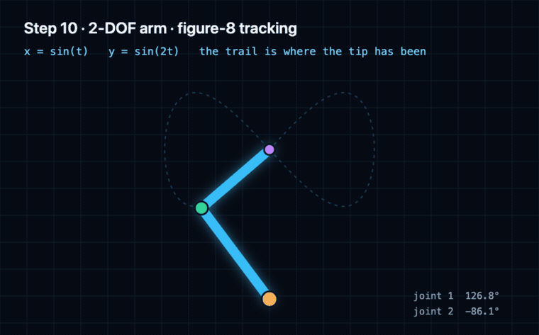
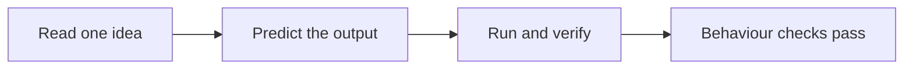

# [New to everything? Click here → Lesson 1](track-p/P.1-variables-and-data-types.md)

You will finish with a simulated two-joint robot arm that holds its own weight, follows a figure-8, and recovers from three faults we break on purpose.
<!-- sim-route:hours -->**≈200–290 hours**<!-- /sim-route --> · **Free ($0) in hardware** — everything runs in your browser; an optional bench starts at $15.

*Step 10: the 2-DOF arm you build towards. No kit, no install — this is the browser simulator.*

No previous electronics, mechanics, or coding. No maths past school arithmetic: what you need is taught, in order, at most two new ideas per lesson.

## Your route: 10 steps

Each step ends with something you can run and check yourself. Start at Step 1; follow the links down.

<!-- route:table:start -->
| Step | What you can do when it is done | Lessons | Modules | Hours |
| :--- | :--- | ---: | ---: | ---: |
| **[1 · Python and the maths a robot needs](track-p/P.1-variables-and-data-types.md)** | Read a formula, write it in Python, and check your own answer. | 14 | — | ≈17–43 |
| **[2 · Circuits and your first microcontroller](stage-0/S0.0-why-electricity-is-like-flow.md)** | Light an LED, read a knob, and dim it with PWM without breaking anything. | 11 | — | ≈14–33 |
| **[3 · Make a joint move: foundations](00-foundations/00.1-effort-flow-and-first-order-lag.md)** | Model a spring, a damper, and a motor as one joint that responds to torque. | 3 | 16 | ≈55–61 |
| **[4 · Power the joint: electronics](01-electronics-and-power/01.1-mosfet-inductor-flyback.md)** | Switch a motor both ways, budget its current, and keep the switching noise out. | 4 | 6 | ≈27–34 |
| **[5 · Build the arm: mechanics](02-mechanics-kinematics-dynamics/02.1-1d-link-fk-and-coord-frames.md)** | Turn joint angles into a tip position, and a tip position back into joint angles. | 5 | 3 | ≈20–30 |
| **[6 · Measure the joint: sensors](03-sensors-and-actuators/03.1-quadrature-and-magnetic-encoders.md)** | Read an encoder, compute a clean angle, and know how much to trust it. | 3 | 2 | ≈11–16 |
| **[7 · Run it in real time: embedded C](04-embedded-and-realtime/04.1-c-types-and-hardware-timer-isr.md)** | Move a fixed-rate control loop off Python and onto a microcontroller. | 3 | 4 | ≈19–25 |
| **[8 · Make it hold still: control](05-control-and-estimation/05.1-pid-virtual-spring-damper-and-anti-windup.md)** | Tune a PID that holds the arm against gravity without overshooting. | 2 | 5 | ≈17–21 |
| **[9 · Plan motion and bring it up safely](06-robotics-and-autonomy/06.1-cubic-trajectories-and-compliant-joints.md)** | Smooth a path, identify the plant, and run a bring-up that fails safe. | 2 | 3 | ≈15–19 |
| **[10 · Put it together: the 2-DOF arm](08-capstone-projects/08.1-tier1-2dof-compliant-arm-capstone.md)** | Run a figure-8 path on a simulated arm, then recover from three planted faults. | 1 | 1 | ≈7–9 |
| **10 steps** | **A finished simulated arm, and the checks to prove it** | **48** | **40** | **≈200–290** |
<!-- route:table:end -->

<!-- route:lessons -->48<!-- /route --> lessons and <!-- sim-route:modules -->**40 modules**<!-- /sim-route --> you practise with. Another <!-- sim-route:extensions -->**10 optional modules (47.5 hours)**<!-- /sim-route --> sit outside the route; skipping all of them still leaves a finished arm.

The hours are targets, not measurements: each page's own estimate, summed by [`scripts/generate_sim_route.py`](scripts/generate_sim_route.py): <!-- sim-route:hours-basis -->the Core's high end is a slow-learner figure on 48 of 88 pages and a single estimate on the other 40, so plan against it as a floor and expect it to rise as those pages are measured<!-- /sim-route -->. No outside learner has completed the route yet. [`docs/SIM_ROUTE.md`](docs/SIM_ROUTE.md) is the full page-by-page list, and `--check` fails CI if a count or hour drifts from the lessons.

## What you need

- **A browser.** The [live workbench](https://tle47.github.io/Mechatronics-Roadmap/) runs Python 3.12, the circuit simulators, and every graded check. Nothing to install.
- **Optional \$15–\$25:** an Arduino Uno clone, breadboard, LEDs, resistors, a potentiometer, and buttons, for the physical versions of Steps 2 and 3.
- **Optional ~\$150:** a current-limited bench supply, multimeter, small motor, and driver, for the physical motor labs. Required for none of the route.

## Stuck on a tool install?

**ROS 2, inside Step 9, is the one heavy install in the course.** Do not start it on your main machine: use the Docker image or the browser walkthrough in [`docs/EXTENSIONS.md`](docs/EXTENSIONS.md#ros-2), or read the node-graph lesson and move on. Nothing after Step 9 opens a ROS 2 shell, and the finished arm does not need it. Zephyr and micro-ROS are optional for the same reason.

Every lesson also ships three progressive hints, a known-failure explainer ([`docs/ERROR_EXPLAINER.md`](docs/ERROR_EXPLAINER.md)), and a 20-minute return path after a break ([`docs/REENTRY.md`](docs/REENTRY.md)).

## How a lesson works

Read one idea, predict what the code will do, then run it. A lesson passes only when its behaviour checks pass, so "it printed something" is not finished. Progress is saved in your browser and exports as a Markdown portfolio; the [beginner timing log](.github/ISSUE_TEMPLATE/beginner-timing-log.md) is where a real completion time helps everyone.

## The rest of the course

The advanced half — state-space control, sensor fusion, motor drives, ROS 2, learned policies — is real, graded, and optional. It lives in [`docs/ROUTE.md`](docs/ROUTE.md) with the full module map; [`docs/EXTENSIONS.md`](docs/EXTENSIONS.md) explains what can be skipped; [`docs/VERIFICATION.md`](docs/VERIFICATION.md) lists the badges and every check CI runs. Nothing there is needed to finish the ten steps.

## License

Curriculum text is [CC BY 4.0](https://creativecommons.org/licenses/by/4.0/); code and simulators are [MIT](LICENSE). Some external links in `resources/` are curated from [engyasin/awesome-mechatronics](https://github.com/engyasin/awesome-mechatronics).
