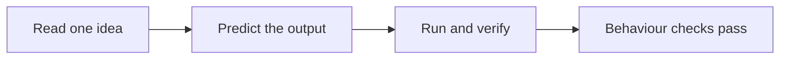

<div align="center">

# Mechatronics Roadmap

### MechaLab — a free, browser-based curriculum

**From zero coding, electronics, or maths past school arithmetic to a working simulated two-joint robot arm** — one that holds its own weight, follows a figure-8, and recovers from four faults broken on purpose.

[](https://tle47.github.io/Mechatronics-Roadmap/)
[](track-p/P.1-variables-and-data-types.md)
[](LICENSE)

[](https://github.com/TLE47/Mechatronics-Roadmap/actions/workflows/ci.yml)
[](https://github.com/TLE47/Mechatronics-Roadmap/actions/workflows/link-check.yml)
[](https://github.com/TLE47/Mechatronics-Roadmap/actions/workflows/ci.yml)
[](#what-you-need)
[](#what-you-need)
[](https://tle47.github.io/Mechatronics-Roadmap/)

</div>

<!-- start-here:start -->
> **Start here — your first 2 hours**
>
> What MechaLab is: this course's browser workbench. Python 3.12 and the circuit simulators run inside the tab, with nothing to install and no account needed. An account is optional, for carrying progress between devices.
>
> **[Read Lesson 1: Variables and data types →](track-p/P.1-variables-and-data-types.md)**
>
> When to use it: any time a lesson asks you to run something — Run Python Lessons lists every lesson and exercise that has an entry. Read the page for the idea, then type, run and verify in MechaLab; your progress stays in this browser unless you sign in, and nothing is saved on GitHub.
<!-- start-here:end -->

<!-- story:start -->
> **3.0 — The Last Hands.** The course now has a story, and the story has one rule: no proof, no
> power. Ten missions follow the ten steps; each is verified by the same checks that always graded
> your code, and a level is only ever a set of them passing here. The robot wakes up as you do — a
> controller board, a joint, an arm that holds its own weight — and ten short Black Box recordings
> tell you what the workshop learned the hard way. The whole story lives in [`content/`](content/)
> as reviewed files; the site is a build of them (["the story"](docs/STORY.md) ·
> ["the content pipeline"](docs/CONTENT.md)).
>
> **One thing to know before your first Run:** the starter code is *designed to fail*. Red checks on
> lesson 1 are the lesson working, not you breaking it.
>
> **Sound is off until you turn it on**, and a remembered yes waits for your first click rather than
> starting by itself. Every cue has a visual already on screen, so a muted visit loses nothing
> (["the sound"](docs/AUDIO.md)).
<!-- story:end -->

---

<div align="center">


*Step 10: the 2-DOF arm you build towards. No kit, no install — this is the browser simulator.*

</div>

**What this is.** A free, browser-based course that starts from no coding, electronics, or maths past school arithmetic and ends with a working simulated two-joint robot arm. You read one small idea, write it in Python, and a lesson only counts when its checks pass.

<!-- sim-route:hours -->**≈121–212 focused hours**<!-- /sim-route --> to the arm · <!-- sim-route:full-hours -->**≈201–292 with the optional depth pass**<!-- /sim-route --> · **\$0 in hardware** — everything runs in your browser; an optional bench starts at \$15.

**Focused hours, not elapsed time.** The first count is the arm route: time with its lessons open, excluding setup, debugging and re-reading. At 6 hours a week, plan for **2–4 years** for the arm once that overhead is counted; the full course with the optional depth pass is **3–5 years**, and the minimum viable finish is about **1.5–2.5 years** at the same pace. [The arithmetic is below.](#how-long-this-really-takes)

> [!NOTE]
> **No outside learner has completed the full route yet.** Every hour on this page is a target summed from the pages' own estimates, and every number is checked by CI against the lessons. The [beginner timing log](.github/ISSUE_TEMPLATE/beginner-timing-log.md) is where a real completion time helps everyone.

No previous electronics, mechanics, or coding. No maths past school arithmetic: what you need is taught, in order, at most two new ideas per lesson.

## Quick start: your first two hours

| | Step | Where |
| :--- | :--- | :--- |
| 1 | **Open the workbench** — Python 3.12 and the circuit sims run in the tab, with no account needed | [MechaLab](https://tle47.github.io/Mechatronics-Roadmap/) |
| 2 | **Read and run Lesson 1** — variables, types and one prediction you check yourself | [P.1 · Variables and data types](track-p/P.1-variables-and-data-types.md) |
| 3 | **Follow the route below** — each step ends with something you can run and verify | [Your route: 10 steps](#your-route-10-steps) |

Nothing to install, nothing to sign up for, and your progress stays in this browser.

## Your route: 10 steps

Each step ends with something you can run and check yourself. Steps 3–10 each have an **arm** module; most also have **depth** modules. The hours column is the **arm route**; the depth modules are the optional second pass, with their own totals in [`docs/DEPTH.md`](docs/DEPTH.md).

<!-- route:table:start -->
| Step | What you can do when it is done | Lessons | Modules (arm + depth) | Focused hours |
| :--- | :--- | ---: | ---: | ---: |
| **[1 · Python and the maths a robot needs](track-p/P.1-variables-and-data-types.md)** | Read a formula, write it in Python, and check your own answer. | 15 | — | ≈18–45 |
| **[2 · Circuits and your first microcontroller](stage-0/S0.0-why-electricity-is-like-flow.md)** | Light an LED, read a knob, and dim it with PWM without breaking anything. | 11 | — | ≈14–33 |
| **[3 · Make a joint move: foundations](00-foundations/00.1-effort-flow-and-first-order-lag.md)** | Model a spring, a damper, and a motor as one joint that responds to torque. | 3 | 5 + 11 | ≈21–27 |
| **[4 · Power the joint: electronics](01-electronics-and-power/01.1-mosfet-inductor-flyback.md)** | Switch a motor both ways, budget its current, and keep the switching noise out. | 4 | 4 + 2 | ≈18–26 |
| **[5 · Build the arm: mechanics](02-mechanics-kinematics-dynamics/02.1-1d-link-fk-and-coord-frames.md)** | Turn joint angles into a tip position, and a tip position back into joint angles. | 5 | 1 + 2 | ≈10–20 |
| **[6 · Measure the joint: sensors](03-sensors-and-actuators/03.1-quadrature-and-magnetic-encoders.md)** | Read an encoder, compute a clean angle, and know how much to trust it. | 3 | 1 + 1 | ≈7–11 |
| **[7 · Run it in real time: embedded C](04-embedded-and-realtime/04.1-c-types-and-hardware-timer-isr.md)** | Move a fixed-rate control loop off Python and onto a microcontroller. | 3 | 2 + 2 | ≈11–17 |
| **[8 · Make it hold still: control](05-control-and-estimation/05.1-pid-virtual-spring-damper-and-anti-windup.md)** | Tune a PID that holds the arm against gravity without overshooting. | 2 | 1 + 4 | ≈6–10 |
| **[9 · Plan motion and bring it up safely](06-robotics-and-autonomy/06.1-cubic-trajectories-and-compliant-joints.md)** | Smooth a path, identify the plant, and run a bring-up that fails safe. | 2 | 2 + 1 | ≈10–14 |
| **[10 · Put it together: the 2-DOF arm](08-capstone-projects/08.1-tier1-2dof-compliant-arm-capstone.md)** | Run a figure-8 path on a simulated arm, then recover from four planted faults. | 1 | 1 | ≈6–9 |
| **10 steps** | **A finished simulated arm, and the checks to prove it** | **49** | **17 + 23** | **≈121–212** |

**Two passes, one order.** The hours column is the **arm route**. Take its arm module in Steps 3–10, then stop at the working arm. The **depth** modules are the optional second pass, with their own totals in [`docs/DEPTH.md`](docs/DEPTH.md).

_Rounded to whole hours: the ten rows add to ≈121–212 for the arm. With the optional depth pass (80 h), the full course is ≈201–292 focused hours. [`docs/SIM_ROUTE.md`](docs/SIM_ROUTE.md) keeps the page-level decimals._
<!-- route:table:end -->

<!-- route:lessons -->49<!-- /route --> lessons and <!-- sim-route:modules -->**17 arm + 23 depth modules**<!-- /sim-route --> you practise with. All 49 lessons and the 17 arm modules are the arm route; the 23 depth modules are the optional second pass; another <!-- sim-route:extensions -->**10 optional modules (47.5 focused hours)**<!-- /sim-route --> sit outside the route's two passes. Skipping the depth and optional work still leaves a finished arm.

The focused hours are targets, not measurements: each page's own estimate, summed by [`scripts/generate_sim_route.py`](scripts/generate_sim_route.py): <!-- sim-route:hours-basis -->the route's high end is a slow-learner figure on 49 of 66 pages and a single estimate on the other 17, so plan against it as a floor and expect it to rise as those pages are measured<!-- /sim-route -->. No outside learner has completed the route yet. [`docs/SIM_ROUTE.md`](docs/SIM_ROUTE.md) is the arm route, [`docs/DEPTH.md`](docs/DEPTH.md) is the depth pass, and `--check` fails CI if a count or hour drifts from the lessons.

> [!TIP]
> **One working arm is a finish line, not a consolation prize.** The [minimum viable finish](#the-minimum-viable-finish) is 48 pages and ≈94–153 focused hours. Everything after it is optional depth.

## How long this really takes

The number above is **focused hours**: time with the lesson open, including the reading, the exercise and its checks. It is not elapsed time. Setup, debugging, re-reading, and the days you take off are real, and for a first project they are often the larger part of the calendar.

| If you can give | Focused route | Plan for (5× overhead) | If you need 10× |
| :--- | :--- | :--- | :--- |
| 6 hours/week | ≈8–11 months | **≈3–5 years** | ≈6–9 years |
| 10 hours/week | ≈5–7 months | ≈2–3 years | ≈4–6 years |

The 5× and 10× are planning multipliers, not measurements: no outside learner has completed the route yet. At 6 hours a week, **3–5 years is the number to plan against**; 8–11 months is only the scheduled lesson time.

## The minimum viable finish

**If you want one working arm, this is a finish line, not a consolation prize.** Do Step 1, Step 2, the arm modules in Steps 3–10, the lessons the capstone opens, and Step 10. That is <!-- sim-route:minimum-pages -->48<!-- /sim-route --> pages and <!-- sim-route:minimum -->**≈94–153 focused hours**<!-- /sim-route -->, the smaller finish inside the arm route. The exact page list is [`docs/MINIMUM.md`](docs/MINIMUM.md); it is not a different course.

**Everything else is someday.** The arm route adds the remaining prose lessons and the capstone's graded exercise ([`docs/SIM_ROUTE.md`](docs/SIM_ROUTE.md)); the depth pass is a separate <!-- sim-route:depth-hours -->**80 focused hours**<!-- /sim-route --> in [`docs/DEPTH.md`](docs/DEPTH.md); the optional modules add their own hours ([`docs/EXTENSIONS.md`](docs/EXTENSIONS.md)). None of it is unfinished business if you stop at the arm.

## How a lesson works



Read one idea, predict what the code will do, then run it. A lesson passes only when its behaviour checks pass, so "it printed something" is not finished. Every lesson also ships three progressive hints (the first is always open; later hints wait until you have run the lesson once), a known-failure explainer ([`docs/ERROR_EXPLAINER.md`](docs/ERROR_EXPLAINER.md)) that a failing run matches and shows beside the traceback, and a 20-minute return path after a break ([`docs/REENTRY.md`](docs/REENTRY.md)). Progress is saved in your browser, exports as a Markdown portfolio, and backs up as a single restorable `.zip` (progress, drafts, saved versions and the learning log) that merges back into any browser; the [beginner timing log](.github/ISSUE_TEMPLATE/beginner-timing-log.md) is where a real completion time helps everyone.

**The keyboard goes everywhere.** `⌘K` opens one search over all 92 lessons and exercises, every tab, and the commands hidden in the header - type `P.1`, `damping ratio`, or `theme`; `↵` opens the highlighted row. `⌘P` is the same list for lessons only, and `⌘⇧F` searches *inside* the course - a word from a starter, a hint, a check, the expected output, or one of the 66 reading pages, which opens on GitHub at the section that matched. A code hit puts the caret on the line it found, and `?` lists every key. `⌘↵` runs the lesson you are on, and **Stop** interrupts a runaway loop in place instead of reloading the page.

**The editor is a real one.** Python is highlighted and completed as you type, undo works, the arm code a lesson imports is a read-only tab beside `main.py`, and a `# @slider` comment on a number becomes a control that rewrites it and re-runs - so tuning `Kp` is a drag, not a retype. The control and mechanics lessons open with those already wired.

### Using AI without skipping the attempt

**Use AI to unblock an attempt, not to make it.** A generated answer that passes the check and a solution you could rebuild are different outcomes, and only the second one survives the next page. The rule this project assumes:

1. Read the idea and the assigned resource section.
2. Write your prediction before you run anything.
3. Attempt it, then use the three hints and the troubleshooting section.
4. Still blocked? Ask for **one hint**, and include what you tried plus the expected and actual numbers.
5. If you end up with a solution, mark that lesson **assisted** and rebuild the essential part unaided a day or two later. The second attempt is the one that counts.

Every lesson's `## Check yourself` is closed-book: the answers are in `<details>` so you can try before you look. The [independence check in P.9](track-p/P.9-rearranging-formulas-and-scaling.md) is the worked example of the last step - same skill, different numbers, no expression supplied.

## What you need

| Requirement | What it covers |
| :--- | :--- |
| **A browser** | [MechaLab](https://tle47.github.io/Mechatronics-Roadmap/) runs Python 3.12, the circuit simulators, and every graded check. Nothing to install, no account required. |
| **Optional \$15–\$25** | An Arduino Uno clone, breadboard, LEDs, resistors, a potentiometer, and buttons, for the physical versions of Steps 2 and 3. |
| **Optional ~\$150** | A current-limited bench supply, multimeter, small motor, and driver, for the physical motor labs. Required for none of the route. |

Every graded check runs without hardware, and the finished arm is the simulator's. The bench is for people who want to touch the parts.

## Stuck on a tool install?

**ROS 2, inside Step 9, is the one heavy install in the course.** Do not start it on your main machine: use the Docker image or the browser walkthrough in [`docs/EXTENSIONS.md`](docs/EXTENSIONS.md#ros-2), or read the node-graph lesson and move on. Nothing after Step 9 opens a ROS 2 shell, and the finished arm does not need it. Zephyr and micro-ROS are optional for the same reason.

## The advanced half (optional)

The advanced material — state-space control, sensor fusion, motor drives, ROS 2, learned policies — is real and graded, and it is not needed for the arm. It is the **depth pass** in [`docs/DEPTH.md`](docs/DEPTH.md): after Step 10, return to Step 3 and take the depth modules in the same step order. The architecture map is [`docs/CURRICULUM.md`](docs/CURRICULUM.md); the full route is [`docs/ROUTE.md`](docs/ROUTE.md); what can be skipped is [`docs/EXTENSIONS.md`](docs/EXTENSIONS.md); the badges and every check CI runs are [`docs/VERIFICATION.md`](docs/VERIFICATION.md).

## What is in the repository

```text
Mechatronics-Roadmap/
├── track-p/ + stage-0/                     Absolute-beginner on-ramp (Python, circuits)
├── 00-foundations/ … 08-capstone-projects/ The ten-step spine: prose lessons + arm modules
├── modules/                                Practice modules (17 arm + 23 depth)
├── exercises/                             50 graded packages: starter, solution, tests, faults
├── app/                                   MechaLab — the Vite + React workbench
├── docs/                                  Route maps, verification, re-entry, pilot results
├── resources/                             Glossary, cheatsheet, plants, reading lists
└── scripts/ + tests/                      Generators and the suites that keep them honest
```

The map is held to the content, not typed twice: [`docs/SIM_ROUTE.md`](docs/SIM_ROUTE.md), [`docs/DEPTH.md`](docs/DEPTH.md), [`docs/MINIMUM.md`](docs/MINIMUM.md), [`docs/ROUTE.md`](docs/ROUTE.md), [`docs/EXTENSIONS.md`](docs/EXTENSIONS.md) and this page all read `scripts/route_model.py`, and `--check` fails when one drifts.

## Contributing and verification

Every lesson and module is continuously verified: links, maths, expected outputs, module parity, route counts and the browser workbench itself. See [`CONTRIBUTING.md`](CONTRIBUTING.md) for the pedagogical rules (at most two new ideas, enforced term order, clean TeX) and the full local suite; [`docs/VERIFICATION.md`](docs/VERIFICATION.md) lists the badges and every check CI runs.

```bash
python3 scripts/verify_repo.py        # relative links, headings, TeX, media
python3 scripts/validate_modules.py   # module contracts, skip/gate keys, counts
python3 scripts/lint_lessons.py       # lesson template and jargon rules
npm run build && npm run test:workbench
```

### Verify the theme

MechaLab ships four palettes — dark, light, paper and high contrast — and each is checked rather than
eyeballed — the [light/dark badge](https://github.com/TLE47/Mechatronics-Roadmap/actions/workflows/ci.yml)
is that step. After `npm ci` and a build:

```bash
npm run test:theme      # the rules: stored pick, OS default, prefers-contrast, all three controls, blocked storage
npm run test:theme:e2e  # Chromium: the three controls, then all 11 tabs in each of the four palettes
```

- **`test:theme`** (12 cases, no browser) pins what a reader cannot see: a first visit stores
  nothing and follows `prefers-contrast: more` ahead of `prefers-color-scheme`; the flip is dark ↔
  light, and contrast and paper are each a real on/off, every control labelled with the palette it
  hands over; a pick in `localStorage['mechalab_theme_v1']` wins from then on; a corrupt key or a
  private-mode store that throws falls back instead of breaking the shell.
- **`test:theme:e2e`** drives the header's three controls in Chromium, checks the choice survives a
  reload and an OS flip, then composites every visible text run in every tab over the backgrounds it
  actually sits on. It fails below 3:1 and reports anything under its size minimum; the current floor
  is 4.52:1 in dark, light and paper, 7.04:1 in high contrast, across 48 tab/palette pairs.
- Add `--warnings` to name the runs between 3:1 and their minimum, or `--screenshots` to write one
  PNG per tab per theme into `.fb-scratch/theme/`.

`test:theme` runs inside `npm run test:workbench`; `test:theme:e2e` is its own step in CI (a seventh
parallel browser suite pushed the older ones past their click timeouts). Tokens live in
[`app/src/index.css`](app/src/index.css) and the rules in [`app/src/theme.ts`](app/src/theme.ts);
[`docs/THEME.md`](docs/THEME.md) sets all four palettes side by side with the utility to use for each
role, and [`app/README.md`](app/README.md#dark-light-paper-and-high-contrast) has the full picture.

## License

Curriculum text is [CC BY 4.0](https://creativecommons.org/licenses/by/4.0/); code and simulators are [MIT](LICENSE). Some external links in `resources/` are curated from [engyasin/awesome-mechatronics](https://github.com/engyasin/awesome-mechatronics).

<div align="center">

**Ready when you are.**

[](https://tle47.github.io/Mechatronics-Roadmap/)
[](track-p/P.1-variables-and-data-types.md)

</div>
