# ⚡ MechaLab — Multi-Pass Tiered Mechatronics & Robotics Roadmap

> **Built for Software Engineers & Self-Learners Transitioning into Hardware, Mixed-Signal Electronics, and Real-Time Robotics.**
>
> **How This Roadmap Works (Linear "Level-Up" Spiral Architecture):**
> Instead of getting stuck in graduate-level $SO(3)$ Lie groups on Track 00 before ever spinning a motor, you traverse the entire curriculum in **three horizontal "Level-Up" passes** from **Track 00 $\to$ Track 08**:
> 1. **[Stage 0 — Level 0 Prerequisite On-Ramp](#stage-0-global-level-0-prerequisite-on-ramp):** Hydraulic/software analogies for voltage, current, capacitance, and inductance; smoke-free breadboard, multimeter, and bench PSU habits; and your first `ESP32`/`Arduino`/`STM32` GPIO, PWM, and ADC loops.
> 2. **[Pass 1 — Tier 1 (Beginner / Intuitive Pass: Track 00 → Track 08)](#pass-1-tier-1-linear-roadmap-beginner--intuitive-pass-track-00--track-08):** Go linearly from Track 00 to Track 08 using breadboards, off-the-shelf breakout modules (`DRV8833`, `SimpleFOCMini`, `AS5600`), and high-level code to build your first 2-DOF compliant desktop robot.
> 3. **[Pass 2 — Tier 2 (Intermediate / Applied Pass: Track 00 → Track 08)](#pass-2-tier-2-linear-roadmap-intermediate--applied-pass-track-00--track-08):** Loop back to Track 00 and upgrade every subsystem from maker breakouts to custom engineering: 4-layer KiCad PCBs, SMD soldering, Kelvin current shunts, URDF/MuJoCo models, Clarke/Park + PLL observers, FreeRTOS + DMA, CAN-FD, and LQR.
> 4. **[Pass 3 — Tier 3 (Advanced / Production Pass: Track 00 → Track 08)](#pass-3-tier-3-linear-roadmap-advanced--production-pass-track-00--track-08):** Loop back to Track 00 for final production mastery: $SO(3)/SE(3)$ Lie groups, $<2\text{ nH}$ 6-layer $48\text{ V}/30\text{ A}$ inverters, SAR charge buckets, $O(n)$ spatial RNEA, $40\text{ kHz}$ bare-metal `STM32G474` FOC, C++20 `WaitFreeSeqLock`, Joseph-form ESKF, CBF-QP safety walls, and $<1\ \mu\text{s}$ dual-channel hardware STO.

---

## 🗺️ Master Multi-Pass Navigation Matrix (Tracks 00–08 × Tiers 1–3)

Read **down a column** to execute a linear pass from Track 00 to Track 08, or read **across a row** to see how a single discipline levels up from breadboards to production hardware:

| Track Folder & Module | Pass 1: Tier 1 (Beginner / Intuitive) | Pass 2: Tier 2 (Intermediate / Applied) | Pass 3: Tier 3 (Advanced / Production) | Bridge Concept (Maker $\to$ Custom) |
| :--- | :--- | :--- | :--- | :--- |
| **[Track 00: Foundations](00-foundations/README.md)** | [Calculus as `while` Loops, 2D Rotations & RC Smoothing](00-foundations/README.md#tier-1-beginner--intuitive) | [State-Space Matrices, Quaternions & Tustin Biquads](00-foundations/README.md#tier-2-intermediate--applied) | [Lie Groups SO(3)/SE(3) & Symplectic Port-Hamiltonian](00-foundations/README.md#tier-3-advanced--production) | [Moving Average → Pre-Warped TDF-II Biquad Notch](00-foundations/README.md#bridging-the-gap-maker-to-custom) |
| **[Track 01: Electronics & Power](01-electronics-and-power/README.md)** | [Breadboard H-Bridges (`DRV8833`), Logic Levels & Decoupling](01-electronics-and-power/README.md#tier-1-beginner--intuitive) | [4-Layer KiCad PCBs, Gate Drivers & Kelvin Shunts](01-electronics-and-power/README.md#tier-2-intermediate--applied) | [6-Layer <2 nH 48 V/30 A Inverter & SAR Charge Buckets](01-electronics-and-power/README.md#tier-3-advanced--production) | [`L298N`/`INA219` Breakouts → `DRV8353` + `INA240` Kelvin PCB](01-electronics-and-power/README.md#bridging-the-gap-maker-to-custom) |
| **[Track 02: Mechanics & Dynamics](02-mechanics-kinematics-dynamics/README.md)** | [2D Planar Kinematics, Gear Ratios (N² Inertia) & Bearings](02-mechanics-kinematics-dynamics/README.md#tier-1-beginner--intuitive) | [Maxwell Exact Constraint, `CadQuery` & URDF/MuJoCo](02-mechanics-kinematics-dynamics/README.md#tier-2-intermediate--applied) | [Screw PoE, `Ti-6Al-4V` Flexures & Featherstone O(n) RNEA](02-mechanics-kinematics-dynamics/README.md#tier-3-advanced--production) | [200:1 Hobby Servos → 8:1 Backdrivable QDD Planetary Actuator](02-mechanics-kinematics-dynamics/README.md#bridging-the-gap-maker-to-custom) |
| **[Track 03: Sensors & Actuators](03-sensors-and-actuators/README.md)** | [Quadrature/Magnetic Encoders & Open-Loop BLDC (`SimpleFOC`)](03-sensors-and-actuators/README.md#tier-1-beginner--intuitive) | [Clarke/Park Transforms, Type-II PLLs & Allan Variance](03-sensors-and-actuators/README.md#tier-2-intermediate--applied) | [25–40 kHz Decoupled d-q FOC, SVPWM & Harmonic LUT](03-sensors-and-actuators/README.md#tier-3-advanced--production) | [Hobby ESC / Voltage Mode → Center-Aligned ADC Current FOC](03-sensors-and-actuators/README.md#bridging-the-gap-maker-to-custom) |
| **[Track 04: Embedded & Real-Time](04-embedded-and-realtime/README.md)** | [Killing `delay()`, 1 kHz Timer ISRs & Binary Serial](04-embedded-and-realtime/README.md#tier-1-beginner--intuitive) | [FreeRTOS Scheduling (RTA), DMA Buffers & CAN-FD (`MIT Mode`)](04-embedded-and-realtime/README.md#tier-2-intermediate--applied) | [Bare-Metal `TIM1`→`ADC`, CORDIC & C++20 `WaitFreeSeqLock`](04-embedded-and-realtime/README.md#tier-3-advanced--production) | [Global Structs / `mutex` → DMA Pipelines & `WaitFreeSeqLock`](04-embedded-and-realtime/README.md#bridging-the-gap-maker-to-custom) |
| **[Track 05: Control & Estimation](05-control-and-estimation/README.md)** | [PID Virtual Spring-Damper, Anti-Windup & Complementary IMU](05-control-and-estimation/README.md#tier-1-beginner--intuitive) | [Bode Loop Shaping, Gang of Four, Swing-Up LQR & Linear KF](05-control-and-estimation/README.md#tier-2-intermediate--applied) | [Joseph-Form Manifold ESKF, MPC & Control Barrier QPs](05-control-and-estimation/README.md#tier-3-advanced--production) | [Trial-and-Error PID / `if` Limits → LQR + Predictive CBF-QP](05-control-and-estimation/README.md#bridging-the-gap-maker-to-custom) |
| **[Track 06: Robotics & Autonomy](06-robotics-and-autonomy/README.md)** | [Cubic/Trapezoidal Trajectories, Webots & Joint Springs](06-robotics-and-autonomy/README.md#tier-1-beginner--intuitive) | [Jacobian Transpose, `Ruckig`, ROS 2 ([`06-robotics.T2.06a`](modules/06-robotics.T2.06a.md), `MoveIt 2`/`Nav2`) & Gazebo](06-robotics-and-autonomy/README.md#tier-2-intermediate--applied) | [Khatib Operational WBC, Embodied AI (`LeRobot`, Diffusion, `π₀`/VLA) & GPU Sim (`Newton`/`Isaac Lab`)](06-robotics-and-autonomy/README.md#tier-3-advanced--production) | [Rigid `servo.write()` Stepping → 1 kHz Torque/Impedance Control](06-robotics-and-autonomy/README.md#bridging-the-gap-maker-to-custom) |
| **[Track 07: Systems, HIL & Safety](07-systems-hil-and-production/README.md)** | [10-Step Safe Bring-Up, `OpenPLC` (IEC 61131-3) & Sine Sweeps](07-systems-hil-and-production/README.md#tier-1-beginner--intuitive) | [Regen Braking Clamps, `OPC UA`, CRC Watchdogs & HIL Faults](07-systems-hil-and-production/README.md#tier-2-intermediate--applied) | [Schroeder Multisine SysID, <1 μs Hardware STO (`ISO 10218:2025`) & Digital Twins (`AAS` IEC 63278)](07-systems-hil-and-production/README.md#tier-3-advanced--production) | [Software `if(fault) pwm=0` → Dual-Channel Hardware STO Cutoff](07-systems-hil-and-production/README.md#bridging-the-gap-maker-to-custom) |
| **[Track 08: Capstone Projects](08-capstone-projects/README.md)** | [Tier 1 Boss: Breakout 2-DOF Arm / `SO-101` / `LeKiwi`](08-capstone-projects/README.md#tier-1-capstone-builds-beginner--breakout-pass) | [Tier 2 Boss: Custom 4-Layer CAN Servo + LQR/MuJoCo / `Pupper` / `UMI`](08-capstone-projects/README.md#tier-2-capstone-builds-intermediate--applied-pass) | [Tier 3 Boss: Capstones I–V (`48V` FOC, Furuta, 6-DOF, `ODRI` Hopper, `ALOHA 2` / `Reachy 2`)](08-capstone-projects/README.md#tier-3-capstone-builds-advanced--production-pass) | [Progressive 3-Pass Hardware/Software Capstone Evolution](08-capstone-projects/README.md#bridging-the-gap-maker-to-custom) |

### 📚 Supporting Reference & Lab Setup Guides (Merged with [`engyasin/awesome-mechatronics`](https://github.com/engyasin/awesome-mechatronics))
* **[Tiered Hardware Lab & Workbench BOM (`resources/lab-workbench-bom.md`)](resources/lab-workbench-bom.md):** Exact shopping lists for **Level 0 / Tier 1 (\$150 Starter Bench)**, **Tier 2 (\$600 Custom PCB & CAN Bench)**, and **Tier 3 (\$3,500+ Production Metrology & HIL Lab)**, plus open-source actuators (`SimpleFOCMini`, `ODrive`, `VESC`, `mjbots moteus`) and open robot platforms (`SO-101`, `LeKiwi`, `UMI`, `ALOHA 2`, `Open-Duck-Mini`, `Stanford Pupper`, `ODRI`, `Reachy 2`).
* **[1-Page Production Engineering Cheat Sheet (`resources/mechatronics-cheatsheet.md`)](resources/mechatronics-cheatsheet.md)**
* **[Open-Source Toolchains, Simulators & Robotics Stacks (`resources/open-source-toolchains.md`)](resources/open-source-toolchains.md)** & **[Curated Textbooks, Papers, Courses & Standards (`resources/textbooks-and-papers.md`)](resources/textbooks-and-papers.md)**

### 🧪 Running the Interactive MechaLab Workbench
Every track below links into the **8-tab interactive workbench** (two-mass resonance Bode, 25 kHz PMSM FOC, Furuta swing-up + LQR + CBF, URDF/MuJoCo + STO, 3D CAD/PCB parasitics, Schroeder SysID, and the 6-DOF ESKF + `WaitFreeSeqLock`). It is a Vite + React app in this repository:

* **Live:** [tle47.github.io/Mechatronics-Roadmap](https://tle47.github.io/Mechatronics-Roadmap/) — typechecked, built and deployed from `main` by GitHub Actions on every push.
* **Local:** `npm ci`, then `npm run dev` (serves `http://localhost:3000`); `npm run build` typechecks and writes the production bundle to `dist/`.

---

## 🔄 Visual Progression Architecture: The 3-Pass Level-Up Loop

```mermaid
flowchart TB
    subgraph L0["STAGE 0: Level 0 Prerequisite On-Ramp (No Prior EE)"]
        L0_1["L0.1 Hydraulic & Software Analogies<br/>(V, I, R, C, L, State Structs)"] --> L0_2["L0.2 Practical Bench Tools<br/>(Breadboard, DMM, CC/CV PSU, Scope)"] --> L0_3["L0.3 Starter MCU Loops<br/>(ESP32/STM32 GPIO, 20kHz PWM, ADC)"]
    end

    subgraph P1["PASS 1: TIER 1 (Beginner / Intuitive Pass: Track 00 → Track 08)"]
        T1_0["Track 00 (T1)<br/>Finite-Diff Sims & RC Filters"] --> T1_1["Track 01 (T1)<br/>Breadboard H-Bridge & Decoupling"] --> T1_2["Track 02 (T1)<br/>2D Planar IK & Gear Ratios"] --> T1_3["Track 03 (T1)<br/>Encoders & SimpleFOC Sine"] --> T1_4["Track 04 (T1)<br/>1kHz Timer ISR & Binary Serial"] --> T1_5["Track 05 (T1)<br/>PID Spring-Damper & Comp IMU"] --> T1_6["Track 06/07 (T1)<br/>Cubic Paths & Bring-Up Checklist"] --> T1_8["🏆 Track 08 (T1 Boss)<br/>Breakout 2-DOF Desktop Arm"]
    end

    subgraph P2["PASS 2: TIER 2 (Intermediate / Applied Pass: Track 00 → Track 08)"]
        T2_0["Track 00 (T2)<br/>State-Space & Tustin Biquad Notch"] --> T2_1["Track 01 (T2)<br/>4-Layer KiCad PCB & Kelvin Shunts"] --> T2_2["Track 02 (T2)<br/>Exact Constraint, CadQuery & MuJoCo"] --> T2_3["Track 03 (T2)<br/>Clarke/Park & Type-II Velocity PLL"] --> T2_4["Track 04 (T2)<br/>FreeRTOS, DMA & CAN-FD MIT Mode"] --> T2_5["Track 05 (T2)<br/>Loop Shaping, Swing-Up LQR & KF"] --> T2_6["Track 06/07 (T2)<br/>Jacobian Transpose, S-Curves & Regen"] --> T2_8["🏆 Track 08 (T2 Boss)<br/>Custom 4-Layer CAN Servo + LQR"]
    end

    subgraph P3["PASS 3: TIER 3 (Advanced / Production Pass: Track 00 → Track 08)"]
        T3_0["Track 00 (T3)<br/>SO(3)/SE(3) Lie Groups & Symplectic"] --> T3_1["Track 01 (T3)<br/><2nH 48V/30A PCB & SAR Buckets"] --> T3_2["Track 02 (T3)<br/>Screw PoE, Ti Flexures & O(n) RNEA"] --> T3_3["Track 03 (T3)<br/>40kHz Decoupled FOC & SVPWM"] --> T3_4["Track 04 (T3)<br/>TIM1->ADC, CORDIC & WaitFreeSeqLock"] --> T3_5["Track 05 (T3)<br/>Joseph ESKF, MPC & CBF-QP Walls"] --> T3_6["Track 06/07 (T3)<br/>Khatib WBC, Schroeder SysID & <1µs STO"] --> T3_8["🏆 Track 08 (T3 Mastery)<br/>Full Production Capstones I–V"]
    end

    L0_3 ==>|"Unlock Pass 1"| T1_0
    T1_8 ==>|"Loop Back & Level Up to Tier 2"| T2_0
    T2_8 ==>|"Loop Back & Level Up to Tier 3"| T3_0

    style L0 fill:#0f172a,stroke:#38bdf8,color:#f1f5f9
    style P1 fill:#064e3b,stroke:#34d399,color:#f1f5f9
    style P2 fill:#1e1b4b,stroke:#38bdf8,color:#f1f5f9
    style P3 fill:#3b0764,stroke:#c084fc,color:#f1f5f9
```



---

## STAGE 0: Global "Level 0" Prerequisite On-Ramp

If you come from a pure software background, start here before opening Track 00.

### L0.1 Everyday Analogies (Hydraulic & Software Mental Models)
- **Core Summary:** Maps invisible electrical quantities—Voltage ($V$), Current ($I$), Resistance ($R$), Capacitance ($C$), Inductance ($L$), and State Vectors ($x$)—to tangible hydraulic pressure/flow mechanics and computer architecture primitives (`L1 cache`, `state structs`).
- **Curated Free Resources:**
  - 🔗 [Falstad Interactive Circuit Simulator Applet](https://www.falstad.com/circuit/) — *Browser-based real-time animated visualization of current flow, voltage pressure colors, RC diaphragms, and inductive kickback.*
  - 🔗 [SparkFun: Voltage, Current, Resistance, and Ohm's Law](https://learn.sparkfun.com/tutorials/voltage-current-resistance-and-ohms-law) — *Illustrated water-tank and pipe analogies tailored for absolute hardware beginners.*
  - 🔗 [All About Circuits — Volume I (DC) Open Textbook](https://www.allaboutcircuits.com/textbook/direct-current/) — *Free open-access reference covering passive components, KVL/KCL, capacitance, and inductance.*
- **🧪 Hands-On Exercise:**
  - *Task:* Open the [Falstad Circuit Simulator](https://www.falstad.com/circuit/) (`Circuits -> Basics -> Inductors`) and build a $12\text{ V}$ source, a switch, and a $10\text{ mH}$ inductor + $4\ \Omega$ resistor in series. Close the switch until current settles at $3\text{ A}$, then open the switch with and without a parallel flyback diode. Compute the theoretical voltage spike $V_L = L \frac{\Delta I}{\Delta t}$ if $3\text{ A}$ interrupts in $\Delta t = 100\text{ ns}$ ($V_L = 300,000\text{ V}$!) and observe how the diode clamps it to $\sim 0.7\text{ V}$.
- **🧠 Knowledge Check:**
  <details>
  <summary><b>Click to toggle quiz questions & answers</b></summary>
  
  **Q1:** Why does placing a $100\text{ nF}$ ceramic capacitor within $1\text{–}2\text{ mm}$ of a microcontroller's `VCC` pin prevent random CPU crashes, even when a large $1000\ \mu\text{F}$ capacitor sits $10\text{ cm}$ away at the power plug?
  * **Answer / Explanation:** Every $10\text{ cm}$ of wire/trace has $\sim 80\text{–}100\text{ nH}$ of series inductance ($V = L\frac{dI}{dt}$), which blocks nanosecond current surges when millions of CPU transistors switch on a clock edge. The local $100\text{ nF}$ capacitor acts like an L1 RAM cache right at the pin, supplying instant nanosecond charge before the distant power supply can react.
  
  **Q2:** Which physical components in a DC motor joint add variables to the system's **State Vector** $x$: (a) Winding resistance $R_a$, (b) Winding inductance $L_a$, (c) Rotor inertia $J_m$, (d) Viscous friction $b_m$, (e) Torsional shaft spring $k_s$?
  * **Answer & Explanation:** **(b) $L_a$, (c) $J_m$, and (e) $k_s$**. Only components that **store energy** ($\frac{1}{2}L_a i^2$, $\frac{1}{2}J_m \omega^2$, $\frac{1}{2}k_s \Delta\theta^2$) require state variables ($i_a, \omega_m, \Delta\theta$). Purely dissipative elements ($R_a, b_m$) turn energy into heat instantaneously and have no memory of past states.
  </details>

### L0.2 Practical Bench Tools (Solderless First)
- **Core Summary:** Introduces smoke-free bench habits using solderless breadboards, a Digital Multimeter (DMM) continuity test, a Constant-Current/Constant-Voltage (CC/CV) bench power supply as a hardware `try/catch` block, and USB logic analyzers vs. oscilloscopes.
- **Curated Free Resources:**
  - 🔗 [SparkFun: How to Use a Breadboard](https://learn.sparkfun.com/tutorials/how-to-use-a-breadboard) — *X-ray photos of internal 5-pin spring clips, power bus rails, and common short-circuit mistakes.*
  - 🔗 [Adafruit: Multimeters Guide — Continuity, Voltage & Current](https://learn.adafruit.com/multimeters) — *Step-by-step guide to continuity beep checks and why measuring voltage with probes in the Amps jack blows the DMM fuse.*
  - 🔗 [PulseView & sigrok Open-Source Logic Analyzer Manual](https://sigrok.org/wiki/PulseView) — *Free open-source protocol decoder documentation for \$15 USB logic analyzers (`I2C`, `SPI`, `UART`, `PWM`).*
- **🧪 Hands-On Exercise:**
  - *Task:* Wire a $1\text{ k}\Omega$ resistor and $100\text{ nF}$ capacitor as a low-pass filter on a breadboard. (1) Perform an unpowered DMM Continuity Beep Check between `VCC` and `GND`. (2) Set your bench PSU to $5.0\text{ V}$ and a **$50\text{ mA}$ Constant-Current (CC) limit** before enabling output. (3) Feed a $1\text{ kHz}$ square wave into the RC input and measure the $10\%\to 90\%$ rise time ($t_r \approx 2.2 R C = 220\ \mu\text{s}$) on your oscilloscope.
- **🧠 Knowledge Check:**
  <details>
  <summary><b>Click to toggle quiz questions & answers</b></summary>
  
  **Q1:** Why should you never run $5\text{ A}$ of motor phase current or a $25\text{ MHz}$ SPI clock through a solderless breadboard?
  * **Answer / Explanation:** Breadboard spring clips have $\sim 0.1\ \Omega$ contact resistance ($P = I^2 R = 25 \times 0.1 = 2.5\text{ W}$ per pin, melting the ABS plastic housing!) and $\sim 5\text{–}10\text{ pF}$ of stray row-to-row capacitance that rounds off and cross-couples $25\text{ MHz}$ digital edges.
  
  **Q2:** You connect a new microcontroller board to a bench supply set to $12.0\text{ V}$ and $100\text{ mA}$ current limit. When you press Output ON, the supply's red `CC` (Constant Current) LED lights up and the display reads $0.9\text{ V}$ at $100\text{ mA}$. What happened, and why didn't the board burn?
  * **Answer & Explanation:** Your board has a short circuit (or reversed diode/IC), attempting to draw $>100\text{ mA}$. Because the PSU's `CC` foldback loop clamped current to $100\text{ mA}$ by automatically dropping the output voltage to $0.9\text{ V}$, total power dissipated in the fault is only $0.9\text{ V} \times 0.1\text{ A} = 0.09\text{ W}$—saving your components!
  </details>

### L0.3 Starter Hardware (`ESP32` / `Arduino` / `STM32 Nucleo`)
- **Core Summary:** Bridges software variables to physical voltages using the three core microcontroller peripherals: digital GPIO with pull-up resistors, $20\text{ kHz}$ hardware timer PWM driving a low-side MOSFET + flyback diode, and 12-bit ADC potentiometer reading.
- **Curated Free Resources:**
  - 🔗 [Wokwi Online ESP32 / STM32 / Arduino Simulator](https://wokwi.com/) — *Free browser-based microcontroller + circuit simulator with virtual logic analyzer, potentiometer, PWM LED/motor, and C++ compiler.*
  - 🔗 [STM32 Step-by-Step Official Wiki Tutorials](https://wiki.st.com/stm32mcu/wiki/STM32StepByStep:STM32_step_by_step_overview) — *Official STMicroelectronics beginner curriculum covering GPIO, Timers, PWM, and ADC on Nucleo boards.*
  - 🔗 [Espressif ESP-IDF MCPWM & ADC Programming Guide](https://docs.espressif.com/projects/esp-idf/en/latest/esp32/api-reference/peripherals/mcpwm.html) — *Official documentation for hardware motor-control PWM and 12-bit SAR ADC calibration on ESP32.*
- **🧪 Hands-On Exercise:**
  - *Task:* Build (on hardware or in [Wokwi](https://wokwi.com/)) a $10\text{ k}\Omega$ potentiometer voltage divider connected to a 12-bit ADC pin (`0..4095`) and configure a $20\text{ kHz}$ hardware timer PWM channel driving a logic-level N-MOSFET (`IRLZ44N`/`AO3400`) + Schottky flyback diode (`1N5819`) to control a $12\text{ V}$ DC fan/motor from $0\%$ to $100\%$ duty cycle with zero `delay()` calls.
- **🧠 Knowledge Check:**
  <details>
  <summary><b>Click to toggle quiz questions & answers</b></summary>
  
  **Q1:** A 12-bit ADC powered from a $3.30\text{ V}$ reference reads a raw integer code of `2048`. What is the physical voltage on the pin, and what is the smallest voltage step ($1\text{ LSB}$) the ADC can resolve?
  * **Answer / Explanation:** $V_{\text{in}} = 3.30\text{ V} \times \frac{2048}{4095} = 1.650\text{ V}$. The resolution is $1\text{ LSB} = \frac{3.30\text{ V}}{4096} \approx 0.806\text{ mV}$.
  
  **Q2:** Why do we configure motor PWM at $20\text{ kHz}$ instead of Arduino's default $490\text{ Hz}$ `analogWrite()` frequency?
  * **Answer & Explanation:** (1) Human hearing extends to $\sim 20\text{ kHz}$, so $490\text{ Hz}$ makes the motor coils emit a loud, annoying $490\text{ Hz}$ acoustic screech. (2) For a small motor with inductance $L = 0.5\text{ mH}$, $490\text{ Hz}$ ($T = 2.04\text{ ms}$) is longer than the electrical time constant $L/R$, causing massive current ripple and heating instead of smooth current averaging.
  </details>

---

## PASS 1: Tier 1 Linear Roadmap (`Beginner / Intuitive Pass: Track 00 → Track 08`)

Complete all 8 steps below in order using breadboards, breakout modules, and high-level libraries:

### Step 1.1 — [Track 00 (Tier 1): Calculus as `while` Loops, 2D Rotations & RC Smoothing](00-foundations/README.md#tier-1-beginner--intuitive)
- **Core Summary:** Translates continuous differential equations ($\dot{x} = f(x,u)$) into discrete time-stepping `while` loops (`v += a*dt; x += v*dt`), introduces $2\times 2$ rotation matrices with wrap-safe `atan2` error, and filters noisy sensors with a 1-line Exponential Moving Average (EMA).
- **Curated Free Resources:**
  - 🔗 [MyPhysicsLab Interactive Differential Equation Simulations](https://www.myphysicslab.com/) — *Free open-source browser simulations of springs, pendulums, and numerical integration (`Euler` vs. `Runge-Kutta`).*
  - 🔗 [3Blue1Brown — Essence of Linear Algebra & Differential Equations](https://www.3blue1brown.com/topics/linear-algebra) — *Visual geometric intuition for 2D/3D rotation matrices, eigenvalues, and state-space phase portraits.*
  - 🔗 [The Scientist and Engineer's Guide to Digital Signal Processing (Free Online Book)](https://www.dspguide.com/) — *Chapters 2 & 19 explain noise statistics and single-pole recursive RC digital filters in plain English.*
- **🧪 Hands-On Exercise:**
  - *Task:* Write a 30-line Python script simulating $m\ddot{x} + b\dot{x} + kx = F$ ($m=0.5\text{ kg}, b=0.8\text{ N}\cdot\text{s/m}, k=50\text{ N/m}$) at $\Delta t = 1\text{ ms}$ using symplectic Euler (`v += a*dt; x += v*dt`). Add Gaussian noise $\mathcal{N}(0, 0.01^2)$ to `x`, compute noisy finite-difference velocity `(x_noisy - x_prev)/dt`, and pass it through an EMA filter `v_filt += alpha * (v_raw - v_filt)` with cutoff $f_c = 15\text{ Hz}$.
- **🧠 Knowledge Check:**
  <details>
  <summary><b>Click to toggle quiz questions & answers</b></summary>
  
  **Q1:** A robot turret is at $\theta_{\text{meas}} = +179^\circ$ and you command $\theta_{\text{ref}} = -179^\circ$. The shortest physical path is $+2^\circ$ across the $\pm 180^\circ$ boundary, but `err = ref - meas` computes $-358^\circ$, causing the turret to spin violently the wrong way around! How do you fix this in one line of code?
  * **Answer / Explanation:** Compute the shortest signed angle on $SO(2)$ using `err = atan2(sin(ref - meas), cos(ref - meas))` (in radians). For $+179^\circ \to -179^\circ$, `atan2(sin(-358°), cos(-358°))` returns $+2^\circ$ ($+0.0349\text{ rad}$), completely eliminating wrap-around spikes.
  
  **Q2:** For a discrete loop running at $f_s = 1000\text{ Hz}$ ($\Delta t = 0.001\text{ s}$), what EMA smoothing coefficient $\alpha = \frac{\Delta t}{\tau + \Delta t}$ corresponds to a low-pass cutoff frequency of $f_c = 15.9\text{ Hz}$ ($\tau = \frac{1}{2\pi f_c} = 0.010\text{ s}$), and how much phase lag does this filter introduce at $15.9\text{ Hz}$?
  * **Answer & Explanation:** $\alpha = \frac{0.001}{0.010 + 0.001} = 0.0909$. At the $-3\text{ dB}$ cutoff frequency $f = f_c$, every first-order low-pass filter introduces exactly **$-45^\circ$ of phase lag**.
  </details>

### Step 1.2 — [Track 01 (Tier 1): Breadboard H-Bridges (`DRV8833`), Logic Levels & Decoupling](01-electronics-and-power/README.md#tier-1-beginner--intuitive)
- **Core Summary:** Explains how 4 MOSFETs in an H-bridge reverse motor polarity, why $3.3\text{ V}$ MCU pins need protection from $5\text{ V}$ logic, and how bulk electrolytic + $100\text{ nF}$ ceramic decoupling capacitors + star grounding prevent motor reversals from resetting the microcontroller.
- **Curated Free Resources:**
  - 🔗 [Texas Instruments: H-Bridge Motor Driver Basics (SLVA959)](https://www.ti.com/lit/pdf/slva959) — *Clear application note explaining H-bridge quadrants, drive/coast vs. drive/brake modes, and shoot-through.*
  - 🔗 [Pololu DRV8833 Dual Motor Driver Carrier Guide](https://www.pololu.com/product/2130) — *Pinout, current-limiting wiring, and breadboard decoupling best practices.*
  - 🔗 [Analog Devices MT-101: Decoupling Techniques](https://www.analog.com/media/en/training-seminars/tutorials/MT-101.pdf) — *Explains why combining bulk electrolytic and low-inductance ceramic bypass capacitors is mandatory.*
- **🧪 Hands-On Exercise:**
  - *Task:* Wire a `DRV8833` or `TB6612FNG` breakout on a breadboard with a $12\text{ V}$ motor supply (`VM`) and $3.3\text{ V}$ MCU logic. Command a harsh $+100\% \to -100\%$ direction reversal every $500\text{ ms}$. Observe the `3.3V` rail on your scope before and after adding a $470\ \mu\text{F}$ electrolytic capacitor across `VM-GND` and a $100\text{ nF}$ ceramic cap across `3.3V-GND`.
- **🧠 Knowledge Check:**
  <details>
  <summary><b>Click to toggle quiz questions & answers</b></summary>
  
  **Q1:** In an H-bridge with Left leg ($Q_{\text{AH}}, Q_{\text{AL}}$) and Right leg ($Q_{\text{BH}}, Q_{\text{BL}}$), what happens if software accidentally turns on both $Q_{\text{AH}}$ (top-left) and $Q_{\text{AL}}$ (bottom-left) at the same time?
  * **Answer / Explanation:** **Shoot-through!** Turning on both MOSFETs in the same half-bridge leg creates a dead short directly from $V_{\text{bus}}$ to `GND` bypassed around the motor, sending hundreds of amps through the FETs and destroying them in microseconds.
  
  **Q2:** What is the physical difference between stopping a brushed DC motor in **Coast Mode** (`IN1=0, IN2=0`, all FETs off) versus **Brake Mode** (`IN1=1, IN2=1`, both low-side FETs on)?
  * **Answer & Explanation:** In **Coast Mode**, motor current stops and the rotor spins freely down only by bearing friction. In **Brake Mode**, shorting the two motor terminals together through the low-side MOSFETs allows the spinning motor's back-EMF ($V_{\text{emf}} = K_e \omega$) to drive reverse current $I = -V_{\text{emf}}/R_a$, generating strong electromagnetic braking torque $\tau = K_t I$ that stops the rotor rapidly.
  </details>

### Step 1.3 — [Track 02 (Tier 1): 2D Planar Kinematics, Gear Ratios (N² Inertia) & Bearings](02-mechanics-kinematics-dynamics/README.md#tier-1-beginner--intuitive)
- **Core Summary:** Covers 2-link planar Forward & Inverse Kinematics using the Law of Cosines, explains why an $N:1$ gearbox multiplies reflected rotor inertia by **$N^2$**, and establishes double-shear radial ball bearing rules for 3D-printed robot joints.
- **Curated Free Resources:**
  - 🔗 [Modern Robotics (Lynch & Park) — Free Preprint PDF & Video Lectures](https://hades.mech.northwestern.edu/index.php/Modern_Robotics) — *Chapter 2 (Configuration Space) & Chapter 6 (Inverse Kinematics) include free Coursera videos and Python code.*
  - 🔗 [Red Blob Games: Interactive 2D Arm Kinematics Guide](https://www.redblobgames.com/) — *Interactive browser visualizations for trigonometry, coordinate transforms, and grid math.*
  - 🔗 [MIT 2.007 Design and Manufacturing I OpenCourseWare](https://ocw.mit.edu/courses/2-007-design-and-manufacturing-i-spring-2009/) — *Practical undergraduate lecture notes on gear ratios, torque/speed trade-offs, shafts, and bearing support.*
- **🧪 Hands-On Exercise:**
  - *Task:* Write a Python function `ik_2dof(x, y, L1=0.10, L2=0.10)` using the Law of Cosines ($\cos q_2 = \frac{x^2+y^2-L_1^2-L_2^2}{2L_1L_2}$), clamping $\cos q_2 \in [-1, 1]$ to prevent `NaN` when $(x,y)$ slightly exceeds reach, and verify that `fk_2dof(*ik_2dof(0.12, 0.08))` returns `(0.12, 0.08)` to within $10^{-12}\text{ m}$ (or test live in **Tab 5** of the workbench).
- **🧠 Knowledge Check:**
  <details>
  <summary><b>Click to toggle quiz questions & answers</b></summary>
  
  **Q1:** A small brushless rotor has inertia $J_{\text{rotor}} = 10^{-5}\text{ kg}\cdot\text{m}^2$. If you attach a $100:1$ harmonic or spur gearbox ($N=100$) vs. an $8:1$ planetary gearbox ($N=8$), what is the reflected rotor inertia $J_{\text{refl}} = N^2 J_{\text{rotor}}$ felt at the joint output in each case?
  * **Answer / Explanation:** For $N=100$, $J_{\text{refl}} = 100^2 \times 10^{-5} = 0.10\text{ kg}\cdot\text{m}^2$ ($10,000\times$ larger!). For $N=8$, $J_{\text{refl}} = 8^2 \times 10^{-5} = 0.00064\text{ kg}\cdot\text{m}^2$ ($156\times$ lower than the $100:1$ gearbox), which is why $8:1$ Quasi-Direct-Drive legs survive ground impacts without snapping gear teeth.
  
  **Q2:** For a 2-link planar arm with $L_1 = 0.15\text{ m}$ and $L_2 = 0.10\text{ m}$, how many valid Inverse Kinematics solutions ("elbow-up" vs. "elbow-down") exist for a target at $(x, y) = (0.15, 0.10)$, and what happens at $r = \sqrt{x^2+y^2} = 0.25\text{ m}$?
  * **Answer & Explanation:** At $(0.15, 0.10)$ ($r = 0.180\text{ m} < L_1 + L_2$), there are **2 distinct solutions** corresponding to $+q_2$ and $-q_2$. At $r = 0.25\text{ m} = L_1 + L_2$, the arm is fully outstretched at its workspace boundary ($q_2 = 0^\circ$), where the two solutions merge into **1 singular solution** and the arm loses the ability to move radially outward.
  </details>

### Step 1.4 — [Track 03 (Tier 1): Quadrature/Magnetic Encoders & Open-Loop BLDC (`SimpleFOC`)](03-sensors-and-actuators/README.md#tier-1-beginner--intuitive)
- **Core Summary:** Explains incremental (`A/B/Z`) vs. 14-bit on-axis diametric magnetic encoders (`AS5600`/`AS5048`), why maximum brushless torque occurs when stator flux leads rotor magnets by $90^\circ$ electrical, and how to spin a gimbal BLDC motor with `SimpleFOC`.
- **Curated Free Resources:**
  - 🔗 [SimpleFOC Official Documentation & Interactive FOC Theory](https://docs.simplefoc.com/) — *Step-by-step animated diagrams of 3-phase sinusoidal commutation, magnetic encoder wiring, and open/closed-loop code.*
  - 🔗 [AMS AS5600 / AS5048A Magnetic Encoder Application Notes](https://ams-osram.com/) — *Explains diametric vs. axial magnets, air-gap tolerances (* $0.5\text{–}2.5\text{ mm}$ *), and SPI/I2C readout.*
  - 🔗 [GreatScott! & SimpleFOC YouTube Tutorials on Brushless Gimbal Motors](https://www.youtube.com/c/GreatScottLab) — *Visual bench demonstrations comparing hobby drone ESCs against smooth low-speed FOC position control.*
- **🧪 Hands-On Exercise:**
  - *Task:* Open **Tab 3: 25 kHz PMSM FOC** in the MechaLab Workbench (or wire a `SimpleFOCMini` + `AS5600` + gimbal motor on your bench). Observe the three $120^\circ$-shifted phase currents $(i_a, i_b, i_c)$ and verify how electrical angle $\theta_e = N_p \theta_{\text{mech}}$ scales with pole pairs $N_p$.
- **🧠 Knowledge Check:**
  <details>
  <summary><b>Click to toggle quiz questions & answers</b></summary>
  
  **Q1:** You buy a standard cylinder neodymium magnet from a hardware store (magnetized *axially* through its thickness, North on top face, South on bottom face) and glue it to the end of a motor shaft above an `AS5600` magnetic encoder. Why does the encoder output garbage?
  * **Answer / Explanation:** On-axis Hall/AMR rotary encoders measure the *in-plane* magnetic field vector rotating parallel to the IC surface. An axially magnetized magnet has a rotationally symmetric field around its spin axis, so spinning it changes nothing! You **must** use a **diametrically magnetized** magnet (North on left half of cylinder, South on right half).
  
  **Q2:** If a gimbal brushless motor has 14 magnetic poles ($N_p = 7$ pole pairs), how many full $360^\circ$ electrical sine-wave cycles must the stator coils complete to rotate the physical motor shaft by 1 full mechanical revolution ($360^\circ$ mechanical)?
  * **Answer & Explanation:** **7 full electrical cycles** ($\theta_e = N_p \theta_{\text{mech}} = 7 \times 360^\circ = 2520^\circ$). Moving the electrical field by $360^\circ$ only advances the rotor by $360^\circ / 7 = 51.43^\circ$ mechanical.
  </details>

### Step 1.5 — [Track 04 (Tier 1): Killing `delay()`, 1 kHz Timer ISRs & Binary Serial](04-embedded-and-realtime/README.md#tier-1-beginner--intuitive)
- **Core Summary:** Replaces blocking `delay()` and slow ASCII `Serial.println()` calls with a deterministic $1.000\text{ kHz}$ hardware timer Interrupt Service Routine (ISR) and compact binary C struct telemetry packets protected by an 8-bit checksum.
- **Curated Free Resources:**
  - 🔗 [Adafruit: Multi-tasking the Arduino — Ditching `delay()`](https://learn.adafruit.com/multi-tasking-the-arduino-part-1) — *Clear progression from blocking loops to non-blocking state machines and timer interrupts.*
  - 🔗 [Nick Gammon's Interrupts & Timer Tutorial](https://www.gammon.com.au/interrupts) — *Deep, practical guide to ISR latency, `volatile` variables, and atomic register access.*
  - 🔗 [Ben Eater — How Interrupts Work in Hardware (YouTube)](https://www.youtube.com/c/BenEater) — *Crystal-clear hardware-level explanation of CPU program counter stacking and interrupt vectors.*
- **🧪 Hands-On Exercise:**
  - *Task:* Write a C/Python serializer and parser for the 14-byte `TelemetryPacket` (`0xAA` sync byte, `uint32_t timestamp_us`, `float q_rad`, `float dq_rad_s`, `uint8_t xor_crc`). Calculate how long it takes to transmit this 14-byte binary packet over UART at $921,600\text{ baud}$ ($10\text{ bits/byte}$) vs. an equivalent 55-character ASCII `printf` string at $115,200\text{ baud}$.
- **🧠 Knowledge Check:**
  <details>
  <summary><b>Click to toggle quiz questions & answers</b></summary>
  
  **Q1:** In C/C++, why must a flag shared between a hardware timer ISR (`void TIM_IRQHandler()`) and `main()` be declared `volatile bool tick_1khz`?
  * **Answer / Explanation:** Without `volatile`, the C++ compiler's optimizer sees that `while (!tick_1khz) {}` inside `main()` never modifies `tick_1khz` inside the loop body, so it caches `tick_1khz` in a CPU register once and loops forever—ignoring updates written to RAM by the interrupt!
  
  **Q2:** At $115,200\text{ baud}$ ($11,520\text{ bytes/sec}$ in `8N1` format), how long does a 58-byte ASCII `Serial.println()` take to shift out, and why does calling it inside a $1\text{ kHz}$ ($1.0\text{ ms}$) control loop break your controller?
  * **Answer & Explanation:** $58\text{ bytes} / 11,520\text{ B/s} = 5.03\text{ ms}$! Because the UART TX buffer overflows after the first 1–2 ticks, `Serial.println()` blocks the CPU for $5\text{ ms}$ per print, dropping your $1000\text{ Hz}$ control loop down to $198\text{ Hz}$ and destroying derivative timing.
  </details>

### Step 1.6 — [Track 05 (Tier 1): PID Virtual Spring-Damper, Anti-Windup & Complementary IMU](05-control-and-estimation/README.md#tier-1-beginner--intuitive)
- **Core Summary:** Builds physical intuition for PID control ($K_p$ = virtual mechanical spring, $K_d$ = virtual viscous damper, $K_i$ = steady-state offset accumulator), prevents integrator windup and derivative kick, and fuses IMU gyroscope + accelerometer tilt in 2 lines of code.
- **Curated Free Resources:**
  - 🔗 [Brian Douglas — Control Systems Lectures (YouTube / MathWorks)](https://www.youtube.com/user/ControlLectures) — *The gold-standard visual explanations of PID control, integrator windup, derivative filtering, and Bode plots.*
  - 🔗 [Feedback Systems (Åström & Murray) — Free Online Textbook (`fbsbook.org`)](https://www.fbsbook.org/) — *Chapter 1 & Chapter 10 (PID Control) provide complete practical anti-windup and derivative filter equations.*
  - 🔗 [Phillip Salmony (Phil's Lab) — IMU Complementary & Kalman Filtering](https://www.youtube.com/c/PhilsLab) — *Step-by-step embedded C implementation of accelerometer + gyroscope complementary fusion.*
- **🧪 Hands-On Exercise:**
  - *Task:* Implement the `IndustrialPID` struct from [Track 05](05-control-and-estimation/README.md#tier-1-beginner--intuitive) in Python or C. Simulate a motor with saturation limits $u \in [-12\text{ V}, +12\text{ V}]$ responding to a large step setpoint with anti-windup disabled (`kaw = 0`) vs. enabled (`kaw = 15`), and plot the massive overshoot caused by unclamped integrator windup.
- **🧠 Knowledge Check:**
  <details>
  <summary><b>Click to toggle quiz questions & answers</b></summary>
  
  **Q1:** If you set $K_p = 5.0\text{ N}\cdot\text{m/rad}$, $K_i = 0$, and $K_d = 0$ on a frictionless motor with inertia $J = 0.01\text{ kg}\cdot\text{m}^2$, what happens when you command a $10^\circ$ step change?
  * **Answer / Explanation:** The closed-loop dynamics are $J\ddot{q} + K_p(q - q_d) = 0$, which is an **undamped harmonic oscillator** (a pure spring with zero damping)! The shaft will oscillate back and forth forever around $10^\circ$ at natural frequency $\omega_n = \sqrt{K_p / J} = 22.36\text{ rad/s}$. You **must** add derivative damping $K_d$ to dissipate kinetic energy.
  
  **Q2:** In the complementary filter $\hat{\theta}\kern0pt_k = 0.98(\hat{\theta}\kern0pt_{k-1} + \omega_{\text{gyro}}\Delta t) + 0.02\,\theta_{\text{accel}}$, why do we weight the integrated gyroscope at $98\%$ and the accelerometer at only $2\%$ on each $1\text{ ms}$ tick?
  * **Answer & Explanation:** Over short millisecond intervals, the gyroscope is extremely clean whereas the accelerometer is corrupted by linear acceleration and frame vibration. Weighting the gyro at $0.98$ trusts the gyro for fast motion ($\tau = \frac{0.98 \times 0.001}{0.02} \approx 49\text{ ms}$ crossover), while the $2\%$ accelerometer pull slowly anchors the estimate to gravity over tenths of a second so gyro bias can never drift away.
  </details>

### Step 1.7 — [Track 06 & 07 (Tier 1): Cubic Trajectories, Joint Springs & 10-Step Safe Bring-Up](06-robotics-and-autonomy/README.md#tier-1-beginner--intuitive)
- **Core Summary:** Replaces violent step jumps with smooth rest-to-rest cubic polynomial trajectories ($q_d(t) = q_0 + (3s^2 - 2s^3)\Delta q$), adds gravity compensation $g(q)$ for compliant human interaction, and enforces the [10-Step Smoke-Free Bring-Up Protocol](07-systems-hil-and-production/README.md#tier-1-beginner--intuitive).
- **Curated Free Resources:**
  - 🔗 [Underactuated Robotics (Russ Tedrake, MIT) — Free Online Textbook](https://underactuated.mit.edu/) — *Interactive Jupyter notebooks on trajectory design, gravity compensation, and compliant control.*
  - 🔗 [ Northwestern Modern Robotics Ch. 9: Trajectory Generation](https://hades.mech.northwestern.edu/index.php/Modern_Robotics) — *Derives cubic, quintic, and trapezoidal point-to-point time scalings.*
- **🧪 Hands-On Exercise:**
  - *Task:* Code a rest-to-rest cubic polynomial trajectory generator moving a pendulum link from $q_0 = 0\text{ rad}$ to $q_f = \pi/2\text{ rad}$ in $T = 1.5\text{ s}$. Compare the peak motor current required when tracking $q_d(t), \dot{q}\kern0pt_d(t)$ + gravity feedforward $g(q) = mgl_c\cos(q)$ against commanding an instantaneous step jump $q_{\text{des}} = \pi/2$.
- **🧠 Knowledge Check:**
  <details>
  <summary><b>Click to toggle quiz questions & answers</b></summary>
  
  **Q1:** In Step 6 of the [10-Step Bring-Up Checklist](07-systems-hil-and-production/README.md#tier-1-beginner--intuitive), why must you manually spin the motor shaft and verify the encoder sign *before* enabling closed-loop PID?
  * **Answer / Explanation:** If positive motor voltage spins the shaft clockwise, but the encoder counts *negatively* clockwise, then $\tau = K_p(q_{\text{ref}} - q_{\text{meas}})$ becomes **positive feedback**! The moment a $0.1^\circ$ error appears, the motor accelerates at $100\%$ torque in the wrong direction to increase the error further, causing violent runaway.
  
  **Q2:** For the normalized cubic polynomial $s(\tau) = 3\tau^2 - 2\tau^3$ ($\tau = t/T \in [0, 1]$), what is the velocity $\dot{s}(\tau)$ at the start ($\tau=0$), midpoint ($\tau=0.5$), and end ($\tau=1$)?
  * **Answer & Explanation:** $\dot{s}(\tau) = \frac{6\tau(1-\tau)}{T}$. At $\tau=0$ and $\tau=1$, velocity is **strictly $0$** (smooth start and stop). At the midpoint $\tau=0.5$, peak velocity is $\frac{1.5}{T}\Delta q$ ($50\%$ higher than the average speed).
  </details>

### Step 1.8 — [Track 08 (Tier 1 Boss Capstone): Breadboard/Breakout 2-DOF Desktop Robot](08-capstone-projects/README.md#tier-1-capstone-builds-beginner--breakout-pass)
- **Core Summary:** Integrates all Pass 1 skills (`ESP32`/`STM32` $1\text{ kHz}$ timer ISR + `SimpleFOCMini` + `AS5600` encoders + 3D-printed double-shear links + Law-of-Cosines IK + cubic spline virtual springs) into a working 2-DOF compliant desktop robot arm.
- **Curated Free Resources:**
  - 🔗 [SimpleFOC Community Projects & 2-DOF Arm Examples](https://community.simplefoc.com/) — *Open-source 3D-printable gimbal BLDC robot arms and pendulum builds.*
  - 🔗 [Track 08 Tier 1 Boss Specification (`08-capstone-projects/README.md`)](08-capstone-projects/README.md#tier-1-capstone-builds-beginner--breakout-pass) — *Full BOM, wiring checklist, and quantitative sign-off gate.*
- **🧪 Hands-On Exercise:**
  - *Task:* Complete the Tier 1 Boss sign-off gate: track a $0.5\text{ Hz}$ figure-8 planar trajectory with $<3\text{ mm}$ error while allowing a human finger to push the arm out of the way and watching it return smoothly with zero MCU resets.
- **🧠 Knowledge Check:**
  <details>
  <summary><b>Click to toggle quiz questions & answers</b></summary>
  
  **Q1:** When your 2-DOF planar arm holds a static payload horizontally, why does adding analytical gravity feedforward $\tau_{ff} = g(q)$ allow you to lower the proportional gain $K_p$ by $5\times$ while still maintaining near-zero droop?
  * **Answer / Explanation:** Without $\tau_{ff}$, the feedback spring $K_p(q_d - q)$ can only generate holding torque *after* the arm droops by $\Delta q = \tau_{\text{gravity}} / K_p$. Supplying $\tau_{ff} = g(q)$ counteracts gravity proactively at $\Delta q = 0$, letting $K_p$ stay soft and compliant for safe human contact.
  
  **Q2:** Once your Tier 1 Boss robot passes all sign-off checks, what is your next step in the MechaLab roadmap?
  * **Answer & Explanation:** Loop back to **Track 00 (Tier 2)** to start **Pass 2 (Intermediate / Applied Pass)**—upgrading every subsystem from breadboards and breakout modules to custom 4-layer KiCad PCBs, Kelvin current shunts, FreeRTOS/DMA, CAN-FD, and LQR!
  </details>

---

## PASS 2: Tier 2 Linear Roadmap (`Intermediate / Applied Pass: Track 00 → Track 08`)

Loop back to Track 00 and level up every module from breadboard breakouts to custom engineering:

### Step 2.1 — [Track 00 (Tier 2): State-Space Matrices, Two-Mass Resonance, Quaternions & Tustin Biquads](00-foundations/README.md#tier-2-intermediate--applied)
- **Core Summary:** Formalizes multi-state physical systems as $\dot{x} = A_c x + B_c u$, models two-mass shaft resonance ($\omega_{ar} < \omega_r$), represents 3D attitude without gimbal lock using unit quaternions, and designs pre-warped Tustin `TDF-II` biquad notch filters.
- **Curated Free Resources:**
  - 🔗 [MechaLab Interactive Tab 2: Two-Mass Resonance & Biquad Notch Simulator](00-foundations/README.md#tier-2-intermediate--applied) — *Drag the Notch Center slider in Tab 2 of this workbench to watch a pre-warped Tustin biquad erase a* $+24\text{ dB}$ *mechanical resonance peak.*
  - 🔗 [Python Control Systems Library (`python-control.org`)](https://python-control.readthedocs.io/) — *Open-source Python docs for `ss()`, `bode()`, `c2d()`, and state-space discretization.*
  - 🔗 [Visualizing Quaternions — Grant Sanderson (3Blue1Brown) & Ben Eater Interactive](https://eater.net/quaternions) — *Interactive 3D browser stereographic projection of unit quaternions* $\mathbb{S}^3$ *.*
- **🧪 Hands-On Exercise:**
  - *Task:* Open **Tab 2: Two-Mass & Notch Bode** in the workbench, load the **"Surgical Cable Drive"** or **"Wafer Stage"** preset, and verify the theoretical anti-resonance $f_{ar} = \frac{1}{2\pi}\sqrt{k_s/J_L}$ and resonance $f_r = f_{ar}\sqrt{1 + J_L/J_m}$. Then tune the biquad notch center $f_n = f_r$ to achieve $>20\text{ dB}$ peak suppression.
- **🧠 Knowledge Check:**
  <details>
  <summary><b>Click to toggle quiz questions & answers</b></summary>
  
  **Q1:** Why does an encoder mounted on the **motor side** (collocated) see an anti-resonance zero $\omega_{ar}$ before the resonance pole $\omega_r$, whereas an encoder mounted on the **load side** (non-collocated) sees only the resonance pole $\omega_r$?
  * **Answer / Explanation:** At $\omega = \omega_{ar} = \sqrt{k_s / J_L}$, the compliant shaft and load inertia act as a tuned dynamic vibration absorber—oscillating $180^\circ$ out of phase with the motor torque so the motor rotor remains nearly stationary ($\omega_m \to 0$, creating a transfer-function zero) while the load oscillates. On the load side, there is no zero, so phase plummets by $-180^\circ$ at $\omega_r$, making high-bandwidth load-side feedback notoriously prone to instability!
  
  **Q2:** If you design a continuous notch filter at $f_n = 850\text{ Hz}$ for a $f_s = 4000\text{ Hz}$ digital loop using standard un-warped Tustin substitution $s \leftarrow \frac{2}{T_s}\frac{z-1}{z+1}$, where does the notch actually land?
  * **Answer & Explanation:** Standard Tustin compresses frequency via $f_{\text{digital}} = \frac{1}{\pi T_s}\arctan(\pi f_n T_s) = \frac{4000}{\pi}\arctan(\pi \frac{850}{4000}) \approx 749.5\text{ Hz}$—missing the $850\text{ Hz}$ resonance by $\sim 100.5\text{ Hz}$! Using **Pre-Warped Tustin** $\frac{\omega_n}{\tan(\omega_n T_s / 2)}\frac{z-1}{z+1}$ places the notch at $850.0\text{ Hz}$ exactly.
  </details>

### Step 2.2 — [Track 01 (Tier 2): 4-Layer KiCad PCBs, Bootstrap Gate Drivers & 4-Terminal Kelvin Shunts](01-electronics-and-power/README.md#tier-2-intermediate--applied)
- **Core Summary:** Moves from breadboards to designing a 4-layer mixed-signal PCB in KiCad (`L1: Sig/Power`, `L2: Solid GND`, `L3: Power Pours`, `L4: Sig`), sizing high-side bootstrap gate driver capacitors (`DRV8323`), and routing 4-terminal Kelvin current shunts (`INA240`).
- **Curated Free Resources:**
  - 🔗 [Phil's Lab — KiCad Mixed-Signal & STM32 PCB Design Tutorials (YouTube)](https://www.youtube.com/c/PhilsLab) — *Full end-to-end 4-layer schematic capture, stackup setup, impedance routing, and JLCPCB/PCBWay manufacturing export.*
  - 🔗 [Texas Instruments: Fundamentals of MOSFET and IGBT Gate Driver Circuits (SLUA618)](https://www.ti.com/lit/pdf/slua618) — *Explains gate driver loops, Miller plateau, and bootstrap diodes (`SLVA959` is the brushed H-bridge decay primer in `01-electronics-and-power/README.md` `[VERIFIED 2026-10-15]`; separate TI motor-drive PCB layout app-note number `[UNVERIFIED]`).*
  - 🔗 [KiCad Official Getting Started & Documentation](https://docs.kicad.org/) — *Open-source ECAD manual covering schematic netlists, footprints, and DRC verification.*
- **🧪 Hands-On Exercise:**
  - *Task:* Open **Tab 6: 3D CAD & 48V PCB** in the workbench and inspect the reference KiCad netlist [`08-capstone-projects/eda-capstone1-foc-drive/capstone1_foc_48v30a.net`](08-capstone-projects/eda-capstone1-foc-drive/capstone1_foc_48v30a.net). Trace how `SHUNT_A_P` and `SHUNT_A_N` connect exclusively to the `INA240` differential inputs rather than sharing the high-current `PGND` return path.
- **🧠 Knowledge Check:**
  <details>
  <summary><b>Click to toggle quiz questions & answers</b></summary>
  
  **Q1:** You use a $1.0\text{ m}\Omega$ shunt resistor to measure $20\text{ A}$ ($V_{\text{shunt}} = 20\text{ mV}$). If you lazily tap the amplifier's `SENSE-` trace from the main ground plane $5\text{ mm}$ away from the shunt pad (adding $0.5\text{ m}\Omega$ of copper trace resistance in the $20\text{ A}$ path), how large is your measurement error?
  * **Answer / Explanation:** The extra $0.5\text{ m}\Omega$ of shared copper adds $20\text{ A} \times 0.5\text{ m}\Omega = 10\text{ mV}$ to the $20\text{ mV}$ shunt signal—a massive **$50\%$ gain error** (plus inductive $L\frac{dI}{dt}$ spikes)! Tapping both `SENSE+` and `SENSE-` directly from the inner Kelvin pads eliminates shared-copper error completely.
  
  **Q2:** Why should you **never** cut a split/slot in the Layer-2 ground plane between "Analog Ground" and "Digital Ground" on a motor controller PCB?
  * **Answer & Explanation:** Above a few kilohertz, return current flows in the ground plane directly beneath its signal trace to minimize loop inductance. Routing any SPI, ADC, or PWM trace across a ground-plane slot forces its high-frequency return current to detour all the way around the slot perimeter—creating a huge loop antenna that radiates EMI and injects switching noise straight into the ADC.
  </details>

### Step 2.3 — [Track 02 (Tier 2): Maxwell Exact Constraint, `CadQuery` & URDF/MuJoCo Validation](02-mechanics-kinematics-dynamics/README.md#tier-2-intermediate--applied)
- **Core Summary:** Applies Maxwell's Principle of Exact Constraint ($\text{DOF} = 6 - C$), generates version-controlled parametric 3D CAD in Python (`CadQuery`), maps Cartesian forces via the Jacobian Transpose ($\tau = J^\top F$), and validates URDF/MuJoCo inertia tensors.
- **Curated Free Resources:**
  - 🔗 [CadQuery Official Documentation & Interactive Examples](https://cadquery.readthedocs.io/) — *Open-source Python library for generating parametric STEP/STL mechanical parts with code.*
  - 🔗 [MuJoCo Official Documentation — XML Reference & Modeling](https://mujoco.readthedocs.io/) — *Complete guide to MJCF multibody trees, actuators, contact parameters, and inertia validation.*
  - 🔗 [MIT Precision Machine Design — Fundamentals of Exact Constraint (Slocum)](https://www.MIT.edu/~slocum/) — *Open lecture notes and spreadsheets on Kelvin couplings, bearings, and Abbe error.*
- **🧪 Hands-On Exercise:**
  - *Task:* Open **Tab 5: URDF / MuJoCo & STO** in the workbench and switch between the **Furuta Pendulum**, **6-DOF Serial Manipulator**, and **3-DOF QDD Hopping Leg**. Verify that every link satisfies the inertia triangle inequality $I_{xx} + I_{yy} \ge I_{zz}$ and inspect how joint angles move the 3D kinematic chain.
- **🧠 Knowledge Check:**
  <details>
  <summary><b>Click to toggle quiz questions & answers</b></summary>
  
  **Q1:** A hand-edited URDF file specifies a link inertia tensor with diagonal entries $I_{xx} = 0.01\text{ kg}\cdot\text{m}^2$, $I_{yy} = 0.01\text{ kg}\cdot\text{m}^2$, and $I_{zz} = 0.05\text{ kg}\cdot\text{m}^2$. Even though all three numbers are positive, why is this physically impossible for any real 3D object?
  * **Answer / Explanation:** By definition of moments of inertia ($I_{xx} = \int(y^2+z^2)dm$, etc.), the sum of any two principal moments is $I_{xx} + I_{yy} = \int(x^2 + y^2 + 2z^2)dm \ge \int(x^2+y^2)dm = I_{zz}$. Since $0.01 + 0.01 = 0.02 < 0.05$, it violates the **Triangle Inequality** ($I_1 + I_2 \ge I_3$), implying negative mass density and causing multibody solvers to crash!
  
  **Q2:** In a Kelvin Kinematic Coupling (one ball in a 3-point tetrahedral recess, one ball in a 2-point V-groove, one ball on a 1-point flat plate), what happens when the aluminum baseplate heats up by $20^\circ\text{C}$ and expands relative to the steel top plate?
  * **Answer & Explanation:** Because the coupling constrains **exactly** $3 + 2 + 1 = 6$ degrees of freedom, the second ball slides freely by a few microns along the axis of the V-groove and the third ball rolls on the flat plate—accommodating thermal expansion with **zero internal stress or warping** while maintaining sub-micron center repeatability.
  </details>

### Step 2.4 — [Track 03 (Tier 2): Clarke/Park Transforms, Type-II PLLs & Allan Variance](03-sensors-and-actuators/README.md#tier-2-intermediate--applied)
- **Core Summary:** Derives amplitude-invariant Clarke ($\{a,b,c\}\to\{\alpha,\beta\}$) and Park ($\{\alpha,\beta\}\to\{d,q\}$) transforms, replaces noisy finite-difference velocity with a lag-free **Type-II Phase-Locked Loop (PLL)** observer, and extracts IMU noise covariances from Allan deviation curves.
- **Curated Free Resources:**
  - 🔗 [Texas Instruments: Field Oriented Control of PMSM Motors (BPRA073 / Teaching Old Motors New Tricks)](https://www.ti.com/lit/pdf/bpra073) — *Classic visual tutorial on Clarke/Park transforms and synchronous* $d$ *-* $q$ *current loops.*
  - 🔗 [MathWorks: Inertial Sensor Noise Analysis Using Allan Variance](https://www.mathworks.com/help/nav/ug/inertial-sensor-noise-analysis-using-allan-variance.html) — *Clear log-log slope diagrams showing how to read Angle Random Walk (* $-1/2$ *) and Bias Instability (* $0$ *).*
- **🧪 Hands-On Exercise:**
  - *Task:* Write a 15-line Python test verifying that for balanced 3-phase currents $i_a = I_{\text{pk}}\cos\theta_e$, $i_b = I_{\text{pk}}\cos(\theta_e - 2\pi/3)$, $i_c = I_{\text{pk}}\cos(\theta_e + 2\pi/3)$, the Clarke + Park transform rotated by $\theta_e - \pi/2$ outputs constant DC values $i_d = 0$ and $i_q = I_{\text{pk}}$ for every angle $\theta_e \in [0, 2\pi)$.
- **🧠 Knowledge Check:**
  <details>
  <summary><b>Click to toggle quiz questions & answers</b></summary>
  
  **Q1:** At a $25\text{ kHz}$ FOC sample rate ($T_s = 40\ \mu\text{s}$), why does computing motor speed via finite differences $\omega_k = (\theta_k - \theta_{k-1})/T_s$ on a 14-bit encoder ($16,384\text{ counts/rev}$) inject $\pm 9.6\text{ rad/s}$ ($91\text{ RPM}$) noise spikes?
  * **Answer / Explanation:** One encoder LSB is $\Delta q = \frac{2\pi}{16384} = 3.835\times 10^{-4}\text{ rad}$. Dividing that tiny quantization step by $T_s = 40\times 10^{-6}\text{ s}$ multiplies the quantization step by $25,000$, yielding $\frac{3.835\times 10^{-4}}{4\times 10^{-5}} = 9.59\text{ rad/s}$ whenever a single bit toggles! A Type-II PLL observer integrates acceleration and filters out high-frequency quantization spikes with zero steady-state velocity lag.
  
  **Q2:** On a log-log Allan Deviation plot $\sigma_A(\tau)$ of a static gyroscope, what slope corresponds to white **Angle Random Walk (ARW)**, and at what averaging cluster time $\tau$ do you read its value $N$ directly?
  * **Answer & Explanation:** White rate noise integrates into a random walk in angle with log-log slope **$-\frac{1}{2}$**, and its coefficient $N$ ($\text{rad}/\sqrt{\text{s}}$ or $^{\circ}/\sqrt{\text{hr}}$) is read directly at **$\tau = 1.0\text{ s}$**.
  </details>

### Step 2.5 — [Track 04 (Tier 2): FreeRTOS Scheduling (RTA), DMA Buffers & CAN-FD (`MIT Mode`)](04-embedded-and-realtime/README.md#tier-2-intermediate--applied)
- **Core Summary:** Schedules multi-rate embedded tasks using Rate-Monotonic Response-Time Analysis ($R_i \le D_i$), offloads SPI/ADC peripheral reads to hardware Direct Memory Access (DMA) circular buffers, and packs 5-parameter impedance commands into an 8-byte CAN/CAN-FD frame.
- **Curated Free Resources:**
  - 🔗 [Mastering the FreeRTOS Real Time Kernel (Free Official PDF Book)](https://www.freertos.org/Documentation/02-Kernel/01-About-the-FreeRTOS-kernel/03-Download-free-book) — *Official hands-on textbook covering task priorities, `vTaskDelayUntil`, queues, and priority inheritance mutexes.*
  - 🔗 [Ben Katz — MIT Mini-Cheetah Actuator CAN Protocol & STM32 Firmware (`GitHub`)](https://github.com/bgkatz/3phase_integrated) — *Open-source reference implementation of the 8-byte `(q_des, dq_des, Kp, Kd, tau_ff)` bit-packing protocol.*
- **🧪 Hands-On Exercise:**
  - *Task:* Given 3 periodic tasks on an MCU: $\tau_1 = (C_1 = 4\ \mu\text{s}, T_1 = 25\ \mu\text{s})$, $\tau_2 = (C_2 = 120\ \mu\text{s}, T_2 = 1000\ \mu\text{s})$, and $\tau_3 = (C_3 = 800\ \mu\text{s}, T_3 = 10,000\ \mu\text{s})$ with zero blocking ($B_i = 0$), iterate the exact Response-Time Analysis recurrence $R_i^{(k+1)} = C_i + \sum_{j \in hp(i)} \lceil R_i^{(k)} / T_j \rceil C_j$ to find the exact worst-case response time $R_2$ of the $1\text{ kHz}$ servo task.
- **🧠 Knowledge Check:**
  <details>
  <summary><b>Click to toggle quiz questions & answers</b></summary>
  
  **Q1:** In the Response-Time Analysis exercise above ($\tau_1: C_1=4\ \mu\text{s}, T_1=25\ \mu\text{s}$; $\tau_2: C_2=120\ \mu\text{s}, T_2=1000\ \mu\text{s}$), what is the exact fixed-point solution $R_2$, and does it meet its $1000\ \mu\text{s}$ deadline?
  * **Answer / Explanation:** Start with $R_2^{(0)} = 120\ \mu\text{s}$:
    * $R_2^{(1)} = 120 + \lceil 120/25 \rceil \times 4 = 120 + 5 \times 4 = 140\ \mu\text{s}$.
    * $R_2^{(2)} = 120 + \lceil 140/25 \rceil \times 4 = 120 + 6 \times 4 = 144\ \mu\text{s}$.
    * $R_2^{(3)} = 120 + \lceil 144/25 \rceil \times 4 = 120 + 6 \times 4 = \mathbf{144\ \mu\text{s} \le 1000\ \mu\text{s}}$ (**PASS**, $14.4\%$ of deadline).
  
  **Q2:** Why must a high-speed CAN-FD bus have a **$120\ \Omega$ termination resistor** across `CAN_H` and `CAN_L` at **both physical ends** of the trunk cable (resulting in $60\ \Omega$ DC resistance measured between `CAN_H` and `CAN_L` with power off)?
  * **Answer & Explanation:** Twisted-pair CAN cable has a characteristic transmission-line impedance $Z_0 \approx 120\ \Omega$. Without $120\ \Omega$ termination at both ends, fast $5\text{ Mbps}$ voltage edges reflect off the open wire ends like ocean waves hitting a seawall, corrupting dominant/recessive bits and causing `Bus-Off` frame errors.
  </details>

### Step 2.6 — [Track 05 (Tier 2): Bode Loop Shaping, Gang of Four, Swing-Up LQR & Linear KF](05-control-and-estimation/README.md#tier-2-intermediate--applied)
- **Core Summary:** Evaluates robustness via Åström's Gang of Four ($M_s = \|S\|\kern0pt_\infty \le 1.75$), pumps energy into an underactuated inverted pendulum using Åström-Furuta swing-up before catching upright with discrete LQR ($u = -Kx$), and implements the Linear Kalman Filter.
- **Curated Free Resources:**
  - 🔗 [MechaLab Interactive Tab 4: Furuta Pendulum Swing-Up + LQR + CBF Simulator](05-control-and-estimation/README.md#tier-2-intermediate--applied) — *Live 60 FPS interactive simulation of energy swing-up, LQR balancing, and impulse recovery.*
  - 🔗 [Steve Brunton — Control Bootcamp: LQR & Kalman Filter Lectures (YouTube)](https://www.youtube.com/c/Eigensteve) — *Concise university lecture series deriving controllable/observable state-space LQR and Kalman filtering.*
  - 🔗 [Kalman and Bayesian Filters in Python — Roger Labbe (Free Interactive GitHub Book)](https://github.com/rlabbe/Kalman-and-Bayesian-Filters-in-Python) — *Open-source Jupyter book walking from g-h filters to linear and extended Kalman filters.*
- **🧪 Hands-On Exercise:**
  - *Task:* Open **Tab 4: Furuta Pendulum + LQR + CBF** in the workbench. Click **"Reset to Hanging ($\theta = \pi$)"** to watch the energy controller pump the pendulum into the $|\theta| < 22^\circ$ catch basin and hand off to LQR. Then drag the LQR Penalty $Q_\theta$ and Control Effort $R_{\text{ctrl}}$ sliders and click **"Inject Impulse Kick"** to test disturbance recovery.
- **🧠 Knowledge Check:**
  <details>
  <summary><b>Click to toggle quiz questions & answers</b></summary>
  
  **Q1:** What does **Bode's Sensitivity Integral ("The Waterbed Effect")** $\int_0^\infty \ln|S(j\omega)|d\omega = 0$ tell you happens at high frequencies when you crank up controller gain to push tracking error $|S(j\omega)|$ way down at low frequencies?
  * **Answer / Explanation:** Because the net area of $\ln|S(j\omega)|$ is conserved at zero, pushing sensitivity down below $0\text{ dB}$ ($|S| < 1$) at low frequencies *inevitably* pushes a bulge of $|S(j\omega)| > 1$ ($>0\text{ dB}$) upward near crossover—amplifying mid-frequency disturbances and eroding stability margins if loop delay is present!
  
  **Q2:** Using **Bryson's Rule**, how should you initialize the diagonal state-cost matrix $Q$ and control-cost $R$ for an LQR controller if the maximum acceptable pendulum tilt error is $\theta_{\max} = 0.1\text{ rad}$ and maximum motor voltage is $u_{\max} = 24\text{ V}$?
  * **Answer & Explanation:** Set $Q_{\theta\theta} = \frac{1}{\theta_{\max}^2} = \frac{1}{0.1^2} = 100\text{ rad}^{-2}$ and $R = \frac{1}{u_{\max}^2} = \frac{1}{24^2} = 0.001736\text{ V}^{-2}$ so that a $100\%$ excursion in angle and a $100\%$ excursion in voltage contribute equally ($1.0$) to the quadratic cost $x^\top Q x + u^\top R u$.
  </details>

### Step 2.7 — [Track 06 & 07 (Tier 2): Jacobian Transpose Compliance, `Ruckig` S-Curves & Regen Clamps](06-robotics-and-autonomy/README.md#tier-2-intermediate--applied)
- **Core Summary:** Commands 3D Cartesian spring-damper hand compliance via $\tau = J(q)^\top F_{\text{cart}} + g(q)$, eliminates acceleration step shocks with jerk-bounded S-curves (`Ruckig`), and protects power supplies during rapid deceleration with [active regenerative braking clamps](07-systems-hil-and-production/README.md#tier-2-intermediate--applied).
- **Curated Free Resources:**
  - 🔗 [Ruckig Open-Source Online Trajectory Generator (`GitHub` & Docs)](https://github.com/pantor/ruckig) — *C++20/Python library for time-optimal 3rd-order jerk-constrained S-curve generation.*
  - 🔗 [Robotic Manipulation (Russ Tedrake, MIT) — Free Online Textbook](https://manipulation.csail.mit.edu/) — *Chapter on Bilinear/Cartesian impedance, Jacobian transpose force control, and contact interaction.*
- **🧪 Hands-On Exercise:**
  - *Task:* Calculate the peak DC bus voltage $V_{\text{bus,peak}} = \sqrt{V_{\text{nom}}^2 + \frac{J\omega_0^2}{C_{\text{bus}}}}$ when a robot link with total reflected inertia $J = 0.02\text{ kg}\cdot\text{m}^2$ spinning at $\omega_0 = 30\text{ rad/s}$ ($E_k = 9.0\text{ J}$) brakes to a halt into a $V_{\text{nom}} = 24\text{ V}$ bus with $C_{\text{bus}} = 1000\ \mu\text{F}$ and no brake resistor!
- **🧠 Knowledge Check:**
  <details>
  <summary><b>Click to toggle quiz questions & answers</b></summary>
  
  **Q1:** In the regenerative braking calculation above ($V_{\text{nom}}=24\text{ V}, J=0.02\text{ kg}\cdot\text{m}^2, \omega_0=30\text{ rad/s}, C_{\text{bus}}=10^{-3}\text{ F}$), what does $V_{\text{bus,peak}}$ reach without a shunt brake chopper?
  * **Answer / Explanation:** $V_{\text{bus,peak}} = \sqrt{24^2 + \frac{2 \times 9.0\text{ J}}{0.001\text{ F}}} = \sqrt{576 + 18,000} = \mathbf{136.3\text{ V}}$! That $136\text{ V}$ surge instantly vaporizes $60\text{ V}$ gate drivers and MOSFETs unless an active shunt brake chopper switches a power resistor across the bus at $28\text{ V}$.
  
  **Q2:** Why does a trapezoidal velocity profile (constant acceleration ramp) still excite structural vibrations in a robot arm, whereas an S-curve profile (`Ruckig`) does not?
  * **Answer & Explanation:** In a trapezoidal velocity profile, acceleration jumps instantaneously from $0$ to $+a_{\max}$ (infinite **jerk** $\dddot{q} = \infty$), which has a flat broadband $1/f^2$ spectrum that hammers structural resonances. An S-curve bounds jerk ($|\dddot{q}| \le j_{\max}$), ramping acceleration linearly so high-frequency spectral energy rolls off at $1/f^3$.
  </details>

### Step 2.8 — [Track 08 (Tier 2 Boss Capstone): Custom 4-Layer CAN Servo + LQR/MuJoCo Twin](08-capstone-projects/README.md#tier-2-capstone-builds-intermediate--applied-pass)
- **Core Summary:** Unites your custom 4-layer KiCad FOC PCB (`DRV8323` + `INA240` Kelvin shunts), FreeRTOS + DMA `MIT Mode` CAN-FD firmware, and inertia-validated URDF/MuJoCo digital twin to drive a physical Furuta Pendulum or 2-DOF Cartesian impedance leg.
- **Curated Free Resources:**
  - 🔗 [Track 08 Tier 2 Boss Specification (`08-capstone-projects/README.md`)](08-capstone-projects/README.md#tier-2-capstone-builds-intermediate--applied-pass) — *Complete integration architecture and sign-off thresholds.*
  - 🔗 [ODrive & VESC Open-Source Motor Controller Hardware Reference](https://odriverobotics.com/) — *Production reference designs for CAN-controlled brushless servo drives.*
- **🧪 Hands-On Exercise:**
  - *Task:* Verify all Tier 2 Boss sign-off gates across **Tab 3 (FOC)**, **Tab 4 (Furuta LQR)**, **Tab 5 (URDF/MuJoCo)**, and **Tab 6 (PCB Thermal/Loop Inductance)** before looping back to Track 00 for Pass 3!
- **🧠 Knowledge Check:**
  <details>
  <summary><b>Click to toggle quiz questions & answers</b></summary>
  
  **Q1:** Why do we evaluate the high-rate PD position/velocity spring $\tau_{pd} = K_p(q_{\text{des}} - q) + K_d(\dot{q}\kern0pt_{\text{des}} - \dot{q})$ *locally* inside the motor drive's $25\text{ kHz}$ MCU loop rather than computing torque on the central PC and sending pure $\tau$ over the $1\text{ kHz}$ CAN bus?
  * **Answer / Explanation:** Closing stiffness $K_p$ and damping $K_d$ at $25\text{ kHz}$ right on the actuator MCU eliminates the $1\text{–}2\text{ ms}$ CAN bus transport delay from the PD loop, allowing $3\text{–}5\times$ higher stable damping $K_d$ while the $1\text{ kHz}$ central PC updates $(q_{\text{des}}, \dot{q}\kern0pt_{\text{des}}, \tau_{ff})$ smoothly.
  
  **Q2:** Once your Tier 2 Boss system passes sign-off, what is your final loop-back action?
  * **Answer & Explanation:** Loop back to **Track 00 (Tier 3)** to execute **Pass 3 (Advanced / Production Pass)**—mastering Lie groups $SO(3)/SE(3)$, $<2\text{ nH}$ 6-layer $48\text{ V}/30\text{ A}$ inverters, $O(n)$ RNEA, $40\text{ kHz}$ bare-metal `STM32G474` FOC, `WaitFreeSeqLock`, Joseph ESKF, CBF-QP safety walls, and $<1\ \mu\text{s}$ hardware STO!
  </details>

---

## PASS 3: Tier 3 Linear Roadmap (`Advanced / Production Pass: Track 00 → Track 08`)

Loop back to Track 00 one final time for graduate theoretical depth and industrial production qualification:

### Step 3.1 — [Track 00 (Tier 3): Lie Groups SO(3)/SE(3), Van Loan ZOH & Port-Hamiltonian Energy](00-foundations/README.md#tier-3-advanced--production)
- **Core Summary:** Formulates 3D rigid-body transformations on matrix Lie groups $SO(3)$ and $SE(3)$ using Rodrigues exponential/logarithmic maps with Taylor small-angle guards ($\theta < 10^{-4}\text{ rad}$), Van Loan exact ZOH matrix exponentials, and energy-conserving Bond Graph / Port-Hamiltonian structures.
- **Curated Free Resources:**
  - 🔗 [Joan Solà — "A Micro Lie Theory for State Estimation in Robotics" (`arXiv:1812.01537` Free PDF)](https://arxiv.org/abs/1812.01537) — *The clearest, most actionable reference on* $SO(3), SE(3)$ *, hat/vee operators, Adjoints, and Jacobians on manifolds.*
  - 🔗 [Sophus C++ / Python Lie Groups Library (`GitHub`)](https://github.com/strasdat/Sophus) — *Production header-only Eigen implementation of `SO3` and `SE3` exponential/logarithmic maps.*
- **🧪 Hands-On Exercise:**
  - *Task:* Implement `so3_exp(phi)` and `so3_log(R)` in Python/C++ with Taylor series fallback $1 - \theta^2/6$ and $\frac{1}{2} - \theta^2/24$ for $\|\phi\| < 10^{-4}\text{ rad}$. Verify that $\|\log(\exp([\phi]\kern0pt_\times))^\vee - \phi\|\kern0pt_2 < 10^{-14}\text{ rad}$ for tiny angles $\|\phi\| = 10^{-8}\text{ rad}$ where naive $\sin\theta / \theta$ would divide by zero or lose precision.
- **🧠 Knowledge Check:**
  <details>
  <summary><b>Click to toggle quiz questions & answers</b></summary>
  
  **Q1:** Why does naive floating-point evaluation of $\frac{1 - \cos\theta}{\theta^2}$ in Rodrigues' formula suffer catastrophic cancellation for $\theta = 10^{-5}\text{ rad}$ in `float32`?
  * **Answer / Explanation:** For $\theta = 10^{-5}$, $\cos\theta \approx 1 - 0.5\times 10^{-10}$. Because IEEE-754 `float32` has only 24 bits of mantissa ($\epsilon_{\text{mach}} \approx 1.19\times 10^{-7}$), $\cos(10^{-5})$ rounds to `1.0000000f`, making $1 - \cos\theta = 0$ instead of $\frac{1}{2}\theta^2$! Switching to the Taylor polynomial $\frac{1}{2} - \frac{\theta^2}{24}$ below $10^{-4}\text{ rad}$ preserves full machine precision.
  
  **Q2:** How does Van Loan's block matrix exponential

$$
\exp\left(\begin{bmatrix} A_c & B_c \\ 0 & 0 \end{bmatrix}T_s\right) = \begin{bmatrix} A_d & B_d \\ 0 & I \end{bmatrix}
$$

  compute exact Zero-Order Hold matrix $B_d = \left(\int_0^{T_s} e^{A_c \tau}d\tau\right)B_c$ even when $A_c$ is singular (non-invertible, e.g., pure double integrator)?

  * **Answer & Explanation:** Computing $A_c^{-1}(e^{A_c T_s} - I)B_c$ fails with a division-by-zero singularity whenever $A_c$ has a zero eigenvalue (such as rigid-body position states). Evaluating the power series / Padé approximant of the upper-triangular block matrix

$$
\begin{bmatrix} A_c & B_c \\ 0 & 0 \end{bmatrix}T_s
$$

  integrates the Taylor series term-by-term without ever inverting $A_c$.

  </details>

### Step 3.2 — [Track 01 (Tier 3): 6-Layer <2 nH 48 V/30 A Inverter, Bessel AFE & SAR Charge Buckets](01-electronics-and-power/README.md#tier-3-advanced--production)
- **Core Summary:** Engineers a 6-layer $<2\text{ nH}$ commutation loop ($V_{DS,\text{peak}} = V_{\text{bus}} + L_{\text{loop}}\frac{dI}{dt} < 58\text{ V}$), 2nd-order differential Bessel anti-aliasing filters for flat group delay, C0G/NP0 SAR ADC charge buckets ($C_{\text{filt}} \ge 20\,C_{sh}$), and coupled electro-thermal $R_{DS(\text{on})}(T_j)$ convergence.
- **Curated Free Resources:**
  - 🔗 [MechaLab Interactive Tab 6: 48V / 30A PCB Parasitic Inductance & Thermal Solver](01-electronics-and-power/README.md#tier-3-advanced--production) — *Drag the Commutation Loop Inductance slider* $L_{\text{loop}}$ *in Tab 6 to see* $V_{DS,\text{peak}}$ *cross the* $60\text{ V}$ *avalanche limit.*
  - 🔗 [Analog Devices: Designing SAR ADC Drive Circuits (MT-021 / Front-End Amplifier & RC Filter Design)](https://www.analog.com/en/resources/technical-articles/front-end-amp-and-rc-filter-design.html) — *Derives exact* $R_{\text{filt}}, C_{\text{filt}}$ *charge-bucket equations for* $<0.25\text{ LSB}$ *settling.*
- **🧪 Hands-On Exercise:**
  - *Task:* Open **Tab 6: 3D CAD & 48V PCB** in the workbench. Set $I_{\text{peak}} = 30\text{ A}$, $f_{\text{pwm}} = 40\text{ kHz}$, and compare **Preset 2 (6-Layer Optimized $1.6\text{ nH}$)** against **Preset 3 (2-Layer Loose $9.5\text{ nH}$)**. Record the exact voltage overshoot $L_{\text{loop}}\frac{dI}{dt}$ and steady-state MOSFET junction temperature $T_j$.
- **🧠 Knowledge Check:**
  <details>
  <summary><b>Click to toggle quiz questions & answers</b></summary>
  
  **Q1:** Why must a 2nd-order anti-aliasing filter inside a $25\text{ kHz}$ FOC current loop use a **Bessel (Thomson)** response rather than a sharp **Chebyshev** response?
  * **Answer / Explanation:** Chebyshev filters achieve steep magnitude roll-off at the expense of severe phase nonlinearity (group-delay peaking) and step-response ringing, which steals phase margin from the current PI loop and causes current overshoot. A **Bessel** filter has maximally flat group delay (linear phase) and zero step overshoot.
  
  **Q2:** Why must the external SAR ADC charge-bucket capacitor ($C_{\text{filt}} \approx 470\text{ pF}$) use a **C0G / NP0** ceramic dielectric rather than an X7R or X5R capacitor?
  * **Answer & Explanation:** Class-II dielectrics (X7R/X5R) change their capacitance nonlinearly with applied instantaneous voltage ($C(V)$ voltage coefficient). In a signal filter path, a voltage-dependent capacitance distorts the analog waveform and injects Total Harmonic Distortion (THD), whereas Class-I **C0G/NP0** has zero voltage coefficient and $< \pm 30\text{ ppm}/^\circ\text{C}$ drift.
  </details>

#### Step 3.3 — [Track 02 (Tier 3): Screw PoE, `Ti-6Al-4V` Flexures, Featherstone O(n) RNEA & GPU Physics (`Newton` / `Isaac Lab`)](02-mechanics-kinematics-dynamics/README.md#tier-3-advanced--production)
- **Core Summary:** Synthesizes monolithic `Ti-6Al-4V` circular notch flexures via Paros-Weisbord stiffness ($k_\theta \propto E b t^{5/2} / \sqrt{R}$) verified with **Gmsh + CalculiX / Elmer FEM**, Product of Exponentials (PoE) screw kinematics on $SE(3)$, Christoffel skew-symmetry ($x^\top(\dot{M}-2C)x = 0$), Featherstone's $O(n)$ Recursive Newton-Euler Algorithm (**Pinocchio**), and massively parallel GPU physics (**Linux Foundation `Newton` / `MuJoCo-Warp` / `NVIDIA Isaac Lab v3.0` / `Genesis`**).
- **Curated Free Resources:**
  - 🔗 [MechaLab Interactive Tab 6: 3D STEP/STL Flexure & Kelvin Coupling Inspector](02-mechanics-kinematics-dynamics/README.md#tier-3-advanced--production) — *Interactive 3D wireframe + Paros-Weisbord stress/fatigue solver for the `Ti-6Al-4V` notch hinge.*
  - 🔗 [Pinocchio C++ / Python Rigid Body Dynamics Library (`GitHub`)](https://github.com/stack-of-tasks/pinocchio) & [Gmsh + CalculiX Open-Source FEA](http://www.calculix.de/) — *Open-source* $O(n)$ *spatial algebra library computing RNEA, ABA, CRBA, and analytical derivatives in* $<5\ \mu\text{s}$ *.*
  - 🔗 [Newton GPU Physics Engine (`Linux Foundation` / NVIDIA Warp / DeepMind)](https://github.com/newton-physics/newton), [NVIDIA Isaac Lab v3.0](https://github.com/isaac-sim/IsaacLab), & [Genesis](https://github.com/Genesis-Embodied-AI/Genesis) — *The 2026 open-source GPU physics engines simulating* $4,096+$ *parallel robot environments for sim-to-real RL and differentiable control.*
- **🧪 Hands-On Exercise:**
  - *Task:* In **Tab 6: 3D CAD & 48V PCB**, select the **`Ti-6Al-4V` Circular Notch Flexure Hinge** and sweep web thickness $t$ from $0.4\text{ mm}$ to $1.5\text{ mm}$. Observe how rotational stiffness $k_\theta \propto t^{5/2}$ and peak bending stress $\sigma_{\max} = K_t \frac{6M}{b t^2}$ scale against the $510\text{ MPa}$ titanium endurance limit.
- **🧠 Knowledge Check:**
  <details>
  <summary><b>Click to toggle quiz questions & answers</b></summary>
  
  **Q1:** In Featherstone's $O(n)$ Recursive Newton-Euler Algorithm (RNEA), how do you include the gravity torque vector $g(q)$ for all $n$ joints without ever computing a separate potential energy derivative $\frac{\partial \mathcal{V}}{\partial q}$?
  * **Answer / Explanation:** By Einstein's Equivalence Principle, sitting in a downward gravitational field $a_{\text{grav}} = [0, 0, -9.81]^\top\text{ m/s}^2$ is dynamically identical to accelerating the robot's base frame upward at $\dot{\mathcal{V}}\kern0pt_0 = [0,0,0, 0, 0, +9.81]^\top$! Initializing the outward kinematic pass with $\dot{\mathcal{V}}\kern0pt_0 = -a_{\text{grav}}$ automatically propagates gravity wrenches across every link in $O(n)$ time.
  
  **Q2:** According to the Paros-Weisbord equation $k_\theta \approx \frac{2 E b t^{5/2}}{9\pi\sqrt{R}}$, by what factor does rotational stiffness $k_\theta$ increase if you double the minimum notch web thickness $t \to 2t$?
  * **Answer & Explanation:** $2^{5/2} = 4\sqrt{2} \approx \mathbf{5.66\times}$ stiffer! Because of the $t^{2.5}$ power law, wire-EDM machining tolerance on web thickness $t$ ($\pm 5\ \mu\text{m}$) is the single most critical dimension on a flexure drawing.
  </details>

### Step 3.4 — [Track 03 (Tier 3): 25–40 kHz Decoupled d-q FOC, SVPWM & Harmonic LUT](03-sensors-and-actuators/README.md#tier-3-advanced--production)
- **Core Summary:** Designs pole-zero-canceled $d$-$q$ PI current controllers ($K_p = L\omega_{bw}, K_i = R\omega_{bw}$) with synchronous speed cross-coupling decoupling ($\mp \omega_e L_{q,d} i_{q,d}$), division-free Min-Max SVPWM ($+15.47\%$ linear voltage boost), and Fourier harmonic encoder/anticogging calibration LUTs.
- **Curated Free Resources:**
  - 🔗 [MechaLab Interactive Tab 3: 25 kHz PMSM FOC, Decoupling & SVPWM Simulator](03-sensors-and-actuators/README.md#tier-3-advanced--production) — *Click "Toggle Decoupling Feedforward" in Tab 3 to watch the high-speed* $i_d$ *cross-coupling error spike.*
  - 🔗 [VESC Open-Source BLDC/FOC Motor Firmware (`GitHub`)](https://github.com/vedderb/bldc) & [Open Dynamic Robot Initiative (`ODRI`)](https://open-dynamic-robot-initiative.github.io/) — *Production C/C++ implementations of* $d$ *-* $q$ *decoupling, SVPWM, observer tracking, and encoder LUTs.*
- **🧪 Hands-On Exercise:**
  - *Task:* Open **Tab 3: 25 kHz PMSM FOC** in the workbench, set Rotor Speed to $2800\text{ RPM}$ and Target $i_q^* = 18\text{ A}$, and toggle **Decoupling Feedforward OFF vs. ON**. Measure the peak $\lvert i_d \rvert$ flux-axis disturbance during the $t = 2\text{ ms}$ torque step in both modes.
- **🧠 Knowledge Check:**
  <details>
  <summary><b>Click to toggle quiz questions & answers</b></summary>
  
  **Q1:** Why does stepping $i_q^*$ from $0\text{ A}$ to $18\text{ A}$ at $2800\text{ RPM}$ cause a large transient error in $i_d$ if feedforward decoupling ($-\omega_e L_q i_q$) is disabled?
  * **Answer / Explanation:** In the rotating $d$-$q$ frame, the stator voltage equation is $v_d = R_s i_d + L_d\frac{di_d}{dt} - \omega_e L_q i_q$. When $i_q$ steps to $18\text{ A}$ at high electrical speed $\omega_e$, the $-\omega_e L_q i_q$ rotational back-EMF cross-couples into the $d$-axis like a sudden voltage disturbance that the $d$-axis PI integrator must slowly fight unless canceled proactively by $v_{d,\text{ff}} = -\hat{\omega}\kern0pt_e \hat{L}\kern0pt_q i_q$.
  
  **Q2:** For a $V_{\text{bus}} = 48.0\text{ V}$ inverter, what is the maximum undistorted phase peak voltage achievable with pure Sinusoidal PWM ($V_{\text{bus}}/2$) versus Space Vector PWM ($V_{\text{bus}}/\sqrt{3}$)?
  * **Answer & Explanation:** Sinusoidal PWM saturates at $48 / 2 = \mathbf{24.0\text{ V}}$, whereas Min-Max SVPWM shifts the neutral common-mode voltage to inscribed-circle radius $48 / \sqrt{3} = \mathbf{27.71\text{ V}}$—giving $+15.47\%$ higher motor top speed from the exact same battery!
  </details>

### Step 3.5 — [Track 04 (Tier 3): Bare-Metal `TIM1`→`ADC`, CORDIC, Embedded Rust (`Embassy`/`RTIC`) & C++20 `WaitFreeSeqLock`](04-embedded-and-realtime/README.md#tier-3-advanced--production)
- **Core Summary:** Triggers simultaneous SAR ADCs directly from the `STM32G474` `TIM1` counter peak (`CNT == ARR`) with $<10\text{ ns}$ hardware jitter, executes 6-cycle Q1.31 hardware `CORDIC` $\sin/\cos$ from zero-wait-state `ITCM`/`CCM-SRAM`, transfers telemetry across threads with zero torn reads using C++20 `WaitFreeSeqLock<T>`, and introduces compile-time race-free **Embedded Rust (`Embassy` & `RTIC`)**.
- **Curated Free Resources:**
  - 🔗 [MechaLab Interactive Tab 8: Cortex-M7 `WaitFreeSeqLock` Torn-Read Simulator](04-embedded-and-realtime/README.md#tier-3-advanced--production) — *Toggle `WaitFreeSeqLock` OFF vs. ON in Tab 8 to observe torn-read struct corruption under ISR preemption.*
  - 🔗 [Bare-Metal STM32G474 40 kHz FOC Firmware (`08-capstone-projects/firmware-capstone1-stm32g474/stm32g474_foc_firmware.cpp`)](08-capstone-projects/firmware-capstone1-stm32g474/stm32g474_foc_firmware.cpp) — *Complete C++20 register-level reference implementation in this repository.*
  - 🔗 [STMicroelectronics AN5305: Getting Started with the STM32G4 CORDIC Co-Processor](https://www.st.com/resource/en/application_note/an5305-getting-started-with-the-cordic-accelerator-using-stm32cubeg4-mcu-package-stmicroelectronics.pdf) & [Embedded Rust: `Embassy` & `RTIC` (`rtic.rs`)](https://rtic.rs/) — *Zero-CPU-overhead Q1.31 hardware trigonometric calculation and Stack Resource Policy compile-time deadlock-free concurrency.*
- **🧪 Hands-On Exercise:**
  - *Task:* Open **Tab 8: Attitude ESKF & SeqLock** in the workbench, click **"Preset 2: Unprotected Shared Struct (Torn Reads)"**, and increase ISR Preemption Contention Rate to $45\%$. Observe the red torn-read spikes when the $40\text{ kHz}$ writer preempts the $1\text{ kHz}$ reader mid-copy, then toggle **`WaitFreeSeqLock` ON** to verify $0$ torn reads.
- **🧠 Knowledge Check:**
  <details>
  <summary><b>Click to toggle quiz questions & answers</b></summary>
  
  **Q1:** In center-aligned PWM (`TIM1` counting up $0 \to \text{ARR}$ then down $\text{ARR} \to 0$), why must the ADC current sample be hardware-triggered at `CNT == ARR` (counter peak) rather than at `CNT == CCRx` (when the MOSFETs switch)?
  * **Answer / Explanation:** At `CNT == CCRx`, the MOSFETs are actively slewing at $20\text{ V/ns}$, injecting massive capacitive ringing into the current shunts. At the counter peak `CNT == ARR`, all three high-side FETs are OFF, all three **low-side FETs are solidly ON**, and no switching edge has occurred for hundreds of nanoseconds—giving a quiet, settled current measurement across all three low-side shunts.
  
  **Q2:** In `WaitFreeSeqLock<T>::read()`, why must the reader retry the copy if *either* `seq0 != seq1` **or** `(seq0 & 1U) != 0U`?
  * **Answer & Explanation:** An **odd** sequence number (`(seq0 & 1U) != 0`) means the $40\text{ kHz}$ writer ISR was already in the middle of writing `data_` when the reader started. Even if `seq0` was even, `seq0 != seq1` means the writer ISR preempted the reader *during* the `copy = data_` operation and incremented `seq_`. Checking both guarantees the reader only accepts a 100% atomic snapshot.
  </details>

### Step 3.6 — [Track 05 (Tier 3): Joseph-Form Manifold ESKF, Embedded MPC (`acados`/`TinyMPC`) & Control Barrier QPs](05-control-and-estimation/README.md#tier-3-advanced--production)
- **Core Summary:** Fuses 6-DOF attitude and gyro bias on $SO(3) \times \mathbb{R}^3$ using a Joseph-form Error-State Kalman Filter (ESKF) verified by $\chi^2$ NEES consistency, solves real-time receding-horizon MPC via **`acados` / `OSQP` / `TinyMPC`**, and enforces provable forward invariance of safe workspace sets $\mathcal{C} = \{x \mid h(x) \ge 0\}$ via Control Barrier Function Quadratic Programs (CBF-QP).
- **Curated Free Resources:**
  - 🔗 [MechaLab Interactive Tab 4 (CBF Safety Wall) & Tab 8 (6-DOF Attitude ESKF)](05-control-and-estimation/README.md#tier-3-advanced--production) — *Interactive simulators for both CBF-QP braking and Joseph-form ESKF bias convergence.*
  - 🔗 [Joan Solà — "Quaternion Kinematics for the Error-State Kalman Filter" (`arXiv:1711.02508`)](https://arxiv.org/abs/1711.02508) & [Stanford EE364a Convex Optimization + `TinyMPC` / `OSQP` / `acados`](https://tinympc.org/) — *Complete derivation of error-state Jacobians, covariance propagation, and sub-millisecond embedded ADMM/SQP solvers.*
  - 🔗 [Aaron Ames et al. — "Control Barrier Functions: Theory and Applications" (`arXiv:1903.11199`)](https://arxiv.org/abs/1903.11199) — *Foundational tutorial on CLF-CBF-QP safety filters for robotic systems.*
- **🧪 Hands-On Exercise:**
  - *Task:* Open **Tab 4: Furuta Pendulum + LQR + CBF**, set the CBF Safety Wall to $x_{\max} = 0.22\text{ m}$, and click **"Inject Impulse Kick"** with the CBF Safety Filter toggled **ON** vs. **OFF**. Observe how the velocity-aware barrier $h(x_c, \dot{x}\kern0pt_c) = x_{\max}^2 - x_c^2 - k_v x_c \dot{x}\kern0pt_c \ge 0$ brakes the cart *before* reaching the red wall.
- **🧠 Knowledge Check:**
  <details>
  <summary><b>Click to toggle quiz questions & answers</b></summary>
  
  **Q1:** Why does production embedded code always use the **Joseph-Form covariance update** $P^+ = (I - KH)P^-(I - KH)^\top + KRK^\top$ instead of the shorter textbook formula $P^+ = (I - KH)P^-$?
  * **Answer / Explanation:** In `float32` arithmetic, subtracting $KHP^-$ in $(I - KH)P^-$ can lose symmetry and produce a slightly negative eigenvalue due to rounding, causing the Kalman filter to diverge to `NaN`! The Joseph form is the sum of two symmetric positive-semidefinite quadratic forms $A P^- A^\top + K R K^\top$, guaranteeing symmetry and positive definiteness even under suboptimal gains or `float32` rounding.
  
  **Q2:** Why does a position constraint $y(x) = x_{\max}^2 - x_c^2 \ge 0$ on a mechanical system ($\ddot{x}\kern0pt_c = f + g u$) have **relative degree 2**, requiring a velocity-dependent barrier $h(x_c, \dot{x}\kern0pt_c)$?
  * **Answer & Explanation:** The first time derivative $\dot{y} = -2 x_c \dot{x}\kern0pt_c$ does **not** contain the motor force input $u$ (motor force changes acceleration $\ddot{x}\kern0pt_c$, not velocity $\dot{x}\kern0pt_c$ instantaneously!). Including the velocity braking term in $h(x_c, \dot{x}\kern0pt_c)$ ensures $\dot{h}$ explicitly contains $\ddot{x}\kern0pt_c(u)$ so the QP can command braking force *before* position reaches $x_{\max}$.
  </details>

### Step 3.7 — [Track 06 & 07 (Tier 3): Khatib WBC, Embodied AI (`LeRobot`, Diffusion, `π₀`/VLA), Schroeder SysID, AAS Digital Twins & <1 μs STO](07-systems-hil-and-production/README.md#tier-3-advanced--production)
- **Core Summary:** Formulates Khatib's Operational-Space Inertia $\Lambda(q) = (J M^{-1} J^\top)^{-1}$ with dynamically consistent null-space projection $\bar{J}(q)$, deploys **Embodied AI visuomotor policies (`Hugging Face LeRobot`, `ACT`, `Diffusion Policy`, `SmolVLA`, `OpenVLA`, `π₀ / openpi`, `Isaac GR00T N1.6`)** with Real-Time Action Chunking (`RTC`) over a $1\text{ kHz}$ torque/CBF safety layer, identifies closed-loop plants using Schroeder multisines ($\text{CF} \approx 1.66$), models **IEC 63278 Asset Administration Shell (AAS)** digital twins, and enforces **IEC 61800-5-2 / ISO 10218:2025** dual-channel hardware Safe Torque Off ($<1\ \mu\text{s}$).
- **Curated Free Resources:**
  - 🔗 [MechaLab Interactive Tab 7 (Schroeder Multisine SysID) & Tab 5 (Dual-Channel Hardware STO)](07-systems-hil-and-production/README.md#tier-3-advanced--production) — *Interactive comparison of Schroeder vs. zero-phase multisine Crest Factor and* $<1\ \mu\text{s}$ *hardware STO fault injection.*
  - 🔗 [Oussama Khatib — Operational Space Formulation (Stanford Robotics Lectures)](https://see.stanford.edu/Course/CS223A) & [Hugging Face `LeRobot` + *Robot Learning: A Tutorial* (`arXiv:2510.12403`)](https://github.com/huggingface/lerobot) — *Operational-space dynamics paired with modern PyTorch imitation learning, Diffusion Policy, Flow Matching (`π₀`), and VLA deployment.*
  - 🔗 [Eclipse BaSyx / IEC 63278 Asset Administration Shell (AAS)](https://basyx.org/) & [ISO 10218:2025 / EU Machinery Regulation 2023/1230](resources/textbooks-and-papers.md) — *Standardized Industry 4.0/5.0 digital twins and functional safety standards for AI-enabled robotics.*
- **🧪 Hands-On Exercise:**
  - *Task:* Open **Tab 7: Schroeder Multisine SysID** in the workbench and toggle between **Naive Zero-Phase ($\phi_k = 0$)** and **Schroeder Quadratic Phase ($\phi_k = -\pi k(k-1)/M$)** with $M = 32$ harmonics. Observe how zero-phase cosines sum constructively at $t=0$ ($\text{CF} = 8.00$), saturating the actuator, whereas Schroeder phasing compresses Crest Factor to $1.66$.
- **🧠 Knowledge Check:**
  <details>
  <summary><b>Click to toggle quiz questions & answers</b></summary>
  
  **Q1:** Why must a redundant 7-DOF manipulator use the **dynamically consistent generalized inverse** $\bar{J}(q) = M^{-1}(q)J(q)^\top \Lambda(q)$ in its null-space projector $N^\top(q) = I - J^\top \bar{J}^\top$ rather than the standard Moore-Penrose pseudoinverse $J^+ = J^\top(J J^\top)^{-1}$?
  * **Answer / Explanation:** The Moore-Penrose pseudoinverse $J^+$ only guarantees zero kinematic velocity coupling, ignoring link inertia $M(q)$. Multiplying the equation of motion by $J M^{-1}$ shows that $J M^{-1}(I - J^\top \bar{J}^\top)\tau_{\text{null}} = (J M^{-1} - J M^{-1} J^\top (J M^{-1} J^\top)^{-1} J M^{-1})\tau_{\text{null}} \equiv 0$—meaning only $\bar{J}$ guarantees that internal elbow posture torques produce **zero instantaneous acceleration at the end-effector**!
  
  **Q2:** In closed-loop system identification, why does the naive spectral estimate $\hat{P}(j\omega) = \frac{\hat{S}\kern0pt_{yu}(j\omega)}{\hat{S}\kern0pt_{uu}(j\omega)}$ yield a biased (wrong) plant transfer function when sensor noise $v(t)$ is present, and how does $\hat{P}(j\omega) = \frac{\hat{S}\kern0pt_{y d_{\text{exc}}}(j\omega)}{\hat{S}\kern0pt_{u d_{\text{exc}}}(j\omega)}$ fix it?
  * **Answer & Explanation:** Inside a closed feedback loop, sensor noise $v(t)$ passes through controller $C(s)$ into the actuator input $u(t)$, making $u(t)$ correlated with the noise ($S_{vu} \ne 0$). At high frequencies where noise dominates, $\hat{S}\kern0pt_{yu}/\hat{S}\kern0pt_{uu}$ converges to $-1/C(j\omega)$ instead of $P(j\omega)$! Cross-correlating both $y$ and $u$ against the known external Schroeder excitation $d_{\text{exc}}$ (which is strictly uncorrelated with sensor noise, $S_{v d_{\text{exc}}} \equiv 0$) eliminates closed-loop noise bias completely.
  </details>

### Step 3.8 — [Track 08 (Tier 3 Production Mastery): Full Production Capstones I–V & Open Robot Platforms](08-capstone-projects/README.md#tier-3-capstone-builds-advanced--production-pass)
- **Core Summary:** Complete hardware, firmware, CAD, URDF/MuJoCo, and quantitative qualification gates for all five production capstones: **Capstone I ($48\text{ V}/30\text{ A}$ 6-Layer FOC Smart Actuator)**, **Capstone II (Furuta Pendulum)**, **Capstone III (6-DOF Force-Controlled Arm / `ALOHA 2` / `Reachy 2`)**, **Capstone IV (3-DOF QDD Hopping Leg / `ODRI` / `Open-Duck-Mini`)**, and **Capstone V (Autonomous Mobile Robot with PLd STO)**.
- **Curated Free Resources:**
  - 🔗 [Track 08 Full Capstone Specifications & Artifacts (`08-capstone-projects/README.md`)](08-capstone-projects/README.md#tier-3-capstone-builds-advanced--production-pass) — *Direct links to the 43-net KiCad netlist, production BOM CSV, bare-metal STM32G474 C++20 firmware, 3D STEP/STL CAD, and URDF/MuJoCo models.*
  - 🔗 [ALOHA 2 Bimanual Teleop (Stanford / Google DeepMind)](https://aloha-2.github.io/), [Pollen Robotics & Hugging Face `Reachy 2`](https://www.pollen-robotics.com/reachy/), & [`Open-Duck-Mini` Bipedal Robot (`apirrone`)](https://github.com/apirrone/Open-Duck-Mini) — *Open-source production research platforms (credited to their respective project authors, not `awesome-mechatronics`) for bimanual manipulation and RL bipedal locomotion.*
- **🧪 Hands-On Exercise:**
  - *Task:* Walk through all 8 interactive tabs of the MechaLab Workbench using the **"Next Step →"** Guided Tour bar and verify every quantitative acceptance gate in the **1-Page Engineering Cheat Sheet**.
- **🧠 Knowledge Check:**
  <details>
  <summary><b>Click to toggle quiz questions & answers</b></summary>
  
  **Q1:** In Capstone IV (3-DOF Quasi-Direct-Drive Hopping Leg), why are all three $8:1$ planetary actuators mounted **coaxially at the hip** driving the knee via a double-shear timing belt / 4-bar linkage instead of bolting the knee motor directly at the knee joint?
  * **Answer / Explanation:** Bolting a $450\text{ g}$ actuator at the knee increases distal leg inertia $J_{\text{leg}} \propto m r^2$, requiring massive hip torque to swing the leg at $2.5\text{ Hz}$ and increasing unsprung impact mass on landing. Mounting all motors coaxially at the hip keeps distal shank mass $<180\text{ g}$, enabling agile flight-phase foot placement and soft touchdowns.
  
  **Q2:** Across all five production capstones, what connects the mathematical models in Track 00 ($SO(3)/SE(3)$, pre-warped biquads, port-Hamiltonian power conservation) to the physical hardware in Track 08?
  * **Answer & Explanation:** **Energy conservation and deterministic timing across domain boundaries:** every mechanical resonance in Track 02 reflects through $\tau = K_t i_q$ into the Track 01/03 electrical current loop, and every microsecond of Track 01/04 AFE/DMA/ISR delay directly bounds the achievable Track 05/06 closed-loop bandwidth and safety margin.
  </details>

---

## 🪜 Bridge Modules and How to Skip Ahead (`modules/`)

Every steep transition before the 24 legacy steps (`1.1`–`3.8`) has a dedicated, self-contained **Bridge Module** in [`modules/`](modules/) indexed against [`modules/_index.yaml`](modules/_index.yaml) (see the 34-week study schedule in [`docs/SYLLABUS.md`](docs/SYLLABUS.md) and the full gate specification in [`docs/ASSESSMENTS.md`](docs/ASSESSMENTS.md)).
- **Module-Level Skip Test (`§8 Checkpoint -> ### Skip test`):** Every bridge module contains a 4–5 question hands-on Skip test with a runnable Python `assert` answer key. Score $\ge 80\%$ ($100\%$ on safety questions in `safety_level: high` modules after reading `## Safety notes`) to skip directly to `## 11. Next modules`. If you miss a question, the remediation key points to the exact `##` section to study.
- **Ladder-Level Gate Test (`§8 Checkpoint -> ### Gate test`):** Only the **final bridge module** of each ladder includes an 8-question Gate test covering every concept introduced across that entire ladder. Pass the Gate test ($\ge 80\%$, $100\%$ on safety items) to skip the entire ladder and enter the legacy step directly.

| Ladder & Target Legacy Step | Bridge Modules in `modules/` (Ordered) | Ladder Final (Has Gate Test) |
| :--- | :--- | :--- |
| **Level -1 Onboarding → Step 1.1 (`00-foundations.T1.01`)** | [`00-foundations.T1.00a`](modules/00-foundations.T1.00a.md) → [`00-foundations.T1.00b`](modules/00-foundations.T1.00b.md) → [`00-foundations.T1.00c`](modules/00-foundations.T1.00c.md) → [`00-foundations.T1.00d`](modules/00-foundations.T1.00d.md) → [`00-foundations.T1.00e`](modules/00-foundations.T1.00e.md) | [`00-foundations.T1.00e`](modules/00-foundations.T1.00e.md) |
| **Track 01 Tier 1 Circuits, Safety & PWM → Step 1.2 (`01-electronics.T1.02`)** | [`01-electronics.T1.01a`](modules/01-electronics.T1.01a.md) → [`01-electronics.T1.01c`](modules/01-electronics.T1.01c.md) → [`01-electronics.T1.01d`](modules/01-electronics.T1.01d.md) → [`01-electronics.T1.01b`](modules/01-electronics.T1.01b.md) | [`01-electronics.T1.01b`](modules/01-electronics.T1.01b.md) |
| **Track 02 Tier 1 Mechanics → Step 1.3 (`02-mechanics.T1.03`)** | [`02-mechanics.T1.02a`](modules/02-mechanics.T1.02a.md) | [`02-mechanics.T1.02a`](modules/02-mechanics.T1.02a.md) |
| **Track 03 Tier 1 Encoders & Poles → Step 1.4 (`03-sensors.T1.04`)** | [`03-sensors.T1.03a`](modules/03-sensors.T1.03a.md) | [`03-sensors.T1.03a`](modules/03-sensors.T1.03a.md) |
| **Track 04 Tier 1 C & ISRs → Step 1.5 (`04-embedded.T1.05`)** | [`04-embedded.T1.04a`](modules/04-embedded.T1.04a.md) → [`04-embedded.T1.04b`](modules/04-embedded.T1.04b.md) | [`04-embedded.T1.04b`](modules/04-embedded.T1.04b.md) |
| **Track 05 Tier 1 PID & Windup → Step 1.6 (`05-control.T1.06`)** | [`05-control.T1.05a`](modules/05-control.T1.05a.md) | [`05-control.T1.05a`](modules/05-control.T1.05a.md) |
| **Track 06 Tier 1 Splines & Compliance → Step 1.7 (`06-robotics.T1.07`)** | [`06-robotics.T1.06a`](modules/06-robotics.T1.06a.md) | [`06-robotics.T1.06a`](modules/06-robotics.T1.06a.md) |
| **Track 07 Tier 1 PLC & SysID → Step 1.8 (`07-systems.T1.08`)** | [`07-systems.T1.07a`](modules/07-systems.T1.07a.md) | [`07-systems.T1.07a`](modules/07-systems.T1.07a.md) |
| **Track 00 Tier 2 State-Space & DSP → Step 2.1 (`00-foundations.T2.01`)** | [`00-foundations.T2.00a`](modules/00-foundations.T2.00a.md) → [`00-foundations.T2.00b`](modules/00-foundations.T2.00b.md) → [`00-foundations.T2.00c`](modules/00-foundations.T2.00c.md) → [`00-foundations.T2.00d`](modules/00-foundations.T2.00d.md) → [`00-foundations.T2.00e`](modules/00-foundations.T2.00e.md) → [`00-foundations.T2.00f`](modules/00-foundations.T2.00f.md) | [`00-foundations.T2.00f`](modules/00-foundations.T2.00f.md) |
| **Track 01 Tier 2 Op-Amps, KiCad & 48V Precharge → Step 2.2 (`01-electronics.T2.02`)** | [`01-electronics.T2.01a`](modules/01-electronics.T2.01a.md) → [`01-electronics.T2.01b`](modules/01-electronics.T2.01b.md) | [`01-electronics.T2.01b`](modules/01-electronics.T2.01b.md) |
| **Track 02 Tier 2 SE(3) & Jacobians → Step 2.3 (`02-mechanics.T2.03`)** | [`02-mechanics.T2.02a`](modules/02-mechanics.T2.02a.md) | [`02-mechanics.T2.02a`](modules/02-mechanics.T2.02a.md) |
| **Track 03 Tier 2 Clarke & Park → Step 2.4 (`03-sensors.T2.04`)** | [`03-sensors.T2.03a`](modules/03-sensors.T2.03a.md) | [`03-sensors.T2.03a`](modules/03-sensors.T2.03a.md) |
| **Track 04 Tier 2 SPI/DMA, RTOS & CAN → Step 2.5 (`04-embedded.T2.05`)** | [`04-embedded.T2.04a`](modules/04-embedded.T2.04a.md) → [`04-embedded.T2.04b`](modules/04-embedded.T2.04b.md) | [`04-embedded.T2.04b`](modules/04-embedded.T2.04b.md) |
| **Track 05 Tier 2 Margins, Observers & Bryson LQR → Step 2.6 (`05-control.T2.06`)** | [`05-control.T2.05a`](modules/05-control.T2.05a.md) | [`05-control.T2.05a`](modules/05-control.T2.05a.md) |
| **Track 06 Tier 2 ROS 2, TF2 & `ros2_control` → Step 2.7 (`06-robotics.T2.07`)** | [`06-robotics.T2.06a`](modules/06-robotics.T2.06a.md) | [`06-robotics.T2.06a`](modules/06-robotics.T2.06a.md) |
| **Track 00 Tier 3 SO(3) Hat/Vee & Matrix Exp → Step 3.1 (`00-foundations.T3.01`)** | [`00-foundations.T3.00a`](modules/00-foundations.T3.00a.md) | [`00-foundations.T3.00a`](modules/00-foundations.T3.00a.md) |
| **Track 06 Tier 3 Embodied AI & RL → Step 3.7 (`06-robotics.T3.07`)** | [`06-robotics.T3.06a`](modules/06-robotics.T3.06a.md) → [`06-robotics.T3.06b`](modules/06-robotics.T3.06b.md) | [`06-robotics.T3.06b`](modules/06-robotics.T3.06b.md) |
| **Track 07 Tier 3 OPC UA, AAS & ISO 13849 → Step 3.7 (`06-robotics.T3.07`)** | [`07-systems.T3.06a`](modules/07-systems.T3.06a.md) | [`07-systems.T3.06a`](modules/07-systems.T3.06a.md) |
| **Track 08 Tier 3 Capstone Pre-Flight Gate → Step 3.8 (`08-capstones.T3.08`)** | [`08-capstones.T3.07a`](modules/08-capstones.T3.07a.md) | [`08-capstones.T3.07a`](modules/08-capstones.T3.07a.md) |

---

## 📦 Complete `engyasin/awesome-mechatronics` & Primary-Source Cross-Reference Index (Books, Software, Simulators, Hardware & Robotics Stacks)

Every section of [`engyasin/awesome-mechatronics`](https://github.com/engyasin/awesome-mechatronics) has been mapped and integrated into its corresponding **Tier 1**, **Tier 2**, and **Tier 3** track files (modern platforms not in `awesome-mechatronics` such as `ALOHA 2`, `Reachy 2`, `Open-Duck-Mini`, `SO-101`, `LeKiwi`, `UMI`, `ODRI`, `Zephyr`, `micro-ROS`, `AAS`, and `LeRobot` are sourced directly from their primary project repositories):

| Category | Tier 1 (Beginner / Intuitive) | Tier 2 (Intermediate / Applied) | Tier 3 (Advanced / Production) | Primary Track & Reference Files |
| :--- | :--- | :--- | :--- | :--- |
| **1. Books, Papers & Courses** | *Bolton* (Mechatronics 7e), *Alciatore & Histand*, *Bishop* (Mechatronics Handbook PDF), *Scherz & Monk*, *Lynch & Park* (Ch. 1–6), *Åström & Murray* (PID), *Paul McWhorter*, *Brian Douglas* | *Kaltjob* (Control of Mechatronic Systems), *Brunton & Kutz* (`databookuw.com`), *Horowitz & Hill* (3e), *Ott* (EMC), *Slocum* (Exact Constraint), *Shigley*, *Craig*, *Fraden* (Sensors), *Lee & Seshia* (`leeseshia.org`), *Nise/Ogata*, *Petruzella* (PLCs), *Warden* (TinyML), *Capuano et al.* (`arXiv:2510.12403`) | *Solà* (Micro Lie Theory & ESKF), *Karnopp* (Bond Graphs), *Featherstone* ($O(n)$ RNEA), *Siciliano*, *Thrun* (Probabilistic Robotics), *Barfoot*, *Slotine & Li*, *Rawlings/Borrelli* (MPC), *Khatib/Hogan*, *Chi et al.* (Diffusion Policy), *Black et al.* (RTC Flow Policies), *Kawaharazuka* (VLA Survey), *Pintelon & Schoukens* | [`resources/textbooks-and-papers.md`](resources/textbooks-and-papers.md) & Tracks `00`–`07` |
| **2. ECAD, MCAD, FEA & PLC Software** | `Falstad`, `Fritzing`, `FreeCAD 1.0+`, `Onshape`, `OpenSCAD`, `PrusaSlicer` / `OrcaSlicer`, `PulseView` (`sigrok`), `OpenPLC` (`IEC 61131-3`) | `KiCad 8/9` (4-Layer PCBs), `LTspice` / `ngspice`, `CadQuery` / `Build123d`, `onshape-to-robot`, `OpenModelica`, `Python Control`, `ControlSystems.jl`, `Edge Impulse`, `LiteRT` (TFLite Micro), `OPC UA` (`open62541`), `Beremiz` | `FastHenry2`, `openEMS`, `Gmsh` + `CalculiX` / `Code_Aster` / `Elmer FEM`, `ToOptix` (Topology Opt), `Eclipse 4diac` (`IEC 61499`), `Eclipse BaSyx` (`AAS` `IEC 63278`), `Model Context Protocol (MCP)`, `Verilator` / `Renode` | [`resources/open-source-toolchains.md`](resources/open-source-toolchains.md) & Tracks `01`, `02`, `04`, `07` |
| **3. Physics & Robotics Simulators** | `Wokwi` (MCU Sim), `MyPhysicsLab`, `Webots`, `CoppeliaSim`, `Factory I/O` | `MuJoCo` (CPU + `MuJoCo Playground`), `Gazebo Harmonic`, `SAPIEN`, `Drake` (MIT/TRI) | `Newton` (Linux Foundation GPU Physics / `MuJoCo-Warp` / `Kamino`), `NVIDIA Isaac Lab v3.0` & `Isaac Sim` (OpenUSD), `Genesis` | [`resources/open-source-toolchains.md`](resources/open-source-toolchains.md) & Tracks `02`, `06`, `07` |
| **4. Actuators, Sensors & Open Robot Hardware** | `ESP32` / `STM32 Nucleo`, `DRV8833`, `SimpleFOCMini` (`DRV8313`), `AS5600` / `AS5048A`, **`SO-ARM100 / SO-101`** *(TheRobotStudio)*, **`LeKiwi`** *(SIGRobotics-UIUC)* | Custom 4-Layer `DRV8323` + `INA240` Kelvin Shunt PCB, `ODrive`, `VESC`, `mjbots moteus`, `OAK-D` / `RealSense`, **`Stanford Pupper`**, **`UMI Gripper`** *(Columbia/Stanford/TRI)* | Custom 6-Layer $<2\text{ nH}$ $48\text{ V}/30\text{ A}$ `STM32G474` + `DRV8353` Inverter, `Ti-6Al-4V` Flexures, **`ODRI` Solo/Bolt** *(MPI/NYU)*, **`ALOHA 2`** *(Stanford/DeepMind)*, **`Open-Duck-Mini`** *(apirrone)*, **`Pollen Reachy 2`** *(Pollen Robotics/HF)* | [`resources/lab-workbench-bom.md`](resources/lab-workbench-bom.md) & Tracks `01`, `03`, `08` |
| **5. Robotics Middleware, Control & Embodied AI Stacks** | `SimpleFOC`, `PythonRobotics`, Basic Timer ISR + Binary Telemetry | `ROS 2 Jazzy / Lyrical LTS`, `ros2_control`, `micro-ROS`, `Zenoh`, `MoveIt 2`, `Nav2`, `Ruckig`, `FreeRTOS` / `Zephyr RTOS`, `ORB-SLAM3`, `PlotJuggler`, `Foxglove`, `Rerun.io` (`MCAP`) | `Pinocchio` + `Crocoddyl`, `CasADi` + `acados` + `OSQP` + `TinyMPC`, `Embassy` / `RTIC` (Embedded Rust), **`Hugging Face LeRobot`** (`ACT`, `Diffusion Policy`, `SmolVLA`, `OpenVLA-OFT`, `π₀ / openpi`, `Isaac GR00T N1.6`, `HIL-SERL`), `rsl_rl`, `SAM 2`, `FoundationPose`, `gsplat` | [`resources/open-source-toolchains.md`](resources/open-source-toolchains.md) & Tracks `04`, `05`, `06`, `08` |

---

## 💻 Running the Interactive MechaLab React Workbench

```bash
# Install dependencies
npm install

# Start the interactive workbench on http://localhost:3000
npm run dev

# Type-check and build for production
npm run build
```
