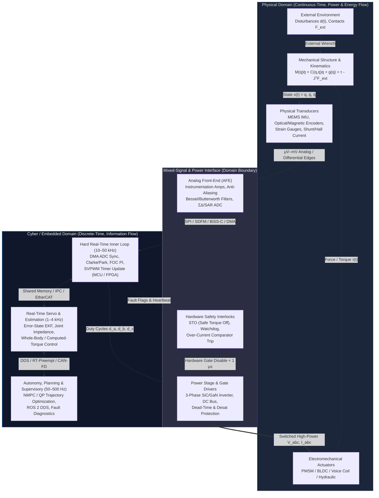
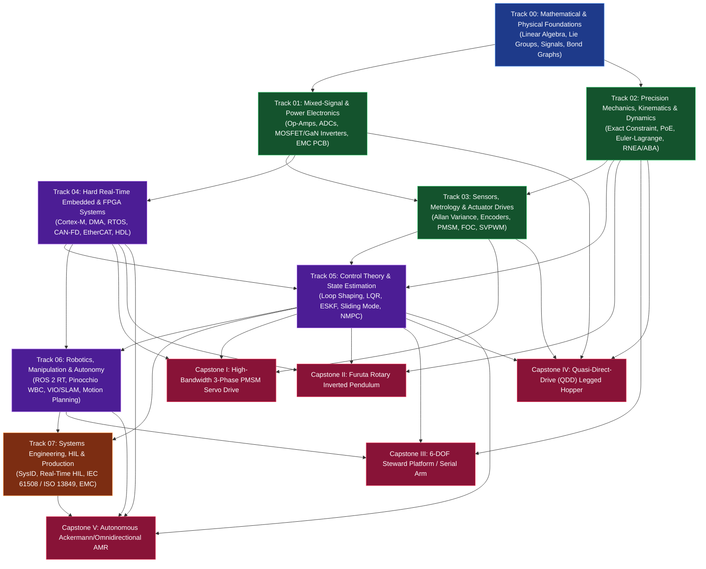
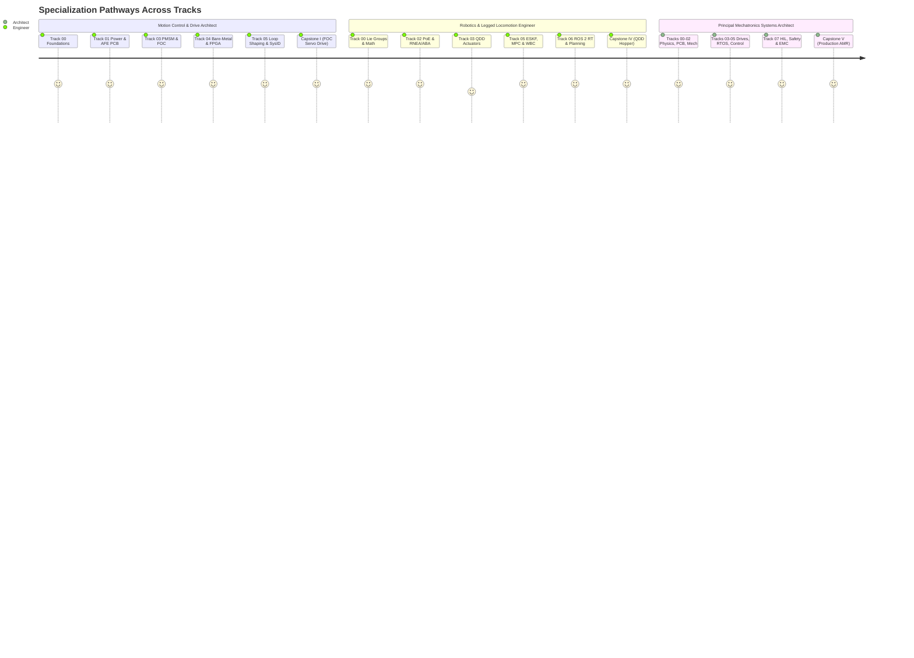

# ⚡ MechaLab — Production-Grade Mechatronics & Robotics Roadmap

> **From Maxwell's Equations and Euler-Lagrange Mechanics to Hard Real-Time STM32G4 Firmware, 48V/30A Field-Oriented Motor Control, Model Predictive Control, and Safety-Critical Autonomous Systems.**
>
> **Beginner-Friendly Plain-English Intuition** + **Full Graduate Mathematical Derivations** + **12 Runnable Python 3 & C++20 Hardware/Control Suites** + **3D STEP/STL CAD & KiCad PCB Netlists**.

---

## 🚀 Quick Start & Live Interactive Workbench (`MechaLab`)

* **🌐 Easy-to-Remember GitHub Pages URL:** [**`https://tle47.github.io/Mechatronics-Roadmap/`**](https://tle47.github.io/Mechatronics-Roadmap/) (redirects automatically via [index.html](index.html) to [web/index.html](web/index.html))
* **🌐 Live Freebuff Sites Production URL:** [**`https://site-2f1b42c07edb4f2ea9ce49ffab6d57e7.freebuff.page`**](https://site-2f1b42c07edb4f2ea9ce49ffab6d57e7.freebuff.page)
  * Includes a **7-Step Interactive Guided Beginner Tour**, **24 One-Click Real-World Industry Application Presets**, native KaTeX math rendering, and **6 live physics/hardware simulators** (Two-Mass Resonance Bode, $25\text{ kHz}$ PMSM FOC, 60 FPS Furuta Pendulum + LQR + CBF, URDF/MuJoCo + STO Fault Injector, 3D CAD + $48\text{ V}/30\text{ A}$ PCB Thermal Explorer, and Schroeder Multisine Closed-Loop SysID).
* **🧪 Run All 12 Verification Suites in 2 Seconds (Zero External Dependencies):**

```bash
# Execute all 12 Python 3 & C++20 simulations, URDF/MJCF checks, STEP/STL manifold tests & PCB thermal solvers
python3 scripts/run_all_labs.py --verbose

# Verify all 13 Markdown modules, 16 Mermaid diagrams, balanced LaTeX blocks & 115+ internal links
python3 scripts/verify_repo.py --verbose
```

### 📦 What's Inside This Repository at a Glance

| Pillar | What Is Included | Key Artifacts |
| :--- | :--- | :--- |
| **🎓 8 Core Engineering Tracks** | Beginner-friendly intuition + full graduate derivations ($SO(3)$, PoE, RNEA, FOC, ESKF, CBF-QP, HIL/STO) | [Track 00](00-foundations/README.md) – [Track 08](08-capstone-projects/README.md) |
| **💻 12 Executable Lab Suites** | Self-checking Python 3 & C++20 physics/control/firmware suites (`0` dependencies beyond stdlib) | [scripts/run_all_labs.py](scripts/run_all_labs.py) |
| **🔩 3D Parametric STEP & STL CAD** | Watertight 2-manifold `.stl` & ISO 10303-21 `.step` Notch Flexure, Kelvin Coupling & 8:1 QDD Carrier | [cad_parametric_parts.py](02-mechanics-kinematics-dynamics/cad/cad_parametric_parts.py) |
| **🤖 6 Validated Robot Models** | Sylvester SPD & triangle-inequality verified URDF & MuJoCo MJCF XMLs (Furuta, 6-DOF Arm, QDD Hopper) | [validate_models.py](08-capstone-projects/models/validate_models.py) |
| **⚡ 48V / 30A FOC PCB & Firmware** | 43-net KiCad `.net` schematic netlist, $\$40.47$ BOM, coupled thermal solver & bare-metal `STM32G474` C++20 ISR | [generate_foc_pcb_and_bom.py](08-capstone-projects/eda-capstone1-foc-drive/generate_foc_pcb_and_bom.py), [stm32g474_foc_firmware.cpp](08-capstone-projects/firmware-capstone1-stm32g474/stm32g474_foc_firmware.cpp) |

---

## 🧭 1. Executive Summary & Engineering Philosophy

Modern mechatronics is not the loose concatenation of mechanical CAD, off-the-shelf Arduino boards, and heuristic PID tuning. At the production and research frontier—spanning surgical robotics, legged locomotion, high-speed semiconductor lithography stages, autonomous aerial vehicles, and EV traction inverters—**mechatronics is the unified co-design of energy conversion, structural dynamics, mixed-signal electronics, deterministic computation, and feedback control under physical uncertainty.**

A control loop cannot rescue a mechanism whose first structural resonance sits inside the desired closed-loop bandwidth. An Extended Kalman Filter cannot recover attitude if the IMU front-end suffers from uncompensated vibration rectification and ADC aliasing. A 3-phase inverter will destroy its MOSFETs if gate-drive loop inductance and dead-time shoot-through are treated as afterthoughts.

This repository provides a **complete, rigorous, self-contained curriculum and implementation blueprint** designed for engineers, researchers, and technical teams building production-grade electromechanical systems. Every module pairs mathematical foundations with physical hardware constraints, failure modes, industry standards, open-source toolchains, and quantitative acceptance gates.

---

## 1B. Beginner's Intuition & Symbol Decoder (Read This First!)

> **New to Mechatronics?** Don't let the Greek letters or differential equations intimidate you. Every graduate equation in this roadmap describes a **physical sensation you already understand**—like feeling a spring push back, balancing a broomstick in your palm, or riding a bicycle over a bump. Use this quick-reference guide to translate the math into plain English before diving into the rigorous derivations below.

### How the 8 Tracks Fit Together (The Human Body Analogy)

| Track | Engineering Name | Human Body Analogy | Plain-English Job Description |
| :--- | :--- | :--- | :--- |
| **Track 00** | **Foundations (Math & Physics)** | **Laws of Nature** | The common language connecting electricity, spinning shafts, heat, and digital filters so we can predict how a machine behaves before building it. |
| **Track 01** | **Power Electronics & AFE** | **Heart, Arteries & Nerves** | **Power stage:** Muscles need high current ($30\text{ A}$) switched at $40\text{ kHz}$ without frying transistors. **AFE (Analog Front-End):** Cleans up tiny microvolt sensor signals before the microcontroller reads them. |
| **Track 02** | **Mechanics, Kinematics & Dynamics** | **Skeleton, Joints & Tendons** | Designing stiff, zero-slop joints (flexures, bearings, planetary gears) and writing the exact equations connecting joint angles ($q$) to forces/torques ($\tau$). |
| **Track 03** | **Sensors & Actuators (FOC)** | **Eyes, Inner Ear & Muscle Fibers** | Calibrating position encoders to sub-arcminute accuracy and timing 3-phase motor currents ($i_d, i_q$) so magnetic fields always push perpendicular to the rotor (**Field-Oriented Control**). |
| **Track 04** | **Embedded & Hard Real-Time** | **Spinal Cord Reflexes** | Running control loops at an exact heartbeat (e.g., every $40\ \mu\text{s}$ with $< 200\text{ ns}$ jitter) using hardware DMA and lock-free memory so the CPU never pauses or stutters. |
| **Track 05** | **Control & State Estimation** | **Cerebellum (Balance & Coordination)** | **Kalman Filter (ESKF):** Fuses noisy sensors to estimate true 3D orientation. **LQR / MPC:** Looks ahead in time to balance unstable systems. **CBF:** An invisible mathematical safety bumper. |
| **Track 06** | **Robotics & Autonomy** | **Motor Cortex & Vision** | Coordinating a 6-DOF robot arm so its hand behaves like a virtual programmable spring/damper (**Impedance Control**) while dodging obstacles smoothly. |
| **Track 07** | **Systems, SysID, HIL & Safety** | **Immune System & Medical Checkups** | Shaking the robot with multi-frequency tones (**Schroeder Multisine**) to measure its true transfer function, and dual-channel hardware **Safe Torque Off (STO)** to cut motor power in $< 1\ \mu\text{s}$ if anything goes wrong. |

### The 12 Equations & Symbols You Will See Everywhere — Decoded

| Symbol / Equation | How to Pronounce It | Plain-English Meaning | Why Engineers Care |
| :--- | :--- | :--- | :--- |
| $q,\ \dot{q},\ \ddot{q}$ | "$q$, $q$-dot, $q$-double-dot" | **Position** ($q$), **Velocity** ($\dot{q}$), and **Acceleration** ($\ddot{q}$) of a robot's joints. | Every dot over a variable just means "rate of change over time" ($\frac{d}{dt}$). |
| $SO(3)$ and $SE(3)$ | "Special Orthogonal / Euclidean Group 3" | **3D Rotation** ($SO(3)$, a $3\times 3$ matrix) and **3D Rotation + Position** ($SE(3)$, a $4\times 4$ matrix). | Unlike Roll-Pitch-Yaw Euler angles, $SO(3)$ rotation matrices never suffer from **Gimbal Lock** at $90^\circ$ pitch. |
| $M(q)\ddot{q} + C(q,\dot{q})\dot{q} + g(q) = \tau$ | "The Manipulator Equation" | $\text{Mass}\times\text{Accel} + \text{Centrifugal/Coriolis} + \text{Gravity} = \text{Motor Torque } (\tau)$. | It is literally Newton's $F = ma$ written for a multi-joint robot arm! |
| $J(q)$ and $\tau = J(q)^\top F$ | "The Jacobian Matrix & Virtual Work" | A leverage multiplier table connecting joint speeds to hand speed ($v = J\dot{q}$) and hand forces to joint torques ($\tau = J^\top F$). | Lets a robot control the exact force at its fingertips without needing a force sensor at the fingertips! |
| $J_{\text{refl}} = N^2 J_{\text{rotor}}$ | "Reflected Inertia ($N$-squared law)" | A gearbox with ratio $N:1$ makes the motor's spinning rotor feel $N^2$ times heavier at the output shaft. | A $100:1$ gearbox makes the rotor feel $10,000\times$ heavier—if a legged robot foot hits the ground, the gears shatter. That is why **QDD** uses $N \le 10:1$. |
| $i_d,\ i_q$ (Clarke & Park) | "$d$-axis and $q$-axis currents" | Mathematical camera trick that rotates with the spinning motor magnet so AC sine waves look like simple DC numbers. | $i_d$ pulls radial on the magnet (wasted heat, keep $i_d = 0$); $i_q$ pushes tangentially (100% pure torque!). |
| $V_{\text{peak}} = V_{\text{bus}} + L_{\text{loop}}\frac{di}{dt}$ | "Inductive Voltage Spike" | Stopping $30\text{ A}$ in $10\text{ ns}$ through a tiny wire loop ($L_{\text{loop}}$) acts like slamming a water valve shut (**water hammer**). | Even $2\text{ nH}$ of stray PCB trace length creates a voltage spike that can blow up an $80\text{ V}$ MOSFET. |
| $\text{DOF} = 6 - C$ | "Maxwell's Exact Constraint Rule" | A free 3D object has $6$ ways to move ($X,Y,Z,\text{Roll,Pitch,Yaw}$). Each contact point removes $1$ degree of freedom. | A **Kelvin Coupling** touches at $3+2+1 = 6$ exact points so the part snaps into the exact sub-micron spot even if the metal expands with heat. |

---

## 2. Master System Architecture: The Mechatronic Coupling Loop

Every mechatronic system is a coupled cyber-physical feedback loop bridging the continuous-time physical plant ($\mathcal{P}$, governed by conservation laws in $\mathbb{R}^n$) and the discrete-time compute engine ($\mathcal{C}$, governed by clocked state machines and floating/fixed-point arithmetic).



---

## 3. Repository Navigation & Curriculum Architecture

```text
mechatronics-roadmap/
├── README.md                                   # Master Architecture, Tracks & Competency Matrix
├── 00-foundations/
│   └── README.md                               # Track 00: Applied Math, Signals, Bond Graphs & Physics
├── 01-electronics-and-power/
│   └── README.md                               # Track 01: Mixed-Signal AFE, Power Stages, PCB EMC/EMI
├── 02-mechanics-kinematics-dynamics/
│   └── README.md                               # Track 02: Precision Design, Screw Theory, Lagrangian Dynamics
├── 03-sensors-and-actuators/
│   └── README.md                               # Track 03: Metrology, Encoders, MEMS, PMSM/BLDC & FOC
├── 04-embedded-and-realtime/
│   └── README.md                               # Track 04: Cortex-M, DMA, RTOS, EtherCAT/CAN-FD, FPGA Co-Design
├── 05-control-and-estimation/
│   └── README.md                               # Track 05: Loop-Shaping, LQR, MPC, Kalman Filtering, Nonlinear Control
├── 06-robotics-and-autonomy/
│   └── README.md                               # Track 06: ROS 2 Real-Time, Visual-Inertial Odometry, Motion Planning
├── 07-systems-hil-and-production/
│   └── README.md                               # Track 07: V-Model, Plant ID, HIL Testing, IEC 61508, DFM/Certs
├── 08-capstone-projects/
│   └── README.md                               # Track 08: 5 Full-Stack Production Capstone Specifications
├── resources/
│   ├── textbooks-and-papers.md                 # Annotated Bibliography: 80+ Textbooks & Seminal Papers
│   ├── open-source-toolchains.md               # Production Software Stack: ECAD, MCAD, FEA, Controls, Embedded
│   └── lab-workbench-bom.md                    # Tiered Hardware Lab Buildout ($500 Starter to $25k Principal Lab)
├── web/
│   └── index.html                              # Interactive Browser Workbench (Mermaid + Live Bode/FOC/Pendulum Sims)
├── .github/workflows/
│   └── ci.yml                                  # Automated GitHub Actions CI Pipeline (Linux + macOS)
└── scripts/
    ├── verify_repo.py                          # Automated Integrity, Link, Math, Mermaid & Section Validator
    └── run_all_labs.py                         # Unified Python 3 + C++20 Reference Simulation Test Runner
```

| Track | Module Link | Core Focus Areas | Primary Deliverable / Milestone Gate |
| :--- | :--- | :--- | :--- |
| **00** | [00-foundations/README.md](00-foundations/README.md) | Lie groups $SO(3)/SE(3)$, Laplace/$Z$-transforms, Bond Graphs, Stochastic Processes | Unified multi-domain bond-graph & state-space Voice-Coil simulation |
| **01** | [01-electronics-and-power/README.md](01-electronics-and-power/README.md) | Low-noise AFE, $\Sigma\Delta$/SAR ADCs, 3-phase GaN/MOSFET inverters, 4/6-layer EMC PCB layout | 48 V / 30 A 3-phase FOC motor drive PCB passing CISPR pre-compliance |
| **02** | [02-mechanics-kinematics-dynamics/README.md](02-mechanics-kinematics-dynamics/README.md) | Exact kinematic constraint, flexures, Hertzian contact, PoE kinematics, ABA/RNEA dynamics | Zero-backlash harmonic/cycloidal actuator module + symbolic dynamics solver |
| **03** | [03-sensors-and-actuators/README.md](03-sensors-and-actuators/README.md) | Allan variance, optical/magnetic encoder calibration, Clarke/Park, SVPWM, sensorless SMO/HFI | 25 kHz closed-loop FOC drive with $<0.05^\circ$ calibrated encoder ripple |
| **04** | [04-embedded-and-realtime/README.md](04-embedded-and-realtime/README.md) | Bare-metal Cortex-M7, cache coherence, lock-free ring buffers, FreeRTOS/Zephyr, EtherCAT | Zero-jitter ($<200\text{ ns}$) timer-triggered DMA control loop + CAN-FD bus |
| **05** | [05-control-and-estimation/README.md](05-control-and-estimation/README.md) | Bode/Nyquist loop shaping, LQR/LQG, ESKF, CLF-CBF QP, RTI-NMPC (`acados`) | Attitude ESKF + embedded NMPC running at $500\text{ Hz}$ on Cortex-M7/ARM64 |
| **06** | [06-robotics-and-autonomy/README.md](06-robotics-and-autonomy/README.md) | `ros2_control` over `PREEMPT_RT`, Factor-Graph VIO, RRT*/TrajOpt, Pinocchio WBC | 6-DOF torque-controlled manipulator with visual servoing & collision avoidance |
| **07** | [07-systems-hil-and-production/README.md](07-systems-hil-and-production/README.md) | ISO/IEC V-Model, frequency-domain sysID, real-time HIL, SIL-2/PLd safety, CE/FCC EMC | Automated CI/CD + HIL fault-injection rig validating Safe Torque Off (STO) |
| **08** | [08-capstone-projects/README.md](08-capstone-projects/README.md) | 5 Integrated Hardware/Firmware/Control Capstones with full specs & pass/fail tables | End-to-end physical hardware bring-up and quantitative benchmark sign-off |

### 🏭 Real-World Industry Example Applications & Interactive Simulator Presets Across All Tracks

Every track in [web/index.html](web/index.html) includes **3 clickable one-click industry application presets** that configure the live physics simulators to match real commercial hardware:

| Track | Industry Application Example 1 | Industry Application Example 2 | Industry Application Example 3 |
| :--- | :--- | :--- | :--- |
| **Track 00: Foundations** | **ASML Lithography Wafer Stage** ($k_s = 340\text{ N\cdot m/rad}$, $f_r = 390\text{ Hz}$ biquad notch) | **Da Vinci Surgical Tendon-Cable Drive** ($k_s = 45\text{ N\cdot m/rad}$, $f_r = 142\text{ Hz}$) | **CNC Preloaded Ballscrew Axis** ($k_s = 120\text{ N\cdot m/rad}$, $f_r = 290.6\text{ Hz}$) |
| **Track 01: Power & AFE** | **6-Layer $1.6\text{ nH}$ Servo Drive PCB** ($V_{DS,\text{peak}} = 53.1\text{ V} < 60\text{ V}$, $99.11\%$ eff) | **2-Layer $5.2\text{ nH}$ Bad Layout** ($V_{DS,\text{peak}} = 64.6\text{ V}$ overshoot warning!) | **$30\text{ A}$ Peak Torque Thermal Soak** ($R_{DS(\text{on})}(T_j)$ self-heating loop) |
| **Track 02: Mechanics & CAD** | **Ti-6Al-4V Fast-Steering Mirror Notch Flexure** ($t = 0.50\text{ mm}$, $k_\theta = 6.98\text{ N\cdot m/rad}$) | **440C Optical Bench Kelvin 3-2-1 Coupling** ($3+2+1=6$ constraints, $\text{DOF}=0$) | **MIT Cheetah $8:1$ QDD Planetary Carrier** (7075-T6 double-shear pin $\text{SF} = 82.9\times$) |
| **Track 03: Sensors & FOC** | **Surgical Cobot Joint** ($1200\text{ RPM}$, $f_{bw} = 2.8\text{ kHz}$, $t_{\text{rise}} = 125\ \mu\text{s}$) | **High-Speed Drone Propeller** ($5500\text{ RPM}$ showing $\omega_e L_{dq}$ cross-coupling) | **$24\text{ A}$ Legged Hopper Stance Pulse** ($3.5\text{ kHz}$ current loop + SVPWM $+15.47\%$ boost) |
| **Track 04: Embedded RT** | **`STM32G474` $40\text{ kHz}$ TIM1 + Dual ADC DMA + CORDIC** (`0` heap allocs, $98\text{ ns}$ host ISR) | **CAN-FD $2\text{ kHz}$ MIT-Mode 5-Param Impedance Codec** ($100\%$ CRC-16 fault rejection) | **`WaitFreeSeqLock<T>` Telemetry Bridge** (`0` torn reads across $250,000$ frames) |
| **Track 05: Control & CBF** | **Autonomous Furuta Swing-Up Catch** ($\theta_0 = 175^\circ \to 0^\circ$ LQR hand-off) | **Tight $\pm 0.50\text{ m}$ CBF Workspace Safety Wall** (active QP braking) | **Heavy $+3.6\text{ rad/s}$ Impulse Hammer Kick** (disturbance rejection within rail limits) |
| **Track 06: Robotics & WBC** | **Capstone IV 3-DOF QDD Hopper Landing Crouch** ($m_{\text{shank}} = 0.15\text{ kg}$ distal inertia) | **Capstone III 6-DOF Serial Arm $20^\circ$ Ramp Polishing** ($10\text{ N}$ compliant force tracking) | **Capstone II Furuta Rotary Upright Balance** (coupled $M_{11}(q_2)$ inertia verification) |
| **Track 07/08: SysID & STO** | **48-Tone Schroeder Multisine SysID** ($\text{CF} = 1.66$, $< 0.4\text{ dB}$ RMS error) | **Zero-Phase ($\phi_k = 0$) Impulse Clipping** ($\text{CF} = 9.80$ amplifier saturation) | **$< 1\ \mu\text{s}$ Hardware `BKIN` Desat & 2-Cycle SPI Encoder Wire-Break STO** |

---

## 4. Dependency Graph & Learning Progression



---

## 5. Role-Based Specialization Pathways

Not every engineer needs all eight tracks simultaneously. Use the specialization pathways below to sequence the repository for your specific engineering objective:



### Pathway A: Precision Motion Control & Motor Drive Architect
* **Target Domains:** Semiconductor wafer stages, CNC machine tools, EV traction inverters, surgical robot joints.
* **Sequence:** [Track 00](00-foundations/README.md) $\rightarrow$ [Track 01](01-electronics-and-power/README.md) $\rightarrow$ [Track 03](03-sensors-and-actuators/README.md) $\rightarrow$ [Track 04](04-embedded-and-realtime/README.md) $\rightarrow$ [Track 05](05-control-and-estimation/README.md) (§1–§3) $\rightarrow$ [Track 07](07-systems-hil-and-production/README.md) $\rightarrow$ [Capstone I](08-capstone-projects/README.md#capstone-1-custom-48v-30a-field-oriented-control-pmsm-servo-drive).

### Pathway B: Dynamic Robotics, Manipulation & Legged Locomotion Engineer
* **Target Domains:** Humanoids, quadrupeds, torque-controlled cobots, aerial manipulation.
* **Sequence:** [Track 00](00-foundations/README.md) $\rightarrow$ [Track 02](02-mechanics-kinematics-dynamics/README.md) $\rightarrow$ [Track 03](03-sensors-and-actuators/README.md) (§3–§5) $\rightarrow$ [Track 05](05-control-and-estimation/README.md) (§2–§6) $\rightarrow$ [Track 06](06-robotics-and-autonomy/README.md) $\rightarrow$ [Capstone III](08-capstone-projects/README.md#capstone-3-6-dof-force-controlled-serial-manipulator-or-stewart-platform) & [Capstone IV](08-capstone-projects/README.md#capstone-4-quasi-direct-drive-qdd-3-dof-legged-hopping-robot-with-contact-mpc).

### Pathway C: Embedded Cyber-Physical & Safety Systems Engineer
* **Target Domains:** Avionics flight controllers, ISO 26262 automotive actuators, IEC 61508 industrial automation, medical devices.
* **Sequence:** [Track 00](00-foundations/README.md) $\rightarrow$ [Track 01](01-electronics-and-power/README.md) $\rightarrow$ [Track 04](04-embedded-and-realtime/README.md) $\rightarrow$ [Track 05](05-control-and-estimation/README.md) $\rightarrow$ [Track 07](07-systems-hil-and-production/README.md) $\rightarrow$ [Capstone II](08-capstone-projects/README.md#capstone-2-rotary-inverted-pendulum-furuta-pendulum-with-swing-up-lqr-mpc) & [Capstone V](08-capstone-projects/README.md#capstone-5-autonomous-mobile-robot-amr-with-violidar-slam-mppi-functional-safety).

---

## 6. Competency Matrix: Junior vs. Senior vs. Principal Mechatronics Engineer

| Engineering Dimension | Level 1: Junior / Foundation | Level 2: Senior / Production | Level 3: Principal / Research Architect |
| :--- | :--- | :--- | :--- |
| **Mathematical Modeling** | LTI transfer functions, basic 1-DOF mass-spring-damper ODEs, Euler angle kinematics. | Multi-domain Bond Graphs, Product-of-Exponentials on $SE(3)$, RNEA/ABA dynamics, state-space discretization with ZOH/Tustin. | Port-Hamiltonian energy shaping, Lie-group error-state observability analysis, differential flatness, stochastic PDE/Fokker-Planck bounds. |
| **Analog & Power Hardware** | Breadboard or basic 2-layer PCB, off-the-shelf H-bridge modules, basic RC filtering. | 4/6-layer impedance-controlled PCBs, custom 3-phase MOSFET/GaN gate drives, Kelvin shunt sensing, active Bessel anti-aliasing filters, thermal resistance networks. | Parasitic inductance extraction ($<2\text{ nH}$ switching loops), SiC/GaN $dV/dt$ immunity ($>100\text{ V/ns}$), CISPR 11/25 first-pass EMC compliance, SIL-3 hardware redundancy. |
| **Mechanical & Structural Design** | 3D-printed brackets, cantilevered shafts, standard timing belts, uncalibrated backlash. | Exact kinematic constraint (Maxwell criteria), preloaded angular-contact duplex bearings, flexural stages, Hertzian contact & AGMA gear life sizing. | Structural-control co-optimization (placing structural zeros/poles relative to collocated/non-collocated sensors), athermalized optical/mechanical metrology frames. |
| **Embedded Firmware & Compute** | Arduino `loop()` polling, blocking I2C calls, floating-point drift, unbounded interrupt latency. | Bare-metal Cortex-M7/H7 timer-triggered ADC+DMA pipelines, lock-free SPSC queues, Zephyr/FreeRTOS priority inheritance, CAN-FD & EtherCAT Distributed Clocks. | Heterogeneous SoC + FPGA co-design (Zynq/Artix), cache-line aligned deterministic memory subsystems, formal WCET (Worst-Case Execution Time) static verification. |
| **Control & Estimation** | Heuristic Ziegler-Nichols PID tuning, complementary filter on Euler angles. | Frequency-domain loop shaping with notch/lead-lag filters, cascaded FOC, LQR/LQG, Error-State EKF on $SO(3)\times\mathbb{R}^n$, friction feedforward (LuGre). | Real-Time Iteration Nonlinear MPC (`acados`), Control Barrier Functions (CLF-CBF-QP) for safety, $H_\infty/\mu$-synthesis for uncertain flexible structures. |
| **Verification & Qualification** | Bench testing on happy-path inputs, scope probing when something smokes. | Automated swept-sine frequency response sysID, Hardware-in-the-Loop (HIL) regression suites, thermal soak testing, FMEA / fault-tree analysis. | Full ISO 13849 PLd / IEC 61508 SIL-2 safety case certification, automated stochastic Monte-Carlo HIL fault injection, production EOL (End-of-Line) automated calibration rigs. |

---

## 7. Quick-Access Reference Library

* **[Annotated Textbooks & Seminal Papers](resources/textbooks-and-papers.md)** — Over 80 rigorously curated texts and milestone papers across all 8 tracks, with guidance on why and when to read each.
* **[Printable 1-Page Mechatronics Reference Cheat Sheet (`resources/mechatronics-cheatsheet.md`)](resources/mechatronics-cheatsheet.md)** and **[Print-Ready A4/Letter KaTeX Card (`web/cheatsheet.html`)](web/cheatsheet.html)** — All core equations, PCB layout rules, flexure/constraint formulas, and control tuning laws on a single page.
* **[Production Open-Source Toolchain Matrix](resources/open-source-toolchains.md)** — The complete modern mechatronics software stack: KiCad, ngspice, FreeCAD, CalculiX, Gmsh, Drake, MuJoCo, Pinocchio, CasADi, `acados`, Zephyr, ROS 2, PlotJuggler, and Sigrok.
* **[Tiered Hardware Lab & Workbench BOM](resources/lab-workbench-bom.md)** — Exact equipment, probes, power supplies, debuggers, and mechanical metrology tools required across three budget tiers ($500, $3,500, and $25,000).
* **[Interactive Web Workbench (`web/index.html`)](web/index.html)** — Zero-build browser dashboard rendering the roadmap architecture alongside interactive Two-Mass Resonance/Notch Bode, 25 kHz PMSM FOC + SVPWM, and Furuta Inverted Pendulum + CBF simulators.
* **[Executable Lab Simulations (`scripts/run_all_labs.py`)](scripts/run_all_labs.py)** — Run `python3 scripts/run_all_labs.py` to compile and execute the reference Python 3 and C++20 simulations and unit tests for Labs 00 through 06:
  * [Lab 00: Two-Mass Resonant Actuator, $SO(3)$ Lie Algebra & Float32 Notch](00-foundations/lab/lab00_two_mass_and_so3.py)
  * [Lab 01: Half-Bridge Switching Parasitics, Bessel AFE & SAR Charge Bucket](01-electronics-and-power/lab/lab01_power_and_afe.py)
  * [Lab 02: Screw Theory PoE Kinematics, $O(n)$ RNEA & Passivity Skew-Symmetry](02-mechanics-kinematics-dynamics/lab/lab02_poe_and_rnea.py)
  * [Lab 03: Allan Variance, Encoder Harmonic LUT & 25 kHz PMSM FOC](03-sensors-and-actuators/lab/lab03_foc_and_metrology.py)
  * [Lab 04: Hard Real-Time C++20 `WaitFreeSeqLock`, Zero-Heap Guard & RTA](04-embedded-and-realtime/lab/lab04_realtime_embedded.cpp)
  * [Lab 05: Gang of Four Sensitivity, Joseph-Form ESKF, CLF-CBF-QP & MPC](05-control-and-estimation/lab/lab05_eskf_mpc_and_cbf.py)
  * [Lab 06: Operational-Space Cartesian Impedance, Null-Space Projector & Minimum-Jerk](06-robotics-and-autonomy/lab/lab06_impedance_and_ruckig.py)
  * [Lab 07: Schroeder Multisine SysID, Dual-Channel STO Fault Injection & Regen Clamp](07-systems-hil-and-production/lab/lab07_sysid_hil_and_sto.py)
  * [Track 02 & Capstone IV Parametric CAD Generator & Validator (`cad_parametric_parts.py`)](02-mechanics-kinematics-dynamics/cad/cad_parametric_parts.py) and [validate_cad_parts.py](02-mechanics-kinematics-dynamics/cad/validate_cad_parts.py)
  * [Capstone I 48V / 30A FOC Servo Drive PCB Netlist, Thermal & BOM Suite (`generate_foc_pcb_and_bom.py`)](08-capstone-projects/eda-capstone1-foc-drive/generate_foc_pcb_and_bom.py)
  * [Capstone I Bare-Metal STM32G474 40 kHz TIM1 SVPWM + Dual ADC DMA + CORDIC Firmware (`stm32g474_foc_firmware.cpp`)](08-capstone-projects/firmware-capstone1-stm32g474/stm32g474_foc_firmware.cpp)
  * [Capstone Models Validator: URDF & MuJoCo MJCF Physics/Inertia Suite](08-capstone-projects/models/validate_models.py)
* **[Repository Verification Script](scripts/verify_repo.py)** — Run `python3 scripts/verify_repo.py` to validate every Markdown link, Mermaid diagram syntax block, equation block, and structural requirement across the repository.

---

## 8. Best Free & Open-Access Study Resources by Subcategory

Every discipline in this roadmap can be studied for **$0** using world-class open-access university courses, free legal textbooks, and authoritative manufacturer engineering handbooks:

| Subcategory | #1 Free Open Textbook / Reference PDF | #1 Free University Course / Video Lectures | Free Hands-On Software / Application Notes |
| :--- | :--- | :--- | :--- |
| **00a · Linear Algebra & Lie Groups** | [J. Sola — *A Micro Lie Theory for State Estimation in Robotics* (`arXiv:1812.01537`)](https://arxiv.org/abs/1812.01537) | [MIT 18.06 Linear Algebra (Gilbert Strang)](https://ocw.mit.edu/courses/18-06-linear-algebra-spring-2010/) & [3Blue1Brown Essence of LA](https://www.3blue1brown.com/topics/linear-algebra) | Python `numpy` / `scipy.spatial.transform` + [Lab 00 (`lab00_two_mass_and_so3.py`)](00-foundations/lab/lab00_two_mass_and_so3.py) |
| **00b · Signals, DSP & Discretization** | [S. W. Smith — *The Scientist and Engineer's Guide to Digital Signal Processing*](https://www.dspguide.com/) | [MIT 6.003 Signals and Systems (OpenCourseWare)](https://ocw.mit.edu/courses/6-003-signals-and-systems-fall-2011/) | [Julius O. Smith — *Introduction to Digital Filters* (Stanford CCRMA)](https://ccrma.stanford.edu/~jos/filters/) |
| **01a · Mixed-Signal AFE & Op-Amps** | [Analog Devices — *Op Amp Applications Handbook* (Walt Jung, Full Free PDF)](https://www.analog.com/en/resources/technical-books/op-amp-applications-handbook.html) | [TI Precision Labs — Op Amps & ADCs Video Curriculum](https://www.ti.com/video/series/precision-labs.html) | [TI *Analog Engineer's Pocket Reference* (Free PDF)](https://www.ti.com/lit/eb/slyw038c/slyw038c.pdf) + `ngspice` |
| **01b · Power Inverters & EMC PCB Layout** | [TI `SLUA618A` — *Fundamentals of MOSFET and IGBT Gate Driver Circuits* (Laszlo Balogh)](https://www.ti.com/lit/pdf/slua618) | [Robert Feranec & Phil's Lab (STM32 & Mixed-Signal KiCad PCB Layout)](https://docs.kicad.org/) | [KiCad 8.0+](https://www.kicad.org/) + [Capstone I 48V/30A FOC PCB Suite](08-capstone-projects/eda-capstone1-foc-drive/generate_foc_pcb_and_bom.py) |
| **02a · Precision Machine Design & Flexures** | [A. H. Slocum — *FUNdaMENTALS of Design* (MIT Free Open Book PDFs)](https://pergatory.mit.edu/resources/FUNdaMENTALS.html) | [MIT 2.75 / 2.72 Elements of Mechanical Design](https://ocw.mit.edu/courses/2-72-elements-of-mechanical-design-spring-2009/) | [FreeCAD](https://www.freecad.org/) + [CadQuery Docs](https://cadquery.readthedocs.io/) + [Track 02 CAD Suite](02-mechanics-kinematics-dynamics/cad/cad_parametric_parts.py) |
| **02b · Screw Theory Kinematics & Dynamics** | [K. M. Lynch & F. C. Park — *Modern Robotics: Mechanics, Planning, and Control* (Free PDF)](https://hades.mech.northwestern.edu/index.php/Modern_Robotics) | [Northwestern Modern Robotics Video Course & Code Library](https://github.com/NxRLab/ModernRobotics) | [MuJoCo Documentation](https://mujoco.readthedocs.io/) + [Pinocchio C++/Python](https://github.com/stack-of-tasks/pinocchio) |
| **03 · Metrology, Encoders & FOC Drives** | [Ben Katz — *A Low Cost Modular Actuator for Dynamic Robots* (MIT Master's Thesis PDF)](https://dspace.mit.edu/handle/1721.1/118671) | [TI Teaching Old Motors New Tricks (Dave Wilson FOC Series)](https://www.ti.com/video/3871417629001) | [SimpleFOC Theory & SVPWM Docs](https://docs.simplefoc.com/) + [NIST Allan Variance Handbook](https://www.nist.gov/publications/handbook-frequency-stability-analysis) |
| **04 · Hard Real-Time Embedded & RTOS** | [R. Barry — *Mastering the FreeRTOS Real Time Kernel* (Official Free Book)](https://www.freertos.org/Documentation/02-Kernel/07-Books-and-manual/01-RTOS_book) | [Miro Samek — *Modern Embedded Systems Programming* Course](https://www.state-machine.com/video-course) | [STM32G4 Reference Manual `RM0440`](https://www.st.com/resource/en/reference_manual/rm0440-stm32g4-series-advanced-armbased-32bit-mcus-stmicroelectronics.pdf) + [Zephyr RTOS](https://docs.zephyrproject.org/) |
| **05a · Classical & Robust Loop Shaping** | [K. J. Åström & R. M. Murray — *Feedback Systems (FBS2e)* (Complete Free Book)](https://fbswiki.org/wiki/index.php/Main_Page) | [Brian Douglas — Control Systems Lectures](https://www.youtube.com/@BrianBDouglas) & [Steve Brunton Control Bootcamp](https://www.youtube.com/playlist?list=PLMrJAkhIeNNR20Mz-VpzgfQs5zrYi085m) | `python-control` + [MechaLab Two-Mass Notch Bode Simulator](web/index.html) |
| **05b · State Estimation (ESKF), MPC & CBF** | [T. D. Barfoot — *State Estimation for Robotics* (Free Complete PDF)](http://asrl.utias.utoronto.ca/~tdb/bib/barfoot_ser17.pdf) & [J. B. Rawlings — *MPC Book PDF*](https://sites.engineering.ucsb.edu/~jbraw/mpc/) | [Cyrill Stachniss — SLAM & State Estimation Course (Uni Bonn)](https://www.ipb.uni-bonn.de/teaching/) | [J. Sola — *Quaternion Kinematics for the ESKF* (`arXiv:1711.02508`)](https://arxiv.org/abs/1711.02508) + [`acados`](https://docs.acados.org/) |
| **06 · Whole-Body Control, Manipulation & Legged Robotics** | [R. Tedrake — *Underactuated Robotics*](https://underactuated.mit.edu/) & [*Robotic Manipulation* (MIT Interactive Textbooks)](https://manipulation.csail.mit.edu/) | [MIT 6.832 Underactuated Robotics & 6.4210 Manipulation Lectures](https://underactuated.mit.edu/) | [Drake (`pydrake`)](https://drake.mit.edu/) + [S. M. LaValle — *Planning Algorithms* (Free Book)](http://lavalle.pl/planning/) |
| **07 & 08 · SysID, HIL & Functional Safety** | [NASA *Systems Engineering Handbook* (`SP-2016-6105`, Free PDF)](https://www.nasa.gov/reference/systems-engineering-handbook/) | [TI Functional Safety & Safe Torque Off (STO) Design Guide (`SLLA547`)](https://www.ti.com/lit/pdf/slla547) | [Lab 07 Schroeder Multisine & STO Suite](07-systems-hil-and-production/lab/lab07_sysid_hil_and_sto.py) |

