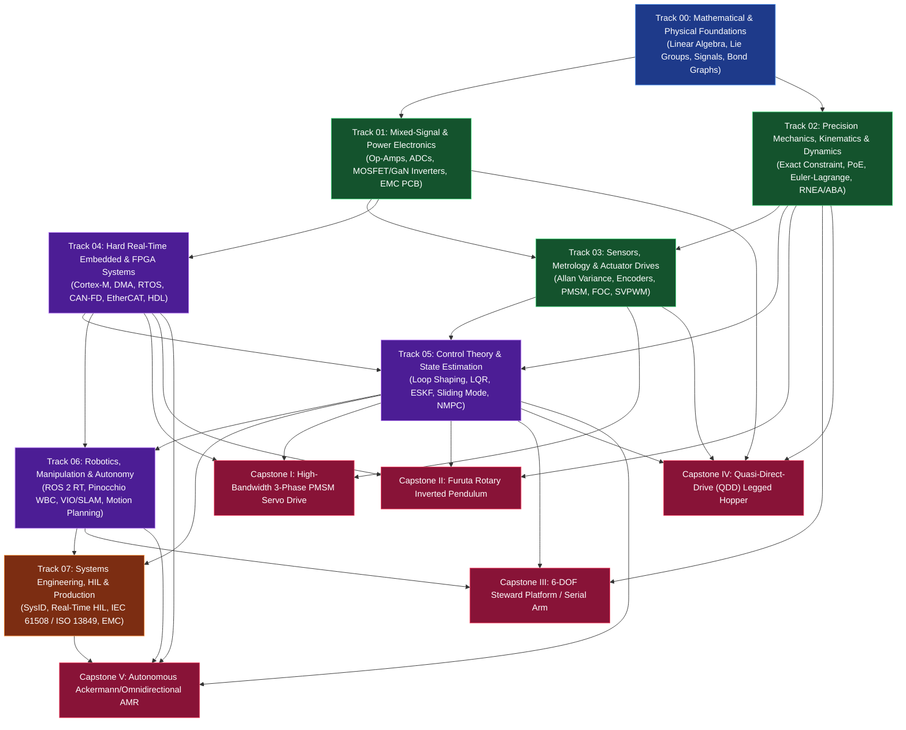
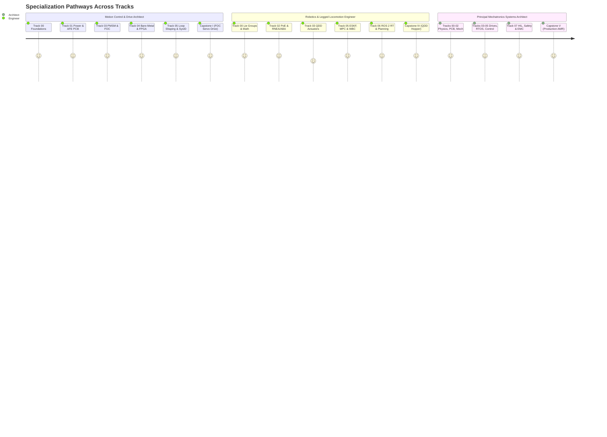

# Production-Grade Mechatronics Engineering & Research Roadmap

> **From Maxwell's Equations and Euler-Lagrange Mechanics to Hard Real-Time Embedded Firmware, Field-Oriented Motor Control, Model Predictive Control, and Safety-Critical Autonomous Systems.**

---

## 1. Executive Summary & Engineering Philosophy

Modern mechatronics is not the loose concatenation of mechanical CAD, off-the-shelf Arduino boards, and heuristic PID tuning. At the production and research frontier—spanning surgical robotics, legged locomotion, high-speed semiconductor lithography stages, autonomous aerial vehicles, and EV traction inverters—**mechatronics is the unified co-design of energy conversion, structural dynamics, mixed-signal electronics, deterministic computation, and feedback control under physical uncertainty.**

A control loop cannot rescue a mechanism whose first structural resonance sits inside the desired closed-loop bandwidth. An Extended Kalman Filter cannot recover attitude if the IMU front-end suffers from uncompensated vibration rectification and ADC aliasing. A 3-phase inverter will destroy its MOSFETs if gate-drive loop inductance and dead-time shoot-through are treated as afterthoughts.

This repository provides a **complete, rigorous, self-contained curriculum and implementation blueprint** designed for engineers, researchers, and technical teams building production-grade electromechanical systems. Every module pairs mathematical foundations with physical hardware constraints, failure modes, industry standards, open-source toolchains, and quantitative acceptance gates.

---

## 2. Master System Architecture: The Mechatronic Coupling Loop

Every mechatronic system is a coupled cyber-physical feedback loop bridging the continuous-time physical plant ($\mathcal{P}$, governed by conservation laws in $\mathbb{R}^n$) and the discrete-time compute engine ($\mathcal{C}$, governed by clocked state machines and floating/fixed-point arithmetic).

```mermaid
flowchart TB
    subgraph PLANT["Physical Domain (Continuous-Time, Power & Energy Flow)"]
        direction LR
        ENV["External Environment<br/>Disturbances d(t), Contacts F_ext"]
        MECH["Mechanical Structure & Kinematics<br/>M(q)q̈ + C(q,q̇)q̇ + g(q) = τ - JᵀF_ext"]
        ACT["Electromechanical Actuators<br/>PMSM / BLDC / Voice Coil / Hydraulic"]
        SENS["Physical Transducers<br/>MEMS IMU, Optical/Magnetic Encoders,<br/>Strain Gauges, Shunt/Hall Current"]
        
        ENV -->|External Wrench| MECH
        ACT -->|Force / Torque τ(t)| MECH
        MECH -->|State x(t) = q, q̇, q̈| SENS
    end

    subgraph INTERFACE["Mixed-Signal & Power Interface (Domain Boundary)"]
        direction LR
        PWR["Power Stage & Gate Drivers<br/>3-Phase SiC/GaN Inverter, DC Bus,<br/>Dead-Time & Desat Protection"]
        AFE["Analog Front-End (AFE)<br/>Instrumentation Amps, Anti-Aliasing<br/>Bessel/Butterworth Filters, ΣΔ/SAR ADC"]
        SAFETY["Hardware Safety Interlocks<br/>STO (Safe Torque Off), Watchdog,<br/>Over-Current Comparator Trip"]
        
        PWR ==>|Switched High-Power V_abc, I_abc| ACT
        SENS -->|μV–mV Analog / Differential Edges| AFE
        SAFETY -.->|Hardware Gate Disable < 1 μs| PWR
    end

    subgraph COMPUTE["Cyber / Embedded Domain (Discrete-Time, Information Flow)"]
        direction LR
        FAST["Hard Real-Time Inner Loop (10–50 kHz)<br/>DMA ADC Sync, Clarke/Park, FOC PI,<br/>SVPWM Timer Update (MCU / FPGA)"]
        MID["Real-Time Servo & Estimation (1–4 kHz)<br/>Error-State EKF, Joint Impedance,<br/>Whole-Body / Computed-Torque Control"]
        HIGH["Autonomy, Planning & Supervisory (50–500 Hz)<br/>NMPC / QP Trajectory Optimization,<br/>ROS 2 DDS, Fault Diagnostics"]
        
        AFE -->|SPI / SDFM / BiSS-C / DMA| FAST
        FAST -->|Duty Cycles d_a, d_b, d_c| PWR
        FAST <-->|Shared Memory / IPC / EtherCAT| MID
        MID <-->|DDS / RT-Preempt / CAN-FD| HIGH
        FAST -.->|Fault Flags & Heartbeat| SAFETY
    end

    style PLANT fill:#1b263b,stroke:#415a77,color:#e0e1dd
    style INTERFACE fill:#2b2d42,stroke:#8d99ae,color:#edf2f4
    style COMPUTE fill:#0f172a,stroke:#38bdf8,color:#f8fafc
```

---

## 3. Repository Navigation & Curriculum Architecture

```text
mechatronics-roadmap/
├── README.md                                   # Master Architecture, Tracks & Competency Matrix
├── 00-foundations/
│   └── README.md                               # Track 00: Applied Math, Signals, Bond Graphs & Physics
├── 01-electronics-and-power/
│   └── README.md                               # Track 01: Mixed-Signal AFE, Power Stages, PCB EMC/EMI
├── 02-mechanics-kinematics-dynamics/
│   └── README.md                               # Track 02: Precision Design, Screw Theory, Lagrangian Dynamics
├── 03-sensors-and-actuators/
│   └── README.md                               # Track 03: Metrology, Encoders, MEMS, PMSM/BLDC & FOC
├── 04-embedded-and-realtime/
│   └── README.md                               # Track 04: Cortex-M, DMA, RTOS, EtherCAT/CAN-FD, FPGA Co-Design
├── 05-control-and-estimation/
│   └── README.md                               # Track 05: Loop-Shaping, LQR, MPC, Kalman Filtering, Nonlinear Control
├── 06-robotics-and-autonomy/
│   └── README.md                               # Track 06: ROS 2 Real-Time, Visual-Inertial Odometry, Motion Planning
├── 07-systems-hil-and-production/
│   └── README.md                               # Track 07: V-Model, Plant ID, HIL Testing, IEC 61508, DFM/Certs
├── 08-capstone-projects/
│   └── README.md                               # Track 08: 5 Full-Stack Production Capstone Specifications
├── resources/
│   ├── textbooks-and-papers.md                 # Annotated Bibliography: 80+ Textbooks & Seminal Papers
│   ├── open-source-toolchains.md               # Production Software Stack: ECAD, MCAD, FEA, Controls, Embedded
│   └── lab-workbench-bom.md                    # Tiered Hardware Lab Buildout ($500 Starter to $25k Principal Lab)
├── web/
│   └── index.html                              # Interactive Browser Workbench (Mermaid + Live Bode/FOC/Pendulum Sims)
├── .github/workflows/
│   └── ci.yml                                  # Automated GitHub Actions CI Pipeline (Linux + macOS)
└── scripts/
    ├── verify_repo.py                          # Automated Integrity, Link, Math, Mermaid & Section Validator
    └── run_all_labs.py                         # Unified Python 3 + C++20 Reference Simulation Test Runner
```

| Track | Module Link | Core Focus Areas | Primary Deliverable / Milestone Gate |
| :--- | :--- | :--- | :--- |
| **00** | [00-foundations/README.md](00-foundations/README.md) | Lie groups $SO(3)/SE(3)$, Laplace/$Z$-transforms, Bond Graphs, Stochastic Processes | Unified multi-domain bond-graph & state-space Voice-Coil simulation |
| **01** | [01-electronics-and-power/README.md](01-electronics-and-power/README.md) | Low-noise AFE, $\Sigma\Delta$/SAR ADCs, 3-phase GaN/MOSFET inverters, 4/6-layer EMC PCB layout | 48 V / 30 A 3-phase FOC motor drive PCB passing CISPR pre-compliance |
| **02** | [02-mechanics-kinematics-dynamics/README.md](02-mechanics-kinematics-dynamics/README.md) | Exact kinematic constraint, flexures, Hertzian contact, PoE kinematics, ABA/RNEA dynamics | Zero-backlash harmonic/cycloidal actuator module + symbolic dynamics solver |
| **03** | [03-sensors-and-actuators/README.md](03-sensors-and-actuators/README.md) | Allan variance, optical/magnetic encoder calibration, Clarke/Park, SVPWM, sensorless SMO/HFI | 25 kHz closed-loop FOC drive with $<0.05^\circ$ calibrated encoder ripple |
| **04** | [04-embedded-and-realtime/README.md](04-embedded-and-realtime/README.md) | Bare-metal Cortex-M7, cache coherence, lock-free ring buffers, FreeRTOS/Zephyr, EtherCAT | Zero-jitter ($<200\text{ ns}$) timer-triggered DMA control loop + CAN-FD bus |
| **05** | [05-control-and-estimation/README.md](05-control-and-estimation/README.md) | Bode/Nyquist loop shaping, LQR/LQG, ESKF, CLF-CBF QP, RTI-NMPC (`acados`) | Attitude ESKF + embedded NMPC running at $500\text{ Hz}$ on Cortex-M7/ARM64 |
| **06** | [06-robotics-and-autonomy/README.md](06-robotics-and-autonomy/README.md) | `ros2_control` over `PREEMPT_RT`, Factor-Graph VIO, RRT*/TrajOpt, Pinocchio WBC | 6-DOF torque-controlled manipulator with visual servoing & collision avoidance |
| **07** | [07-systems-hil-and-production/README.md](07-systems-hil-and-production/README.md) | ISO/IEC V-Model, frequency-domain sysID, real-time HIL, SIL-2/PLd safety, CE/FCC EMC | Automated CI/CD + HIL fault-injection rig validating Safe Torque Off (STO) |
| **08** | [08-capstone-projects/README.md](08-capstone-projects/README.md) | 5 Integrated Hardware/Firmware/Control Capstones with full specs & pass/fail tables | End-to-end physical hardware bring-up and quantitative benchmark sign-off |

---

## 4. Dependency Graph & Learning Progression



---

## 5. Role-Based Specialization Pathways

Not every engineer needs all eight tracks simultaneously. Use the specialization pathways below to sequence the repository for your specific engineering objective:



### Pathway A: Precision Motion Control & Motor Drive Architect
* **Target Domains:** Semiconductor wafer stages, CNC machine tools, EV traction inverters, surgical robot joints.
* **Sequence:** [Track 00](00-foundations/README.md) $\rightarrow$ [Track 01](01-electronics-and-power/README.md) $\rightarrow$ [Track 03](03-sensors-and-actuators/README.md) $\rightarrow$ [Track 04](04-embedded-and-realtime/README.md) $\rightarrow$ [Track 05](05-control-and-estimation/README.md) (§1–§3) $\rightarrow$ [Track 07](07-systems-hil-and-production/README.md) $\rightarrow$ [Capstone I](08-capstone-projects/README.md#capstone-1-custom-48v-30a-field-oriented-control-pmsm-servo-drive).

### Pathway B: Dynamic Robotics, Manipulation & Legged Locomotion Engineer
* **Target Domains:** Humanoids, quadrupeds, torque-controlled cobots, aerial manipulation.
* **Sequence:** [Track 00](00-foundations/README.md) $\rightarrow$ [Track 02](02-mechanics-kinematics-dynamics/README.md) $\rightarrow$ [Track 03](03-sensors-and-actuators/README.md) (§3–§5) $\rightarrow$ [Track 05](05-control-and-estimation/README.md) (§2–§6) $\rightarrow$ [Track 06](06-robotics-and-autonomy/README.md) $\rightarrow$ [Capstone III](08-capstone-projects/README.md#capstone-3-6-dof-force-controlled-serial-manipulator-or-stewart-platform) & [Capstone IV](08-capstone-projects/README.md#capstone-4-quasi-direct-drive-qdd-3-dof-legged-hopping-robot-with-contact-mpc).

### Pathway C: Embedded Cyber-Physical & Safety Systems Engineer
* **Target Domains:** Avionics flight controllers, ISO 26262 automotive actuators, IEC 61508 industrial automation, medical devices.
* **Sequence:** [Track 00](00-foundations/README.md) $\rightarrow$ [Track 01](01-electronics-and-power/README.md) $\rightarrow$ [Track 04](04-embedded-and-realtime/README.md) $\rightarrow$ [Track 05](05-control-and-estimation/README.md) $\rightarrow$ [Track 07](07-systems-hil-and-production/README.md) $\rightarrow$ [Capstone II](08-capstone-projects/README.md#capstone-2-rotary-inverted-pendulum-furuta-pendulum-with-swing-up-lqr-mpc) & [Capstone V](08-capstone-projects/README.md#capstone-5-autonomous-mobile-robot-amr-with-violidar-slam-mppi-functional-safety).

---

## 6. Competency Matrix: Junior vs. Senior vs. Principal Mechatronics Engineer

| Engineering Dimension | Level 1: Junior / Foundation | Level 2: Senior / Production | Level 3: Principal / Research Architect |
| :--- | :--- | :--- | :--- |
| **Mathematical Modeling** | LTI transfer functions, basic 1-DOF mass-spring-damper ODEs, Euler angle kinematics. | Multi-domain Bond Graphs, Product-of-Exponentials on $SE(3)$, RNEA/ABA dynamics, state-space discretization with ZOH/Tustin. | Port-Hamiltonian energy shaping, Lie-group error-state observability analysis, differential flatness, stochastic PDE/Fokker-Planck bounds. |
| **Analog & Power Hardware** | Breadboard or basic 2-layer PCB, off-the-shelf H-bridge modules, basic RC filtering. | 4/6-layer impedance-controlled PCBs, custom 3-phase MOSFET/GaN gate drives, Kelvin shunt sensing, active Bessel anti-aliasing filters, thermal resistance networks. | Parasitic inductance extraction ($<2\text{ nH}$ switching loops), SiC/GaN $dV/dt$ immunity ($>100\text{ V/ns}$), CISPR 11/25 first-pass EMC compliance, SIL-3 hardware redundancy. |
| **Mechanical & Structural Design** | 3D-printed brackets, cantilevered shafts, standard timing belts, uncalibrated backlash. | Exact kinematic constraint (Maxwell criteria), preloaded angular-contact duplex bearings, flexural stages, Hertzian contact & AGMA gear life sizing. | Structural-control co-optimization (placing structural zeros/poles relative to collocated/non-collocated sensors), athermalized optical/mechanical metrology frames. |
| **Embedded Firmware & Compute** | Arduino `loop()` polling, blocking I2C calls, floating-point drift, unbounded interrupt latency. | Bare-metal Cortex-M7/H7 timer-triggered ADC+DMA pipelines, lock-free SPSC queues, Zephyr/FreeRTOS priority inheritance, CAN-FD & EtherCAT Distributed Clocks. | Heterogeneous SoC + FPGA co-design (Zynq/Artix), cache-line aligned deterministic memory subsystems, formal WCET (Worst-Case Execution Time) static verification. |
| **Control & Estimation** | Heuristic Ziegler-Nichols PID tuning, complementary filter on Euler angles. | Frequency-domain loop shaping with notch/lead-lag filters, cascaded FOC, LQR/LQG, Error-State EKF on $SO(3)\times\mathbb{R}^n$, friction feedforward (LuGre). | Real-Time Iteration Nonlinear MPC (`acados`), Control Barrier Functions (CLF-CBF-QP) for safety, $H_\infty/\mu$-synthesis for uncertain flexible structures. |
| **Verification & Qualification** | Bench testing on happy-path inputs, scope probing when something smokes. | Automated swept-sine frequency response sysID, Hardware-in-the-Loop (HIL) regression suites, thermal soak testing, FMEA / fault-tree analysis. | Full ISO 13849 PLd / IEC 61508 SIL-2 safety case certification, automated stochastic Monte-Carlo HIL fault injection, production EOL (End-of-Line) automated calibration rigs. |

---

## 7. Quick-Access Reference Library

* **[Annotated Textbooks & Seminal Papers](resources/textbooks-and-papers.md)** — Over 80 rigorously curated texts and milestone papers across all 8 tracks, with guidance on why and when to read each.
* **[Production Open-Source Toolchain Matrix](resources/open-source-toolchains.md)** — The complete modern mechatronics software stack: KiCad, ngspice, FreeCAD, CalculiX, Gmsh, Drake, MuJoCo, Pinocchio, CasADi, `acados`, Zephyr, ROS 2, PlotJuggler, and Sigrok.
* **[Tiered Hardware Lab & Workbench BOM](resources/lab-workbench-bom.md)** — Exact equipment, probes, power supplies, debuggers, and mechanical metrology tools required across three budget tiers ($500, $3,500, and $25,000).
* **[Interactive Web Workbench (`web/index.html`)](web/index.html)** — Zero-build browser dashboard rendering the roadmap architecture alongside interactive Two-Mass Resonance/Notch Bode, 25 kHz PMSM FOC + SVPWM, and Furuta Inverted Pendulum + CBF simulators.
* **[Executable Lab Simulations (`scripts/run_all_labs.py`)](scripts/run_all_labs.py)** — Run `python3 scripts/run_all_labs.py` to compile and execute the reference Python 3 and C++20 simulations and unit tests for Labs 00 through 06:
  * [Lab 00: Two-Mass Resonant Actuator, $SO(3)$ Lie Algebra & Float32 Notch](00-foundations/lab/lab00_two_mass_and_so3.py)
  * [Lab 01: Half-Bridge Switching Parasitics, Bessel AFE & SAR Charge Bucket](01-electronics-and-power/lab/lab01_power_and_afe.py)
  * [Lab 02: Screw Theory PoE Kinematics, $O(n)$ RNEA & Passivity Skew-Symmetry](02-mechanics-kinematics-dynamics/lab/lab02_poe_and_rnea.py)
  * [Lab 03: Allan Variance, Encoder Harmonic LUT & 25 kHz PMSM FOC](03-sensors-and-actuators/lab/lab03_foc_and_metrology.py)
  * [Lab 04: Hard Real-Time C++20 `WaitFreeSeqLock`, Zero-Heap Guard & RTA](04-embedded-and-realtime/lab/lab04_realtime_embedded.cpp)
  * [Lab 05: Gang of Four Sensitivity, Joseph-Form ESKF, CLF-CBF-QP & MPC](05-control-and-estimation/lab/lab05_eskf_mpc_and_cbf.py)
  * [Lab 06: Operational-Space Cartesian Impedance, Null-Space Projector & Minimum-Jerk](06-robotics-and-autonomy/lab/lab06_impedance_and_ruckig.py)
* **[Repository Verification Script](scripts/verify_repo.py)** — Run `python3 scripts/verify_repo.py` to validate every Markdown link, Mermaid diagram syntax block, equation block, and structural requirement across the repository.
