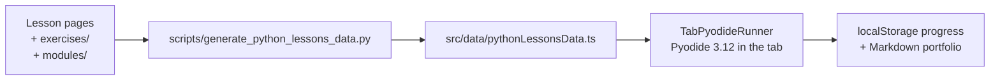

# app/ — the MechaLab workbench

The browser workbench every lesson links to: https://tle47.github.io/Mechatronics-Roadmap/. It runs
Python 3.12 in the tab (Pyodide), grades a program against the lesson's expected output and its
instructor tests, and keeps progress in `localStorage`, with a Markdown portfolio export.

Nothing here is a second copy of the curriculum. The lesson registry is generated from the Markdown
and the graded packages, so this directory is the *viewer*: if a number in the UI disagrees with a
lesson, regenerate the data rather than editing the data.



## The shell's design system

[`src/index.css`](src/index.css) is the one place colours, type, radii, motion and the component
primitives live: tokens (`--bg`, `--panel`, `--accent`, `--emerald`, …), a fluid type scale
(`--step-3` … `--step--1`), `.btn` / `.btn-primary` / `.chip` / `.kbd`, one visible focus ring for
every interactive element, and a `prefers-reduced-motion` branch that disables the hero animation and
the transitions.

Every tab now names the tokens, not a hex. `@theme inline` in [`src/index.css`](src/index.css)
registers `bg-canvas`, `bg-panel`, `bg-raise`, `border-line`, `text-ink`, `text-body`, `text-muted`,
`text-faint` and the accent set as Tailwind colours that resolve to the custom properties, so opacity
modifiers (`bg-emerald/20`) work too. A literal colour left in a tab is a bug that the light theme
shows immediately.

## Light and dark

`<html data-theme>` decides every colour. The inline script in [`index.html`](index.html) writes it
before first paint (stored pick, else `prefers-color-scheme`), so there is no flash;
[`src/theme.ts`](src/theme.ts) owns the rules and [`src/useTheme.ts`](src/useTheme.ts) mounts them in
the header toggle.

| Situation | What happens |
| :--- | :--- |
| First visit | The OS decides. Nothing is written to `localStorage`. |
| Toggle clicked | The visible theme flips and `mechalab_theme_v1` stores the side that was picked. |
| Reload, or the OS flips | The stored pick wins; only an unpicked visit keeps following the OS. |
| Corrupt or blocked storage | Falls back to the OS and keeps working — no throw, no broken shell. |

Plots are the exception by design: a canvas or SVG chart sits on `.plot` (`--plot: #070a12`) in both
themes, because the traces are drawn in literal plot colours tuned against that ink. Light mode is
warm paper around dark instrument faces, not a white plot with invisible curves.

[`docs/THEME.md`](../docs/THEME.md) is the token reference: every colour in both palettes side by
side, the utility family that reaches it, a "you are styling X, reach for Y" table, and the rules
above stated once. It is checked against `src/index.css` by `tests/test_theme_docs.py`, so it cannot
drift from the stylesheet.

The same table is in the app at `?view=theme`, linked from the footer
([`src/components/ThemeTokens.tsx`](src/components/ThemeTokens.tsx)). It reads `index.css` with
`?raw` and paints each value, so it needs no maintenance when a token is added; `npm run
test:theme:tokens` pins the parse and `npm run test:theme:e2e` checks the painted swatches in a
browser. The page is a route, not a tab: the learner's rail is unchanged.

Legibility is measured, not eyeballed: `npm run test:theme` pins the storage/OS rules, and
`npm run test:theme:e2e` drives Chromium through all eleven tabs in both themes, compositing each
text run over the backgrounds it actually sits on and failing anything below 3:1 (the current floor
is 4.5:1). The unit suite runs inside `npm run test:workbench`; the browser sweep is its own CI step,
because as a seventh parallel suite it pushed the older ones past their click timeouts. `--warnings` lists runs between 3:1 and their size minimum; `--screenshots` writes one
PNG per tab per theme to `.fb-scratch/theme/`.

Landing hero: [`src/components/StartHereCard.tsx`](src/components/StartHereCard.tsx) renders the
README's own Start-here block (the words come from `src/data/startHere.json`, so the page and the
README cannot drift apart) beside [`HeroArm.tsx`](src/components/HeroArm.tsx) - a live canvas running
the capstone's figure-8 through two-link inverse kinematics. The canvas pauses off-screen, draws one
still frame under `prefers-reduced-motion`, and never exceeds 2x device pixels.

## Python you can stop, and ⌘K over everything

Python runs in a **dedicated Web Worker** ([`src/runtime/pythonWorker.js`](src/runtime/pythonWorker.js)),
mounted from a real module URL (`new Worker(new URL(...), { type: 'module' })`) rather than a blob, so the
service worker controls it and can cache the runtime. It never runs on the UI thread: the editor keeps
typing, the tabs keep switching, and a runaway loop cannot freeze the page.

| Problem | What the runner does |
| :--- | :--- |
| `while True:` | **Stop** writes to a `SharedArrayBuffer` interrupt word that Pyodide watches; the interpreter raises `KeyboardInterrupt` **in place**, so imports, variables and the 10 MB runtime all survive. Without `SharedArrayBuffer` it falls back to terminating the worker, which still stops the run. |
| `input()` | The worker posts the prompt, then `Atomics.wait`s on a second shared word while the page shows the input box. The UI stays live because it is a different thread. Stop wakes the wait. |
| The download | The runtime is warmed on idle, so the first Run is a warm run; the status line reports the measured boot (`ready in 1.4 s`), not a spinner. |
| GitHub Pages (no headers) | [`public/sw.js`](public/sw.js) adds the COOP/COEP pair a static host cannot send; it reloads once and then `SharedArrayBuffer` exists. `npm run dev` and `preview` send the same pair directly (`scripts/isolation-headers.mjs`), so the dev server never puts a worker between HMR and the page. |

Interruption needs cross-origin isolation for **one** reason: it is what makes `SharedArrayBuffer`
available. If the service worker is blocked, the runner still stops programs — it just pays for it by
restarting the runtime.

### Offline

The same worker caches the app, so a second visit starts without the network. On install it precaches
the shell, `index.html`, the manifest and the favicon; every same-origin asset it serves after that is
cache-first with a background refresh, which is why a repeat visit is instant and a deploy still lands
on the next load. Navigations are network-first with the cached document as the fallback, so an offline
reload — or a deep link like `?lesson=P.4` the cache never saw — still opens the workbench, isolated,
with the lesson list rendered.

`npm run test:offline` is the suite that proves it the way Pages serves it: the built bundle is served
**without** the header pair, the worker takes control, and then the context goes offline. It asserts the
isolated document, the cached shell/manifest/bundle, the take-offline button, an offline reload that
paints the workbench, a whole lesson run to a verdict with the network off, and an offline deep link
into a lesson.

**The interpreter is cached too.** Pyodide is loaded by that module worker with a dynamic `import()` of
its ESM build, and its `pyodide.mjs`, wasm binary, stdlib zip and any wheel it loads are cached under
`mechalab-pyodide-v1` - which is the difference between "offline reading" and "a lesson on a plane".

**Take this step offline.** A button in the runtime strip makes that deliberate rather than accidental:
[`src/offlineTakeAlong.ts`](src/offlineTakeAlong.ts) sends the worker the URLs this document is actually
running (its own `<script>` and `<link>` tags, never a build manifest that goes stale), the worker caches
them with `cache: 'reload'`, the runtime is loaded if it is not up yet, and the app then measures every
`mechalab-*` cache and prints the result on the button - `Offline ready · 8.0 MB · 16 files`. The number
is the transfer size the CDN and host served, not the decoded size on disk. A host that sends its own
isolation headers (the dev server, a preview) has no service worker in front of it, and the button says
so instead of claiming a cache it cannot build. `npm run test:takealong` pins the URL list, the size
wording, and the rule that only the interpreter's own files let the button call itself ready.

### Backup

Six stores hold the work, so getting it out is one file, not six: **Back Up (.zip)** in the header
writes a small archive — `manifest.json`, `progress.json`, `drafts.json`, `history.json`, `study.json`,
`learning-log.json`, `README.txt` — with the counts and date in the manifest, and a README that still
explains the file if it is opened years later. [`src/backupZip.ts`](src/backupZip.ts) is a stored-method
zip writer and reader (CRC-32, central directory, end record) rather than a dependency: the payload is
JSON and code text, and a stored archive needs no decompressor.

**Restore (.zip)** merges, and never deletes. Flags union, drafts and notes only fill lessons this
browser has nothing for, highlights union by the passage they quote (the newer comment wins), versions
union by the timestamp they were filed at, and log events dedupe by identity the same way cloud sync
does. The toast reports what actually changed (`Restored · 4 lessons verified · 2
drafts · 11 log events`), or says the file has nothing new; a refusal says which refusal it was — not a
backup, a download that stopped short, or a zip that was re-compressed after it was unzipped, which is
common enough (macOS Archive Utility) to deserve its own sentence.

A restore writes the stores, not React's copy of them, so the controls dispatch
`mechalab:store-restored` and `App` re-reads the maps: the tick comes back without a reload, which keeps
the learner's tab and unsaved editor text. `npm run test:backup` pins the format (CRC vector, a
byte-for-byte round trip, all three refusals) and the merge rules (a local flag survives a backup that
lacks it, a local draft beats the file's, a newer version is not pushed out by an older one, the caps
still hold); `npm run test:e2e:backup` does it in Chromium — write the zip, wipe, restore, and see the
tick and the draft come back.

Why this as well as IndexedDB: the caps bound everything the seven stores can hold at ~2.0 M
characters (12 drafts × 40 k, 120 k of versions, 25 lessons of notes and highlights, 500 review cards,
5,000 log events) and `test:backup` computes that number from the exported caps instead of trusting
this paragraph. Before the move that was 80% of a 5 MB bucket; now it is the size of the archive and
the cost of one `put`, which is a budget a cap can defend rather than an emergency. A backup is still
the part that matters when a browser is cleared, which no amount of storage room changes.

### Where the work is stored

The six stores above are too big for `localStorage` and live in **IndexedDB**
([`src/bulkStorage.ts`](src/bulkStorage.ts), [`src/idbBackend.ts`](src/idbBackend.ts)): one database
(`mechalab`), one object store (`kv`), the same key names the bucket used.

No store module changed its signature to get there. They all read through a `Storage` helper, so this is
a `Storage` — one with a write-behind cache underneath. `hydrateBulkStorage()` runs in `main.tsx` before
the first render: it opens the database, copies every entry into memory, and migrates anything a
previous build left in the bucket. After that reads are synchronous from that copy (so `readDrafts()`
and the rest keep working, and React can keep reading in `useState` initializers) and writes land in
IndexedDB on the next tick, coalesced per key. `pagehide` flushes the queue, so the last edit does not
need that tick.

The migration is the rule that cannot lose work: **copy everything first, delete only after the backend
has it**, and the bucket's copy wins over the database's when both have a key, because the bucket copy is
the one the previous build wrote. A browser that refuses a database — private mode, blocked third-party
storage, a second tab holding an older version open — settles on the bucket and behaves exactly as it
did before; a page that never hydrated gets `null` ("not ready") rather than an empty store. The small
first-paint keys stay in `localStorage` on purpose: theme, focus, the last lesson, the view mode, the
progress flags and the dismissed cards are read before React mounts, and a theme that arrives one frame
late is a flash the learner sees.

`npm run test:storage` pins the fallback, the migration order, the coalescing queue and the retry after
a refused write against a fake backend; `npm run test:e2e:storage` starts as a learner from the previous
build — a bucket full of all six stores — reloads, and checks the values arrive in the database, the
bucket is empty, the editor/note box/deck show the carried work, and a note typed now lands in
IndexedDB and comes back after a reload.

### Keys

| Key | Does |
| :--- | :--- |
| `⌘K` / `Ctrl+K` | The command palette: every lesson, exercise, tab and command in one searchable list. `↑`/`↓` move, `↵` opens, `esc` closes. It works while the editor has focus, which is when it is needed. |
| `⌘↵` / `Ctrl+↵` | Run the open lesson. |

[`src/palette.ts`](src/palette.ts) is the whole search (prefix > word-start > substring >
subsequence, stable order inside a score band) and [`src/paletteCatalog.ts`](src/paletteCatalog.ts)
builds the list from the lesson registry plus the rail's metadata, so a new lesson or a renamed tab
appears without editing the palette.

### Study notes

Every lesson has one place for what the learner writes down: a note box under the editor, saved as they
type (on a pause, and again when they leave the lesson), plus **Pin selected text** — select a passage
or a line of code, press it, and the passage is kept with the lesson and an optional comment. It is
the part of a course that cannot be regenerated by pressing Run, and it used to live on paper beside
the laptop.

[`src/studyNotes.ts`](src/studyNotes.ts) is one `localStorage` store with two shapes: a note per lesson
(trimmed, capped at 4,000 characters, cleared by emptying the box — so "no note" is one state, not
two) and highlights that are identified by their quoted text, so pinning the same passage twice
updates what was said about it instead of growing a duplicate list. A selection is collapsed to one
line before it is stored, comments are capped at a margin note's length, and the store is bounded like
every other one (20 highlights per lesson, 25 lessons, least-recently-written evicted). Notes ride in
the backup and merge back the same way drafts do: the note on this machine is the newer draft and wins,
and highlights union by quote with the newer comment kept.

Two failures worth naming, because both are invisible until they happen: a note typed and then followed
by a lesson switch within the debounce window is written by the lesson-change flush (the write belongs
to the id it was typed under), and React's development double-mount must not treat its own empty mount
as an edit — the panel writes only after a real keystroke, which is what kept a saved note from being
cleared on reload. `npm run test:study` pins the rules; `npm run test:e2e` types a note, pins a line,
reloads, and finds both still there.

### Review cards

A highlight with a comment is a question with its answer: the quote asks *why did you keep this?*, the
comment says. The Study panel asks it back on a schedule — **Review (N due)** draws on the whole
course's deck, shows the quote, and only after **Show answer** offers the four answers FSRS schedules
on (Again, Hard, Good, Easy). A highlight without a comment is a passage marked, not a question set, so
it never becomes a card: that one rule is what keeps the deck from filling with prompts nobody can
answer.

[`src/fsrs.ts`](src/fsrs.ts) is **FSRS-5**, the published algorithm, with its sources in the file: the
default weights `w0`–`w18`, the initial stability and difficulty formulas, the mean-reverting difficulty
update, the forgetting curve (`DECAY = -0.5`, `FACTOR = 19/81`), stability after recall and after a
lapse, the same-day branch, and the interval for a 90% desired retention. The constants are what make
`R(S, S) = 0.9` an identity rather than a setting, and the test suite asserts exactly that. Two
departures are deliberate and stated where they happen: the weights are the published defaults (there
is no review history yet to fit them to) and the longest interval is a year, not the library's century
— a course lasts a term.

[`src/studyCards.ts`](src/studyCards.ts) keeps the join honest by keeping it derived: a card's
existence comes from the notes store on every read, and only its schedule is stored. Deleting the
highlight deletes the card, re-pinning the same passage keeps its progress (the id is the lesson plus
the quote), and clearing the comment retires it and prunes the schedule on the next sync. Clearing a
comment needed a new door in the notes store — `setComment` — because `addHighlight` refuses a blank
overwrite on purpose; that rule is right for pinning and wrong for a learner who has decided a passage
is not a question after all.

The deck rides in the backup as `study-cards.json`, and a restore keeps the schedule that has been
answered more (`reps`, tie broken by the later review), so an older file can never un-learn a card; a
backup taken before cards existed simply has no such file. `npm run test:review` pins the arithmetic
and the join without a browser; `npm run test:e2e:review` does it through the panel — a real selection,
the real pin button, the real comment box, a rating, a reload, and the deck still knowing when the card
is next due.

### Focus mode and the sitting clock

A review is ruined by a screen full of other things to do, so **Focus** (the header's button, or `⌘.`)
hides the header, the mode bar, the tab rail, the lesson list and the footer, and leaves the editor, the
checks and the study card. `Escape` and the pill in the corner both leave it, and the choice is
remembered across a reload — a focus mode with no visible exit is a trap, which is why the pill is the
one control the mode does not hide.

It is one rule, not a prop threaded through five components: `App` puts `data-focus` on the shell and
every region that offers a different task carries `data-chrome`, so `[data-focus='on'] [data-chrome]`
hides them and the pane that shared a row with the lesson list takes the whole row. [`src/focusMode.ts`](src/focusMode.ts)
is the store and the event; the state itself lives in `App` so the button, the attribute and the pill
cannot disagree.

The clock is the other half, because the pilot's `active_minutes` column had no measurement behind it.
[`src/sittingClock.ts`](src/sittingClock.ts) records **sittings**: any lesson open, run or review extends
the one in progress, five minutes without one closes it, and a sitting is capped at three hours so a tab
left open overnight is not study time. The study panel prints `Today 34 min · median sitting 18 min`,
and the learning-log export carries the raw sittings beside the events, so a pilot can compute the median
and range `docs/PILOT.md` asks for instead of estimating them. A sitting is deliberately **not** in the
backup: it is a fact about one machine's clock, and merging two machines' sittings would count the same
hour twice.

### The portfolio export

**Export Progress (.md)** writes one Markdown file a learner can put in a repository, a CV or a course
submission, and it now carries the work rather than only the ticks: the three progress sections, then
**Study Notes and Kept Passages** (each lesson's note as a blockquote, its passages with their
comments), **Review Deck (FSRS-5)** (cards, how many are due, when the next comes back, the first
twenty), and **Measured Study Time** (total, median and longest, plus a table of the most recent
sittings). [`src/portfolio.ts`](src/portfolio.ts) is the builder, pure and given `now`, so
`npm run test:portfolio` reads the document as text.

Three rules it keeps, each because the opposite is what a pretty screenshot hides: a section appears
only when it has content (three empty headings read as "did nothing"), every free-text block is a
blockquote (a note that starts with `#` cannot become a heading and swallow the section after it), and
the time section says it was measured on this device, because a pilot reading the file has to know what
the number is. The document is built on the render that opens the modal — never a frame of empty
preview — and the download and the preview are the same string.

### The editor

The textarea is gone: [`PythonEditor.tsx`](src/components/PythonEditor.tsx) mounts **CodeMirror 6**
(Python highlighting, line numbers, undo history, bracket matching and closing, in-document search,
`Tab`/`Shift-Tab` indent, and completion from **Jedi** with the keyword list as its fallback). The
colours come from the app's tokens ([`editor/theme.ts`](src/editor/theme.ts)), so light mode is not a
second editor theme.

**The editor knows Python, because the interpreter is already there.** `math.` offers `acos` with its
signature (`acos(x: SupportsFloat, /) -> float`) and the docstring beside it; hovering a name opens a
card with its definition (`def acos`), its call and the docstring's first paragraph; typing
`math.acos(` shows that call with the argument being typed marked; and the Checker strip under the
editor names an unused import on the line it is on. All of it comes from the same worker that runs
the lesson: Jedi for completions, hover and signatures, pyflakes for the lint
([`src/analysisClient.ts`](src/analysisClient.ts), [`src/editor/completions.ts`](src/editor/completions.ts),
[`src/editor/analysisTips.ts`](src/editor/analysisTips.ts), `npm run test:analysis` for the mapping
rules and `npm run test:runtime` in a browser). Ruff is a Rust binary and cannot run in Pyodide at
all, so pyflakes is the browser's honest linter and the editor never claims otherwise; nothing here
reformats code.

**Hover asks about the whole dotted name, and a signature only exists inside a call.** `math.acos` is
one token, so a card opened over `acos` still describes `math.acos`; `callContext` walks back to the
unmatched `(` behind the cursor, ignoring brackets in strings and comments, and counts top-level
commas so the right argument is the one underlined — including in a nested call, where the inner
signature is the one that matters. Both cards are drawn with `textContent`, never as HTML: a
docstring is third-party text. While a run is in flight the worker is busy, so nothing is asked and
no card opens rather than queueing a request behind the learner's own program.

The analyzers **install on first use** (~1.5 MB, one online request), not at boot, so a learner who
never edits pays nothing for them and the first Run still waits for the interpreter only. If the
install cannot happen — a first offline visit — the completion source answers from the keywords it
always had and the strip says the checker could not load, rather than showing an empty list as if
nothing were wrong. Only the learner's own text is checked: a lesson's starter is the scaffold the
lesson ships, and notes about it would read as the app complaining about its own exercise. A request
that is never answered times out and is dropped, and an analysis answer can never be mistaken for a
run's verdict — the two share one worker, and the message ids keep them apart.

The document is still owned by React: every edit is reported through `onChange`, an external change
(a different lesson, Load Solution, Reset) replaces the document, and the run button reads the same
state the screen shows. The component also exposes a two-method bridge
(`window.__mechalabEditors['editor-main']`) so the browser suites type and read through the view
rather than through CodeMirror's internal markup ([`scripts/editor-code.mjs`](../scripts/editor-code.mjs)).

**A lesson is a small project.** `main.py` is the learner's tab. A lesson whose starter, solution,
hints or tests mention `mechalab_plant` gets a second, **read-only** tab holding that plant
([`src/lessonFiles.ts`](src/lessonFiles.ts); 29 of the 92 entries do). The worker writes the same
text into Pyodide's filesystem ([`TabPyodideRunner.tsx`](src/components/tabs/TabPyodideRunner.tsx)),
so `from mechalab_plant import simulate_arm` works exactly as it would locally - and the learner can
read what the import is doing without being able to break it.

**Sliders are a comment on a number.**

```python
Kp = 4.0   # @slider 0 20 0.1
```

puts a control under that line ([`src/editor/sliderModel.ts`](src/editor/sliderModel.ts) parses it,
[`sliderWidget.ts`](src/editor/sliderWidget.ts) draws it). Dragging **rewrites the literal in the
file** - no hidden parameter channel - and re-runs once the drag settles (450 ms). The file stays
ordinary Python: open it in VS Code and it runs the same. A directive with a missing or inverted
range is ignored rather than guessed at, and the range input is reused while only its value moves,
so the drag is not aborted by its own re-render.

**Every run files the code it started from.** A draft holds one text - the latest - so running a
version that worked, breaking it and running again used to leave the learner with the broken one and
nothing to go back to. **History** in the lesson header lists the last five attempts for that lesson,
each with the verdict it got (`passed`, `output mismatch`, `checks failed`, `stopped`, …) and how long
ago it ran, and **Restore** puts that text back in the editor ungraded. Snapshots are taken on Run,
not on typing: the same text run twice is one version carrying the newer verdict, the untouched
starter is never filed (Reset Starter already restores it), and the store evicts the oldest attempt
anywhere once it passes its budget - [src/draftHistory.ts](src/draftHistory.ts), pinned by
`npm run test:history`.

**A failure, read.** A red line is where the work starts, and a traceback is written for a terminal: the
learner's own frame sits among the lesson's harness frames, and the failure that *is* one of the
twelve things [docs/ERROR_EXPLAINER.md](../docs/ERROR_EXPLAINER.md) documents is named only on a page
in another tab. So a runtime error now gets a card under the output: Python's exception line,
the line in the learner's own file (`Show line 7` puts the cursor there and scrolls to it), and the
matching explainer entry with its own "check first" list ([`src/traceback.ts`](src/traceback.ts),
[`src/errorIndex.ts`](src/errorIndex.ts), [`src/components/TracebackCard.tsx`](src/components/TracebackCard.tsx)).

The parser reads CPython's text rather than a structured payload, because a learner can print a
traceback of their own and the panel is handed whatever was printed: it takes the last block of a
chained failure (the one that stopped the program), the deepest frame that is not the lesson's appended
`_selfcheck`, and both SyntaxError shapes. The index is generated from the page by
`scripts/generate_error_index.py` — an edit to an entry without regenerating fails `check:errorindex` —
and the match comes from the entry's heading: a class and its quoted message, or a class alone. A
failure the page does not cover says so and leaves Python's words as the diagnosis; a failure raised
inside the lesson's own check says the line is the check's, not the learner's.

**The Scope: your loop, drawn.** A lesson that prints forty lines of `theta = ...` is asking the reader
to plot it in their head. Inside a run, Python can hand its samples to a panel instead:

```python
import math
from mechalab import scope

ts = [i / 100 for i in range(400)]
ys = [1 - math.exp(-t) for t in ts]
scope.stream("step response", ts, ys)
```

`scope.stream(name, t, y)` (and its synonym `scope.plot`) takes lists, ranges or numpy arrays and
records a trace for **this run**. The worker buffers the points and posts them in batches of 500 plus
one final batch before the verdict, so the curve grows while the loop runs and is complete when it
stops; a runaway recording is capped at 20 000 points per series and says so
([`src/scopeModel.ts`](src/scopeModel.ts) holds the rules, `npm run test:scope` pins them). The panel
shares one pair of axes across traces, marks zero when the data crosses it, prints each trace's last
value beside its name, and **Show as table** turns the same run into twelve sampled rows - a canvas is
invisible to a screen reader ([`src/components/ScopePanel.tsx`](src/components/ScopePanel.tsx)).

**Reading it.** Pointing at the plot draws a cursor and names every trace's value at that one `t`
(interpolated between samples, `—` where a trace has no sample there); the arrow keys move the same
cursor, so the readout is not mouse-only. Wheel, **Zoom +/−** and `+`/`-`/`0` change the time axis
about the pointer or the middle of the view, dragging pans it, and both are clamped to the data and
to a 1/1000-of-the-trace floor, so the axis can never end up showing empty space. The y axis follows
the visible window rather than the whole trace.

**Comparing two runs.** **Pin as A** keeps this run's traces on the axes while the next run draws
over them as B (dashed, lighter), so a change to `Kp` or `ki` is read on one pair of axes; the cursor
then reads both values at the same `t`, and the legend names both. Pinning survives a run and is
cleared by changing lesson or by **Clear A**.

Nothing is stored beyond the pinned traces in memory: a trace belongs to the run that produced it,
and pressing Run on something that traces nothing clears the current curve rather than leaving a stale
one on screen.

The seven control and mechanics lessons (02.1-02.5, 05.1, 05.2) ship their own annotations: link
lengths on the FK/IK demos, mass and gear ratio on the inertia lesson, tooth counts on the belt
drive, `Kp`/`Ki`/`Kd` on the PID lesson and the gyro bias/`alpha` pair on the complementary filter -
14 sliders across 7 starters, every default exactly the literal it replaced. The reference solutions
stay the plain version, so **Load Solution** shows the canonical code while the starter is the
workspace where the numbers move. `npm run test:editor` fails if one of those starters loses its
sliders or gains a slider the demo never reads.

## Stack

Vite 6 · React 19 · TypeScript 5.7 · Tailwind 4 · KaTeX · Lucide. Tests drive the built bundle with
`playwright-core`.

## Run it

```bash
npm install                 # from the repository root, not app/
npm run dev                 # http://localhost:3000, regenerates the lesson registry first
npm run build               # tsc -b && vite build -> ../dist (Pages base path)
npm run lint                # tsc -b only
```

`npm run dev` and `npm run build` both run `predev`/`prebuild`, which regenerate
[`src/data/pythonLessonsData.ts`](src/data/pythonLessonsData.ts) from `exercises/` and the lesson
pages. A stale registry is a build failure, not a silent mismatch.

## Where things live

| Path | What it is |
| :--- | :--- |
| [`src/App.tsx`](src/App.tsx) | The workbench shell: tab list, beginner/advanced view, progress wiring. |
| [`src/components/tabs/`](src/components/tabs) | One file per tab. [`TabPyodideRunner.tsx`](src/components/tabs/TabPyodideRunner.tsx) is the graded runner — editor, expected output, badges, instructor panel. |
| [`src/data/`](src/data) | **Generated.** Lesson registry, spine, start-here card, plant model, link history. Edit the generator, not these files. |
| [`src/outputMatch.ts`](src/outputMatch.ts) | How stdout is compared (exact vs formatting-tolerant), shared by the runner and its tests. |
| [`src/analysisClient.ts`](src/analysisClient.ts) | Completions and lint over the worker: request ids, timeouts, Jedi's vocabulary mapped to the completion list, pyflakes messages made drawable. |
| [`src/editor/completions.ts`](src/editor/completions.ts) | The completion source: Jedi when the interpreter is up, keywords when it is not, and the inserted span after the dot. |
| [`src/progressMerge.ts`](src/progressMerge.ts) | Merging saved progress between browsers and accounts. |
| [`src/lessonCoach.ts`](src/lessonCoach.ts) | The progressive hints and the stuck-state prompts. |
| [`src/checkHints.ts`](src/checkHints.ts) | The join between a failed check and the hint rung that answers it, plus the rule that earns rung 2. |
| [`src/runtime/pythonWorker.js`](src/runtime/pythonWorker.js) | The interpreter worker: warm-up, run, in-place Stop, `input()`, `mechalab.scope`, `result` and `scope` messages. |
| [`src/components/PythonEditor.tsx`](src/components/PythonEditor.tsx) | The CodeMirror editor: view, external sync, test bridge. |
| [`src/editor/`](src/editor) | Editor-only logic: the token theme, the slider model and its widget. |
| [`src/lessonFiles.ts`](src/lessonFiles.ts) | The read-only helper files a lesson brings (the shared plant). |
| [`src/draftHistory.ts`](src/draftHistory.ts) | The versions behind the draft: what each run started from, with its verdict, bounded per lesson and in total, plus the merge a restore uses. |
| [`src/backupZip.ts`](src/backupZip.ts) | The zip writer and reader a backup is made of: stored entries, CRC-32, and the four ways a chosen file can fail. |
| [`src/backupBundle.ts`](src/backupBundle.ts) | What a backup holds and how a restore merges it: flags union, drafts fill gaps, versions and events dedupe. |
| [`src/progressKeys.ts`](src/progressKeys.ts) | Where the three progress maps live, so the backup can read them without importing React. |
| [`src/scopeModel.ts`](src/scopeModel.ts) | What a Scope payload must be to be drawn: NaN dropped, lengths aligned, flat traces widened, tables sampled. |
| [`src/components/ScopePanel.tsx`](src/components/ScopePanel.tsx) | The Scope: canvas, shared axes, legend with last values, and the same data as a table. |
| [`src/learningLog.ts`](src/learningLog.ts) | The event log behind the friction report and the roadmap's "opened / tried" states. |
| [`src/fsrs.ts`](src/fsrs.ts) | FSRS-5: the published weights and formulas, pure — a schedule in, a schedule out, `now` injected. |
| [`src/studyCards.ts`](src/studyCards.ts) | The deck: cards derived from commented highlights, their schedules stored, and the merge a restore uses. |
| [`src/sittingClock.ts`](src/sittingClock.ts) | The measured sitting: idle cutoff, three-hour cap, bounded store, and the totals the pilot quotes. |
| [`src/focusMode.ts`](src/focusMode.ts) | Focus mode's stored choice and the event the header, the pill and the page share. |
| [`src/portfolio.ts`](src/portfolio.ts) | The exported Markdown: progress, notes and passages, the deck, and the measured sittings. |
| [`src/traceback.ts`](src/traceback.ts) | CPython's failure text as data: frames, the learner's own frame, chains, and both SyntaxError shapes. |
| [`src/errorIndex.ts`](src/errorIndex.ts) | The explainer's entries matched to a parsed failure, and the honest "not in the index" case. |
| [`src/components/TracebackCard.tsx`](src/components/TracebackCard.tsx) | The failure card: exception, line, `Show line N`, and the entry's check-first list. |
| [`src/bulkStorage.ts`](src/bulkStorage.ts) | The six large stores behind a `Storage`-shaped write-behind cache over IndexedDB, and the migration out of the bucket. |
| [`src/idbBackend.ts`](src/idbBackend.ts) | The raw IndexedDB backend: one object store, three operations, and `null` on every way a database can be refused. |

## Checks that cover this directory

```bash
npm run lint                 # types
npm run test:workbench       # runner behaviour (happy-dom) + palette search + editor model
npm run test:runtime         # the worker: in-place Stop, input(), isolation, Pages fallback
npm run test:editor          # slider directives (parse/clamp/format) and helper-tab detection
npm run test:history         # run history: filed on Run, deduped, capped per lesson and in total
npm run test:scope          # Scope rules: payloads, cursor sampling, zoom/pan windows, bounds, tables
npm run test:analysis       # completions, hover and signatures: insertion point, cursor coordinates, the call under the cursor, note shape, transport rules
npm run test:checkhints      # the failed check -> rung join, and the rule that earns rung 2
npm run test:e2e             # dev server, one lesson end to end
npm run test:e2e:pages       # built bundle at the Pages base path: every graded entry, ramp R.1-R.6, tablet width
npm run test:offline         # the service worker: isolation without host headers, the take-offline button, offline reload, run + deep link
npm run test:takealong       # the offline button's rules: URL list, size wording, what "ready" may claim
npm run test:backup          # the archive: CRC, round trip, the three refusals, and a merge that never deletes
npm run test:study           # notes and highlights: what is kept, deduped, evicted, and what a restore merges
npm run test:review          # FSRS: 0.9-at-stability, grade order, lapses, the year cap, and the card join
npm run test:sitting         # the sitting clock's rules and focus mode's store, without a browser
npm run test:portfolio       # the export: sections only when they have content, quoting, caps, the time table
npm run test:storage         # IndexedDB: the bucket fallback, the migration order, the write queue, a refused write
npm run test:traceback       # tracebacks as data: frames, chains, syntax shapes, and the index match
npm run test:e2e:backup      # the header buttons in Chromium: write a zip, wipe, restore to store and screen
npm run test:e2e:review      # pin, comment, rate, reload in Chromium: the card stays scheduled
npm run test:e2e:focus       # focus in Chromium: the chrome hides, the work stays, three exits, one measured sitting
npm run test:e2e:storage     # a pre-IndexedDB bucket in Chromium: migrated whole, shown on screen, written to
npm run check:lessons        # the registry is current
```

`test:e2e:pages` is the suite that proves what a learner actually opens; it fails if the bundle was
built for `/` instead of `/Mechatronics-Roadmap/`, if an entry the registry ships is missing from the
lesson list, or if any starter verifies.

## Deploying

`.github/workflows/ci.yml` builds `dist/` and the Pages workflow publishes it. The base path comes
from `PAGES_BASE` in [`../vite.config.ts`](../vite.config.ts); override it (`PAGES_BASE=/ npm run
build`) only for a host serving from a domain root, and expect `test:e2e:pages` to fail until the
served base matches.
