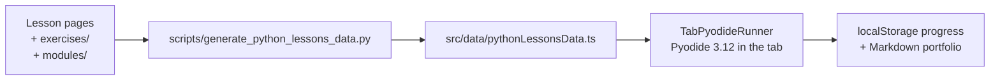

# app/ — the MechaLab workbench

The browser workbench every lesson links to: https://tle47.github.io/Mechatronics-Roadmap/. It runs
Python 3.12 in the tab (Pyodide), grades a program against the lesson's expected output and its
instructor tests, and keeps progress in `localStorage`, with a Markdown portfolio export.

Nothing here is a second copy of the curriculum. The lesson registry is generated from the Markdown
and the graded packages, so this directory is the *viewer*: if a number in the UI disagrees with a
lesson, regenerate the data rather than editing the data.



## The shell's design system

[`src/index.css`](src/index.css) is the one place colours, type, radii, motion and the component
primitives live: tokens (`--bg`, `--panel`, `--accent`, `--emerald`, …), a fluid type scale
(`--step-3` … `--step--1`), `.btn` / `.btn-primary` / `.chip` / `.kbd`, one visible focus ring for
every interactive element, and a `prefers-reduced-motion` branch that disables the hero animation and
the transitions.

Every tab now names the tokens, not a hex. `@theme inline` in [`src/index.css`](src/index.css)
registers `bg-canvas`, `bg-panel`, `bg-raise`, `border-line`, `text-ink`, `text-body`, `text-muted`,
`text-faint` and the accent set as Tailwind colours that resolve to the custom properties, so opacity
modifiers (`bg-emerald/20`) work too. A literal colour left in a tab is a bug that the light theme
shows immediately.

## Dark, light, paper and high contrast

`<html data-theme>` decides every colour. The inline script in [`index.html`](index.html) writes it
before first paint (stored pick, else `prefers-contrast`, else `prefers-color-scheme`), so there is no
flash; [`src/theme.ts`](src/theme.ts) owns the rules and [`src/useTheme.ts`](src/useTheme.ts) mounts
them in the header's three controls.

| Situation | What happens |
| :--- | :--- |
| First visit | The OS decides — a `prefers-contrast: more` request takes high contrast ahead of the colour scheme. Nothing is written to `localStorage`. |
| Sun/moon pressed | Dark ↔ light, and `mechalab_theme_v1` stores the side that landed. The label names the palette the press gives you; from high contrast it returns to the OS palette. |
| Contrast pressed | High contrast on or off — a real on/off, so `aria-pressed` states what is drawn. Off returns to the OS palette. |
| Paper pressed | Paper on or off, the same way. It is never an OS default: a first visit that opened on cream would look like a mistake on a work laptop. |
| Reload, or the OS flips | The stored pick wins; only an unpicked visit keeps following the OS. |
| Corrupt or blocked storage | Falls back to the OS and keeps working — no throw, no broken shell. |

Plots are the exception by design: a canvas or SVG chart sits on `.plot` (`--plot: #070a12`) in every
palette, because the traces are drawn in literal plot colours tuned against that ink. Light mode is
warm paper around dark instrument faces, not a white plot with invisible curves; high contrast keeps
the same face and spends its contrast budget on the text and the lines around it. The paper palette is
that idea taken further: a cream sheet with brown-black ink, for long lesson pages.

[`docs/THEME.md`](../docs/THEME.md) is the token reference: every colour in all four palettes side by
side, the utility family that reaches it, a "you are styling X, reach for Y" table, and the rules
above stated once. It is checked against `src/index.css` by `tests/test_theme_docs.py`, so it cannot
drift from the stylesheet.

The same table is in the app at `?view=theme`, linked from the footer
([`src/components/ThemeTokens.tsx`](src/components/ThemeTokens.tsx)). It reads `index.css` with
`?raw` and paints each value, so it needs no maintenance when a token is added; `npm run
test:theme:tokens` pins the parse and `npm run test:theme:e2e` checks the painted swatches in a
browser. The page is a route, not a tab: the learner's rail is unchanged.

Legibility is measured, not eyeballed: `npm run test:theme` pins the storage/OS rules and keeps the
three controls honest, and `npm run test:theme:e2e` drives Chromium through all twelve tabs in all four
palettes, compositing each text run over the backgrounds it actually sits on and failing anything
below 3:1 (the current floor is 4.52:1, and 7:1 in high contrast). The unit suite runs inside
`npm run test:workbench`; the browser sweep is its own CI step,
because as a seventh parallel suite it pushed the older ones past their click timeouts. `--warnings` lists runs between 3:1 and their size minimum; `--screenshots` writes one
PNG per tab per theme to `.fb-scratch/theme/`.

Landing hero: [`src/components/StartHereCard.tsx`](src/components/StartHereCard.tsx) renders the
README's own Start-here block (the words come from `src/data/startHere.json`, so the page and the
README cannot drift apart) beside [`HeroArm.tsx`](src/components/HeroArm.tsx) - a live canvas running
the capstone's figure-8 through two-link inverse kinematics. The canvas pauses off-screen, draws one
still frame under `prefers-reduced-motion`, and never exceeds 2x device pixels.

## Python you can stop, and ⌘K over everything

Python runs in a **dedicated Web Worker** ([`src/runtime/pythonWorker.js`](src/runtime/pythonWorker.js)),
mounted from a real module URL (`new Worker(new URL(...), { type: 'module' })`) rather than a blob, so the
service worker controls it and can cache the runtime. It never runs on the UI thread: the editor keeps
typing, the tabs keep switching, and a runaway loop cannot freeze the page.

| Problem | What the runner does |
| :--- | :--- |
| `while True:` | **Stop** writes to a `SharedArrayBuffer` interrupt word that Pyodide watches; the interpreter raises `KeyboardInterrupt` **in place**, so imports, variables and the 10 MB runtime all survive. Without `SharedArrayBuffer` it falls back to terminating the worker, which still stops the run. |
| `input()` | The worker posts the prompt, then `Atomics.wait`s on a second shared word while the page shows the input box. The UI stays live because it is a different thread. Stop wakes the wait. |
| The download | The runtime is warmed on idle, so the first Run is a warm run; the status line reports the measured boot (`ready in 1.4 s`), not a spinner. |
| GitHub Pages (no headers) | [`public/sw.js`](public/sw.js) adds the COOP/COEP pair a static host cannot send; it reloads once and then `SharedArrayBuffer` exists. `npm run dev` and `preview` send the same pair directly (`scripts/isolation-headers.mjs`), so the dev server never puts a worker between HMR and the page. |

Interruption needs cross-origin isolation for **one** reason: it is what makes `SharedArrayBuffer`
available. If the service worker is blocked, the runner still stops programs — it just pays for it by
restarting the runtime.

### Offline

The same worker caches the app, so a second visit starts without the network. On install it precaches
the shell, `index.html`, the manifest and the favicon; every same-origin asset it serves after that is
cache-first with a background refresh, which is why a repeat visit is instant and a deploy still lands
on the next load. Navigations are network-first with the cached document as the fallback, so an offline
reload — or a deep link like `?lesson=P.4` the cache never saw — still opens the workbench, isolated,
with the lesson list rendered.

`npm run test:offline` is the suite that proves it the way Pages serves it: the built bundle is served
**without** the header pair, the worker takes control, and then the context goes offline. It asserts the
isolated document, the cached shell/manifest/bundle, the take-offline button, an offline reload that
paints the workbench, a whole lesson run to a verdict with the network off, and an offline deep link
into a lesson.

**The interpreter is cached too.** Pyodide is loaded by that module worker with a dynamic `import()` of
its ESM build, and its `pyodide.mjs`, wasm binary, stdlib zip and any wheel it loads are cached under
`mechalab-pyodide-v1` - which is the difference between "offline reading" and "a lesson on a plane".

**Take this step offline.** A button in the runtime strip makes that deliberate rather than accidental:
[`src/offlineTakeAlong.ts`](src/offlineTakeAlong.ts) sends the worker the URLs this document is actually
running (its own `<script>` and `<link>` tags, never a build manifest that goes stale), the worker caches
them with `cache: 'reload'`, the runtime is loaded if it is not up yet, and the app then measures every
`mechalab-*` cache and prints the result on the button - `Offline ready · 8.0 MB · 16 files`. The number
is the transfer size the CDN and host served, not the decoded size on disk. A host that sends its own
isolation headers (the dev server, a preview) has no service worker in front of it, and the button says
so instead of claiming a cache it cannot build. `npm run test:takealong` pins the URL list, the size
wording, and the rule that only the interpreter's own files let the button call itself ready.

### Backup

Six stores hold the work, so getting it out is one file, not six: **Back Up (.zip)** in the header
writes a small archive — `manifest.json`, `progress.json`, `drafts.json`, `history.json`, `study.json`,
`learning-log.json`, `README.txt` — with the counts and date in the manifest, and a README that still
explains the file if it is opened years later. [`src/backupZip.ts`](src/backupZip.ts) is a stored-method
zip writer and reader (CRC-32, central directory, end record) rather than a dependency: the payload is
JSON and code text, and a stored archive needs no decompressor.

**Restore (.zip)** merges, and never deletes. Flags union, drafts and notes only fill lessons this
browser has nothing for, highlights union by the passage they quote (the newer comment wins), versions
union by the timestamp they were filed at, and log events dedupe by identity the same way cloud sync
does. The toast reports what actually changed (`Restored · 4 lessons verified · 2
drafts · 11 log events`), or says the file has nothing new; a refusal says which refusal it was — not a
backup, a download that stopped short, or a zip that was re-compressed after it was unzipped, which is
common enough (macOS Archive Utility) to deserve its own sentence.

A restore writes the stores, not React's copy of them, so the controls dispatch
`mechalab:store-restored` and `App` re-reads the maps: the tick comes back without a reload, which keeps
the learner's tab and unsaved editor text. `npm run test:backup` pins the format (CRC vector, a
byte-for-byte round trip, all three refusals) and the merge rules (a local flag survives a backup that
lacks it, a local draft beats the file's, a newer version is not pushed out by an older one, the caps
still hold); `npm run test:e2e:backup` does it in Chromium — write the zip, wipe, restore, and see the
tick and the draft come back.

Why this as well as IndexedDB: the caps bound everything the seven stores can hold at ~2.0 M
characters (12 drafts × 40 k, 120 k of versions, 25 lessons of notes and highlights, 500 review cards,
5,000 log events) and `test:backup` computes that number from the exported caps instead of trusting
this paragraph. Before the move that was 80% of a 5 MB bucket; now it is the size of the archive and
the cost of one `put`, which is a budget a cap can defend rather than an emergency. A backup is still
the part that matters when a browser is cleared, which no amount of storage room changes.

### Where the work is stored

The six stores above are too big for `localStorage` and live in **IndexedDB**
([`src/bulkStorage.ts`](src/bulkStorage.ts), [`src/idbBackend.ts`](src/idbBackend.ts)): one database
(`mechalab`), one object store (`kv`), the same key names the bucket used.

No store module changed its signature to get there. They all read through a `Storage` helper, so this is
a `Storage` — one with a write-behind cache underneath. `hydrateBulkStorage()` runs in `main.tsx` before
the first render: it opens the database, copies every entry into memory, and migrates anything a
previous build left in the bucket. After that reads are synchronous from that copy (so `readDrafts()`
and the rest keep working, and React can keep reading in `useState` initializers) and writes land in
IndexedDB on the next tick, coalesced per key. `pagehide` flushes the queue, so the last edit does not
need that tick.

The migration is the rule that cannot lose work: **copy everything first, delete only after the backend
has it**, and the bucket's copy wins over the database's when both have a key, because the bucket copy is
the one the previous build wrote. A browser that refuses a database — private mode, blocked third-party
storage, a second tab holding an older version open — settles on the bucket and behaves exactly as it
did before; a page that never hydrated gets `null` ("not ready") rather than an empty store. The small
first-paint keys stay in `localStorage` on purpose: theme, focus, the last lesson, the view mode, the
progress flags and the dismissed cards are read before React mounts, and a theme that arrives one frame
late is a flash the learner sees.

`npm run test:storage` pins the fallback, the migration order, the coalescing queue and the retry after
a refused write against a fake backend; `npm run test:e2e:storage` starts as a learner from the previous
build — a bucket full of all six stores — reloads, and checks the values arrive in the database, the
bucket is empty, the editor/note box/deck show the carried work, and a note typed now lands in
IndexedDB and comes back after a reload.

### Keys

| Key | Does |
| :--- | :--- |
| `⌘K` / `Ctrl+K` | The command palette: every lesson, exercise, tab and command in one searchable list. `↑`/`↓` move, `↵` opens, `esc` closes. It works while the editor has focus, which is when it is needed. |
| `⌘P` / `Ctrl+P` | The same palette over **lessons only** — quick-open for a learner who already knows what they are opening. The browser's Print gives way; the cheat sheet's own **Print** button still prints. |
| `⌘⇧F` / `Ctrl+⇧+F` | Search **inside** the course: the lessons' starter code, hint ladder, instructor's checks and expected output, and the 65 reading pages' prose. A starter hit opens the lesson with the caret on that line; a hint, check or output hit says which panel it is in; a course-page hit names its section and opens that page **on GitHub at the heading**, in a new tab, with the workbench still behind it. |
| `?` | The sheet of every key, from [`src/shortcuts.ts`](src/shortcuts.ts) — one table, so the list cannot go stale. It must be typed outside an editor or a field, where `?` is a character. `⌘K` finds it too, by typing `shortcuts`. |
| `⌘↵` / `Ctrl+↵` | Run the open lesson. |
| `Escape`, then `i` | With **Vim keys** on (the toolbar's `Vim keys` button), normal mode reads `dd`, `u`, `/` and the rest; the badge beside the line count names the mode that is reading them. Off by default, and remembered once turned on ([`src/vimMode.ts`](src/vimMode.ts)). |

**Six of those keys are yours to change.** A row's key in the sheet is a button: press it, press a
new chord, and that is the key — `⌘⇧J` for focus, say. A key another action already has is refused
with that action's name, one the browser keeps (⌘W, ⌘R, ⌘1) as the browser's, and a bare letter as
typing; the old chord is freed by the move, so nothing has to be unbound first. **Reset all keys**
puts the shipped six back, and the choice is remembered. A chord is stored **physically** —
`KeyboardEvent.code` plus its modifiers — so `⌥1` still opens Study on a Mac that types `¡` for it;
the sheet's own `?` is stored as the **character**, because `?` is Shift+Slash on a US keyboard, its
own key on a French one, and the character is the thing the learner pressed. What stays fixed is
said on the sheet: the four preset digits are a positional family, F9/F12 belong to the caret, and
Escape and Tab belong to dialogs ([`src/keymap.ts`](src/keymap.ts),
[`src/useKeymap.ts`](src/useKeymap.ts), `npm run test:keymap` for the rules, browser step 12b for the
press, the clash, the reload and the reset).

[`src/palette.ts`](src/palette.ts) is the whole search (prefix > word-start > substring >
subsequence, stable order inside a score band) and [`src/paletteCatalog.ts`](src/paletteCatalog.ts)
builds the list from the lesson registry plus the rail's metadata, so a new lesson or a renamed tab
appears without editing the palette.

**Three doors, one dialog.** `⌘K` lists everything, `⌘P` lists lessons, `⌘⇧F` searches the text the
course carries ([`src/lessonSearch.ts`](src/lessonSearch.ts), [`src/proseSearch.ts`](src/proseSearch.ts));
the dialog's own footer counts what it found, and each mode answers with its own placeholder, so a text
search does not look like a lesson list. A search hit is a **line**, not a lesson: a starter hit opens
the lesson *on that line* — the line travels as part of the mount (`initialLine`), so it survives the
editor being replaced, which is what happens when the pick is for another lesson. The full solution is
**not** indexed: the diff panel refuses to show it until it is earned, and a search box that echoed
solution lines would be the same answer through a different door.

**The reading pages are the other half.** The 65 pages a learner reads — 48 prose lessons and the 17 arm
modules — are Markdown in this repository, and Pages serves only the built app, so their words are not
in the bundle at all. `scripts/generate_prose_index.py` copies what is searchable (headings, prose,
lists and safety notes; not code fences, tables, or the callouts and ladder-gate exam scripts write
into every page) into [`app/public/prose-index.json`](public/prose-index.json), and the app fetches that
file **the first time `⌘⇧F` is opened** — 207 kB gzipped, never on a normal visit, cached by the service
worker after the first search. A heading hit outranks a body hit, two sections per page and fifteen rows
overall; the row names its section and opens the page on GitHub at that heading's anchor
(`github-slugger`'s rule, including the `-1` a repeated heading gets), so a hit on a 300-line module is
a place to read, not just a page. `prose_gzip` is its own line in
[`docs/weight-budget.json`](../docs/weight-budget.json): it is neither JavaScript nor part of a first
paint, and `python3 scripts/generate_prose_index.py --check` (a CI gate, and in `check_all.py`) fails
when a page changes without the index being rebuilt.

### Study notes

Every lesson has one place for what the learner writes down: a note box under the editor, saved as they
type (on a pause, and again when they leave the lesson), plus **Pin selected text** — select a passage
or a line of code, press it, and the passage is kept with the lesson and an optional comment. It is
the part of a course that cannot be regenerated by pressing Run, and it used to live on paper beside
the laptop.

[`src/studyNotes.ts`](src/studyNotes.ts) is one `localStorage` store with two shapes: a note per lesson
(trimmed, capped at 4,000 characters, cleared by emptying the box — so "no note" is one state, not
two) and highlights that are identified by their quoted text, so pinning the same passage twice
updates what was said about it instead of growing a duplicate list. A selection is collapsed to one
line before it is stored, comments are capped at a margin note's length, and the store is bounded like
every other one (20 highlights per lesson, 25 lessons, least-recently-written evicted). Notes ride in
the backup and merge back the same way drafts do: the note on this machine is the newer draft and wins,
and highlights union by quote with the newer comment kept.

Two failures worth naming, because both are invisible until they happen: a note typed and then followed
by a lesson switch within the debounce window is written by the lesson-change flush (the write belongs
to the id it was typed under), and React's development double-mount must not treat its own empty mount
as an edit — the panel writes only after a real keystroke, which is what kept a saved note from being
cleared on reload. `npm run test:study` pins the rules; `npm run test:e2e` types a note, pins a line,
reloads, and finds both still there.

### Review cards

A highlight with a comment is a question with its answer: the quote asks *why did you keep this?*, the
comment says. The Study panel asks it back on a schedule — **Review (N due)** draws on the whole
course's deck, shows the quote, and only after **Show answer** offers the four answers FSRS schedules
on (Again, Hard, Good, Easy). A highlight without a comment is a passage marked, not a question set, so
it never becomes a card: that one rule is what keeps the deck from filling with prompts nobody can
answer.

[`src/fsrs.ts`](src/fsrs.ts) is **FSRS-5**, the published algorithm, with its sources in the file: the
default weights `w0`–`w18`, the initial stability and difficulty formulas, the mean-reverting difficulty
update, the forgetting curve (`DECAY = -0.5`, `FACTOR = 19/81`), stability after recall and after a
lapse, the same-day branch, and the interval for a 90% desired retention. The constants are what make
`R(S, S) = 0.9` an identity rather than a setting, and the test suite asserts exactly that. Two
departures are deliberate and stated where they happen: the weights are the published defaults (there
is no review history yet to fit them to) and the longest interval is a year, not the library's century
— a course lasts a term.

[`src/studyCards.ts`](src/studyCards.ts) keeps the join honest by keeping it derived: a card's
existence comes from the notes store on every read, and only its schedule is stored. Deleting the
highlight deletes the card, re-pinning the same passage keeps its progress (the id is the lesson plus
the quote), and clearing the comment retires it and prunes the schedule on the next sync. Clearing a
comment needed a new door in the notes store — `setComment` — because `addHighlight` refuses a blank
overwrite on purpose; that rule is right for pinning and wrong for a learner who has decided a passage
is not a question after all.

The deck rides in the backup as `study-cards.json`, and a restore keeps the schedule that has been
answered more (`reps`, tie broken by the later review), so an older file can never un-learn a card; a
backup taken before cards existed simply has no such file. `npm run test:review` pins the arithmetic
and the join without a browser; `npm run test:e2e:review` does it through the panel — a real selection,
the real pin button, the real comment box, a rating, a reload, and the deck still knowing when the card
is next due.

### Focus mode and the sitting clock

A review is ruined by a screen full of other things to do, so **Focus** (the header's button, or `⌘.`)
hides the header, the mode bar, the tab rail, the lesson list and the footer, and leaves the editor, the
checks and the study card. `Escape` and the pill in the corner both leave it, and the choice is
remembered across a reload — a focus mode with no visible exit is a trap, which is why the pill is the
one control the mode does not hide.

It is one rule, not a prop threaded through five components: `App` puts `data-focus` on the shell and
every region that offers a different task carries `data-chrome`, so `[data-focus='on'] [data-chrome]`
hides them and the pane that shared a row with the lesson list takes the whole row. [`src/focusMode.ts`](src/focusMode.ts)
is the store and the event; the state itself lives in `App` so the button, the attribute and the pill
cannot disagree.

The clock is the other half, because the pilot's `active_minutes` column had no measurement behind it.
[`src/sittingClock.ts`](src/sittingClock.ts) records **sittings**: any lesson open, run or review extends
the one in progress, five minutes without one closes it, and a sitting is capped at three hours so a tab
left open overnight is not study time. The study panel prints `Today 34 min · median sitting 18 min`,
re-reading on `SITTING_RECORDED_EVENT` after any write — a run is written by the runner, so a panel that
only refreshed for its own writes printed the number the store held on mount — and the learning-log
export carries the raw sittings beside the events, so a pilot can compute the median
and range `docs/PILOT.md` asks for instead of estimating them. A sitting is deliberately **not** in the
backup: it is a fact about one machine's clock, and merging two machines' sittings would count the same
hour twice.

### The trail

Every other surface answers a question about *one* lesson. The roadmap's trail card answers the one a
self-paced course is asked by the person sitting it — "what did I do last Tuesday" — from the two
stores that already held the answer: the learning log (what happened) and the sitting clock (how long
it lasted). [`src/timeline.ts`](src/timeline.ts) is the reading, pure and given `now`, and
[`src/components/TrailCard.tsx`](src/components/TrailCard.tsx) draws it under the resume card: days
newest first, each row a local time and a verb (`opened`, `run · checks failed`, `verified`, `read hint
2`, `exported the portfolio`, with a failure's first line beside it).

Four rules make it a trail rather than a dump, and each one is pinned in `npm run test:trail`:

- **A day is local**, and named the way a learner names it: `Today`, `Yesterday`, `Tue 20 Oct`.
- **An open is context, not work.** An open followed by a run, hint or verification within thirty
  minutes is that work, so its row is dropped; the same fold collapses a re-mount's second open. An
  open with nothing behind it stays as the read-only visit it was.
- **A verification is the run that passed.** Within ten seconds of a passing run the row folds, so a
  success is one line and not a list that flatters.
- **A sitting contributes time, not rows.** Its duration lands on the day it *started* (stated in the
  card), so a sitting across midnight is filed where it began and the total never counts it twice.

The card renders nothing until there is work — a run, a hint, a pass or an export — because the app
opens on the runner and a brand-new profile logs one `lesson_open` before doing anything. A trail of
opens is not a study history. It is bounded too (14 days, 30 rows a day, 120 in total) and reports
what the caps left out rather than ending mid-list, and its lesson ids are buttons that open the
runner on that lesson.

**What this says.** A record is not advice, so [`src/trailReading.ts`](src/trailReading.ts) reads the
same days for what they imply and the card prints the result under the heading: the lesson that took
the most failed runs (`P.1: 3 failed runs before it passed.`, or `… and not passed yet.`), the review
deck going quiet (`No card review since Sun 18 Oct.`), and days that were only opens (`2 of these 3
days are opens with nothing after them.`). Three rules keep it a reading rather than a scoreboard:

- **Only the days on screen.** No new store and no hidden history: the readings are a pure function
  of the trail the card was going to draw, so nothing is claimed about work the caps left out.
- **A floor, or silence.** Three failed runs, two open-only days, three whole days without a review —
  below every floor the reading is absent rather than softened into a compliment.
- **At most three**, most actionable first (a resisting lesson, then the deck, then the opens), and a
  reading about a lesson offers the button that opens it.

Each rule is pinned by `npm run test:trailreading` (20 checks) and the rendered reading by
`npm run test:e2e:trail`, which runs a lesson three times before its pass and expects the card to say
so.

### The portfolio export

**Export Progress (.md)** writes one Markdown file a learner can put in a repository, a CV or a course
submission, and it now carries the work rather than only the ticks: the three progress sections, then
**Study Notes and Kept Passages** (each lesson's note as a blockquote, its passages with their
comments), **Review Deck (FSRS-5)** (cards, how many are due, when the next comes back, the first
twenty), and **Measured Study Time** (total, median and longest, plus a table of the most recent
sittings). [`src/portfolio.ts`](src/portfolio.ts) is the builder, pure and given `now`, so
`npm run test:portfolio` reads the document as text.

Three rules it keeps, each because the opposite is what a pretty screenshot hides: a section appears
only when it has content (three empty headings read as "did nothing"), every free-text block is a
blockquote (a note that starts with `#` cannot become a heading and swallow the section after it), and
the time section says it was measured on this device, because a pilot reading the file has to know what
the number is. The document is built on the render that opens the modal — never a frame of empty
preview — and the download and the preview are the same string.

### Accessibility, weight, audits and surfaces, as gates

Four measurements about the shell itself, all measured rather than asserted.

**`npm run check:axe`** injects `axe-core` into every one of the twelve tabs, in all four palettes, and
fails on anything `serious` or `critical`. `minor` and `moderate` findings are printed (a few dozen of
them, counted per tab and palette, and all of one kind: `page-has-heading-one`, `region`,
`heading-order`) and do not fail — a gate that trips on a landmark suggestion is a gate people turn off. `color-contrast` is switched off here on purpose: the theme
suite composites the real ancestor backgrounds and fails below 3:1 on all 48 tab/palette pairs, and a
second, rougher contrast measure that disagreed with it would make the accurate one look wrong.

Its first run found three things, all fixed rather than excused: **22 sliders with no accessible
name** across the seven lab tabs (a screen reader announced "slider" and a number, on the control the
lab is built around — each now carries a plain-language `aria-label` with its unit spoken out,
`"Shaft stiffness, newton-metres per radian"`), **the brand link**, which reworded itself in an
`aria-label` that did not contain the words on screen (WCAG 2.5.3 — it now ends in a screen-reader-only
", back to top" instead), and **the editor's scroll region**, which a keyboard could not reach: the
`.cm-scroller` takes a `tabindex` of its own, so a long file can be paged through without moving the
caret.

Exceptions live in [`docs/a11y-allowlist.json`](../docs/a11y-allowlist.json), and the ratchet runs
three ways: an unlisted finding fails, an entry that fires on more nodes than it recorded fails, and
an entry that fires on none fails as **stale** — the failure that keeps a gate honest a year later.
It is empty.

**`npm run check:weight`** gzips the built shell (`dist/assets/**` plus `dist/index.html`) and compares
it against [`docs/weight-budget.json`](../docs/weight-budget.json): `js_gzip`, `css_gzip`, `fonts` (raw,
because woff2 is already compressed), `largest_js_gzip`, `prose_gzip` and `total`. Today that is **1.06
MB across 39 files**, with the budgets a few percent above. A breach fails with the overshoot named, and
so does a budget with nothing measured behind it — a metric the build stopped emitting would otherwise
pass forever. The rules are pure ([`../scripts/weight_budget.mjs`](../scripts/weight_budget.mjs)) and
`npm run test:weight` pins the boundary at exactly-on-budget and one-byte-over, because that is where a
budget gate is usually wrong.

The bundle has two shapes, and the gate grades the shipped one instead of only whatever is in `dist/`.
A clone builds `local_only`: no Supabase variables, the account library folded to a one-byte stub. CI
builds `signed_in`, which carries that library and is the bundle that ships. When `dist/` is the
local-only build, the gate builds the signed-in shape into `dist-signed-in/` — a bare Vite build with
placeholder credentials, about five seconds — measures it against `signed_in`'s ceilings, and removes
the directory. CI's `dist/` is already signed-in and builds nothing extra. That is Run 207's lesson
kept: its entry breach existed only in the build nobody made locally, so it could only be found after
a push.

A byte budget is a gate because it is deterministic. Wall-clock timing is not gated: on a shared runner
its variance is larger than any regression this app could ship, and a flaky gate gets disabled. That is
why **Lighthouse runs without its performance category** — see below.

**`npm run check:lighthouse`** runs Lighthouse against the **built bundle**, served at the Pages base
path, for the three categories whose audits are facts: `best-practices`, `seo` and `accessibility`. The
scores print; the audits are what fails. `performance` is not run at all, for the reason the paragraph
above gives: a score that moves with the runner is not a gate, and a number nobody gates is read as a
promise the build does not keep.

It also does not grade the machine's colour scheme. Lighthouse cannot be told which
`prefers-color-scheme` to audit, so a plain run follows the desktop: dark on this Mac, light on a
runner with no preference, which is how one commit scored 100 here and 97 in CI. The gate now asks
Chrome for **dark and then light**, and asks the browser which palette it resolved before each audit;
a browser that does not take the pin fails the run (exit 2, naming the flag) instead of going back to
grading whatever it is sitting on. That is not hypothetical: every contrast finding in CI's first red
run of the gate was in light or paper, and none was in dark.

Its first run found four things, and the first three were real. **Two header buttons had no accessible
name** — their words are `hidden` below 1536 px, so on every ordinary screen they were an icon and
nothing else (`Export Progress (.md)` and `1-Page Cheat Sheet` are now also their `aria-label`, matching
the visible words rather than describing them). **A lesson card's heading was an `h3`** under the page's
only `h1`, skipping a level. **The docking control's `aria-label` described the move** without
containing the words drawn on it — `List → Right` — which is WCAG 2.5.3. The axe gate had passed all
three: its ruleset and Lighthouse's disagree about text hidden with `display:none`, which is exactly why
the CI row wanted both. The fourth finding, `valid-source-maps`, is the one entry in
[`docs/lighthouse-allowlist.json`](../docs/lighthouse-allowlist.json) — every byte of this bundle is
built from this public repository, and maps would roughly double what Pages serves. The allowlist is
the same three-way ratchet as the accessibility one: unlisted fails, wider than recorded fails, and
stale fails.

**`npm run check:snapshot`** records the **painted surface** of all 48 tab/palette combinations: where
the header, the activity rail, the main pane and its first panel sit, how many buttons, inputs, links,
headings, canvases and tables the tab has, and the colours, type and palette tokens the browser
resolved. Every other suite asks about a feature; this one is the only place that notices a panel that
stopped being a panel.

It is **not a pixel diff**, and that is a decision. A screenshot baseline is taken on one machine and
its antialiasing does not exist on the next — the runner is Linux, the person writing this is on a Mac,
and a gate whose first red build is font rasterisation teaches people to ignore it. So the portable
part is recorded: geometry with a **2 px tolerance** per number, counts and resolved styles exactly.
`--record` rewrites [`docs/surface-snapshot.json`](../docs/surface-snapshot.json) and the diff is the
list of what moved; `--png` writes a picture per surface to `.fb-scratch/surfaces/` for the review a
number cannot do; `--tab`/`--palette` narrow a run while fixing one.

### One chunk became an entry, six vendors and twelve tabs

The budget's first reading was a single 614 kB chunk, and turning the split into a gate is what made
the number move. `App.tsx` imports the runner statically — it is the tab the app opens on, so a lazy
boundary there would only add a fetch before the lesson appears — and the other eleven tabs are
`React.lazy` chunks, fetched when the learner opens one. `vite.config.ts` splits the libraries by how
often they change (`vendor-react`, `vendor-editor`, `vendor-katex`, `vendor-icons`), so editing a tab
no longer invalidates React and CodeMirror with it.

The editor's 149 kB left the entry the same way. The runner's editor is now a `React.lazy` boundary:
[`PythonEditor.tsx`](src/components/PythonEditor.tsx) is the shell that stays — the props, the handle
type, and a placeholder that paints the learner's code in monospace at the editor's own metrics — and
the CodeMirror view moved to [`pythonEditorImpl.tsx`](src/components/pythonEditorImpl.tsx). A first
paint now waits for the lesson text, the code and the Run button only; the editor is parsed while they
are already readable.

| | one chunk | tabs split | editor lazy |
| :--- | ---: | ---: | ---: |
| `entry_gzip` (document + script + preloads + CSS) | 627.5 kB | 585.5 kB | **432.9 kB** |
| `largest_js_gzip` | 614.1 kB | 267.3 kB | **263.0 kB** |
| `total` (every emitted file) | 937.8 kB | 947.7 kB | 948.5 kB |
| files | 16 | 32 | 33 |

The largest single file fell 58%, the bytes a first paint waits for fell 195 kB, and the whole bundle
grew 10.7 kB — every chunk is emitted whether or not its tab is opened, so `total` is a ceiling on the
bundle rather than the cost of a visit. The rail **prefetches on pointer-enter and focus**, so the
chunk is usually in memory before the button is released and the Suspense panel never shows; a tab
nobody points at is never fetched.

The splits also taught three gates to wait rather than guess: the theme sweep and the axe sweep now
wait for `[data-testid="tab-loading"]` to disappear before auditing (a fixed 260 ms would audit the
skeleton and pass every rule), and the pair sweep's settle loop waits for it too — its fingerprint of
"Loading this tab…" is perfectly stable, which is exactly why it had to be excluded. The editor's
placeholder joins both conditions (`[data-editor-ready="false"]`): it is a different shape of the
same hazard, since its own text runs would otherwise be measured as the editor's.

### What the paint actually costs

The budget above can say what a visit downloads. It cannot say what the visit *waited for*, and the
splits were made on the theory that the two are the same thing. [`src/paintTiming.ts`](src/paintTiming.ts)
is that reading, taken by the browser rather than inferred:

| moment | what it means |
| :--- | :--- |
| `fcp` | `first-contentful-paint` — something is on screen |
| `lcp` | `largest-contentful-paint`, until the learner interacts — the lesson is readable |
| `editor` | CodeMirror mounted where the placeholder stood (`PythonEditor`'s impl) |
| `run` | the runner committed, so the Run button is clickable |

All four are milliseconds from navigation start, from `performance`, so a wall clock that jumps cannot
move them. They live in their own small store (the newest 50 visits, one sample per navigation,
replaced rather than duplicated when the same visit flushes again on `pagehide`) because the learning
log is a record of what the *learner* did — a paint sample is a fact about this build on this machine,
and putting it in the log would draw it as a trail row with no lesson.

The reading is carried by **Export Learning Log (.json)** under `paint` (`schema`, `samples` and the
medians), flushed first so an export made a second after load still carries this visit. On this machine
a Chromium run reports `first paint 385 ms · editor 582 ms · Run 384 ms` for a visit that has no
cache — the editor lands about 200 ms after the text it replaced, which is what the lazy boundary buys
and costs. `npm run test:paint` pins the store, the medians and the export (16 checks) and the
`test:e2e` suite reads the sample back out of the downloaded file, so a reading that stops being
recorded fails rather than going quiet. **Wall-clock timings stay un-gated** for the reason the budget
note gives; what is gated is that the measurement exists.

### The editor

The textarea is gone: [`PythonEditor.tsx`](src/components/PythonEditor.tsx) mounts **CodeMirror 6**
(Python highlighting, line numbers, undo history, bracket matching and closing, in-document search,
`Tab`/`Shift-Tab` indent, and completion from **Jedi** with the keyword list as its fallback). The
colours come from the app's tokens ([`editor/theme.ts`](src/editor/theme.ts)), so light mode is not a
second editor theme.

**Vim keys are one press away, and one chunk away.** The `Vim keys` control installs
[`@replit/codemirror-vim`](https://github.com/replit/codemirror-vim) — the CM5 Vim emulation ported to
CM6, `dd`, `ciw`, visual blocks and all — into a **compartment of the existing editor state**, so
turning it on or off never mounts a second editor: the document, the caret and the undo history are
the ones that were there. It is off by default (normal mode would read a beginner's first `i` as a
command) and remembered once asked for; the badge beside the line count prints `NORMAL`, `INSERT` or
`VISUAL LINE`, because a mode nothing on screen names is the shape of a broken editor. The package is
39 kB gzipped and **dynamically imported** into its own `vendor-vim` chunk, so a visitor who never
presses the button never downloads it — which is also what kept `entry_gzip` at 446 kB when the
static import first pulled 149 kB of CodeMirror back into the preload list (`docs/weight-budget.json`).
The Emacs-style line motions (`Ctrl-a/e/f/b/n/p`) were already in CodeMirror's default keymap.

**The editor knows Python, because the interpreter is already there.** `math.` offers `acos` with its
signature (`acos(x: SupportsFloat, /) -> float`) and the docstring beside it; hovering a name opens a
card with its definition (`def acos`), its call and the docstring's first paragraph; typing
`math.acos(` shows that call with the argument being typed marked; and the Checker strip under the
editor names an unused import on the line it is on. All of it comes from the same worker that runs
the lesson: Jedi for completions, hover and signatures, and **two linters for the strip** — pyflakes
for what the code does (an unused import, an undefined name) and pycodestyle for how it is written
([`src/analysisClient.ts`](src/analysisClient.ts), [`src/editor/completions.ts`](src/editor/completions.ts),
[`src/editor/analysisTips.ts`](src/editor/analysisTips.ts), `npm run test:analysis` for the mapping
rules and `npm run test:runtime` in a browser). Ruff is a Rust binary and cannot run in Pyodide at
all, so the strip names the linters that answered — `Checker · pyflakes + pycodestyle` — and every
style note carries the rule code (`E711 comparison to None …`, `W291 trailing whitespace`) rather
than paraphrasing it. The style slice is E4 and E7 (the pycodestyle families Ruff shipped by default
for years) plus W291/W293/W605, the rules for characters a learner cannot see. Two rules are off on
purpose, both by measurement: E741, because a bare `l` is a link length in this course, and E501,
because at Black's 88 columns it fires 740 times across this repo's own 100 starters and solutions —
notes about lines the lesson shipped, not about the line the learner wrote. What the strip does *not*
run is the indentation family (`E1`/`E2`/`E3`): those are what Black's **Format** button fixes, and a
press that changes the code is a better answer for a beginner than a sentence describing the change.

**Hover asks about the whole dotted name, and a signature only exists inside a call.** `math.acos` is
one token, so a card opened over `acos` still describes `math.acos`; `callContext` walks back to the
unmatched `(` behind the cursor, ignoring brackets in strings and comments, and counts top-level
commas so the right argument is the one underlined — including in a nested call, where the inner
signature is the one that matters. Both cards are drawn with `textContent`, never as HTML: a
docstring is third-party text. While a run is in flight the worker is busy, so nothing is asked and
no card opens rather than queueing a request behind the learner's own program.

The analyzers **install on first use** (~1.6 MB, one online request for Jedi, pyflakes and
pycodestyle together), not at boot, so a learner who never edits pays nothing for them and the first
Run still waits for the interpreter only. If the
install cannot happen — a first offline visit — the completion source answers from the keywords it
always had and the strip says the checker could not load, rather than showing an empty list as if
nothing were wrong. Only the learner's own text is checked: a lesson's starter is the scaffold the
lesson ships, and notes about it would read as the app complaining about its own exercise. A request
that is never answered times out and is dropped, and an analysis answer can never be mistaken for a
run's verdict — the two share one worker, and the message ids keep them apart.

The document is still owned by React: every edit is reported through `onChange`, an external change
(a different lesson, Load Solution, Reset) replaces the document, and the run button reads the same
state the screen shows. The component also exposes a two-method bridge
(`window.__mechalabEditors['editor-main']`) so the browser suites type and read through the view
rather than through CodeMirror's internal markup ([`scripts/editor-code.mjs`](../scripts/editor-code.mjs)).

**A lesson is a small project.** `main.py` is the learner's tab. A lesson whose starter, solution,
hints or tests mention `mechalab_plant` gets a second, **read-only** tab holding that plant
([`src/lessonFiles.ts`](src/lessonFiles.ts); 29 of the 92 entries do). The worker writes the same
text into Pyodide's filesystem ([`TabPyodideRunner.tsx`](src/components/tabs/TabPyodideRunner.tsx)),
so `from mechalab_plant import simulate_arm` works exactly as it would locally - and the learner can
read what the import is doing without being able to break it.

**After a run, the names show what they hold.** A completed run sends back the namespace it returned —
functions, classes, modules and dunders filtered out, each `repr` cut to 48 characters — and the
editor draws each value at the end of the line that bound it, muted and italic so it reads as a note
about the line rather than a verdict on it ([`src/inlineValues.ts`](src/inlineValues.ts),
[`src/editor/inlineWidget.ts`](src/editor/inlineWidget.ts), `npm run test:inline`). Three choices keep
it honest: the value is the **last top-level assignment** for that name (a line inside a loop or a
function runs many times, so it is not a home for one value); the values come from **the run's own
namespace**, so a stale number from an earlier attempt is impossible; and **any edit clears them**,
because the numbers then describe code that is no longer on screen. A stopped or timed-out run draws
none — a half-filled namespace presented as an answer is worse than no answer.

**`# %%` is a run boundary.** A marker at column 0 draws a **Run to here** button above it: pressing
it runs the document *through* the end of that cell, ungraded — no verification, no hint rung, nothing
filed to history. Through the cell rather than just the cell because the worker runs each program in a
fresh namespace, so a later cell on its own would `NameError` on everything the earlier ones bound;
the code above the first marker is part of cell 1, and an indented `# %%` inside a function is not a
boundary at all ([`src/editor/cells.ts`](src/editor/cells.ts),
[`src/editor/cellWidget.ts`](src/editor/cellWidget.ts), `npm run test:cells`).

**A name can be followed to where it is defined.** **F12** on a name, or ⌘-click / Ctrl-click on it,
puts the cursor on the line that defines it. A lesson is a small project, so the definition may be in
the other file: a name imported from `mechalab_plant` opens the read-only tab on its own `def` line.
The index is a line scan, not a parser — `def`, `async def` and `class` at any indent, plus a
top-level assignment, first occurrence wins — and an attribute (`z.real`) is declined rather than
jumping to an unrelated `real`. A name nothing defines is not a dead key: the file strip says
`no definition for <name>` ([`src/symbolIndex.ts`](src/symbolIndex.ts), `npm run test:symbols`).

**The screen gives its width to one thing at a time, if you ask it to.** Four presets, in the
editor's header or on `⌥1`–`⌥4`: **Study** (the chooser, the editor and the results — the default),
**Write** (the editor alone; the results of a run describe code that has since changed), **Read** (the
results, with the editor and chooser out of the way for rereading a traceback), and **Split** (the
editor on the left, the results on the right — the arrangement a 1440 px screen has been asking for,
where the verdict used to be scrolled off the moment the line it was about came into view). The
choice is remembered. The shortcut reads `KeyboardEvent.code` because `⌥2` types `™` in `key` on a
Mac, a stored value that is not one of the four reads as the default rather than blanking the page,
and the two rules are kept apart on purpose: *which* regions a preset shows, and *how* the ones left
are arranged (one column, or two at the `lg` breakpoint before a narrow window stacks them again)
([`src/workspaceLayout.ts`](src/workspaceLayout.ts), `npm run test:layout`).

**Split's divider is yours to move.** The handle between the columns is a `role="separator"`: drag
it, or focus it and use `←`/`→` (2% a press, 10% with `Shift`), `Home`/`End` for the two ends, and
double-click for an even split again. What is stored is the *share* of the work area the editor
gets, not a pixel width, because the same learner moves between a laptop and a monitor; neither
column may fall below 30%, which at 1440 px is a 345 px editor — still a line of Python without
wrapping. The drag is captured by the handle itself, so letting go outside the window still ends it,
and the number is written once at the end rather than on every pointer move
([`src/workspaceLayout.ts`](src/workspaceLayout.ts), `npm run test:layout` for the arithmetic,
`npm run test:e2e:pages` for the drag and the reload).

**A panel can sit on either edge.** The presets decide what is on screen; **docking** decides which
side. Study's chooser can move to the right of the work area, and Split's results to the left of the
editor — the arrangement for a learner whose eyes are on the code and who wants the output on that
side too. One button names the panel it will move *in the preset in force* (`List → Right`,
`Results → Left`) and offers the way back; Write and Read draw no button, because neither has a panel
beside anything to move. The two sides are remembered separately, and the stored share is still the
**editor's**: with the results on the left, the pointer, the arrow keys and `Home`/`End` follow the
handle, so `Home` puts it at the container's left edge and the editor is at its widest. The two
Split columns are placed by CSS column rather than by document order, so the editor stays first in
the DOM (it is what the results are about) while the screen can put either one first
([`src/workspaceLayout.ts`](src/workspaceLayout.ts), `npm run test:layout`, `npm run test:e2e:pages`
for the docked geometry and the drag).

**At `xl` the tab rail is an activity bar.** Below 1280 px the twelve tabs are the horizontal scroller
they have always been; above it they are a vertical strip down the left edge, pinned to the top so a
long lesson scrolls past it, with every label visible and none of them behind a sideways scroll. Same
buttons, same `data-testid`s: the strip is the rail's classes, not a second copy of the list.

**Sliders are a comment on a number.**

```python
Kp = 4.0   # @slider 0 20 0.1
```

puts a control under that line ([`src/editor/sliderModel.ts`](src/editor/sliderModel.ts) parses it,
[`sliderWidget.ts`](src/editor/sliderWidget.ts) draws it). Dragging **rewrites the literal in the
file** - no hidden parameter channel - and re-runs once the drag settles (450 ms). The file stays
ordinary Python: open it in VS Code and it runs the same. A directive with a missing or inverted
range is ignored rather than guessed at, and the range input is reused while only its value moves,
so the drag is not aborted by its own re-render.

**Every run files the code it started from.** A draft holds one text - the latest - so running a
version that worked, breaking it and running again used to leave the learner with the broken one and
nothing to go back to. **History** in the lesson header lists the last five attempts for that lesson,
each with the verdict it got (`passed`, `output mismatch`, `checks failed`, `stopped`, …) and how long
ago it ran, and **Restore** puts that text back in the editor ungraded. Snapshots are taken on Run,
not on typing: the same text run twice is one version carrying the newer verdict, the untouched
starter is never filed (Reset Starter already restores it), and the store evicts the oldest attempt
anywhere once it passes its budget - [src/draftHistory.ts](src/draftHistory.ts), pinned by
`npm run test:history`.

**The verdict is announced, not only coloured.** A run ends in one polite live region that says the
outcome first and then the reason — the two lines that differ (quoted from the original text, so
`and a second` is not read as `andasecond`), the harness's own sentence about the metric that is off,
the exception's last line for a runtime error, or `Stopped`, with the lesson's prediction as a second
sentence ([src/announce.ts](src/announce.ts), `npm run test:announce`). The old region said *read the
failing line above*, which is an instruction written for eyes; the failing line is now the words.

**Watch mode is the fix loop.** A beginner fixes one `TODO`, presses Run, reads, fixes the next, and
the pressing is what they think about instead of the program. With **Watch** on, a pause in typing
re-runs the checks — but only after a *graded failure*, which is the state the loop is for: never on
a first visit, never after a pass, never after a Stop (the learner said no) and never on a syntax
error that is usually mid-typing. While the predict gate waits on a guess it owns the next run, so
watch mode cannot be the one path around it ([src/watchMode.ts](src/watchMode.ts), `npm run
test:watch`). An automatic run files no version and logs no `run` event: it must not evict the attempts
the learner actually made, nor inflate the friction report's denominators.

**Predict first.** The third move of the ladder (`docs/SYLLABUS.md`) is to commit to a prediction
before anything runs, and the workbench is where the running happens: pressing Run on the starter and
reading the answer off the screen is the one shortcut the course is built to prevent. So a lesson's
**first** Run asks instead of running — *what will this print?* — and holds the run until the guess is
committed or deliberately skipped ([src/predictGate.ts](src/predictGate.ts)). The guess is graded
against the lesson's own `expectedOutput`, which exists before any run, so the verdict costs no
interpreter time: **exact**, **the right lines in a different order**, **n of m lines**, or **none**,
judged on trimmed lines rather than substrings — `True` is not `true`, and `1.20` is not `1.2`. The
learner sees the verdict before their program does, the run then goes, and Skip is a *recorded*
decision rather than a loophole, so "predicted" and "skipped" stay distinguishable. One question per
lesson: a returning learner is not nagged, and **Predict again** is a real second attempt. The card is
also behind **Predict** in the lesson header, where a closed card's answer stays legible as a chip.

**Which lines, not just how many.** The roadmap card can say "4 lines changed"; **Diff** in the lesson
header says which ones. It reads the editor against the starter by default, and against the lesson's
solution once that is earned - opened in this visit, or the lesson passed - so the view cannot be used
to read an answer nobody asked for yet. The third reference is your own work: every filed run's code
is a button (`vs run 2 · passed`), so "what changed since the run that passed" is one click, and a
version a restore or the five-version cap removed falls back to the starter instead of blanking the
panel. Both line numbers, `+`/`−` rows, and the unchanged runs around
a change trimmed to three lines each side and counted (`… 12 unchanged`). An indentation fix is a
change here on purpose: this is the file, not the lenient output comparison the checks use. A file too
large for the subsequence table keeps its common head and tail and says so rather than freezing the
tab, and the same engine counts the roadmap card's changed lines, so the two surfaces cannot disagree
- [src/codeDiff.ts](src/codeDiff.ts) and [src/diffReference.ts](src/diffReference.ts), pinned by
`npm run test:codediff` and browser step 7g-i.

**A failure, read.** A red line is where the work starts, and a traceback is written for a terminal: the
learner's own frame sits among the lesson's harness frames, and the failure that *is* one of the
twelve things [docs/ERROR_EXPLAINER.md](../docs/ERROR_EXPLAINER.md) documents is named only on a page
in another tab. So a runtime error now gets a card under the output: Python's exception line,
the line in the learner's own file (`Show line 7` puts the cursor there and scrolls to it), and the
matching explainer entry with its own "check first" list ([`src/traceback.ts`](src/traceback.ts),
[`src/errorIndex.ts`](src/errorIndex.ts), [`src/components/TracebackCard.tsx`](src/components/TracebackCard.tsx)).

The parser reads CPython's text rather than a structured payload, because a learner can print a
traceback of their own and the panel is handed whatever was printed: it takes the last block of a
chained failure (the one that stopped the program), the deepest frame that is not the lesson's appended
`_selfcheck`, and both SyntaxError shapes. The index is generated from the page by
`scripts/generate_error_index.py` — an edit to an entry without regenerating fails `check:errorindex` —
and the match comes from the entry's heading: a class and its quoted message, or a class alone. A
failure the page does not cover says so and leaves Python's words as the diagnosis; a failure raised
inside the lesson's own check says the line is the check's, not the learner's.

**The Scope: your loop, drawn.** A lesson that prints forty lines of `theta = ...` is asking the reader
to plot it in their head. Inside a run, Python can hand its samples to a panel instead:

```python
import math
from mechalab import scope

ts = [i / 100 for i in range(400)]
ys = [1 - math.exp(-t) for t in ts]
scope.stream("step response", ts, ys)
```

`scope.stream(name, t, y)` (and its synonym `scope.plot`) takes lists, ranges or numpy arrays and
records a trace for **this run**. The worker buffers the points and posts them in batches of 500 plus
one final batch before the verdict, so the curve grows while the loop runs and is complete when it
stops; a runaway recording is capped at 20 000 points per series and says so
([`src/scopeModel.ts`](src/scopeModel.ts) holds the rules, `npm run test:scope` pins them). The panel
shares one pair of axes across traces, marks zero when the data crosses it, prints each trace's last
value beside its name, and **Show as table** turns the same run into twelve sampled rows - a canvas is
invisible to a screen reader ([`src/components/ScopePanel.tsx`](src/components/ScopePanel.tsx)).

**Reading it.** Pointing at the plot draws a cursor and names every trace's value at that one `t`
(interpolated between samples, `—` where a trace has no sample there); the arrow keys move the same
cursor, so the readout is not mouse-only. Wheel, **Zoom +/−** and `+`/`-`/`0` change the time axis
about the pointer or the middle of the view, dragging pans it, and both are clamped to the data and
to a 1/1000-of-the-trace floor, so the axis can never end up showing empty space. The y axis follows
the visible window rather than the whole trace.

**Comparing two runs.** **Pin as A** keeps this run's traces on the axes while the next run draws
over them as B (dashed, lighter), so a change to `Kp` or `ki` is read on one pair of axes; the cursor
then reads both values at the same `t`, and the legend names both. Pinning survives a run and is
cleared by changing lesson or by **Clear A**.

Nothing is stored beyond the pinned traces in memory: a trace belongs to the run that produced it,
and pressing Run on something that traces nothing clears the current curve rather than leaving a stale
one on screen.

The seven control and mechanics lessons (02.1-02.5, 05.1, 05.2) ship their own annotations: link
lengths on the FK/IK demos, mass and gear ratio on the inertia lesson, tooth counts on the belt
drive, `Kp`/`Ki`/`Kd` on the PID lesson and the gyro bias/`alpha` pair on the complementary filter -
14 sliders across 7 starters, every default exactly the literal it replaced. The reference solutions
stay the plain version, so **Load Solution** shows the canonical code while the starter is the
workspace where the numbers move. `npm run test:editor` fails if one of those starters loses its
sliders or gains a slider the demo never reads.

### Pause, step, and the run trace

**Pause parks the interpreter.** The toolbar's **Pause** stops the program at the next line of your
own file without losing the session, and the bar above the editor names the line it is about to run,
quotes it and shows that frame's values; **Step** runs that one line and parks on the next, **Continue**
runs on, and **Stop** wakes a parked run and leaves Python loaded (`npm run test:runtime`). The worker
waits on a shared command word because a message queues behind the very loop it is meant to steer —
the same reason Stop uses one — so a parked run costs no CPU and the page never blocks. A pause is only
offered where the browser gave the page shared memory; without it, nothing can reach a parked worker.
**A breakpoint is that park placed on a line** ([`src/editor/breakpoints.ts`](src/editor/breakpoints.ts),
[`src/editor/breakpointGutter.ts`](src/editor/breakpointGutter.ts), `npm run test:breakpoints`): click
the gutter slot beside a line, or put the caret on it and press **F9**, and the run stops there whether
or not the learner can reach the toolbar in time. Clicking an armed line disarms it, a lesson keeps its
own list, and the list is remembered in `localStorage` across a reload.

**A breakpoint can wait for a pass.** The toolbar's **Breakpoints (N)** panel lists every dot with one
line for a condition — a Python expression the worker compiles once per run and evaluates **with the
names the line can see** — so `n == 3` stops a loop on its third turn instead of its first, and
**Continue** is not a stop per turn. A narrowed dot is drawn **hollow** rather than filled, because a
filled dot would claim a park that only sometimes stops; the condition travels with the dot when an edit
moves it; and a condition that raises parks **anyway**, with the interpreter's own sentence under the
parked line, because a typo in the condition must neither end the run nor silently skip the park. The
conditions reach the interpreter with the request, like the dots, so one written during a run applies to
the next one.

**Step in reaches the call.** **Step** runs a call to its end; **Step in** parks on the called function's
first line instead — in your own file, or in a file you can read, like a lesson's helper tab or the
shared plant. A park names its file now, so the bar shows the name and quotes **that** file's line
rather than `main.py`'s, and the frame's values are the callee's. A call into CPython itself
(`math.sqrt`) has no source in the editor to stand on, so a Step in on one behaves as a Step; from
inside a helper, Step stays in that helper, and a call that returns lands back in its caller.

**Format tidies the file with Black.** The toolbar's **Format** button (or *Format the file with Black* in
`⌘K`) re-indents and re-spaces your file in place, with Black's own default mode — the same output
`black file.py` would write. Black is pure Python, so it runs **inside the same worker** as your code,
installed on the first press and remembered for the session; nothing is added to the bundle for it. The
answer is applied as **one undo step** (the status line says so), and it is one of three sentences: the
file was tidied, it was already tidy, or Black could not parse it — the last one quotes the parser's
own position and leaves your file untouched. The button is disabled while a program runs or a park waits,
because the worker is one thread.

**Step out comes back.** **Step out** runs the rest of the frame that is parked and stops in its caller,
on the line that made the call — even though a call is usually the last thing on its line and the caller
gets no fresh line event to stop at, because the park is on the frame's **return**. From the plant it
lands back in your file; at top level there is no caller, so it runs on to the end like Continue.

**A name can be pinned so it is answered at every park.** The bar's **Watch** field takes a Python
expression — `total`, `n * 2`, `plant.L1` — and its value is shown beside it at every stop, not only in
the frames where it happens to be a local: the interpreter evaluates each expression **in whichever
frame it parks in**. It is pinned from the bar while the run stands there, and the first answer arrives
in that same frame (the parked worker reads the expression and posts the line again), up to five per
lesson, remembered with the lesson the way its dots are. One this frame cannot answer — a name the loop
has not assigned yet, a typo — says what the interpreter said beside the expression and leaves the run
parked; the small **×** unpins one without moving it
([`src/editor/watches.ts`](src/editor/watches.ts), `npm run test:watches`).

**A parked frame's values can be changed.** Every value in the bar is a button: it opens a one-line form
prefilled with that value, and **Set** evaluates what you type in the frame the interpreter is stopped in
and writes it back, so **Continue** runs the next line with it. The run does not move while you do this —
the bar re-posts with the frame's new values — and a refused expression is shown in the interpreter's own
words. It changes the run, never the file.

Every run is also recorded, line by line, and the **Trace** panel beside the output steps through it
([`src/runTrace.ts`](src/runTrace.ts), [`src/components/TracePanel.tsx`](src/components/TracePanel.tsx),
`npm run test:trace`, browser step 5h). A replay answers *"why did this loop do that?"* after the fact —
including a stop and a timeout, which keep their partial traces — while Pause answers it *in the moment*.
The recording is the history; the park is the present.

| Rule | Why |
| :--- | :--- |
| A step is an executed line **in the learner's own file** | Frames from the harness, the plant and the appended self-check are not steps; stepping through `math.sqrt` would be reading CPython, not their code. |
| The frame's values ride with the step — six names, reprs cut to 40 characters | A full frame dump is a wall a beginner cannot read, and the worker already formatted the reprs once so a value that raises cannot become a second failure. |
| **300 steps kept, every line counted** | Past the cap the worker stops collecting but keeps counting, so the panel prints `300 of 12,431 steps · capped` rather than implying the program stopped there. |
| The quoted line comes from **the text that ran**, not from the editor | A run is a fact about a program; the panel still describes it after an edit, and a new run replaces it. |
| A stop and a timeout keep their partial traces | "Where was my loop when I stopped it" is the question Stop is pressed to answer. |
| A breakpoint is **held as a position, remembered as a line number** | While the editor is open a dot is a document position, so CodeMirror's change mapping carries it with the statement it was placed on: a newline typed above moves it down, undo brings it back, and Load Solution re-seeds it from the line number instead of collapsing it. The line number is what a lesson switch and a reload restore (see [`src/editor/breakpointState.ts`](src/editor/breakpointState.ts)). |
| A breakpoint is read **when the run starts** | A park needs a list the interpreter already has; a message cannot reach a worker inside Python, so a dot (or a condition) added mid-run is for the next run — the toolbar's Pause catches the loop that is already spinning. |
| The gutter draws a **slot on every line** | A column that is invisible until it holds something has no affordance to click. The slot is the click target *and* the dot, so what the learner reads is what they pressed. |
| A step out parks on a frame **return**, not on the caller's next line | `print(f(x))` never gives the caller another line event: waiting for one would run the program to its end. At the return event the caller's line is still the call, which is the line to show. |
| A step lands only in a file the page can show, and the park says **which** | A park quotes a line; a frame with no source (CPython's own) would be a sentence nobody can check, so `math.sqrt` is stepped over, not into. A step over parks at the depth that asked for it or shallower — which is also how a returning call lands back in its caller. |
| A narrowed dot is **hollow**, and a condition that raises **still parks** | A filled dot says "always stops", which is the wrong sentence about a park the learner just narrowed; and a condition that could not be evaluated is a mistake the learner has to see, not a park skipped in silence or a run ended with no explanation. |
| The formatter is **Black**, in the worker, not a bundled library | Ruff is a Rust binary and cannot run in Pyodide at all; Black is pure Python and installs through micropip on the first press, so the formatter costs the bundle nothing and the offline page says it is unavailable rather than pretending. |
| A format is **one undo step**, and a parse refusal touches nothing | A tidy-up the learner cannot take back is a change they did not ask for; and a file Black cannot read is their own syntax — the parser's position is the useful half, replacing their text with nothing is not. |
| A watch is an **expression**, and it is evaluated in whichever frame parks | The bar's value chips list this frame's locals, so `plant.L1` or `n * 2` has nowhere to appear; a watch asks one question at every stop. |
| A watch is pinned **while parked**, and the bar answers in that frame | A chip with nothing beside it until the next Step would look broken: the parked worker reads the expression from the frame-edit buffer, evaluates it in the frame it is standing in, and posts the same line again. |
| A watch that raises **says so**, and the list is **five per lesson, per file** | A name this frame has not bound is a question it cannot answer, not a failure of the program, so the run stays parked and the sentence is shown in place. Five is what fits beside the frame's own values; the store is per lesson because `total` is one file's variable, not the next lesson's. |
| A value in the bar is a **button**, and the edit runs **in that frame** | "What if `total` were 41" is answered before the learner decides to continue: the worker evaluates the expression with the frame's own globals and locals, writes it back, and stays parked. Inside a function that needs `PyFrame_LocalsToFast` (a function frame's `f_locals` is a snapshot on CPython 3.12); a failure says so rather than leaving a value that only looks applied. The learner's file is never touched. |

The panel says in a sentence that it is a recording — this is where the program has been, not where it
is — and offers **Show line** to put the caret on the step's line; the values are that step's frame, so
the quote and the numbers always describe the same moment.

### Sharing an attempt

**Share** in the runner toolbar copies a link to this lesson with the editor's text in it
([`src/shareLink.ts`](src/shareLink.ts), `npm run test:share`). It is the one thing a stuck learner
can send a person: a screenshot loses the code and a paste lands in the wrong lesson.

| Rule | Why |
| :--- | :--- |
| The code rides in the URL **fragment** (`#share=…`), base64url | The fragment never reaches GitHub Pages or its logs. Base64 is encoding, not encryption, and the status line says so rather than implying a privacy the link does not have. |
| The whole URL is capped at **2,000 characters**, measured | Chat clients and mail truncate around there; a refusal names the measured size instead of producing a link that will be cut in half. |
| An empty editor is not a link | The button says there is nothing to send; it cannot produce a URL that silently opens the starter. |
| A received attempt is **offered, never applied** | A link opening a page must not be able to replace the draft that is behind it. The card says how many lines arrived and what its button replaces, and loading the code then stores it as this lesson's draft like any other edit. |
| Decoding is validation | Version, alphabet, JSON shape, field types and the same length cap are checked; anything else decodes to nothing and the workbench opens normally. |

The link opens `?lesson=<id>#share=<payload>`, so a client that strips the fragment still lands on
the right lesson. The share link is the send; the session it was missing is **Pair**, below.

### Asking for help

A link is the work; a person answering a beginner also needs to know what the lesson was, what the
check said and which line Python named. **Ask for help** sits under the verdict of a run that did not
pass and turns that screen into one message ([`src/helpReport.ts`](src/helpReport.ts),
[`src/components/HelpSheet.tsx`](src/components/HelpSheet.tsx), `npm run test:help`).

| Rule | Why |
| :--- | :--- |
| **Nothing is sent from the app** | There is no endpoint. The sheet copies text, or opens GitHub's `issues/new` form pre-filled; the learner presses the button that files it. The footer says the code is in the report and to send it where they would send the file. |
| **The preview is the report** | The `<pre>` is the exact string Copy writes and the issue's body, so nobody sends a message they have not read — including the caps' own sentences. |
| The question comes **first** | The textarea is focused on open because what the learner was trying is the one thing a run cannot say; without it the report is a dump. It is capped at 500 characters. |
| The ladder **never** travels | A report carries `Hints opened: 2 of 3`, never a rung's text or the solution — otherwise a helper's reply quotes the answer back, and the report becomes a way around the pacing `checkHints.ts` enforces. Pinned by `test:help`. |
| Every cap **prints itself** | Code past 120 lines ends with `# … 80 more lines not included`; `stdout`, `stderr` and the instructor's message are cut at 1,200 characters each; a report past 4,000 ends with `_Report shortened: N characters were left out._` A report that silently drops the failing line is worse than none. |
| The issue door is **measured** | GitHub's form refuses nothing, so the URL is capped at 7,000 characters and a report past it is refused *in the sheet* with its size, while Copy still works. |

The report names the verdict in the badge's own words, the lesson page on GitHub, the attempts and
rungs, the traceback's line and the explainer entry it matched, a capstone's failing metric lines, and
the checks' own detail — the same sentences the panels show, so a helper reading the report is not
reading a second description of the same failure.

### Pair study

**Pair** in the runner toolbar opens a session with one other workbench: a direct WebRTC data channel,
with the connection carried **by hand** ([`src/pairing.ts`](src/pairing.ts),
[`src/usePairSession.ts`](src/usePairSession.ts), [`src/components/PairSheet.tsx`](src/components/PairSheet.tsx),
`npm run test:pair`).

| Rule | Why |
| :--- | :--- |
| **Three pieces of text, no server** | The host copies an invitation (`mechalab-pair-1:` + base64url SDP), the guest sends back a reply, the host pastes it in. The app has no room to join and posts nothing; after those two pastes the two pages talk only to each other. |
| **No ICE servers** | Two tabs on one machine, or two workbenches on one network, find each other from their own host candidates. Shipping a STUN address would tell a third party who is pairing, so there is none — and the sheet says a session across a restrictive network may not connect rather than pretending. |
| A signal **says which box it belongs in** | The likeliest mistake with two textareas is pasting the invitation into the reply field; the refusal names that mistake, and a code from another build is refused before `setRemoteDescription` ever sees it. |
| Gathering is **bounded** | The invitation exists after ICE completes or 3 s, whichever comes first — a button that waits forever is a button that never answers. |
| **An attempt is offered, never applied** | Send is a button here; on the other side the attempt arrives as a card with its line count, and **Load their code** is what replaces a draft — the share link's rule, because it is the same thing. |
| The card **knows the lesson** | An attempt carries its lesson id. If the two learners are on different lessons the card says which one and offers **Open P.2**; code is never dropped into another lesson's draft, and there is no lesson switch mid-merge. |
| Messages are **validated field by field** | The other side is a program: unknown kind, wrong version, a non-string code or an attempt past 24,000 characters is dropped, never truncated into an editor with its ending missing. |

### Co-editing one file

**Co-edit together** joins the two editors: one document, both screens, over the same data channel
([`src/collab.ts`](src/collab.ts), `npm run test:collab`). The host offers, the guest accepts, and from
then on every change is shared.

| Rule | Why |
| :--- | :--- |
| **A character has an identity** | The document is an RGA: each character carries `{workbench, sequence}` and the id of the character it was typed after, and the file is a walk of that tree. Two people typing at the same spot get the same order on both machines without a server or a clock deciding. |
| **A local edit is a diff** | The editor only ever says "the text is now this"; the common prefix and suffix are found and the middle becomes character ops. That is why one path covers typing, pasting, Format's rewrite, Load Solution and a slider. |
| **Undo is yours** | A peer's edit is applied outside the undo history, so ⌘Z steps back through what *you* typed. The one honest limit, said on the sheet: if they typed inside the exact text you undo, their characters go with it, as if you had selected and deleted. |
| **The text travels once** | Both sides seed the same character ids from the starting text, so opening a session is one message rather than a transcript of every character already in the file. |
| **Accepting is a press** | The guest's editor is replaced only when they press **Accept and co-edit** — the share link's rule and the attempt card's, for the same reason. Declining touches nothing and says so to the host. |
| **A paste is split, not refused** | Ops travel in batches of 200 in order; applying them in order leaves the other copy holding the same text. A file past 24,000 characters stops co-editing with a sentence rather than half-applying a paste. |
| **The lesson is the boundary** | Moving to another lesson, stopping co-editing or leaving the session ends it on both screens with the sentence that says which happened — a shared document never quietly starts writing into another lesson. |

What it is not is presence: there is no cursor of theirs on your screen and no list of who is where.
The two people are already talking, by whatever channel carried the invitation.

### Try-it blocks

A module page's worked example opens with **Predict first (before you run it)** — and had no Run to
press, because a Markdown fence is inert and the workbench is a page away with a different lesson in
its editor. A page now marks that fence with `<!-- try -->` on the line above it and
[`scripts/generate_try_links.mjs`](../scripts/generate_try_links.mjs) writes the link that opens it
([`src/tryLink.ts`](src/tryLink.ts), [`src/tryLinks.ts`](src/tryLinks.ts), `npm run test:try`,
`npm run check:try-links`).

| Rule | Why |
| :--- | :--- |
| The payload is the share codec under its own key (`#try=…`) | One encoder, one decoder, one version, one 2,000-character cap. A second codec is a second thing that can disagree with the first, and base64url of JSON disagrees silently. |
| The snippet opens in a **scratch** editor, ungraded | A page's block is the page's, not the learner's attempt, and usually not an answer to the exercise. Every run in scratch takes `{ grade: false }`: nothing is verified, no version is filed, no `run` is logged, and the hint ladder does not move. |
| The learner's draft is never touched | Scratch text is not written to the draft store, so a link from a page cannot cost a reader the work behind it. **Back to my draft** restores what was there, and the sitting still counts — they were at the screen. |
| The lesson comes from the page | The id is the one the page's own run callout names, so a block cannot open a different entry from the link above it, and a page that names none is reported instead of shipping a link to nowhere. |
| The link is generated, and `--check` gates it | Edit the code and re-run the generator; a stale page fails `npm run check:try-links` instead of opening old code. A block too long for the URL cap is refused by its measured size — why the biggest worked examples are still read-only. |

### The board, without the board

Five lessons are Arduino sketches — Stage 0's four plus Track 01's H-bridge lab — and this tab cannot
compile C: it holds CPython, and an AVR toolchain is a multi-megabyte wasm build the weight budget does
not carry. The roadmap's **Board** card
([`src/components/BoardBridge.tsx`](src/components/BoardBridge.tsx),
[`src/boardBridge.ts`](src/boardBridge.ts)) therefore bridges the gap instead of faking it: the lesson's
own `Full Solution`, a Copy button, a link into a simulator in another tab, and one thing graded here.

| Decision | Why |
| :--- | :--- |
| The sketch is generated from the page | `scripts/extract_and_compile_sketches.py --write-panel` writes [`src/data/boardBridges.json`](src/data/boardBridges.json) from the five lesson pages, and `--check-panel` (`npm run check:panel`) fails when it drifts. A hand-kept copy would teach an older program the first time a lesson edited its solution. |
| The serial is the text CI proves | `--host-verify` compiles each solution against a host mock of `Arduino.h` and compares `setup()`'s output with the lesson's `### Expected Output`; the card shows that exact text and grades the learner's prediction against it with the runner's own whitespace rule (`src/outputMatch.ts`). |
| The board is a link, never an `iframe` | The document is isolated with `COEP: require-corp` for `SharedArrayBuffer`, so a cross-origin frame from a site that sends no CORP header renders as an empty box; Wokwi's own embed is an unsupported prototype. A new tab is the only shape that works, which is why the polish — the sketch, the copy, the steps, the check — lives on this side. |
| The card says where the seam is | Third-party simulators need the network, and Tinkercad asks for an account; nothing pasted there reaches this page. A card that implied otherwise would be a worse lie than one that points. |
| A graded prediction is a `run` | Answering the serial box files `{ kind: 'run', lesson, outcome }` in the learning log, so the friction report counts the attempt the same way it counts a Python run — the learner did something and it was checked. |

### Board — the tab that runs machine code

The plan's last row asked for a read-only surface over the compiled Arduino reference, and **Board**
is it ([`src/components/tabs/TabBoard.tsx`](src/components/tabs/TabBoard.tsx),
[`src/avrSim.ts`](src/avrSim.ts)). `scripts/extract_and_compile_sketches.py --write-firmware` compiles
each `Full Solution` for `arduino:avr:uno` and commits the `.hex` to [`app/public/firmware/`](public/firmware/)
(51 kB of Intel HEX, **served, not bundled**) with [`src/data/firmware.json`](src/data/firmware.json)
recording the hash of the sketch each was built from and of the file.

| Decision | Why |
| :--- | :--- |
| The emulator is a lazy chunk of its own | `avr8js` (9.2 kB gzipped) is imported **inside** the Run handler. It also gets its own `vendor-avr` chunk: the catch-all `vendor` chunk is preloaded by `index.html`, and leaving the emulator in it put 9.6 kB in every first visit for a tab nobody opened — `entry_gzip` caught that at 481.7 kB against a 480 kB ceiling before the split, and reads 472.4 kB after it |
| The program is committed, not built in the tab | An AVR toolchain is far beyond the bundle. What runs is the compiled reference; an **edit** runs on a board or in CI, and the tab says so |
| Two gates, because a byte-compare cannot work | `--check-firmware` proves each hex was built from the sketch the page ships (a newer toolchain changes the machine code, not the behaviour); `npm run test:avr` runs every hex through `AvrSketch` — the module the tab uses — and asserts its serial is the lesson's |
| The guess is graded against what it printed | The page's text is the run's **stop condition**, not the answer key; a guess is compared with the emulator's own USART output, so a divergence between page and program shows up as a mismatch instead of being forgiven |
| Inputs float at 0, deliberately | No ADC is attached, exactly like `--host-verify`'s host mock, which is why the lesson's expected serial is what the emulator prints. A real board differs in the numbers an unconnected pin reads, not in the code |
| Stop, Reset, and a cycle clock | A run is chunked (40 000 instructions a tick) so the tab stays responsive; leaving the tab cancels it, and the clock says how much Arduino time the run was |

## Stack

Vite 6 · React 19 · TypeScript 5.7 · Tailwind 4 · KaTeX · Lucide. Tests drive the built bundle with
`playwright-core`.

## Run it

```bash
npm install                 # from the repository root, not app/
npm run dev                 # http://localhost:3000, regenerates the lesson registry first
npm run build               # tsc -b && vite build -> ../dist (Pages base path)
npm run lint                # tsc -b only
```

`npm run dev` and `npm run build` both run `predev`/`prebuild`, which regenerate
[`src/data/pythonLessonsData.ts`](src/data/pythonLessonsData.ts) from `exercises/` and the lesson
pages. A stale registry is a build failure, not a silent mismatch.

## Where things live

| Path | What it is |
| :--- | :--- |
| [`src/App.tsx`](src/App.tsx) | The workbench shell: tab list, beginner/advanced view, progress wiring. |
| [`src/components/tabs/`](src/components/tabs) | One file per tab. [`TabPyodideRunner.tsx`](src/components/tabs/TabPyodideRunner.tsx) is the graded runner — editor, expected output, badges, instructor panel. |
| [`src/data/`](src/data) | **Generated.** Lesson registry, spine, start-here card, plant model, link history. Edit the generator, not these files. |
| [`src/outputMatch.ts`](src/outputMatch.ts) | How stdout is compared (exact vs formatting-tolerant), shared by the runner and its tests. |
| [`src/analysisClient.ts`](src/analysisClient.ts) | Completions, lint and format over the worker: request ids, timeouts, Jedi's vocabulary mapped to the completion list, pyflakes and pycodestyle messages made drawable, Black's refusal told apart from a missing formatter. |
| [`src/editor/completions.ts`](src/editor/completions.ts) | The completion source: Jedi when the interpreter is up, keywords when it is not, and the inserted span after the dot. |
| [`src/progressMerge.ts`](src/progressMerge.ts) | Merging saved progress between browsers and accounts. |
| [`src/lessonCoach.ts`](src/lessonCoach.ts) | The progressive hints and the stuck-state prompts. |
| [`src/checkHints.ts`](src/checkHints.ts) | The join between a failed check and the hint rung that answers it, plus the rule that earns rung 2. |
| [`src/runtime/pythonWorker.js`](src/runtime/pythonWorker.js) | The interpreter worker: warm-up, run, in-place Stop, `input()`, `mechalab.scope`, `result` and `scope` messages. |
| [`src/components/PythonEditor.tsx`](src/components/PythonEditor.tsx) | The CodeMirror editor: view, external sync, test bridge. |
| [`src/editor/`](src/editor) | Editor-only logic: the token theme, the slider model and its widget. |
| [`src/lessonFiles.ts`](src/lessonFiles.ts) | The read-only helper files a lesson brings (the shared plant). |
| [`src/draftHistory.ts`](src/draftHistory.ts) | The versions behind the draft: what each run started from, with its verdict, bounded per lesson and in total, plus the merge a restore uses. |
| [`src/codeDiff.ts`](src/codeDiff.ts) | The Diff panel's engine: exact-line LCS, hunk windows with counted gaps, the coarse head/tail fallback, and the changed-line count the roadmap card reuses. |
| [`src/predictGate.ts`](src/predictGate.ts) | Predict first: how a free-text guess is graded against the expected output (four verdicts, lines not substrings), and the bounded per-lesson store of guesses and skips. |
| [`src/watchMode.ts`](src/watchMode.ts) | When the checks may re-run themselves — after a graded failure, on an edited buffer, never past the gate — and the remembered toggle. |
| [`src/announce.ts`](src/announce.ts) | The sentence a screen reader hears after a run: verdict first, then the failing line, the metric or the exception — condensed to one interruption. |
| [`src/backupZip.ts`](src/backupZip.ts) | The zip writer and reader a backup is made of: stored entries, CRC-32, and the four ways a chosen file can fail. |
| [`src/backupBundle.ts`](src/backupBundle.ts) | What a backup holds and how a restore merges it: flags union, drafts fill gaps, versions and events dedupe. |
| [`src/progressKeys.ts`](src/progressKeys.ts) | Where the three progress maps live, so the backup can read them without importing React. |
| [`src/scopeModel.ts`](src/scopeModel.ts) | What a Scope payload must be to be drawn: NaN dropped, lengths aligned, flat traces widened, tables sampled. |
| [`src/components/ScopePanel.tsx`](src/components/ScopePanel.tsx) | The Scope: canvas, shared axes, legend with last values, and the same data as a table. |
| [`src/learningLog.ts`](src/learningLog.ts) | The event log behind the friction report and the roadmap's "opened / tried" states. |
| [`src/fsrs.ts`](src/fsrs.ts) | FSRS-5: the published weights and formulas, pure — a schedule in, a schedule out, `now` injected. |
| [`src/studyCards.ts`](src/studyCards.ts) | The deck: cards derived from commented highlights, their schedules stored, and the merge a restore uses. |
| [`src/sittingClock.ts`](src/sittingClock.ts) | The measured sitting: idle cutoff, three-hour cap, bounded store, and the totals the pilot quotes. |
| [`src/timeline.ts`](src/timeline.ts) | The log and the sittings as days of work: the fold that drops repeat rows, local days, and the caps. |
| [`src/trailReading.ts`](src/trailReading.ts) | The same days read for advice: a resisting lesson, a quiet review deck, days that were only opens — at most three, each behind its own floor. |
| [`../scripts/weight_budget.mjs`](../scripts/weight_budget.mjs) | The weight rules: what counts, what a breach is, and why an unmeasured budget fails too. |
| [`src/components/TrailCard.tsx`](src/components/TrailCard.tsx) | The roadmap's trail: a day's time and work, a row per event, and rows that open their lesson. |
| [`src/focusMode.ts`](src/focusMode.ts) | Focus mode's stored choice and the event the header, the pill and the page share. |
| [`src/portfolio.ts`](src/portfolio.ts) | The exported Markdown: progress, notes and passages, the deck, and the measured sittings. |
| [`src/traceback.ts`](src/traceback.ts) | CPython's failure text as data: frames, the learner's own frame, chains, and both SyntaxError shapes. |
| [`src/errorIndex.ts`](src/errorIndex.ts) | The explainer's entries matched to a parsed failure, and the honest "not in the index" case. |
| [`src/components/TracebackCard.tsx`](src/components/TracebackCard.tsx) | The failure card: exception, line, `Show line N`, and the entry's check-first list. |
| [`src/bulkStorage.ts`](src/bulkStorage.ts) | The six large stores behind a `Storage`-shaped write-behind cache over IndexedDB, and the migration out of the bucket. |
| [`src/idbBackend.ts`](src/idbBackend.ts) | The raw IndexedDB backend: one object store, three operations, and `null` on every way a database can be refused. |

## Checks that cover this directory

```bash
npm run lint                 # types
npm run test:workbench       # runner behaviour (happy-dom) + palette search + editor model
npm run test:runtime         # the worker: in-place Stop, input(), isolation, Pages fallback
npm run test:editor          # slider directives (parse/clamp/format) and helper-tab detection
npm run test:history         # run history: filed on Run, deduped, capped per lesson and in total
npm run test:scope          # Scope rules: payloads, cursor sampling, zoom/pan windows, bounds, tables
npm run test:analysis       # completions, hover and signatures: insertion point, cursor coordinates, the call under the cursor, note shape, transport rules
npm run test:checkhints      # the failed check -> rung join, and the rule that earns rung 2
npm run test:e2e             # dev server, one lesson end to end
npm run test:e2e:pages       # built bundle at the Pages base path: every graded entry, ramp R.1-R.6, tablet width
npm run test:offline         # the service worker: isolation without host headers, the take-offline button, offline reload, run + deep link
npm run test:takealong       # the offline button's rules: URL list, size wording, what "ready" may claim
npm run test:backup          # the archive: CRC, round trip, the three refusals, and a merge that never deletes
npm run test:study           # notes and highlights: what is kept, deduped, evicted, and what a restore merges
npm run test:review          # FSRS: 0.9-at-stability, grade order, lapses, the year cap, and the card join
npm run test:sitting         # the sitting clock's rules and focus mode's store, without a browser
npm run test:portfolio       # the export: sections only when they have content, quoting, caps, the time table
npm run test:storage         # IndexedDB: the bucket fallback, the migration order, the write queue, a refused write
npm run test:traceback       # tracebacks as data: frames, chains, syntax shapes, and the index match
npm run test:trail           # the trail: local days, the fold, sitting time on its start day, the caps
npm run test:trailreading    # the same trail read for advice: a resisting lesson, a quiet deck, opens alone
npm run test:paint          # the first paint as a reading: one sample per visit, medians, the export shape
npm run test:weight          # the weight budget's rules: the boundary, an unmeasured metric, the tightest
npm run test:share           # the share link: round trips, the URL-safe alphabet, the measured cap, every malformed fragment
npm run test:inline          # inline values: top-level bindings only, the last binding, payload validation, the cut
npm run test:board           # the Board card: each lesson's sketch, a prediction graded against the proven serial, malformed bridges refused
npm run check:panel          # the card's generated data still matches the five Arduino lesson pages
npm run test:avr             # every committed .hex runs in avr8js and prints its lesson's serial; corrupt records and wrong expectations refused
npm run check:firmware       # each .hex was built from the sketch the page ships, and is the file the index hashes
npm run check:axe            # axe over all 12 tabs in every palette; serious/critical fails, stale allowlists fail
npm run check:weight         # the gzipped shell against docs/weight-budget.json (run after npm run build)
npm run check:lighthouse     # best-practices, SEO and accessibility audits on the built bundle; performance is not run
npm run check:snapshot       # the painted structure of all 48 tab/palette surfaces against docs/surface-snapshot.json
npm run test:e2e:backup      # the header buttons in Chromium: write a zip, wipe, restore to store and screen
npm run test:e2e:review      # pin, comment, rate, reload in Chromium: the card stays scheduled
npm run test:e2e:focus       # focus in Chromium: the chrome hides, the work stays, three exits, one measured sitting
npm run test:e2e:trail       # the trail in Chromium: runs become today, a reload keeps them, a row opens its lesson, the reading names the lesson that resisted
npm run test:e2e:storage     # a pre-IndexedDB bucket in Chromium: migrated whole, shown on screen, written to
npm run check:lessons        # the registry is current
```

`test:e2e:pages` is the suite that proves what a learner actually opens; it fails if the bundle was
built for `/` instead of `/Mechatronics-Roadmap/`, if an entry the registry ships is missing from the
lesson list, or if any starter verifies.

## Deploying

`.github/workflows/ci.yml` builds `dist/` and the Pages workflow publishes it. The base path comes
from `PAGES_BASE` in [`../vite.config.ts`](../vite.config.ts); override it (`PAGES_BASE=/ npm run
build`) only for a host serving from a domain root, and expect `test:e2e:pages` to fail until the
served base matches.
