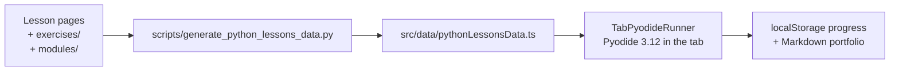

# app/ — the MechaLab workbench

The browser workbench every lesson links to: https://tle47.github.io/Mechatronics-Roadmap/. It runs
Python 3.12 in the tab (Pyodide), grades a program against the lesson's expected output and its
instructor tests, and keeps progress in `localStorage`, with a Markdown portfolio export.

Nothing here is a second copy of the curriculum. The lesson registry is generated from the Markdown
and the graded packages, so this directory is the *viewer*: if a number in the UI disagrees with a
lesson, regenerate the data rather than editing the data.



## The shell's design system

[`src/index.css`](src/index.css) is the one place colours, type, radii, motion and the component
primitives live: tokens (`--bg`, `--panel`, `--accent`, `--emerald`, …), a fluid type scale
(`--step-3` … `--step--1`), `.btn` / `.btn-primary` / `.chip` / `.kbd`, one visible focus ring for
every interactive element, and a `prefers-reduced-motion` branch that disables the hero animation and
the transitions.

Every tab now names the tokens, not a hex. `@theme inline` in [`src/index.css`](src/index.css)
registers `bg-canvas`, `bg-panel`, `bg-raise`, `border-line`, `text-ink`, `text-body`, `text-muted`,
`text-faint` and the accent set as Tailwind colours that resolve to the custom properties, so opacity
modifiers (`bg-emerald/20`) work too. A literal colour left in a tab is a bug that the light theme
shows immediately.

## Light and dark

`<html data-theme>` decides every colour. The inline script in [`index.html`](index.html) writes it
before first paint (stored pick, else `prefers-color-scheme`), so there is no flash;
[`src/theme.ts`](src/theme.ts) owns the rules and [`src/useTheme.ts`](src/useTheme.ts) mounts them in
the header toggle.

| Situation | What happens |
| :--- | :--- |
| First visit | The OS decides. Nothing is written to `localStorage`. |
| Toggle clicked | The visible theme flips and `mechalab_theme_v1` stores the side that was picked. |
| Reload, or the OS flips | The stored pick wins; only an unpicked visit keeps following the OS. |
| Corrupt or blocked storage | Falls back to the OS and keeps working — no throw, no broken shell. |

Plots are the exception by design: a canvas or SVG chart sits on `.plot` (`--plot: #070a12`) in both
themes, because the traces are drawn in literal plot colours tuned against that ink. Light mode is
warm paper around dark instrument faces, not a white plot with invisible curves.

[`docs/THEME.md`](../docs/THEME.md) is the token reference: every colour in both palettes side by
side, the utility family that reaches it, a "you are styling X, reach for Y" table, and the rules
above stated once. It is checked against `src/index.css` by `tests/test_theme_docs.py`, so it cannot
drift from the stylesheet.

The same table is in the app at `?view=theme`, linked from the footer
([`src/components/ThemeTokens.tsx`](src/components/ThemeTokens.tsx)). It reads `index.css` with
`?raw` and paints each value, so it needs no maintenance when a token is added; `npm run
test:theme:tokens` pins the parse and `npm run test:theme:e2e` checks the painted swatches in a
browser. The page is a route, not a tab: the learner's rail is unchanged.

Legibility is measured, not eyeballed: `npm run test:theme` pins the storage/OS rules, and
`npm run test:theme:e2e` drives Chromium through all eleven tabs in both themes, compositing each
text run over the backgrounds it actually sits on and failing anything below 3:1 (the current floor
is 4.5:1). The unit suite runs inside `npm run test:workbench`; the browser sweep is its own CI step,
because as a seventh parallel suite it pushed the older ones past their click timeouts. `--warnings` lists runs between 3:1 and their size minimum; `--screenshots` writes one
PNG per tab per theme to `.fb-scratch/theme/`.

Landing hero: [`src/components/StartHereCard.tsx`](src/components/StartHereCard.tsx) renders the
README's own Start-here block (the words come from `src/data/startHere.json`, so the page and the
README cannot drift apart) beside [`HeroArm.tsx`](src/components/HeroArm.tsx) - a live canvas running
the capstone's figure-8 through two-link inverse kinematics. The canvas pauses off-screen, draws one
still frame under `prefers-reduced-motion`, and never exceeds 2x device pixels.

## Python you can stop, and ⌘K over everything

Python runs in a **dedicated Web Worker** ([`src/runtime/pythonWorker.js`](src/runtime/pythonWorker.js)),
mounted from a real module URL (`new Worker(new URL(...), { type: 'module' })`) rather than a blob, so the
service worker controls it and can cache the runtime. It never runs on the UI thread: the editor keeps
typing, the tabs keep switching, and a runaway loop cannot freeze the page.

| Problem | What the runner does |
| :--- | :--- |
| `while True:` | **Stop** writes to a `SharedArrayBuffer` interrupt word that Pyodide watches; the interpreter raises `KeyboardInterrupt` **in place**, so imports, variables and the 10 MB runtime all survive. Without `SharedArrayBuffer` it falls back to terminating the worker, which still stops the run. |
| `input()` | The worker posts the prompt, then `Atomics.wait`s on a second shared word while the page shows the input box. The UI stays live because it is a different thread. Stop wakes the wait. |
| The download | The runtime is warmed on idle, so the first Run is a warm run; the status line reports the measured boot (`ready in 1.4 s`), not a spinner. |
| GitHub Pages (no headers) | [`public/sw.js`](public/sw.js) adds the COOP/COEP pair a static host cannot send; it reloads once and then `SharedArrayBuffer` exists. `npm run dev` and `preview` send the same pair directly (`scripts/isolation-headers.mjs`), so the dev server never puts a worker between HMR and the page. |

Interruption needs cross-origin isolation for **one** reason: it is what makes `SharedArrayBuffer`
available. If the service worker is blocked, the runner still stops programs — it just pays for it by
restarting the runtime.

### Offline

The same worker caches the app, so a second visit starts without the network. On install it precaches
the shell, `index.html`, the manifest and the favicon; every same-origin asset it serves after that is
cache-first with a background refresh, which is why a repeat visit is instant and a deploy still lands
on the next load. Navigations are network-first with the cached document as the fallback, so an offline
reload — or a deep link like `?lesson=P.4` the cache never saw — still opens the workbench, isolated,
with the lesson list rendered.

`npm run test:offline` is the suite that proves it the way Pages serves it: the built bundle is served
**without** the header pair, the worker takes control, and then the context goes offline. It asserts the
isolated document, the cached shell/manifest/bundle, one online run that pulls the interpreter in, an
offline reload that paints the workbench, a whole lesson run to the same verdict with the network off,
and an offline deep link into a lesson.

**The interpreter is cached too.** Pyodide is loaded by that module worker with a dynamic `import()` of
its ESM build, and its `pyodide.mjs`, wasm binary, stdlib zip and any wheel it loads are cached under
`mechalab-pyodide-v1`. One online run is enough: the suite then goes offline and runs the same lesson to
the same verdict from the cache - which is the difference between "offline reading" and "a lesson on a
plane".

### Keys

| Key | Does |
| :--- | :--- |
| `⌘K` / `Ctrl+K` | The command palette: every lesson, exercise, tab and command in one searchable list. `↑`/`↓` move, `↵` opens, `esc` closes. It works while the editor has focus, which is when it is needed. |
| `⌘↵` / `Ctrl+↵` | Run the open lesson. |

[`src/palette.ts`](src/palette.ts) is the whole search (prefix > word-start > substring >
subsequence, stable order inside a score band) and [`src/paletteCatalog.ts`](src/paletteCatalog.ts)
builds the list from the lesson registry plus the rail's metadata, so a new lesson or a renamed tab
appears without editing the palette.

### The editor

The textarea is gone: [`PythonEditor.tsx`](src/components/PythonEditor.tsx) mounts **CodeMirror 6**
(Python highlighting, line numbers, undo history, bracket matching and closing, in-document search,
`Tab`/`Shift-Tab` indent, and completion from Python keywords plus the names the file itself
defines). The colours come from the app's tokens ([`editor/theme.ts`](src/editor/theme.ts)), so light
mode is not a second editor theme.

The document is still owned by React: every edit is reported through `onChange`, an external change
(a different lesson, Load Solution, Reset) replaces the document, and the run button reads the same
state the screen shows. The component also exposes a two-method bridge
(`window.__mechalabEditors['editor-main']`) so the browser suites type and read through the view
rather than through CodeMirror's internal markup ([`scripts/editor-code.mjs`](../scripts/editor-code.mjs)).

**A lesson is a small project.** `main.py` is the learner's tab. A lesson whose starter, solution,
hints or tests mention `mechalab_plant` gets a second, **read-only** tab holding that plant
([`src/lessonFiles.ts`](src/lessonFiles.ts); 29 of the 92 entries do). The worker writes the same
text into Pyodide's filesystem ([`TabPyodideRunner.tsx`](src/components/tabs/TabPyodideRunner.tsx)),
so `from mechalab_plant import simulate_arm` works exactly as it would locally - and the learner can
read what the import is doing without being able to break it.

**Sliders are a comment on a number.**

```python
Kp = 4.0   # @slider 0 20 0.1
```

puts a control under that line ([`src/editor/sliderModel.ts`](src/editor/sliderModel.ts) parses it,
[`sliderWidget.ts`](src/editor/sliderWidget.ts) draws it). Dragging **rewrites the literal in the
file** - no hidden parameter channel - and re-runs once the drag settles (450 ms). The file stays
ordinary Python: open it in VS Code and it runs the same. A directive with a missing or inverted
range is ignored rather than guessed at, and the range input is reused while only its value moves,
so the drag is not aborted by its own re-render.

**Every run files the code it started from.** A draft holds one text - the latest - so running a
version that worked, breaking it and running again used to leave the learner with the broken one and
nothing to go back to. **History** in the lesson header lists the last five attempts for that lesson,
each with the verdict it got (`passed`, `output mismatch`, `checks failed`, `stopped`, …) and how long
ago it ran, and **Restore** puts that text back in the editor ungraded. Snapshots are taken on Run,
not on typing: the same text run twice is one version carrying the newer verdict, the untouched
starter is never filed (Reset Starter already restores it), and the store evicts the oldest attempt
anywhere once it passes its budget - [src/draftHistory.ts](src/draftHistory.ts), pinned by
`npm run test:history`.

**The Scope: your loop, drawn.** A lesson that prints forty lines of `theta = ...` is asking the reader
to plot it in their head. Inside a run, Python can hand its samples to a panel instead:

```python
import math
from mechalab import scope

ts = [i / 100 for i in range(400)]
ys = [1 - math.exp(-t) for t in ts]
scope.stream("step response", ts, ys)
```

`scope.stream(name, t, y)` (and its synonym `scope.plot`) takes lists, ranges or numpy arrays and
records a trace for **this run**. The worker buffers the points and posts them in batches of 500 plus
one final batch before the verdict, so the curve grows while the loop runs and is complete when it
stops; a runaway recording is capped at 20 000 points per series and says so
([`src/scopeModel.ts`](src/scopeModel.ts) holds the rules, `npm run test:scope` pins them). The panel
shares one pair of axes across traces, marks zero when the data crosses it, prints each trace's last
value beside its name, and **Show as table** turns the same run into twelve sampled rows - a canvas is
invisible to a screen reader ([`src/components/ScopePanel.tsx`](src/components/ScopePanel.tsx)).

**Reading it.** Pointing at the plot draws a cursor and names every trace's value at that one `t`
(interpolated between samples, `—` where a trace has no sample there); the arrow keys move the same
cursor, so the readout is not mouse-only. Wheel, **Zoom +/−** and `+`/`-`/`0` change the time axis
about the pointer or the middle of the view, dragging pans it, and both are clamped to the data and
to a 1/1000-of-the-trace floor, so the axis can never end up showing empty space. The y axis follows
the visible window rather than the whole trace.

**Comparing two runs.** **Pin as A** keeps this run's traces on the axes while the next run draws
over them as B (dashed, lighter), so a change to `Kp` or `ki` is read on one pair of axes; the cursor
then reads both values at the same `t`, and the legend names both. Pinning survives a run and is
cleared by changing lesson or by **Clear A**.

Nothing is stored beyond the pinned traces in memory: a trace belongs to the run that produced it,
and pressing Run on something that traces nothing clears the current curve rather than leaving a stale
one on screen.

The seven control and mechanics lessons (02.1-02.5, 05.1, 05.2) ship their own annotations: link
lengths on the FK/IK demos, mass and gear ratio on the inertia lesson, tooth counts on the belt
drive, `Kp`/`Ki`/`Kd` on the PID lesson and the gyro bias/`alpha` pair on the complementary filter -
14 sliders across 7 starters, every default exactly the literal it replaced. The reference solutions
stay the plain version, so **Load Solution** shows the canonical code while the starter is the
workspace where the numbers move. `npm run test:editor` fails if one of those starters loses its
sliders or gains a slider the demo never reads.

## Stack

Vite 6 · React 19 · TypeScript 5.7 · Tailwind 4 · KaTeX · Lucide. Tests drive the built bundle with
`playwright-core`.

## Run it

```bash
npm install                 # from the repository root, not app/
npm run dev                 # http://localhost:3000, regenerates the lesson registry first
npm run build               # tsc -b && vite build -> ../dist (Pages base path)
npm run lint                # tsc -b only
```

`npm run dev` and `npm run build` both run `predev`/`prebuild`, which regenerate
[`src/data/pythonLessonsData.ts`](src/data/pythonLessonsData.ts) from `exercises/` and the lesson
pages. A stale registry is a build failure, not a silent mismatch.

## Where things live

| Path | What it is |
| :--- | :--- |
| [`src/App.tsx`](src/App.tsx) | The workbench shell: tab list, beginner/advanced view, progress wiring. |
| [`src/components/tabs/`](src/components/tabs) | One file per tab. [`TabPyodideRunner.tsx`](src/components/tabs/TabPyodideRunner.tsx) is the graded runner — editor, expected output, badges, instructor panel. |
| [`src/data/`](src/data) | **Generated.** Lesson registry, spine, start-here card, plant model, link history. Edit the generator, not these files. |
| [`src/outputMatch.ts`](src/outputMatch.ts) | How stdout is compared (exact vs formatting-tolerant), shared by the runner and its tests. |
| [`src/progressMerge.ts`](src/progressMerge.ts) | Merging saved progress between browsers and accounts. |
| [`src/lessonCoach.ts`](src/lessonCoach.ts) | The progressive hints and the stuck-state prompts. |
| [`src/checkHints.ts`](src/checkHints.ts) | The join between a failed check and the hint rung that answers it, plus the rule that earns rung 2. |
| [`src/runtime/pythonWorker.js`](src/runtime/pythonWorker.js) | The interpreter worker: warm-up, run, in-place Stop, `input()`, `mechalab.scope`, `result` and `scope` messages. |
| [`src/components/PythonEditor.tsx`](src/components/PythonEditor.tsx) | The CodeMirror editor: view, external sync, test bridge. |
| [`src/editor/`](src/editor) | Editor-only logic: the token theme, the slider model and its widget. |
| [`src/lessonFiles.ts`](src/lessonFiles.ts) | The read-only helper files a lesson brings (the shared plant). |
| [`src/draftHistory.ts`](src/draftHistory.ts) | The versions behind the draft: what each run started from, with its verdict, bounded per lesson and in total. |
| [`src/scopeModel.ts`](src/scopeModel.ts) | What a Scope payload must be to be drawn: NaN dropped, lengths aligned, flat traces widened, tables sampled. |
| [`src/components/ScopePanel.tsx`](src/components/ScopePanel.tsx) | The Scope: canvas, shared axes, legend with last values, and the same data as a table. |
| [`src/learningLog.ts`](src/learningLog.ts) | The event log behind the friction report and the roadmap's "opened / tried" states. |

## Checks that cover this directory

```bash
npm run lint                 # types
npm run test:workbench       # runner behaviour (happy-dom) + palette search + editor model
npm run test:runtime         # the worker: in-place Stop, input(), isolation, Pages fallback
npm run test:editor          # slider directives (parse/clamp/format) and helper-tab detection
npm run test:history         # run history: filed on Run, deduped, capped per lesson and in total
npm run test:scope           # Scope rules: payloads, cursor sampling, zoom/pan windows, bounds, tables
npm run test:checkhints      # the failed check -> rung join, and the rule that earns rung 2
npm run test:e2e             # dev server, one lesson end to end
npm run test:e2e:pages       # built bundle at the Pages base path: every graded entry, ramp R.1-R.6, tablet width
npm run test:offline         # the service worker: isolation without host headers, cached shell, offline reload + deep link
npm run check:lessons        # the registry is current
```

`test:e2e:pages` is the suite that proves what a learner actually opens; it fails if the bundle was
built for `/` instead of `/Mechatronics-Roadmap/`, if an entry the registry ships is missing from the
lesson list, or if any starter verifies.

## Deploying

`.github/workflows/ci.yml` builds `dist/` and the Pages workflow publishes it. The base path comes
from `PAGES_BASE` in [`../vite.config.ts`](../vite.config.ts); override it (`PAGES_BASE=/ npm run
build`) only for a host serving from a domain root, and expect `test:e2e:pages` to fail until the
served base matches.
