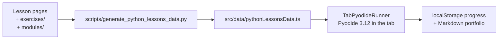

# app/ — the MechaLab workbench

The browser workbench every lesson links to: https://tle47.github.io/Mechatronics-Roadmap/. It runs
Python 3.12 in the tab (Pyodide), grades a program against the lesson's expected output and its
instructor tests, and keeps progress in `localStorage`, with a Markdown portfolio export.

Nothing here is a second copy of the curriculum. The lesson registry is generated from the Markdown
and the graded packages, so this directory is the *viewer*: if a number in the UI disagrees with a
lesson, regenerate the data rather than editing the data.



## Stack

Vite 6 · React 19 · TypeScript 5.7 · Tailwind 4 · KaTeX · Lucide. Tests drive the built bundle with
`playwright-core`.

## Run it

```bash
npm install                 # from the repository root, not app/
npm run dev                 # http://localhost:3000, regenerates the lesson registry first
npm run build               # tsc -b && vite build -> ../dist (Pages base path)
npm run lint                # tsc -b only
```

`npm run dev` and `npm run build` both run `predev`/`prebuild`, which regenerate
[`src/data/pythonLessonsData.ts`](src/data/pythonLessonsData.ts) from `exercises/` and the lesson
pages. A stale registry is a build failure, not a silent mismatch.

## Where things live

| Path | What it is |
| :--- | :--- |
| [`src/App.tsx`](src/App.tsx) | The workbench shell: tab list, beginner/advanced view, progress wiring. |
| [`src/components/tabs/`](src/components/tabs) | One file per tab. [`TabPyodideRunner.tsx`](src/components/tabs/TabPyodideRunner.tsx) is the graded runner — editor, expected output, badges, instructor panel. |
| [`src/data/`](src/data) | **Generated.** Lesson registry, spine, start-here card, plant model, link history. Edit the generator, not these files. |
| [`src/outputMatch.ts`](src/outputMatch.ts) | How stdout is compared (exact vs formatting-tolerant), shared by the runner and its tests. |
| [`src/progressMerge.ts`](src/progressMerge.ts) | Merging saved progress between browsers and accounts. |
| [`src/lessonCoach.ts`](src/lessonCoach.ts) | The progressive hints and the stuck-state prompts. |

## Checks that cover this directory

```bash
npm run lint                 # types
npm run test:workbench       # unit-level runner behaviour (happy-dom)
npm run test:e2e             # dev server, one lesson end to end
npm run test:e2e:pages       # built bundle at the Pages base path: every graded entry, ramp R.1-R.6, tablet width
npm run check:lessons        # the registry is current
```

`test:e2e:pages` is the suite that proves what a learner actually opens; it fails if the bundle was
built for `/` instead of `/Mechatronics-Roadmap/`, if an entry the registry ships is missing from the
lesson list, or if any starter verifies.

## Deploying

`.github/workflows/ci.yml` builds `dist/` and the Pages workflow publishes it. The base path comes
from `PAGES_BASE` in [`../vite.config.ts`](../vite.config.ts); override it (`PAGES_BASE=/ npm run
build`) only for a host serving from a domain root, and expect `test:e2e:pages` to fail until the
served base matches.
