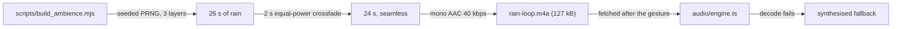

# The room's recorded loop

`rain-loop.m4a` is the only audio file in the repository: 24 seconds of night rain, mono AAC at
40 kbps, 127 kB. Everything else MechaLab plays is synthesised (`docs/AUDIO.md`).



## Where it comes from

It is **generated by this repository**, not sampled from anywhere:

```bash
node scripts/build_ambience.mjs           # write it
node scripts/build_ambience.mjs --check   # re-render and compare the bytes
node scripts/build_ambience.mjs --dry-run
```

The render is three layers — broadband body, a bright hiss of drops on glass, and a low city rumble —
from a seeded PRNG (`mulberry32`), so the same command produces the same samples on every machine. A
26-second bed is folded into 24 with a two-second equal-power crossfade, which is what makes the loop
seamless. `--check` re-renders and compares, so a regenerated asset is a reviewable diff rather than a
different sound.

No sample library, no stock audio, no attribution requirement, and nothing to police: the file's
provenance is the script beside it. Treat it as the project's own work under the repository's licence.

## Why it is committed as a binary

The loop is served beside the bundle and fetched only after a learner turns sound on
(`app/src/audio/rainAsset.ts` → `engine.ts`), so it is not generated at build time: a build step that
needed a particular `ffmpeg` encoder version would make the same source produce different bytes on a
different machine. Committing the encoded file keeps the sound identical everywhere, and `--check`
keeps it honest.

## The budget

`npm run check:weight` measures this file as the **`audio`** metric, at its own bytes rather than a
gzip of them (AAC is already compressed), against a 150 kB ceiling. It counts inside `total` because
it ships in the bundle, and it is outside `entry_gzip` because it is fetched after a gesture, never on
a first paint. The ceiling is deliberately under two loops: a second recording has to be argued for
in `docs/weight-budget.json`, not slipped in.

## Format notes

Mono AAC in an `.m4a` container plays in every browser MechaLab supports except a Chromium built
without proprietary codecs (headless CI is one). That case is not a failure: the engine synthesises a
fallback rain of the same character, and `__mechalabAudio().rain` reports `synth` instead of `file`.
