# The two music beds

`lab-night.m4a` and `focus-current.m4a` are 60-second seamless loops of two real lo-fi tracks,
released under **CC0 1.0 Universal** on Free Music Archive. They are the plan's two named beds: *Lab
Night* at the bench, *Focus Current* in focus mode. Everything else MechaLab plays is synthesised
(`docs/AUDIO.md`).

```mermaid
flowchart LR
    S["CC0 source (7 MB MP3)"] -->|60 s window at a fixed start| W["excerpt"]
    W -->|2 s equal-power fold| L["seamless 60 s loop"]
    L -->|peak-normalised to 0.8| P["both beds the same level"]
    P -->|stereo AAC 56 kbps| F["lab-night.m4a / focus-current.m4a (434 kB each)"]
    F -->|fetched only after the gesture| E["audio/engine.ts"]
    E -->|decode fails, or the learner chose it| D["the synthesised drone"]
```



## The tracks

| Bed | File | Track | Artist | Album | Licence |
| :--- | :--- | :--- | :--- | :--- | :--- |
| *Lab Night* | `lab-night.m4a` | [Snow Drift](https://freemusicarchive.org/music/holiznacc0/winter-lofi/snow-drift/) | holiznacc0 | *Winter Lofi* | CC0 1.0 Universal |
| *Focus Current* | `focus-current.m4a` | [Fire Place](https://freemusicarchive.org/music/holiznacc0/winter-lofi/fire-place/) | holiznacc0 | *Winter Lofi* | CC0 1.0 Universal |

CC0 1.0 is a public-domain dedication: no attribution is required, commercial use is allowed, and a
derivative (a cut loop) may be redistributed. The credit in the settings panel and in this file is
therefore honour rather than obligation — and a learner is entitled to know whose music they hear.

## How they were cut

```bash
node scripts/build_music.mjs --download   # fetch the sources into .cache/music, then cut both loops
node scripts/build_music.mjs --check      # re-cut from those sources and compare (local, needs sources)
node scripts/build_music.mjs --dry-run
```

The window (60 s from 42 s into *Snow Drift*, 36 s into *Fire Place*), the two-second fold, the peak
normalisation and the bitrate all live in `scripts/build_music.mjs`; changing one changes the file, and
the script prints the size it wrote. The sources themselves are **not** committed — they are 7 MB of
MP3 to derive two 434 kB loops — and `.cache/music/` is ignored. `--check` therefore needs a local copy
of the sources; it is a local proof, not a CI gate. What CI grades is the weight (`music`, and
`total`), and what ships is the committed loop.

## Why these two, and why a fallback

The beds are a *place*, not a score: one warm and low for the bench, one sparser and brighter for
focus. Both are instrumental and quiet enough to sit under the cues, and both are ducked while a run
executes. A browser that cannot decode AAC (a Chromium built without proprietary codecs, which is
what CI runs), or a learner who prefers a texture to a song, gets the synthesised drone instead —
selected by the **Drone** button in the settings panel, or by the engine's fallback when a bed fails
to load. `__mechalabAudio().musicSource` reports `file`, `synth` or `none`, and the panel's Music
section says which one you are hearing.

## The budget

`npm run check:weight` measures both files as the **`music`** metric, at their own bytes rather than a
gzip of them (AAC is already compressed), against a 1.00 MB ceiling: 867.7 kB measured, which is room
to re-cut both at a higher bitrate and not enough for a third. They are inside `total` because they
ship in the bundle, and outside `entry_gzip` because nothing here is fetched until sound is on.
