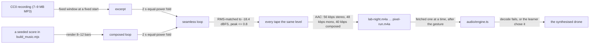

# The music tapes

Eleven files, five genre doors, two kinds of source. Every file is a seamless loop (`docs/AUDIO.md`
describes the engine that plays them).



The doors are **Lo-fi**, **J-Pop**, **Synthwave**, **Chiptune** and **Acoustic**. A door is a mood a
learner might want at a bench; each names a `defaultTape` so choosing it plays the loop written for
that idiom, and the panel shows the tapes inside the door that is open.

## Recorded: four CC0 tracks

All four are by **HoliznaCC0**, from the album *Winter Lofi* on Free Music Archive, each page stating
**CC0 1.0 Universal**.

| File | Door | Track | Length | Source page |
| :--- | :--- | :--- | ---: | :--- |
| `lab-night.m4a` | Lo-fi | Snow Drift | 60 s | [page](https://freemusicarchive.org/music/holiznacc0/winter-lofi/snow-drift/) |
| `focus-current.m4a` | Lo-fi | Fire Place | 60 s | [page](https://freemusicarchive.org/music/holiznacc0/winter-lofi/fire-place/) |
| `first-snow.m4a` | Acoustic | First Snow | 40 s | [page](https://freemusicarchive.org/music/holiznacc0/winter-lofi/first-snowmp3/) |
| `winter-blues.m4a` | Acoustic | Winter Blues | 45 s | [page](https://freemusicarchive.org/music/holiznacc0/winter-lofi/winter-blues/) |

*First Snow*'s page slug really is `first-snowmp3` — the track is titled "First Snow.mp3" in the
album. The app shows "First Snow".

CC0 1.0 is a public-domain dedication: no attribution is required, commercial use is allowed, and a
derivative (a cut loop) may be redistributed. The credits in the settings panel and in this file are
therefore honour rather than obligation — and a learner is entitled to know whose music they hear.

## Composed: seven loops written here

No free recording covers city-pop, synthwave or chiptune idioms, and licensing a real song would be a
different kind of project. These seven are rendered by `scripts/build_music.mjs` from a seeded additive
synth, so a re-render is the same file. The app credits them as "composed by this repository" — never
as a band.

| File | Door | Piece | Length | Idiom |
| :--- | :--- | :--- | ---: | :--- |
| `bench-arpeggio.m4a` | J-Pop | Bench Arpeggio | 24 s | Em–C–G–D plucks at 80 bpm, no drums, a room floor |
| `paper-lanterns.m4a` | J-Pop | Paper Lanterns | 24 s | A minor pentatonic bells over a drone, 80 bpm |
| `city-lights.m4a` | J-Pop | City Lights | 24 s | C–G–Am–F pad, four-on-the-floor, offbeat plucks, 120 bpm |
| `neon-stage.m4a` | J-Pop | Neon Stage | 24 s | Am–F–C–G, sixteenth plucks and claps, 120 bpm |
| `city-pop.m4a` | J-Pop | Morning City | 32 s | Am7–Fmaj7–Cmaj7–G7, a bell lead and a walking bass, 90 bpm |
| `night-drive.m4a` | Synthwave | Night Drive | 16 s | Saw pads, a sixteenth analog arpeggio, a kick on every beat, 120 bpm |
| `pixel-run.m4a` | Chiptune | Pixel Run | 16 s | A pulse lead, triangle bass and noise hats, 120 bpm |

## How they are made

```bash
node scripts/build_music.mjs --download   # fetch the four sources into .cache/music, then cut and render all eleven
node scripts/build_music.mjs --check      # re-cut and re-render, compare with what is committed
node scripts/build_music.mjs --dry-run
```

The windows (60 s from 42 s into *Snow Drift*, 36 s into *Fire Place*, 40 s into *Winter Blues*, 24 s
into *First Snow*), the two-second fold, the RMS match, the bitrates and the composed scores all live
in `scripts/build_music.mjs`; changing one changes the file, and the script prints the size it wrote.
The sources themselves are **not** committed — 16 MB of MP3 to derive four loops — and `.cache/music/`
is ignored. `--check` therefore needs a local copy of the sources; it is a local proof, not a CI gate.
What CI grades is the weight (`music`, and `total`), and what ships is the committed set.

## Why eleven, and why a fallback

Five doors are five moods a learner might want at a bench, and each is guaranteed to hold at least one
tape; the three idioms no free recording covered got a composed loop rather than a hole. A browser
that cannot decode AAC (a Chromium built without proprietary codecs, which is what CI runs), an
offline first visit, or a learner who prefers a texture to a song gets the synthesised drone instead —
selected by the **Drone** chip, or by the engine's fallback when a tape fails to load.
`__mechalabAudio().musicSource` reports `file`, `synth` or `none`, and shows the chosen tape's id
alongside.

## The budget

`npm run check:weight` measures all eleven files as the **`music`** metric, at their own bytes rather
than a gzip of them (AAC is already compressed), against a 2.35 MB ceiling: 2.23 MB measured, which is
room for one more short tape or a higher bitrate and not for a second library. They are inside `total`
because they ship in the bundle, and outside `entry_gzip` because a learner who leaves sound off
fetches none of them.
