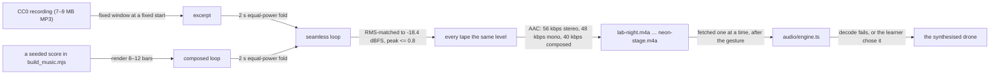

# The music tapes

Eight files, six categories, two kinds of source. Every file is a seamless loop (`docs/AUDIO.md`
describes the engine that plays them).



## Recorded: four CC0 tracks

All four are by **HoliznaCC0**, from the album *Winter Lofi* on Free Music Archive, each page stating
**CC0 1.0 Universal**.

| File | Category | Track | Length | Source page |
| :--- | :--- | :--- | ---: | :--- |
| `lab-night.m4a` | Lo-fi | Snow Drift | 60 s | [page](https://freemusicarchive.org/music/holiznacc0/winter-lofi/snow-drift/) |
| `focus-current.m4a` | Lo-fi | Fire Place | 60 s | [page](https://freemusicarchive.org/music/holiznacc0/winter-lofi/fire-place/) |
| `winter-blues.m4a` | Jazz | Winter Blues | 45 s | [page](https://freemusicarchive.org/music/holiznacc0/winter-lofi/winter-blues/) |
| `first-snow.m4a` | Instrumental | First Snow | 40 s | [page](https://freemusicarchive.org/music/holiznacc0/winter-lofi/first-snowmp3/) |

*First Snow*'s page slug really is `first-snowmp3` — the track is titled "First Snow.mp3" in the
album. The app shows "First Snow".

CC0 1.0 is a public-domain dedication: no attribution is required, commercial use is allowed, and a
derivative (a cut loop) may be redistributed. The credits in the settings panel and in this file are
therefore honour rather than obligation — and a learner is entitled to know whose music they hear.

## Composed: four loops written here

No free recording covers anime, pop or K-pop idioms, and licensing a real song would be a different
kind of project. These four are rendered by `scripts/build_music.mjs` from a seeded additive synth, so
a re-render is the same file. The app credits them as "composed by this repository" — never as a band.

| File | Category | Piece | Length | Idiom |
| :--- | :--- | :--- | ---: | :--- |
| `bench-arpeggio.m4a` | Instrumental | Bench Arpeggio | 24 s | Em–C–G–D plucks at 80 bpm, no drums, a room floor |
| `paper-lanterns.m4a` | Anime | Paper Lanterns | 24 s | A minor pentatonic bells over a drone, 80 bpm |
| `city-lights.m4a` | Pop | City Lights | 24 s | C–G–Am–F pad, four-on-the-floor, offbeat plucks, 120 bpm |
| `neon-stage.m4a` | K-pop | Neon Stage | 24 s | Am–F–C–G, sixteenth plucks and claps, 120 bpm |

## How they are made

```bash
node scripts/build_music.mjs --download   # fetch the four sources into .cache/music, then cut and render all eight
node scripts/build_music.mjs --check      # re-cut and re-render, compare with what is committed
node scripts/build_music.mjs --dry-run
```

The windows (60 s from 42 s into *Snow Drift*, 36 s into *Fire Place*, 40 s into *Winter Blues*, 24 s
into *First Snow*), the two-second fold, the RMS match, the bitrates and the composed scores all live
in `scripts/build_music.mjs`; changing one changes the file, and the script prints the size it wrote.
The sources themselves are **not** committed — 16 MB of MP3 to derive four loops — and `.cache/music/`
is ignored. `--check` therefore needs a local copy of the sources; it is a local proof, not a CI gate.
What CI grades is the weight (`music`, and `total`), and what ships is the committed set.

## Why eight, and why a fallback

Six categories are six moods a learner might want at a bench; two of them hold two tapes so a category
is not a single door. A browser that cannot decode AAC (a Chromium built without proprietary codecs,
which is what CI runs), an offline first visit, or a learner who prefers a texture to a song gets the
synthesised drone instead — selected by the **Drone** chip, or by the engine's fallback when a tape
fails to load. `__mechalabAudio().musicSource` reports `file`, `synth` or `none`, and shows the chosen
tape's id alongside.

## The budget

`npm run check:weight` measures all eight files as the **`music`** metric, at their own bytes rather
than a gzip of them (AAC is already compressed), against a 2.10 MB ceiling: 1.90 MB measured, which is
room for one more short tape or a higher bitrate and not for a second library. They are inside `total`
because they ship in the bundle, and outside `entry_gzip` because a learner who leaves sound off
fetches none of them.
