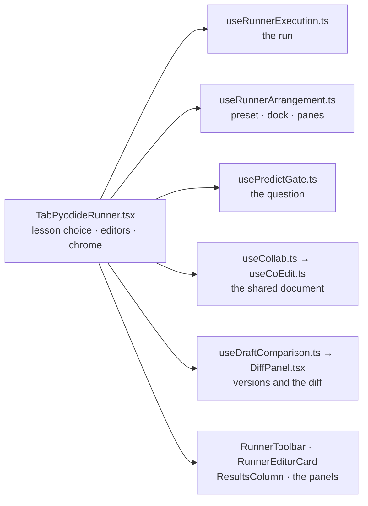

# The lesson runner, split

`TabPyodideRunner.tsx` is the assembly: it owns the lesson choice, the editor's writers and the
chrome, destructures the execution hook by name, and renders the regions below. Each module here owns
one concern and is readable without the tab.

| Module | Owns |
|---|---|
| `useRunnerExecution.ts` | The run: the worker session and buffers, every cell a run's outcome lands in (output, trace, analysis, watches, parks), and `runPythonCode` / `runCellTo` / Stop / Pause / frame edits / watches. |
| `usePredictGate.ts` | The predict-first question: this lesson's record, the half-typed guess, the run it holds, and the one `requestRun` every surface asks a run through. |
| `useCoEdit.ts` | Co-editing over the pair session: the shared document, their offer (asked before an editor is replaced), and every local write turned into ops. |
| `useCollab.ts` | The pair channel read for co-editing: the subscription that feeds the session once the lesson functions exist, and the one message — an attempt — that belongs to the tab. |
| `collabNotice.ts` | What a co-edit session says when it stops: one sentence per reason and per side, so a remote stop never claims an action this workbench did not take. |
| `useDraftComparison.ts` | The versions behind the draft and what the diff compares against: the filed list, the earned solution, the chosen reference and the lesson reset. |
| `DiffPanel.tsx` | The diff drawing: reference buttons, rows, and the sentences about a fallback or an identical file. |
| `AttemptOffers.tsx` | The two offers of someone else's code — a pair attempt and a shared link — with the lesson check before either can replace a draft. |
| `useShareLink.ts` | The Share press and its five outcomes, including the printed URL when the clipboard refuses. |
| `useVimKeys.ts` | The remembered Vim opt-in and the mode the editor reads keys in while it is on. |
| `usePassToast.ts` | When a pass is news: the once-per-lesson tape change, and the callback that raises the card. The six-second life is sonner's, not this module's. |
| `PassNotice.tsx` | The pass card itself — the lesson, both halves of the verdict and the door to the next lesson — handed to sonner's toast, which owns its stack, live region and hold. |
| `useProgressFlags.ts` | The verified and self-marked lesson stores, parent-owned or local, and the two writers. |
| `useRunnerArrangement.ts` | The editor/results split share, which side results sit on, and the persisted layout record. |
| `RunnerToolbar.tsx` | The run controls: presets and dock, Pause/Stop/Run, Predict, and the More panel's actions. |
| `RunnerEditorCard.tsx` | The editor surface: main/helper tabs, the pane strip, and the editor body beside Requirements, Predict, Run output, Expected, Cases and Workflow. |
| `EditorPaneBody.tsx` | The pane body: up to four panes in a mixed grid (three side by side put the first at full height and stack the other two beside it, so no cell is empty), the same arrangement stacked on a phone, the dividers a pointer drags to resize them, each split pane's own close — that view leaves, the rest stay in order — and the offer that puts a closed view back in its slot. The prediction gate's own Close records the same arrangement through `paneUndo.ts`. |
| `EditorPaneArrangement.tsx` | Horizontal/vertical axis, Add pane, pane swapping and Close — the split's controls, lazy beside the eager Split door and outside the tablist. Close records the arrangement it takes away, so the same Undo a pane's corner close offers restores the whole split. It also reads how many panes the viewport allows: two on a phone, three on a laptop, four on a large desktop, re-read on resize. |
| `PanePlacement.tsx` | A pane's own split direction once there are three or more: the two buttons that open its boundary beside or under it, in their own spot beside the close so no control covers another, loaded with the placement control instead of the tab's eager chunk. |
| `PaneDrag.tsx` | The pane's pointer chrome: a wide, short header grip in each pane that exchanges it with the pane it is dropped on, the pane's own close in the opposite corner (that view leaves, the rest stay in order), the single bottom grip that resizes the pane area, and the body's Undo offer after a close — the arrangement it replaced, so the view returns to its slot, for eight seconds or until the next close, and ⌥Z does the same from the keyboard while the offer is up. One lazy chunk, so a one-pane body never pays for drawing the offer; the notice it reads lives in `paneUndo.ts`. |
| `PaneResize.tsx` | The pane area's bottom grip itself: drag it to trim unused space under the panes, and the Reset size control restores the body's default height. Loaded with `PaneDrag.tsx`, only for bounded desktop bodies. |
| `paneUndo.ts` | The one close waiting to be undone: the arrangement snapshot, what closed, and whether a keyboard press lost the focus to it. Every close records here — a pane's corner ×, the split's Close and the prediction gate's own Close — while the offer that draws it and puts the arrangement back is lazy with `PaneDrag.tsx`. |
| `EditorGoal.tsx` | The lesson's goal as a labelled prompt card, folded with the editor body. |
| `EditorRequirements.tsx` | The lesson's pass conditions as their own editor tab: numbered colourful cards with the micro lessons' token styling. |
| `resultTabMeta.tsx` | What each result tab says: its label, its tooltip and its glyph. |
| `robotPane.tsx` | The Robot tab's slot: the four lesson views, and the lazy result tab that is null everywhere else. |
| `CasesPane.tsx` | The behavioural cases: one row per substituted input, with what the last run proved and which cases it never reached. |
| `readerContinue.ts` | Where the page goes next: Study into Read, Read into Write. |
| `LessonChooserRail.tsx` | The Study preset's left column, the brief's button that brings a folded rail back, and the grid width that follows the fold. In Read, Write and Debug, which have no rail column, that same button opens the lesson sheet. |
| `LessonAmbience.tsx` | The pointer-free atmosphere behind the runner: aurora, instrument grid, orbit and four HUD chips. |
| `RunnerRuntimeStrip.tsx` | Where the interpreter is while it loads: first-run guide and runtime sentence. |
| `RunVerdict.tsx` | The one-line verdict under the run controls, from the last outcome. |
| `PredictPane.tsx` | The prediction gate's pane: the question, the committed guess and its reading. Its own Close is a pane close like the corner ×, so it leaves the same Undo, which puts the pane back with the guess still on it. |
| `ResultsColumn.tsx` | The column that reports on the code: checker notes, study note, assessment, trace, scope, and the split divider. |
| `AssessmentPanel.tsx` | Instructor behavioural assessment: badges, graded checks and the hint each one unlocks. |
| `PausedBar.tsx` (+ `parkSource.ts`) | The parked-run bar: step controls, the quoted line, frame values, watches and frame edits. `PausedStep` is the worker's park payload. |
| `DraftHistoryPanel.tsx` | The filed runs behind a draft, and restoring one. |
| `BreakpointPanel.tsx` | Armed breakpoints and their conditions, now a pane of the editor body. |
| `SelfDoneChecklist.tsx` | The three questions beside a pass that turn it into "and I did it unaided", backed by the self-marked store. |
| `useFirstRunTour.ts` | The first-run tour: record, offer/chip, gates, focus and dismissal. |
| `useGuideFold.ts` | The brief's remembered hide/show switch for the first-run guide, one value for every lesson. |
| `GuideToggle.tsx` | The brief's and the phone strip's door onto that switch, in two target sizes and one behaviour. |

## The robot tab

Four Python lessons get a Robot tab in the one `python-runner-editor`: **P.1** variables and data types,
**P.3** decisions and clamping, **P.4** lists and `for`, and **P.5** functions and `while`. The
lesson goal above the editor remains the lesson's goal; there is no second code surface. `robotPane.tsx`
gates the four ids and lazily mounts `../../robotSim/RobotPane.tsx` as the Robot result tab in
`EditorPaneBody.tsx`. The tab offers **Run robot**, **Reset**, **Replay**, and a compact **Speed** switch
(**0.5×**, **1×**, **2×**, default **1×**) beside the status line. The switch changes only how long
each sampled line is held for the eye; it never changes the source, the Python execution, the
lesson's verdict, or the final reading. The tab has no starter loader and never writes to the
editor: **Run robot** executes the learner's current code and appends one
read-only probe that calls `_robot_send(...)` with the names the lesson itself binds: `robot_mode`,
`encoder_ticks` and `battery_level` for P.1; `clamped_high`, `clamped_low` and `safe_output` for P.3;
the command lists for P.4; `pos_m`, `vel_m_s` and `step` for P.5. Missing names are shown as `—`,
never as invented values.

While the run is alive, the same bridge samples those names before each executed line of `main.py`
and sends the line number with the reading. The Robot tab therefore advances step by step instead of
waiting for the final probe, and `main.py` draws a rectangle around the line currently running. The
box follows the interpreter down the file, scrolls with it, and is cleared when the run ends, when
Stop or Reset is pressed, or when the editor changes. The **Speed** switch holds each line for about 360 ms
at **0.5×**, 180 ms at **1×**, and 90 ms at **2×**; it stays available during a run, so the remaining
lines follow a new choice. The readings are queued in the page and presented at that pace after the
worker has answered, so the switch never holds up Python or counts against the run's execution
budget. The probe still sends the final reading after the last line, so a value bound on that last
line is not lost.

The stage is a mission, not a readout. A round mission card names the lesson's goal in the learner's
language — **Wake the rover**, **Guard the motor**, **Sort the convoy**, **Dock the arm** — and turns
that goal into two to four targets read from the lesson's own `expected` reading, so a target cannot
drift from the solution it describes. Every chip shows the run's current value beside the target
(`— → 425 ticks` before a run), and a tap opens the sentence explaining it. The bar and the **Goal
reached** banner count only targets this run actually reached; a partial reading says `2/4 targets`,
never a percentage of an invented answer. A chip also points back at the code that wrote its current
value: after the run it carries a small `L8` badge, and opening it shows `main.py:8` with the
executed line quoted. The chip puts the editor's box on that line (the run keeps the box while it is
live), and the quoted reference moves it again. The line is provenance from the run's own frames,
not a fixed lookup in the lesson text, so P.3's clamp chips name the branch that actually ran
(`clamped_high = 255` on line 8) rather than the last assignment in the file.

The arena is those same values in motion. One round robot with big blinking eyes drives an encoder
track (P.1), pulls two commands into a safe corridor (P.3), meets a conveyor of clamped crates (P.4),
or docks a joint (P.5); every moving part is placed from a real reading and travels with a CSS
transition, so it moves between values instead of teleporting. The target flag comes from the
mission's target, not a second set of numbers. A strip under the arena quotes the `main.py` line the
interpreter is on, beside the same line box in the editor. Numbers stay in the large readout tiles
under the arena; a missing name is `—`. The robot’s face is Fredoka, self-hosted beside Space Grotesk
and named once as `--font-round`; body copy keeps Geist. Motion still follows the header's Motion
switch and `prefers-reduced-motion`.

**Replay** plays the frames the last successful run already recorded, without running Python again,
without touching `main.py`, and without grading. It starts from the first line, so the arena travels
the same path again; the button stays disabled until a run has finished. The robot run is
`grade: false`: it never verifies a lesson, and Run & Verify remains the verdict.

The first time the tab opens, a three-step guide points at **Run robot**, the goal chips and
**Replay**. It uses the first-lesson tour's visual language — a ring with a shadow instead of a
backdrop, and a card that does not take a focus trap — so Run and the chips stay usable while it is
up. **Next** and **Back** walk the three steps, the last one reads **Got it**, and `Esc` or the ×
skips it. The record (`mechalab_robot_tour_v1`) means it opens once; resetting Onboarding brings it
back, and a quiet **Show guide** beside the status line brings it back without opening Reset
progress. On a phone the card is a bottom sheet with 44 px controls and no ring. It is deliberately
separate from the six-step first-lesson tour, which owns the screen first.

The browser suite (`npm run test:robot:browser`) asserts the goal above `main.py`, opens the
**Robot** tab, sets each lesson's own `fullSolution`, clicks **Run robot**, compares `data-reading`,
asserts the mission reports every target met and the arena arrives (`data-robot-position` 1), and
asserts the editor is unchanged. It also checks that every chip names the `main.py` line that wrote
its value, that opening the first chip quotes and boxes that exact line and closing it clears the
box, that a chip opens and closes its hint, that the
robot moves through several positions and quotes executed lines, that Replay re-presents the run
without an edit or a grade, that Stop and Reset clear the line box mid-run, that Reset and a failing
program leave no reading, selects all three speeds and runs P.1 at 2× to prove the reading, `main.py`
and verified tally are unchanged, and runs P.4 at 360×740, 390×844 and 412×915 to prove the mission,
stage, chips, Run control and speed switch fit. A fresh context also opens the Robot guide on Run,
checks the ring lands and stays click-through, walks Back/Next to the chips and Replay, checks the
completed record survives a reload, checks Escape keeps it skipped, opens **Show guide** to bring it
back at Run, and checks the phone sheet and its touch targets. `npm run test:robot` is the no-browser
model suite:
every view is the lesson record, every mission target is that lesson's expected value, a full
solution completes the mission while a partial reading does not, a chip's source is the line that
last changed its value (including P.3's executed branch), numbers keep their tolerance and lists
compare element by element, the probe names that lesson's values, the old grid commands are gone,
the guide walks exactly Run → targets → Replay with a tolerant one-time record, starts again from
Run after it is finished, and the parser
refuses junk. The stage's contract is `robot-stage`'s `data-reading`,
`data-target`, `data-robot-position`, `data-motion`, `data-lesson` and `robot-status`; the pane adds
`data-running-line`, `data-speed`, `data-replay` and `robot-code-line`; the goal is the existing
`editor-goal-text` above the code.
Wiring rule: a region takes exactly the state and callbacks it renders; it never reaches into the tab.
A region with more than a handful of inputs takes them as named concern objects — `RunnerEditorCard`
is handed `surface`, `draft`, `panes`, `gate`, `run`, `slots` and `collab`, and `ResultsColumn` its
`split`, `checks`, `trace` and `scope` — so its signature says what it depends on. A concern object
is not a bag: `panes` is one `{ value, onPanes }`, and the card derives the split, the visible views,
the slot order, the pane borders and the open helper file from it, so a new derivation is a change in
the card rather than a new input at the call site. The run is one
state every region is a view of, so it lives in one place — `useRunnerExecution.ts` — and the shared
worker protocol under it lives in `../../runtime/pyodideWorker.ts`. A change to how a lesson runs lands
in the hook; a change to how the tab looks lands here.

The editor precedes the reader in the DOM so the stacked Study preset reads code then text; `index.css`
still places them by column at `2xl`, so only the walk order changes, not the drawing. The lesson
chooser's fold and strip live in `LessonChooserRail.tsx`, which is also why the tab stays inside its
line budget.

Size rule, held by `npm run test:runner` (`scripts/test_runner_shape.mjs`): the tab's budget is
**3,020 lines with 28 state cells and 24 refs**, a state-owning hook stays under 400 lines except
`useRunnerExecution.ts` (one noun, so it is one module), and a view under 730. Those numbers are
measured, not chosen; the check fails when one rises, and a pass that raises one owes the reason in
the commit that raises it.
