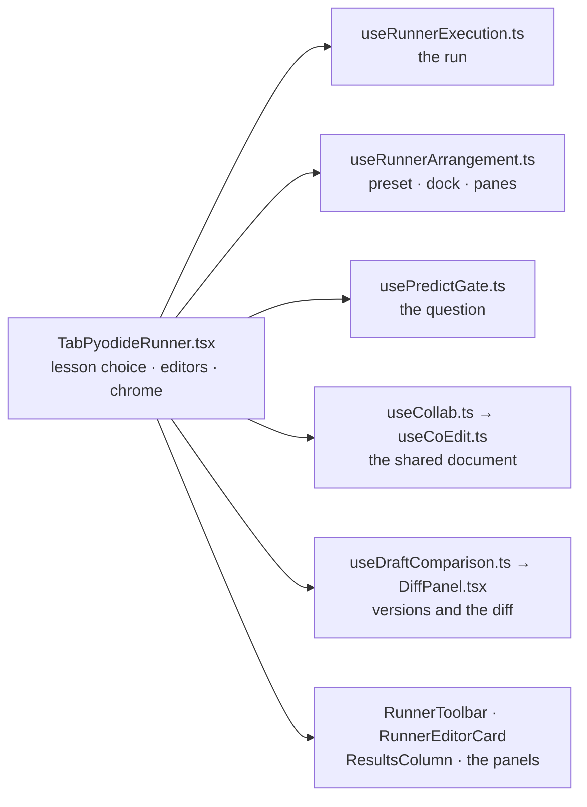

# The lesson runner, split

`TabPyodideRunner.tsx` is the assembly: it owns the lesson choice, the editor's writers and the
chrome, destructures the execution hook by name, and renders the regions below. Each module here owns
one concern and is readable without the tab.

| Module | Owns |
|---|---|
| `useRunnerExecution.ts` | The run: the worker session and buffers, every cell a run's outcome lands in (output, trace, analysis, watches, parks), and `runPythonCode` / `runCellTo` / Stop / Pause / frame edits / watches. |
| `usePredictGate.ts` | The predict-first question: this lesson's record, the half-typed guess, the run it holds, and the one `requestRun` every surface asks a run through. |
| `useCoEdit.ts` | Co-editing over the pair session: the shared document, their offer (asked before an editor is replaced), and every local write turned into ops. |
| `useCollab.ts` | The pair channel read for co-editing: the subscription that feeds the session once the lesson functions exist, and the one message — an attempt — that belongs to the tab. |
| `collabNotice.ts` | What a co-edit session says when it stops: one sentence per reason and per side, so a remote stop never claims an action this workbench did not take. |
| `useDraftComparison.ts` | The versions behind the draft and what the diff compares against: the filed list, the earned solution, the chosen reference and the lesson reset. |
| `DiffPanel.tsx` | The diff drawing: reference buttons, rows, and the sentences about a fallback or an identical file. |
| `AttemptOffers.tsx` | The two offers of someone else's code — a pair attempt and a shared link — with the lesson check before either can replace a draft. |
| `useShareLink.ts` | The Share press and its five outcomes, including the printed URL when the clipboard refuses. |
| `useVimKeys.ts` | The remembered Vim opt-in and the mode the editor reads keys in while it is on. |
| `useProgressFlags.ts` | The verified and self-marked lesson stores, parent-owned or local, and the two writers. |
| `useRunnerArrangement.ts` | The editor/results split share, which side results sit on, and the persisted layout record. |
| `RunnerToolbar.tsx` | The run controls: presets and dock, Pause/Stop/Run, Predict, and the More panel's actions. |
| `RunnerEditorCard.tsx` | The editor surface: main/helper tabs, the pane strip, the split controls, and the editor body beside Predict, Run output, Expected and Workflow. |
| `LessonChooserRail.tsx` | The Study preset's left column: the lesson chooser, the strip it folds to, and the grid width that follows the fold. |
| `RunnerRuntimeStrip.tsx` | Where the interpreter is while it loads: first-run guide and runtime sentence. |
| `RunVerdict.tsx` | The one-line verdict under the run controls, from the last outcome. |
| `PredictPane.tsx` | The prediction gate's pane: the question, the committed guess and its reading. |
| `ResultsColumn.tsx` | The column that reports on the code: checker notes, study note, assessment, trace, scope, and the split divider. |
| `AssessmentPanel.tsx` | Instructor behavioural assessment: badges, graded checks and the hint each one unlocks. |
| `PausedBar.tsx` (+ `parkSource.ts`) | The parked-run bar: step controls, the quoted line, frame values, watches and frame edits. `PausedStep` is the worker's park payload. |
| `DraftHistoryPanel.tsx` | The filed runs behind a draft, and restoring one. |
| `BreakpointPanel.tsx` | Armed breakpoints and their conditions. |
| `useFirstRunTour.ts` | The first-run tour: record, offer/chip, gates, focus and dismissal. |

Wiring rule: a region takes exactly the state and callbacks it renders; it never reaches into the tab.
A region with more than a handful of inputs takes them as named concern objects — `RunnerEditorCard`
is handed `surface`, `draft`, `panes`, `gate`, `run`, `slots` and `collab`, and `ResultsColumn` its
`split`, `checks`, `trace` and `scope` — so its signature says what it depends on. A concern object
is not a bag: `panes` is one `{ value, onPanes }`, and the card derives the split, the visible views,
the slot order, the pane borders and the open helper file from it, so a new derivation is a change in
the card rather than a new input at the call site. The run is one
state every region is a view of, so it lives in one place — `useRunnerExecution.ts` — and the shared
worker protocol under it lives in `../../runtime/pyodideWorker.ts`. A change to how a lesson runs lands
in the hook; a change to how the tab looks lands here.

The editor precedes the reader in the DOM so the stacked Study preset reads code then text; `index.css`
still places them by column at `2xl`, so only the walk order changes, not the drawing. The lesson
chooser's fold and strip live in `LessonChooserRail.tsx`, which is also why the tab stays inside its
line budget.

Size rule, held by `npm run test:runner` (`scripts/test_runner_shape.mjs`): the tab's budget is
**2,986 lines with 28 state cells and 24 refs**, a state-owning hook stays under 400 lines except
`useRunnerExecution.ts` (one noun, so it is one module), and a view under 650. Those numbers are
measured, not chosen; the check fails when one rises, and a pass that raises one owes the reason in
the commit that raises it.
