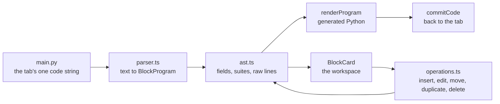

# The visual Python editor

`python-runner-editor`'s Visual face. It is a way of writing the lesson's one `main.py`, not a second
editor, document or runner: the code string and `Run` are the tab's, and the blocks are a model over
them.

| Module | Owns |
|---|---|
| `ast.ts` | The shared program: statement kinds, fields, suites, and `renderProgram`. The fast path returns the parsed `source` byte-for-byte until the first edit; an edited program is generated from its blocks. Raw and import nodes carry their own lines. |
| `parser.ts` | Python text to nodes. Logical lines are grouped before classification (brackets, triple-quoted strings, backslash continuations), suites are found by indentation, and an unrecognized indented block becomes one raw node that keeps its relative indentation. |
| `operations.ts` | Immutable edits: insert a template at a point, change fields, move within a body, duplicate with fresh ids, remove. Each returns a new program with `dirty` set. |
| `registry.ts` | The Python Toolbox catalogue: nine categories, complete statement templates, keyword search, and the Recommended / Categories / A–Z / Recently used sorts. |
| `settings.ts` | The remembered mode (`visual` / `code`), appearance, toolbox sort and recent element ids. Field-by-field normalization is the door stored values use. |
| `appearance.ts` | Normal and Colorful. Colorful gives each statement family a theme token (`--accent`, `--emerald`, `--amber`, `--rose`, `--purple`) mixed into the panel, so it follows all four palettes. |
| `useBlockEditor.ts` | The program, undo/redo stacks, selection and insertion point. Text this hook did not emit re-parses; text it did emit is not parsed back. |
| `BlockCard.tsx` | One statement as a card: real Python tokens, inline fields, a fold over move/duplicate/delete/insert-after, and an "Add statement inside" door on a suite. Each card publishes the drop target a dragged element lands on. |
| `InlineField.tsx` | One editable token: tap to open where it is, Enter or leaving commits, Escape restores. |
| `PythonToolbox.tsx` | The toolbox: category dropdown, Previous/Next, search, sort, tap-to-insert, pointer drag onto a card, and the phone's dock (grabber, swipe, a third of the screen). Colorful paints each element with its card's ink. |
| `PythonBlockEditor.tsx` | The workspace and its toolbar: undo/redo, Normal/Colorful, statement count, the card list and the toolbox (docked on a phone, inline from tablet up). |

## What the model promises

1. **Opening Visual is a read.** `renderProgram(parseProgram(source)) === source` while nothing is
   edited, blank lines and comments included. Switching back to Python Code cannot rewrite a starter.
2. **The first edit writes valid Python.** Fields generate headers, empty suites generate `pass`,
   and the detected indent unit (2 or 4 spaces, or a tab) is used for new nested lines. The browser
   suite presses the runner's own Run and reads the block's print from the interpreter's output.
3. **Raw Python survives.** A `class`, a decorator or a statement outside the supported set keeps
   its lines and its relative indentation after an unrelated block changes.
4. **One program.** Visual and Python Code are two drawings of `code`; the tab's `commitCode` is the
   only writer, so drafts, checks, co-editing and Run see one document.

## Where it is wired

`app/src/components/tabs/runner/EditorCodePane.tsx` holds the main pane and the Visual / Python Code
switch. The block workspace is a `React.lazy` chunk, opened only when Visual is chosen, so the code
editor's first paint does not fetch it. The mode and look are device preferences; the code is not.

## Phone and desktop are one face

The workspace is not a phone-only surface, and the toolbox is not a second catalog for phones. Below
768 px the toolbox is a **dock**: fixed above the Study bar, folded to its grabber or opened to about
a third of the screen, moved by a swipe on the grabber, with the catalog scrolling inside it. From
`sm` up it is the inline panel under the workspace. The compact toolbar above the workspace is a
phone budget (one row, no sentence); `sm` restores the words, the larger buttons and the statement
noun. A card's five controls open folded on a phone and unfolded on desktop, and the fold is on every
card either way. The remembered `visual` mode also opens Study's editor body on a desktop instead of
leaving the chosen face behind a collapsed card.

Dragging is one pointer implementation, not HTML5 drag-and-drop: a mouse drag or a sideways touch
drag on an element follows the pointer, and the release hit-tests the `data-drop-body` /
`data-drop-index` attributes the cards and the workspace publish. Vertical touch drags stay with the
list's scroll (`touch-action: pan-y`), so dragging a block never breaks scrolling the catalog. The
click that pointer capture retargets at the element after a drop is swallowed, which is what keeps
one drop from inserting twice.

## Gates

- `npm run test:blocks` — the model, with no browser: round trips, nesting, edits, undo-relevant
  immutability, raw preservation, an empty suite completed with `pass`, two-space and tab
  indentation, a drop landing at the index its target named (root and inside a suite), the nine
  categories, the four sorts, and CPython's `ast.parse` on the generated programs.
- `npm run test:e2e:blocks` — the real surface: Python Code and Normal are the defaults; opening
  Visual and returning leaves `main.py` untouched and keeps the code caret; a statement typed in
  Python Code draws as a block, and returning to code leaves that text byte-identical; the toolbox
  collapses, steps categories, searches across them, sorts and remembers Recently used; a mouse drag
  from the toolbox lands after the card it is released on and is one undo step; a card folds and
  unfolds its five controls; a toolbox tap and an inline edit reach the code view; add-inside,
  insert-after, duplicate, delete and move up/down change the generated program; the interpreter runs
  it; the same history answers its buttons and ⌘Z/⇧⌘Z; Colorful repaints the toolbox and changes only
  the drawing, and with the mode and recent list survives a reload; axe finds nothing serious or
  critical; a 390 px phone has no horizontal scrolling, its toolbox is a dock on the Study bar that
  folds and reopens by swipe and by tap, and a touch tap inserts a statement; and the open Python
  Code pane walks all four app palettes, checking CodeMirror's rendered keyword, string, number and
  comment inks and its surface against the palette variables, then closes and reopens the pane across
  another palette and checks again.
- The app-wide sweeps open this workspace too: `npm run check:axe` and `npm run test:theme:e2e` audit
  Normal and Colorful in all four palettes on a seeded program containing one card of every
  statement family, so Colorful's five inks are measured rather than assumed.
