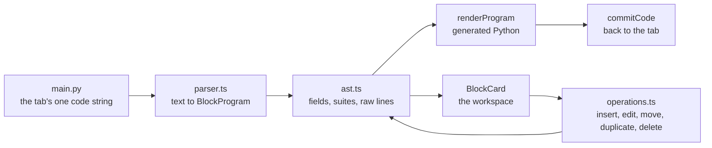

# The visual Python editor

`python-runner-editor`'s Visual face. It is a way of writing the lesson's one `main.py`, not a second
editor, document or runner: the code string and `Run` are the tab's, and the blocks are a model over
them.

| Module | Owns |
|---|---|
| `ast.ts` | The shared program: statement kinds, fields, suites, and `renderProgram`. The fast path returns the parsed `source` byte-for-byte until the first edit; an edited program is generated from its blocks. Raw and import nodes carry their own lines. |
| `parser.ts` | Python text to nodes. Logical lines are grouped before classification (brackets, triple-quoted strings, backslash continuations), suites are found by indentation, and an unrecognized indented block becomes one raw node that keeps its relative indentation. |
| `operations.ts` | Immutable edits: insert a template at a point, change fields, move within a body, move to the exact point a drop names (across bodies, never into the statement's own subtree, no-op on its own place), duplicate with fresh ids, remove. Each returns a new program with `dirty` set. |
| `registry.ts` | The Python Toolbox catalogue: nine categories, complete statement templates, keyword search, and the Recommended / Categories / A–Z / Recently used sorts. |
| `settings.ts` | The remembered mode (`visual` / `code`), appearance, toolbox sort and recent element ids. Field-by-field normalization is the door stored values use. |
| `appearance.ts` | Normal and Colorful. Colorful gives each statement family a theme token (`--accent`, `--emerald`, `--amber`, `--rose`, `--purple`) mixed into the panel, so it follows all four palettes. |
| `useBlockEditor.ts` | The program, undo/redo stacks, selection and insertion point. Text this hook did not emit re-parses; text it did emit is not parsed back. |
| `BlockCard.tsx` | One statement as a card: real Python tokens, inline fields, a fold over move/duplicate/delete/insert-after that opens closed at every width, and an "Add statement inside" door on a suite. A press on the card lifts it (a hold on touch, a short travel with a mouse); each card publishes the drop target a dragged element lands on, the ring a release would snap to, and a small arrow in the gap the statement will land in. |
| `InlineField.tsx` | One editable token: tap to open where it is, Enter or leaving commits, Escape restores. |
| `PythonToolbox.tsx` | The toolbox: category dropdown, Previous/Next, search, sort, tap-to-insert, pointer drag onto a card, and the phone's dock (a grabber whose swipe moves the sheet with the finger, a third of the screen). Colorful paints each element with its card's ink. |
| `PythonBlockEditor.tsx` | The workspace and its toolbar: undo/redo, Normal/Colorful, statement count, the card list and the toolbox (docked on a phone, inline from tablet up). |

## What the model promises

1. **Opening Visual is a read.** `renderProgram(parseProgram(source)) === source` while nothing is
   edited, blank lines and comments included. Switching back to Python Code cannot rewrite a starter.
2. **The first edit writes valid Python.** Fields generate headers, empty suites generate `pass`,
   and the detected indent unit (2 or 4 spaces, or a tab) is used for new nested lines. The browser
   suite presses the runner's own Run and reads the block's print from the interpreter's output.
3. **Raw Python survives.** A `class`, a decorator or a statement outside the supported set keeps
   its lines and its relative indentation after an unrelated block changes.
4. **One program.** Visual and Python Code are two drawings of `code`; the tab's `commitCode` is the
   only writer, so drafts, checks, co-editing and Run see one document.

## Where it is wired

`app/src/components/tabs/runner/EditorCodePane.tsx` holds the main pane and the Visual / Python Code
switch. The block workspace is a `React.lazy` chunk, opened only when Visual is chosen, so the code
editor's first paint does not fetch it. The mode and look are device preferences; the code is not.

## Phone and desktop are one face

The workspace is not a phone-only surface, and the toolbox is not a second catalog for phones. Below
768 px the toolbox is a **dock**: fixed above the Study bar, folded to its grabber or opened to about
a third of the screen, with the catalog scrolling inside it. The grabber's swipe is not a decision on
release: the sheet's height follows the finger pixel for pixel while it moves, and only letting go
settles it — one short ease to open or folded, or a snap back when a drag ends on the side it
started. A folded dock keeps its body mounted (clipped, `inert`, `aria-hidden`) so that fold has
something to animate, and a touch tap on the grabber still toggles it. From `sm` up it is the inline
panel under the workspace. The compact toolbar
above the workspace is a phone budget (one row, no sentence); `sm` restores the words, the larger
buttons and the statement noun. A card's five controls open folded at every width: the toggle is on
every card, and the code is what a card is for. The remembered `visual` mode also opens Study's
editor body on a desktop instead of leaving the chosen face behind a collapsed card.

Dragging is one pointer implementation, not HTML5 drag-and-drop: a mouse drag or a sideways touch
drag on an element follows the pointer, and the release hit-tests the `data-drop-body` /
`data-drop-index` attributes the cards and the workspace publish. Vertical touch drags stay with the
list's scroll (`touch-action: pan-y`), so dragging a block never breaks scrolling the catalog. The
click that pointer capture retargets at the element after a drop is swallowed, which is what keeps
one drop from inserting twice.

**A card is draggable too**, and by the same targets. A touch rests on a card for about a third of a
second, or a mouse travels past eight pixels, and the card follows the pointer behind a small label
chip that rides just above the pointer (a chip centred on the finger would cover the landing gap);
the card under it draws the line a release will snap to, with a small down arrow in the exact slot —
the gap below that card, or just above the top of an empty suite's dashed target — and the drop is
one exact point — root or any suite, above or below any card. A touch that moves before the hold ends is a scroll, not
a drag. Controls opt out with `data-no-drag`, so a verb is still a button and a tap still opens a
field; a press that has not lifted is cancelled when the pointer leaves the card, and the card takes
pointer capture only once it is in the air, so a tap's click reaches the field it started on. The
move keeps the statement's id, refuses to drop a suite inside itself, and a drop on the statement's
own place is not an edit (and so not an undo step).

The browser's own long-press gestures are declined while a card is in hand. The non-passive
`touchmove` guard goes on when the finger goes down, not when the hold lifts, because a browser
decides at the start of a touch sequence whether that sequence may scroll; only once the card has
lifted does the guard `preventDefault`, so a finger that scrolls sooner still scrolls. A
`contextmenu` guard does the same for Android's long-press menu, and the card's own CSS
(`-webkit-touch-callout: none`, and `user-select: none` under a coarse pointer, with fields keeping
their text selection) keeps iOS's callout and selection out of the same finger. A mouse on a wide
screen can still select the code it can see.

## Gates

- `npm run test:blocks` — the model, with no browser: round trips, nesting, edits, undo-relevant
  immutability, raw preservation, an empty suite completed with `pass`, two-space and tab
  indentation, a drop landing at the index its target named (root and inside a suite), a card moved
  to an exact point across bodies, a suite refusing a drop into its own subtree, a drop on its own
  place leaving the program identical, the nine categories, the four sorts, and CPython's `ast.parse`
  on the generated programs.
- `npm run test:e2e:blocks` — the real surface: Python Code and Normal are the defaults; opening
  Visual and returning leaves `main.py` untouched and keeps the code caret; a statement typed in
  Python Code draws as a block, and returning to code leaves that text byte-identical; the toolbox
  collapses, steps categories, searches across them, sorts and remembers Recently used; a mouse drag
  from the toolbox lands after the card it is released on and is one undo step; a card opens folded,
  and its toggle unfolds the five controls; a card is picked up, follows the pointer with its label
  chip riding above it and a small arrow in the gap a release would land in, and snaps to the drop
  point it was released on, as one undo step; a real touch long-press
  carries a card onto another card without scrolling the page, selecting text or opening the
  long-press menu, and a real touch swipe on the dock grabber moves the sheet before it settles; a
  toolbox tap and an inline edit reach the code view; add-inside,
  insert-after, duplicate, delete and move up/down change the generated program; the interpreter runs
  it; the same history answers its buttons and ⌘Z/⇧⌘Z; Colorful repaints the toolbox and changes only
  the drawing, and with the mode and recent list survives a reload; axe finds nothing serious or
  critical; a 390 px phone has no horizontal scrolling, its toolbox is a dock on the Study bar whose
  height follows the grabber before it settles, folds and reopens by touch swipe and touch tap, and
  a touch tap inserts a statement; and the open Python
  Code pane walks all four app palettes, checking CodeMirror's rendered keyword, string, number and
  comment inks and its surface against the palette variables, then closes and reopens the pane across
  another palette and checks again.
- `npm run test:e2e:snap-arrow` — the arrow **on screen**, not only in the DOM: at 1280 and 390 it
  holds a real drag (a mouse and a CDP touch long-press) over the gap below a card and over an empty
  suite, screenshots each paused frame into `artifacts/snap-arrow/`, hides the arrow to diff its own
  pixels, and checks the painted pixels are the accent colour at 10×6. A clipped, covered or
  wrong-coloured marker fails here; the after-release frame and the DOM count prove it clears.
- The app-wide sweeps open this workspace too: `npm run check:axe` and `npm run test:theme:e2e` audit
  Normal and Colorful in all four palettes on a seeded program containing one card of every
  statement family, so Colorful's five inks are measured rather than assumed.
