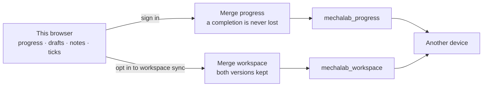

# Accounts — optional sign-in, what syncs, and where the data goes

Learning is open without an account. Reading a lesson, running code, keeping drafts, notes, cards and a
learning log all work in a browser with nothing configured and nothing sent anywhere. An account exists
for one reason: carrying that work to another device.

| build / state | what happens |
| :--- | :--- |
| **No Supabase variables** (default, and this repository's CI) | Everything works as before. Progress, drafts, notes, checklist ticks and the log live in this browser. The header button reads **Sign in** and the panel says cloud sync is not configured. |
| **Configured, signed out** | The same local-only behaviour, plus a working **Continue with Google**, email + password and emailed-link form. Nothing is uploaded until a sign-in succeeds. |
| **Configured, signed in** | The progress snapshot is merged with the account on sign-in and saved after each change. Drafts, notes and checklist ticks stay local unless workspace sync is switched on. |
| **Signed in, workspace sync on** | The merged workspace — drafts, lesson notes and highlights, and the checklist ticks — is written to both the browser and the account. Conflicts keep both versions; ticks union. |



## Signing in

- **Continue with Google** — the same button for a new and a returning learner. Supabase/Google decide
  whether the account exists; there is no separate "register with Google" flow to get wrong.
- **Email + password** — create an account, confirm the address (Supabase sends the confirmation), sign
  in, reset a forgotten password from a link. The password rules live in `app/src/accountRules.ts`: at
  least ten characters, not the email address, not one repeated character.
- **Email me a sign-in link** — kept from the first version: no password to remember, one link per
  sign-in.
- **Linking** — signing in with Google using the same confirmed email links the identity to the existing
  account, so progress does not split in two. Where Supabase cannot link automatically, it asks the
  learner to confirm; it never silently creates a duplicate account with the same address.
- **Returning to the right page** — the sign-in request carries an internal destination (`?lesson=P.1`,
  `?view=dashboard`). `app/src/returnTo.ts` reduces it to this origin and base path, refuses a scheme,
  `//host`, a backslash and `..`, and falls back to the site root. The Supabase redirect allow-list is
  the second lock.
- **Recovery links** — a reset link lands on the app with `?type=recovery`; the panel opens on "set a new
  password" instead of asking for the old one.

## What syncs

| data | first release | with workspace sync on |
| :--- | :--- | :--- |
| `verifiedLessons`, `completedLessons`, `completedMilestones` | yes | yes |
| Learning log (`mechalab.learningLog.v1`) | yes | yes |
| Lesson drafts (`mechalab_drafts_v1`) | no | yes |
| Lesson notes and highlights (`mechalab_study_notes_v1`) | no | yes |
| Lesson checklist ticks (`mechalab_lesson_checks_v1`) | no | yes — unioned, so a tick is never removed |
| Study-card schedule, pair sessions, layout, theme | no | no — device-local by design |

**Progress merge** (`app/src/progressMerge.ts`, `npm run test:merge`): a flag true on either side stays
true, a flag the newer snapshot sets to false is removed, and the log is the union de-duplicated by
`(time, kind, lesson, outcome, level)`. Signing in on a fresh browser therefore inherits the account's
progress instead of replacing it.

**Workspace merge** (`app/src/workspaceMerge.ts`, `npm run test:accounts`): a draft or note present on
one side is kept; identical copies collapse to one; two different versions both survive — the newer
snapshot owns the lesson's slot and the other version is stored in `conflicts` with its origin and time.
Highlights union by quote; two different comments on one quote keep the newer in place and the older in
the conflict list. Checklist ticks union by item, the same rule the backup uses: a tick added on either
device is kept, and neither side can take one away. Nothing is silently overwritten, and the dashboard
counts the kept versions.

Switching workspace sync off stops uploads and deletes nothing, on either side.

## What leaves the browser

- The email address and password (or the Google identity) you sign in with, held by Supabase Auth.
- The progress snapshot: three flag maps and the learning log. No page views, no time-on-page, no keystroke
  data, no code you ran.
- With workspace sync on, only: drafts for lessons you edited, lesson notes, highlight quotes plus
  their comments, and the items you ticked in lesson checklists.
- One row in `mechalab_roles` if you are an admin, and an audit entry naming the admin who changed a
  setting or a role.

It does **not** send analytics, advertising identifiers, your layout, theme, study-card schedule, pair
sessions or the contents of your clipboard. Nothing is shared with another learner; row-level security
keys every row to the signed-in user id.

## Export and delete

Both live in **Account → Your data**.

- **Export my data** → `account-action` returns one JSON document: the account (id, email, creation time,
  connected providers), the progress snapshot and, if it exists, the workspace copy. The browser turns it
  into `mechalab-account.json`.
- **Delete account** → type `DELETE`, and `account-action` removes the workspace, progress and role rows,
  then the auth user itself. Work still in this browser is untouched; the panel says so before you type.
  An account-deletion entry is written to the audit log first.

The Edge Function takes the user id from the session JWT, never from the request body, so it cannot be
asked to delete somebody else's account.

## One-time setup (staging first)

Do this twice: a staging project first, then production. Nothing in the app can move staging data into
production, and the two have separate keys.

1. **Create a Supabase project** (the free tier is enough; a snapshot is a few KB).
2. **Run the migrations** in order, either by pasting each file from
   [`supabase/migrations/`](../supabase/migrations) into the SQL editor or with the CLI:

   ```bash
   supabase link --project-ref <staging-ref>
   supabase db push
   ```

   They create `mechalab_progress`, `mechalab_workspace`, `mechalab_roles`, `mechalab_audit` and
   `mechalab_site_settings`, enable and **force row level security**, revoke the default grants and grant
   back only the verbs each table needs. `python3 tests/test_accounts_schema.py` checks those properties.
3. **Auth → URL Configuration.** Set **Site URL** to the deployed app and add every redirect:
   - `https://tle47.github.io/Mechatronics-Roadmap/`
   - `http://localhost:3000/`
   - the staging Pages URL, if you deploy one

   Google returns to the Supabase callback, and Supabase then checks the final destination against this
   list: the return-to sanitiser in the bundle is not a substitute for it.
4. **Auth → Providers → Email.** Confirmation is on by default; keep it. The free tier's built-in sender
   is rate-limited (a handful of messages an hour) — set custom SMTP before inviting a class.
5. **Google sign-in.** In Google Cloud Console create an OAuth client of type *Web application*:
   - **Authorized JavaScript origins:** `https://tle47.github.io` and `http://localhost:3000`
   - **Authorized redirect URI:** `https://<project-ref>.supabase.co/auth/v1/callback` — the callback
     Supabase shows in **Authentication → Providers → Google**
   - Copy the client id and secret into Supabase's Google provider and enable it.
6. **Password reset** uses the same redirect allow-list; no extra provider is needed.
7. **Edge Functions.** With the CLI linked to the project:

   ```bash
   supabase functions deploy account-action
   supabase functions deploy admin-action
   supabase functions deploy curriculum-pr
   ```

   These need `SUPABASE_URL`, `SUPABASE_ANON_KEY` and `SUPABASE_SERVICE_ROLE_KEY`, which the platform
   provides. Add `APP_ORIGIN=https://tle47.github.io,http://localhost:3000` so CORS answers only those
   origins. `curriculum-pr` additionally needs the GitHub App secrets in [`ADMIN.md`](ADMIN.md); it
   answers `501` until they are set, and the rest of the app is unaffected.
8. **The first admin** is assigned out of band, in the SQL editor — see [`ADMIN.md`](ADMIN.md). There is
   no button for it, and no profile field can grant a role.
9. **Build variables.** The anon key is public by design; the service key must never reach the bundle.
   - **GitHub Actions → Variables:** `VITE_SUPABASE_URL`, `VITE_SUPABASE_ANON_KEY`. The Pages build in
     [`.github/workflows/ci.yml`](../.github/workflows/ci.yml) reads them on the next push to `main`.
   - **Locally:** `.env.local` in the repository root with the same two names; `npm run dev` then serves
     the configured build. Without it, dev stays local-only.

## Troubleshooting

| symptom | likely cause |
| :--- | :--- |
| Panel says cloud sync is not configured | The build ran without `VITE_SUPABASE_URL` / `VITE_SUPABASE_ANON_KEY`. Variables are read at build time, not runtime. |
| "Google sign-in is not enabled on this project yet" | Provider not enabled in Supabase, or the OAuth client is missing its callback URI. |
| Returns to the site root after sign-in | The intended destination was rejected by `returnTo.ts`, or the app URL is not in Supabase's redirect list. |
| "Draft sync unavailable: …" | `0002_…` has not run on this project; progress sync keeps working. |
| Sign-in email never arrives | Free-tier rate limit or the address is on Supabase's suppression list; check Auth → Logs. |
| Admin actions answer 403 with a MFA sentence | The account panel's **Set up two-factor** enrols a TOTP factor; verify one code and the session is `aal2` — see [`ADMIN.md`](ADMIN.md). |
| `mechalab_progress` row exists but nothing loads | The row's `snapshot.schema` is not `mechalab.progress/1`; an older or hand-edited row is ignored on purpose. |

## Release checks before inviting learners

Automated (`npm run test:accounts`, `npm run test:schema`, `npm run test:merge`, plus the build and the
existing suites):

- A build with no Supabase variables still works fully as a guest.
- Email/password rules, callback-error sentences, return-to sanitisation, merge rules, the dashboard
  model, the admin gate and the flag parser.

Against staging, by hand — each of these is a check that no unit test can make:

1. Create an account, receive the confirmation, sign in, sign out; reset the password from the link.
2. Sign in with Google as a **new** user, then again as the **same** user; cancel the Google sheet once and
   confirm the panel says so and nothing changed.
3. Sign in on a second browser and confirm progress arrives; edit a draft on both and confirm the
   dashboard lists both versions.
4. Sign in as two different accounts and confirm neither can read the other's row (also try the REST
   endpoint with the first account's JWT and the second's user id).
5. With a learner's JWT, call `admin-action` directly and confirm `403`; try `role.assign` for yourself.
6. As an admin without a TOTP session, confirm the same `403`; enrol and confirm the action works.
7. Change the announcement, reload signed out, confirm the banner appears; clear it.
8. Open a curriculum pull request from the admin area and confirm a PR appears that must pass CI.
9. Export the account, inspect the JSON, then delete the account and confirm the rows and the auth user
   are gone while the browser's local work remains.
10. Go offline, edit a draft, come back, sign in and confirm the merge report is honest.

### The staging pass, and what it found

Steps 4–9 (except the pull request) are scripted, so they can be repeated instead of retyped:

```bash
SUPABASE_ACCESS_TOKEN=… npm run check:staging          # 18 checks against a live project
npm run test:e2e:two-factor                            # the panel, in a browser, against :3000
```

`check:staging` creates confirmed test accounts with generated passwords (written to
`~/.staging-secrets/staging-users.json`, `0600`, never printed; accounts from an earlier run are deleted
first), then asserts: a learner reads and writes only their own row, cannot insert into somebody else's
and cannot patch their own role; `admin-action` and `curriculum-pr` refuse a learner's JWT; an admin at
`aal1` is refused with the MFA sentence and at `aal2` is allowed in, after a real TOTP enrolment computed
by the script; the announcement is written, reads back signed out, and clears; promote and demote both
work; demoting the last admin is `409`; audit rows exist for every write; export returns account,
progress and workspace; delete removes the auth user and its rows; `curriculum-pr` answers `501` until
its GitHub App secrets exist. `test:e2e:two-factor` signs in through the panel, sets up the factor from
the secret the panel shows, verifies a code, saves an announcement from the admin area, and then signs
in from a fresh browser that is asked for a code rather than shown the secret again.

**Run on 2026-10-24 against `mechalab-staging`: 18/18 and all six panel checks passed.** It found two
real defects: the function asked `getAuthenticatorAssuranceLevel()` on a stateless client, so every
admin was refused, and the panel had no way to enrol a factor at all — so the release checks above were
unreachable. Both are fixed; the pass is the regression test.

Still manual: the confirmation email (the built-in sender allows a couple an hour), the Google round
trip including cancellation, the two-browser draft conflict, the offline merge, and the GitHub App pull
request, which needs the App's secrets.
