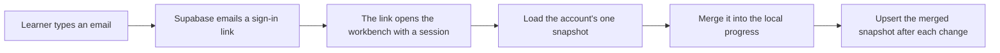

# Accounts — signing in, and where progress goes

The workbench ships two modes and the same UI for both:

| build | what happens |
| --- | --- |
| **No Supabase variables** (default, and this repository's CI) | Everything works exactly as before. Progress lives in this browser, the header button reads **Sign in**, and the panel explains that cloud sync is not configured. |
| **`VITE_SUPABASE_URL` + `VITE_SUPABASE_ANON_KEY` set** | The button opens an email field. A learner types their address, gets a sign-in link, and from then on the three progress maps and the learning log are merged with their account on every change. |

There is no password, no server of ours, and no secret in the bundle: Supabase's `anon` key is a
public identifier, and row-level security is what stops one learner from reading another's row.



## What syncs

- `verifiedLessons`, `completedLessons`, `completedMilestones` — the same maps the header counters and
  the portfolio export already read.
- The learning log (`mechalab.learningLog.v1`) — exported by the header button as JSON.

**Merge rule** (implemented in `app/src/progressMerge.ts`, tested by `npm run test:merge`): a flag
true on either side stays true, a flag the newer snapshot sets to false is removed, and the log is the
union of both sides de-duplicated by `(time, kind, lesson, outcome, level)`. Signing in on a fresh
browser therefore inherits the account's progress instead of replacing it, and un-ticking a milestone
on one device is not undone by another device's older copy.

Signing out stops the sync; local progress stays where it is.

## One-time setup (about five minutes)

1. Create a project at <https://supabase.com> (free tier is enough: the row is a few KB).
2. In **SQL Editor**, run:

   ```sql
   create table if not exists public.mechalab_progress (
     user_id uuid primary key references auth.users on delete cascade,
     snapshot jsonb not null,
     updated_at timestamptz not null default now()
   );

   alter table public.mechalab_progress enable row level security;

   create policy "read own progress" on public.mechalab_progress
     for select using (auth.uid() = user_id);

   create policy "insert own progress" on public.mechalab_progress
     for insert with check (auth.uid() = user_id);

   create policy "update own progress" on public.mechalab_progress
     for update using (auth.uid() = user_id) with check (auth.uid() = user_id);
   ```

3. Under **Authentication → URL Configuration**, set **Site URL** to
   `https://tle47.github.io/Mechatronics-Roadmap/` and add the same value to **Redirect URLs**.
   For local testing also add `http://localhost:3000/`.
4. Under **Project Settings → API**, copy **Project URL** and the **anon public** key.
5. Put them where the build can see them:
   - **GitHub Pages:** repository **Settings → Secrets and variables → Actions → Variables** →
     `VITE_SUPABASE_URL` and `VITE_SUPABASE_ANON_KEY`. The Pages build in
     `.github/workflows/ci.yml` reads them; the next push to `main` publishes a build with sign-in.
   - **Locally:** create `.env.local` in the repository root with

     ```
     VITE_SUPABASE_URL=https://<project-ref>.supabase.co
     VITE_SUPABASE_ANON_KEY=<anon public key>
     ```

     `npm run dev` then serves the configured build. Without the file, dev stays local-only.

## Notes and limits

- The SDK is imported on demand (`app/src/accounts.ts`), so a build with variables set emits one extra
  chunk that a signed-out visitor never downloads, and a build without them contains no SDK at all.
- Email delivery on the Supabase free tier is rate-limited (a handful per hour) and arrives from
  Supabase's shared sender. For a single learner that is fine; for a class, configure custom SMTP.
- Progress is last-write-wins per snapshot with the merge above; two devices editing at the same
  moment cannot lose a *completion*, but a milestone un-ticked offline on the older device can be
  re-ticked by the newer one. That is deliberate: keeping work beats enforcing the uncheck.
- Nothing else is collected — no name, no analytics, no PIN. The row holds the email's user id, the
  snapshot and the time it changed.
