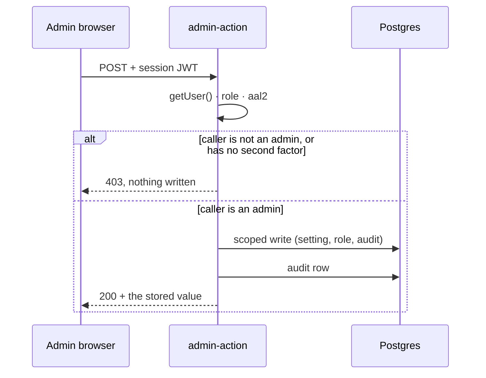

# Admin area — roles, site settings and reviewed curriculum changes

The admin area is `?view=admin` on the deployed app, and an entry appears in the account panel for an
account whose role row says `admin`. It is deliberately small: an overview, an announcement and one
feature flag, a role control, the audit log, and a curriculum change that leaves as a pull request.

## The boundary, and why the hidden page is not it

A hidden URL is not security, and this page does not pretend otherwise. Four things hold the line:

1. **Row-level security** on every table. A learner's JWT can read only their own progress and workspace
   rows; the audit log and role table have no browser write grant at all
   ([`supabase/migrations/`](../supabase/migrations), checked by `python3 tests/test_accounts_schema.py`).
2. **The role lives in `mechalab_roles`**, not in a profile field, an email domain or a `localStorage`
   flag. `authenticated` may `select` its own row and nothing else; there is no insert, update or delete
   privilege to misuse.
3. **Every privileged action is an Edge Function** (`account-action`, `admin-action`, `curriculum-pr`)
   that reads the user from the JWT, re-reads the role with the service-role client, and refuses anyone
   else with `403`. Calling the function by hand with a learner's token gets the same answer the page
   would have shown.
4. **Two-factor sessions for admin writes.** `admin-action` and `curriculum-pr` require the `aal2`
   level. An admin enrols from the account panel — **Set up two-factor** shows a base32 secret and an
   `otpauth://` link — and verifying a code turns that session into `aal2`; on a later sign-in the panel
   asks for a code instead of showing the secret again. A fresh project before anyone has a factor can
   set the secret `ADMIN_REQUIRE_MFA=0` to bootstrap; production leaves it unset.

   The level is read from the `aal` claim of the JWT the function has already validated with
   `getUser()`, not through `auth.mfa.getAuthenticatorAssuranceLevel()`: that helper reads the *stored
   session* of the client it is called on, and this client is stateless, so it answered `null` for every
   caller and refused every admin — caught by `npm run check:staging` before anyone depended on it.

What the admin area **cannot** do: read a learner's drafts, notes, code, learning log or email body.
Those rows are not exposed to it, and no function returns them. It also cannot publish a lesson directly;
curriculum changes go through CI.



## The first admin, out of band

Run this once in the SQL editor, with the id from **Authentication → Users**:

```sql
insert into public.mechalab_roles (user_id, role)
values ('00000000-0000-0000-0000-000000000000', 'admin')
on conflict (user_id) do update set role = excluded.role;
```

No account can grant itself a role: the table grants the browser `select` only, and `role.assign` in
`admin-action` is the sole writer — after checking the caller is already an admin.

The same function refuses to demote the **last** admin, so the site cannot be left with nobody who can
open this page.

## What each section does

| section | storage | notes |
| :--- | :--- | :--- |
| Overview | — | Version and the capability list. Aggregate only; no learner data. |
| Announcement | `mechalab_site_settings` key `announcement` | Public read, ≤280 characters, shown at the top of every page. Clearing it removes the row and the built-in default (no banner) applies. |
| Feature flags | `mechalab_site_settings` key `feature_flags` | Fixed names only (`guided_tour` today). A flag that has never been written is **on**, so a fresh project behaves like the build before settings existed. |
| Roles | `mechalab_roles` | Paste a user id and choose `admin` or `learner`. Written through `admin-action`, audited. |
| Audit log | `mechalab_audit` | Read through `admin-action` only. Each entry: time, actor id, action, JSON detail. |
| Curriculum | GitHub | Opens a branch, one commit and a pull request. Merge is a person, after CI. |

## Curriculum changes: a pull request, not a database edit

The lesson Markdown in this repository is the source of truth: the generators rebuild the app's lesson
data from it, and the full check suite is what decides a change ships. The dashboard's form therefore
takes a lesson path (`modules/…`, `track-p/…`, `ramp/…`, `stage-0/…` or a `00-…` chapter), a one-line
summary and the proposed Markdown, and `curriculum-pr`:

1. authenticates as the GitHub App (`GITHUB_APP_ID`, `GITHUB_APP_PRIVATE_KEY`, `GITHUB_INSTALLATION_ID`),
2. branches from `CURRICULUM_BASE_BRANCH` (default `main`),
3. commits the file, reusing its blob sha when the page exists,
4. opens a pull request titled `Curriculum: <summary>`, and
5. writes an audit entry.

Create the App under **GitHub → Settings → Developer settings → GitHub Apps** with **Contents:
read & write** and **Pull requests: read & write** on this repository only; install it on the
repository; then add its id, private key and installation id as Supabase function secrets.

```bash
supabase secrets set GITHUB_APP_ID=... GITHUB_INSTALLATION_ID=...
supabase secrets set GITHUB_APP_PRIVATE_KEY="$(cat app-private-key.pem)"
supabase functions deploy curriculum-pr
```

`CURRICULUM_REPO` (default `TLE47/Mechatronics-Roadmap`) and `CURRICULUM_BASE_BRANCH` are optional.
Until the secrets exist the function answers `501` and the rest of the admin page works.
The private key is never in the bundle, never in chat and never in a `VITE_` variable.

## Reading the audit log

| field | meaning |
| :--- | :--- |
| `at` | Server time of the action |
| `actor` | The admin's user id (`null` after the account is deleted) |
| `action` | `site_setting.set`, `site_setting.clear`, `role.assign`, `curriculum.pr`, `account.delete` |
| `detail` | The key and value, the target user and role, the PR number and path |

Writes are best-effort: a failed audit insert is logged to the function's console but does not turn a
completed action into an error. If an entry matters legally, read the function logs too.

## Admin release checks

Run these against staging before inviting anyone:

1. A learner's JWT calling `admin-action` directly → `403`; the same for `curriculum-pr`.
2. An admin session at `aal1` → `403` with the MFA sentence; after enrolling TOTP and signing in again →
   the action succeeds.
3. `role.assign` demoting the only admin → `409`.
4. A role row inserted by hand for a second account → that account sees the button; a deleted row removes
   it on the next sign-in.
5. Announcement set → visible signed out on a fresh browser; cleared → gone.
6. `guided_tour` set to `false` → the tour bar is absent on a simulator tab; cleared → back.
7. Curriculum PR → a PR appears, its own CI run starts, and it cannot merge on a red suite.
8. The admin page never shows a learner's draft, note or code, even when a row is named in a URL or the
   console.

Incident notes: rotate the App private key and re-deploy `curriculum-pr` if it is ever exposed; suspending
the App's installation revokes its access immediately. `ADMIN_REQUIRE_MFA=0` is a bootstrap switch, not a
setting — remove it once every admin has a factor.
