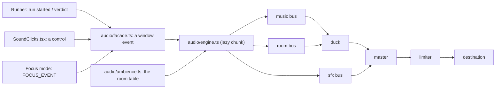

# Sound: opt-in, immersive, and quiet

MechaLab's sound is the plan's section 6. The plan's three rules are the design:

1. **Off until asked for, and no autoplay on landing.** A remembered "on" is *armed*: the first
   pointer press or key press starts the context. Remembering a preference is not permission to make
   noise at someone's desk.
2. **One press from muted.** The header carries the toggle, and focus mode carries the same button
   next to its way out — because focus hides the header, and a mute you cannot reach is not a mute.
3. **Nothing is required.** Every cue has a visual already on screen — the pips, the stamp, the award
   card, the failing line — so a muted learner loses no information. No setting here is a gate.

Inside those rules there are two kinds of sound, with different jobs:

* **The interface is furniture.** Seven short ticks (a tab, a Run, a latch, a row, a chip, a detent,
  a close) tell you that something happened without ever judging it. They have their own level, their
  own pacing, and they are the only thing in the app that pans.
* **The room is a place.** Rain on the window, the electrical floor, the city beyond it, and the
  bench under load. Which of those you hear is a fact about what you are doing — never a random
  event — and a run is the one moment the machinery is the loudest thing in the mix.



## The mixer

Five gain nodes and one limiter are the whole mixer. The bed level is

```
music = music × scene factor × duck factor
room  = room  × scene factor × duck factor
```

| Factor | Home | Focus | Run active |
| :--- | :--- | :--- | :--- |
| scene | 1 | 0.45 | unchanged |
| duck | 1 | 1 | 0.32 (≈ −10 dB) |

Focus and the duck are separate nodes, so they compose instead of overwriting each other — the one
bug this shape exists to prevent. The **room bus** is its own bus under the duck, so the Room fader
(rain, floor, city) is independent of the Music fader (the two beds). The **effects bus** carries the
cues, the interface ticks and the bench layer, and it **never** ducks: the relay click and the
verification stinger are the point of the moment, and a run should make the machine louder, not
quieter.

A **limiter** (a `DynamicsCompressorNode` at −6 dB, ratio 4) is the last thing before the speakers.
Nothing bypasses it, because a fast interface plus a verification stinger at the same instant is
exactly the case a passive mixer gets wrong.

## What plays, and when

| Moment | Cue | What it is |
| :--- | :--- | :--- |
| Sound is turned on | `boot` | A low swell, once — first light on the bench |
| Run pressed | `run-start` | A relay click; the bed steps back |
| Run passes, first time on this lesson | `verify` | The stamp's two-note stinger (under 1 s) |
| Run passes again | `run-pass` | The same rising third as the pips, shorter than the stamp |
| Run fails | `run-fail` | A neutral low tick — never a buzzer — plus one breath of rain |

A **watch run** — the machine repeating a check on the learner's behalf — is silent: it did not press
Run, so it gets neither the click nor the duck.

The beds are named in the plan and both exist: **Lab Night** (a low drone) at home, **Focus Current**
(a quieter, higher shimmer) in focus mode. They crossfade over 1.2 s.

## The interface's seven ticks

`audio/clickMap.ts` classifies a control from what it already says about itself, so the app never
needs a second styling system:

| Role | What it is | Sound |
| :--- | :--- | :--- |
| `nav` | a tab, a link, a select | dry metal, low, gone before the panel is |
| `primary` | Run, Continue, Open | the relay, shorter, with a spring release |
| `toggle` | a latch (`aria-pressed` / `aria-expanded`) | two stages, the second smaller |
| `row` | a list row, a disclosure | a brush, not a click |
| `chip` | a badge, a tag | glass, small and high |
| `slider` | a range input | the tiniest sound in the app |
| `close` | close, cancel, skip, back, delete | an unlatch, lower and darker than anything else |

Precedence: `data-sound="<role>"` wins; `data-sound="none"` silences a subtree; then `disabled`
is silent (it did nothing); then the element's own semantics decide. Text fields are silent — typing
is not a sound in this design.

Three budgets keep the ticks from becoming a noisemaker:

| Rule | Value | Why |
| :--- | :--- | :--- |
| one tick per | 35 ms | a click, not a rattle |
| at most | 16 ticks per second | a slider drag or several listeners cannot clip the mix |
| peak | 0.1 per tone | under the quietest verdict |

Each tick is placed by the pointer's position (`panFromX`), clamped to ±0.35, so the rail leans left
and the runner leans right. A keyboard activation is centred. `SoundClicks.tsx` is one delegated
listener — `pointerdown` and Enter/Space — mounted once in `App`, in every branch.

## The room's four layers

`audio/ambience.ts` is a table, and the engine only ramps the numbers it is given:

| Layer | What it is | home | focus | run |
| :--- | :--- | ---: | ----: | ---: |
| `rain` | the window, with the city behind it | 1.0 | 0.35 | 0.55 |
| `floor` | 50 Hz mains hum and its harmonic | 0.5 | 0.25 | 0.5 |
| `city` | distant traffic, band-passed noise | 0.35 | 0 | 0.25 |
| `bench` | the machine under load, on the effects bus | 0 | 0 | 0.8 |

A run in focus is the run row with the rain and the city pulled back to 60%: focus is a choice about
the room and it holds even while the checks run. A failed run pulls one **gust** of rain (1.55×, half
a second back down) — the room reacting to the machine, not a punishment sound.

## One recorded file, and why

Everything above is synthesised at the moment it plays, with one exception: the rain. It is a single
24-second loop, `app/src/audio/assets/rain-loop.m4a` (mono AAC, 40 kbps, 127 kB), because a noise
stack does not reach the texture of weather.

* **It ships in the bundle, so it is budgeted.** `npm run check:weight` measures the emitted media
  as `audio`, at its own bytes (not a gzip of an already-compressed file), against a 150 kB ceiling;
  it is inside `total` and outside `entry_gzip`.
* **It is fetched only after the gesture.** The engine's `ensureRain()` runs from `enable()`, so a
  learner who never turns sound on downloads no audio at all, and the service worker caches the loop
  on first success rather than precaching it.
* **It has a fallback.** If the file cannot be fetched or decoded (a browser without AAC, an offline
  first visit), the engine synthesises a looping filtered-noise rain instead. The debug snapshot says
  which one is playing (`rain: 'file' | 'synth'`), and the sound panel never mentions it — the room is
  the room either way.
* **It is generated, not sampled.** `scripts/build_ambience.mjs` renders it from a seeded PRNG, so it
  has no third-party rights attached and can be rebuilt byte-for-byte (see
  [`app/src/audio/assets/README.md`](../app/src/audio/assets/README.md)).

## Where the code is

| File | Owns |
| :--- | :--- |
| `app/src/audio/prefs.ts` | the store (`mechalab_sound_v1`), clamping, subscribers, the labels |
| `app/src/audio/facade.ts` | `playCue` / `playUi` / `setSoundScene` — three functions on one window event, no audio code |
| `app/src/audio/clickMap.ts` | what a control *is*, from what it already says; pan from a pointer |
| `app/src/audio/ambience.ts` | the room table: four layers, per state |
| `app/src/audio/engine.ts` | the AudioContext, graph, synthesis, limiter, ducking, scenes, the rain fetch (a lazy chunk) |
| `app/src/audio/rainAsset.ts` | the loop's URL, and nothing else, so a Node test can import the engine |
| `app/src/components/SoundClicks.tsx` | one delegated listener; renders nothing |
| `app/src/components/SoundControl.tsx` | the header button and panel, the focus pill, arming on a gesture |
| `scripts/build_ambience.mjs` | renders the loop, and `--check` proves the committed file is current |
| `scripts/test_audio.mjs` | the store, the graph, the automation, the room, the ticks — with a recording double |

The facade is why the runner can say "a run started" without importing the synthesiser: a learner
who never enables sound downloads the button, the event name and the click classifier, not the
engine.

## Accessibility and the archive

The toggle is a real `aria-pressed` button; the panel's sliders have labels and a visible percentage,
and every level is rounded to what the slider can show. Cues are short (≤ 1.2 s), quiet, and never a
buzzer — the plan's "failures are neutral". The interface's ticks are optional by construction: sound
off is silence, and `data-sound="none"` can silence any subtree. Nothing in the app depends on hearing
anything.

The preference is a preference: like the palette, the layout and the fold keys, it is **not** carried
in a backup, and `backupBundle.ts` says so in the archive's README.

## The gates

```bash
npm run test:audio        # 27 checks: defaults, clamping, graph, limiter, ducking, focus,
                          # the room table, the click vocabulary, pan, the cap, the rain fallback
npm run test:e2e:game     # 13 checks in Chromium: off by default, one press on, the room arriving,
                          # a click heard, the bed ducked on Run, the pill, a gesture after reload,
                          # and one press back to a silent interface
npm run check:weight      # the `audio` metric: the loop at its own bytes, under 150 kB
node scripts/build_ambience.mjs --check   # locally, with ffmpeg or afconvert present: the committed
                          # loop is still what the script makes byte for byte
```

The `--check` is a local proof rather than a CI gate on purpose: it compares encoded bytes, and two
`ffmpeg` builds can encode the same samples differently. What CI grades is the weight (`audio`, and
`total`), and what it serves is the committed file.

`test:audio` runs in the workbench matrix (`npm run test:workbench`), so a change to the engine runs
on the same dev server and the same built bundle as the rest of the app.
