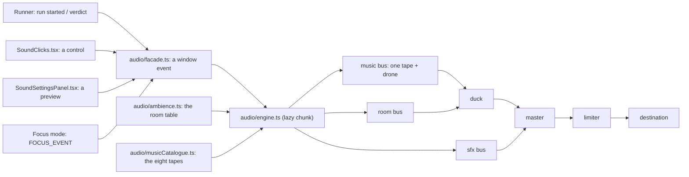

# Sound: opt-in, immersive, and quiet

MechaLab's sound is the plan's section 6. The plan's three rules are the design:

1. **Off until asked for, and no autoplay on landing.** A remembered "on" is *armed*: the first
   pointer press or key press starts the context. Remembering a preference is not permission to make
   noise at someone's desk.
2. **One press from muted.** The header carries the toggle, and focus mode carries the same button
   next to its way out — because focus hides the header, and a mute you cannot reach is not a mute.
3. **Nothing is required.** Every cue has a visual already on screen — the pips, the stamp, the award
   card, the failing line — so a muted learner loses no information. No setting here is a gate.

Inside those rules there are three kinds of sound, with different jobs:

* **The interface is furniture.** Seven short ticks (a tab, a Run, a latch, a row, a chip, a detent,
  a close) tell you that something happened without ever judging it. They have their own level, their
  own pacing, a switch of their own, and they are the only thing in the app that pans.
* **The room is a place.** Rain on the window, the electrical floor, the city beyond it, and the
  bench under load. Which of those you hear is a fact about what you are doing — never a random
  event — and a run is the one moment the machinery is the loudest thing in the mix.
* **The music is a bed, not a score, and it is a choice.** Eight seamless loops in six categories —
  Lo-fi, Jazz, Instrumental, Anime, Pop, K-pop — four cut from CC0 recordings, four composed by this
  repository. A learner picks a category, then a tape inside it; only the chosen file is fetched. A
  learner who would rather have a texture than a song picks the **Drone**, and the same drone covers a
  browser that cannot decode AAC.



## The mixer

Five gain nodes and one limiter are the whole mixer. The bed level is

```
music = music × scene factor × duck factor
room  = room  × scene factor × duck factor
```

| Factor | Home | Focus | Run active |
| :--- | :--- | :--- | :--- |
| scene | 1 | 0.45 | unchanged |
| duck | 1 | 1 | 0.32 (≈ −10 dB) |

Focus and the duck are separate nodes, so they compose instead of overwriting each other — the one
bug this shape exists to prevent. The **room bus** is its own bus under the duck, so the Room fader
(rain, floor, city) is independent of the Music fader (the tape). The **effects bus** carries the
cues, the interface ticks and the bench layer, and it **never** ducks: the relay click and the
verification stinger are the point of the moment, and a run should make the machine louder, not
quieter.

A **limiter** (a `DynamicsCompressorNode` at −6 dB, ratio 4) is the last thing before the speakers.
Nothing bypasses it, because a fast interface plus a verification stinger at the same instant is
exactly the case a passive mixer gets wrong.

## What plays, and when

| Moment | Cue | What it is |
| :--- | :--- | :--- |
| Sound is turned on | `boot` | A low swell, once — first light on the bench |
| Run pressed | `run-start` | A relay click; the bed steps back |
| Run passes, first time on this lesson | `verify` | The stamp's two-note stinger (under 1 s) |
| Run passes again | `run-pass` | The same rising third as the pips, shorter than the stamp |
| Run fails | `run-fail` | A neutral low tick — never a buzzer — plus one breath of rain |

A **watch run** — the machine repeating a check on the learner's behalf — is silent: it did not press
Run, so it gets neither the click nor the duck.

## The interface's seven ticks

`audio/clickMap.ts` classifies a control from what it already says about itself, so the app never
needs a second styling system:

| Role | What it is | Sound |
| :--- | :--- | :--- |
| `nav` | a tab, a link, a select | dry metal, low, gone before the panel is |
| `primary` | Run, Continue, Open | the relay, shorter, with a spring release |
| `toggle` | a latch (`aria-pressed` / `aria-expanded`) | two stages, the second smaller |
| `row` | a list row, a disclosure | a brush, not a click |
| `chip` | a badge, a tag | glass, small and high |
| `slider` | a range input | the tiniest sound in the app |
| `close` | close, cancel, skip, back, delete | an unlatch, lower and darker than anything else |

Precedence: `data-sound="<role>"` wins; `data-sound="none"` silences a subtree; then `disabled`
is silent (it did nothing); then the element's own semantics decide. Text fields are silent — typing
is not a sound in this design.

Three budgets keep the ticks from becoming a noisemaker:

| Rule | Value | Why |
| :--- | :--- | :--- |
| one tick per | 35 ms | a click, not a rattle |
| at most | 16 ticks per second | a slider drag or several listeners cannot clip the mix |
| peak | 0.1 per tone | under the quietest verdict |

Each tick is placed by the pointer's position (`panFromX`), clamped to ±0.35, so the rail leans left
and the runner leans right. A keyboard activation is centred. `SoundClicks.tsx` is one delegated
listener — `pointerdown` and Enter/Space — mounted once in `App`, in every branch. Once the engine is
loaded the message is handled **inside the event**, not on a promise chain: a press is dispatched on
`pointerdown` and the control's own handler runs after it, so an async hop would let a press that
switches the clicks off swallow the sound of its own click.

## The settings panel

The header's sound button turns sound on and off; the `···` beside it opens the panel
(`components/SoundSettingsPanel.tsx`), in the order a learner asks the questions:

| Section | What it holds |
| :--- | :--- |
| Sound | the master, and whether a remembered "on" is armed or playing |
| Music | the music fader, six category chips plus **Drone**, and the tapes inside the open category |
| Room | the room fader — rain, floor, city |
| Cues | the effects fader — Run, the pips, the stamp |
| Interface | a switch for whether the interface ticks at all, and three previews (a tab, Run, close) |
| Credit | the track, the artist, the licence, a link to the source, and **Reset** |

The switches are switches, not sliders at zero: a learner may want the verdicts and the room while
finding a tick under every button distracting. **A preview plays even with the clicks switched off** —
it is exempt from that switch and from the 35 ms gap, because asking to hear one is not the interface
chattering; the mute still wins. **Reset** restores the levels and the switches but never switches the
learner's sound off, and never changes the music source mid-phrase.

It is not a dialog: no focus trap, no backdrop, no scroll lock. It draws under the button, closes on
Escape or a press outside, and every control in it is a plain `<input type="range">` or `<button>`
with a label, so the keyboard reaches it without special handling.

**It lives in a portal, and it is clamped.** The card used to be an `absolute` child of the header's
sound tray, which on a phone meant a left edge at -21 px and a lower half inside the tray row's
sideways scroller — open, and impossible to use. `SoundControl` now portals it to `<body>` and places
it from the button's own rect (`placePanel`): right-aligned to the button and pulled back inside the
window, under it when there is room and above it when there is more, with a width of
`min(312 px, window − 24 px)` and a `max-height` of the room that side actually has. The card fills
that box and scrolls inside it, so a 360×640 phone scrolls the credit and **Reset** into view instead of
losing them below the fold. A press inside the panel is not a press outside it (the outside-click check
names both the control and the portal), and focus lands on the panel's first control and returns to the
button on close.

## The room's four layers

`audio/ambience.ts` is a table, and the engine only ramps the numbers it is given:

| Layer | What it is | home | focus | run |
| :--- | :--- | ---: | ----: | ---: |
| `rain` | the window, with the city behind it | 1.0 | 0.35 | 0.55 |
| `floor` | 50 Hz mains hum and its harmonic | 0.5 | 0.25 | 0.5 |
| `city` | distant traffic, band-passed noise | 0.35 | 0 | 0.25 |
| `bench` | the machine under load, on the effects bus | 0 | 0 | 0.8 |

A run in focus is the run row with the rain and the city pulled back to 60%: focus is a choice about
the room and it holds even while the checks run. A failed run pulls one **gust** of rain (1.55×, half
a second back down) — the room reacting to the machine, not a punishment sound.

## The eight tapes, and which ones are real

The music is a small library, not one bed. A **category** is a door, a **tape** is what plays, and the
panel says which is which — including, in the credit line, whether the learner is hearing a recording
or something this repository wrote.

| Tape | Category | Source | Length | File |
| :--- | :--- | :--- | ---: | ---: |
| *Snow Drift* | Lo-fi | HoliznaCC0, *Winter Lofi*, CC0 1.0 | 60 s | 415 kB |
| *Fire Place* | Lo-fi | HoliznaCC0, *Winter Lofi*, CC0 1.0 | 60 s | 415 kB |
| *Winter Blues* | Jazz | HoliznaCC0, *Winter Lofi*, CC0 1.0 | 45 s | 272 kB |
| *First Snow* | Instrumental | HoliznaCC0, *Winter Lofi*, CC0 1.0 | 40 s | 242 kB |
| *Bench Arpeggio* | Instrumental | composed here | 24 s | 123 kB |
| *Paper Lanterns* | Anime | composed here | 24 s | 122 kB |
| *City Lights* | Pop | composed here | 24 s | 121 kB |
| *Neon Stage* | K-pop | composed here | 24 s | 122 kB |

**The four recordings are real tracks, and CC0.** CC0 1.0 is a public-domain dedication: a cut loop
may be bundled and redistributed with no attribution obligation. The credit in the panel and in
[`../app/src/audio/assets/music/NOTICE.md`](../app/src/audio/assets/music/NOTICE.md) is honour rather
than duty.

**The other four are composed, and say so.** No free recording covers anime, pop or K-pop idioms, and
licensing a real song would be a different kind of project. `scripts/build_music.mjs` renders each
from a seeded additive synth — bells, four-chord pads, a plucked arpeggio — so a re-render is the same
file, and the catalogue's artist field is "composed by this repository" rather than a band name.

How every file is made, in one pipeline:

* **Recorded:** a fixed window at a fixed start, then the two seconds after it folded back over the
  head with an equal-power crossfade, so the loop has no seam.
* **Composed:** eight or twelve bars of a chord schedule and a rhythm, chosen so the folded seam lands
  on a downbeat.
* **Matched:** every tape is normalised to a common RMS (≈ −18.4 dBFS) with a peak ceiling of 0.8. Peak
  normalisation alone is not loudness: a dense 24-second synth loop and a sparse piano recording both
  peak at 0.8 and differ by 6 dB under the fader, which makes choosing a category sound like choosing
  a volume.
* **Encoded:** the two original beds stay stereo at 56 kbps; the newer tapes are mono at 48 kbps and
  the composed ones at 40 kbps. Eight tapes is where weight starts to matter.

Behaviour the engine owns:

* **One file, after the gesture, only if asked for.** `ensureTape()` runs from `enable()` or from an
  `apply()` that changes the tape or raises Music above zero. A learner who never turns sound on, who
  chose the drone, or who left Music at zero downloads nothing.
* **The chosen tape, not both beds.** A tape change is a scene change: the old loop and the new one
  crossfade over 1.2 s, and a scene change (home ↔ focus) does not switch tapes at all — focus quiets
  the music through the bus.
* **Three decoded tapes are kept.** A visited tape stays looping at zero gain so switching back is
  instant; past three, the oldest gives up its node. Hunting through all eight cannot keep eight
  decoded buffers resident.
* **The drone is the fallback and the alternative.** A browser without AAC, an offline first visit, a
  404: `musicFailed` leaves the synthesised bed playing and `musicSource` reports `synth`. The panel's
  **Drone** chip is the same path chosen on purpose. A late failure for a tape the learner already
  abandoned does not blank the one now playing.
* **It is budgeted separately.** The eight files are the `music` metric at their own bytes: 1.90 MB
  against a 2.10 MB ceiling, inside `total` and outside `entry_gzip`.

## The room's recorded loop

The rain is one more file: `app/src/audio/assets/rain-loop.m4a` (24 s, mono AAC, 127 kB), generated
by `scripts/build_ambience.mjs` from a seeded PRNG, so it has no third-party rights and rebuilds
byte-for-byte. It is the `audio` metric (127 kB against 150 kB), fetched after the gesture, with a
synthesised fallback when it cannot be had.

## Where the code is

| File | Owns |
| :--- | :--- |
| `app/src/audio/prefs.ts` | the store (`mechalab_sound_v1`), clamping, subscribers, the labels; five levels-or-switches, with old records migrated |
| `app/src/audio/facade.ts` | `playCue` / `playUi` / `previewUi` / `setSoundScene` — one window event, no audio code |
| `app/src/audio/clickMap.ts` | what a control *is*, from what it already says; pan from a pointer |
| `app/src/audio/ambience.ts` | the room table: four layers, per state |
| `app/src/audio/musicCatalogue.ts` | the eight tapes as facts — category, title, artist, licence, page — with no audio imports, so the panel and the tests can read them |
| `app/src/audio/musicBeds.ts` | the tapes' lazy URL glob and decode, reached only through a dynamic import inside the engine |
| `app/src/audio/engine.ts` | the AudioContext, graph, synthesis, limiter, ducking, scenes, the chosen tape and its three-node cache, the rain fetch (a lazy chunk) |
| `app/src/audio/rainAsset.ts` | the rain loop's URL, and nothing else |
| `app/src/components/SoundClicks.tsx` | one delegated listener; renders nothing |
| `app/src/components/SoundControl.tsx` | the header button, the focus pill, arming on a gesture, and the engine's synchronous handler |
| `app/src/components/SoundSettingsPanel.tsx` | the panel: sections, faders, the two switches, previews, credit, reset — a card that fills the box `SoundControl` gives it |
| `scripts/build_ambience.mjs` / `scripts/build_music.mjs` | the rain and the eight tapes, and the `--check` that proves each is what its script makes |
| `scripts/test_audio.mjs` | the store, the graph, the automation, the room, the ticks, the catalogue, the tape cache — with a recording double |

The facade is why the runner can say "a run started" without importing the synthesiser: a learner who
never enables sound downloads the button, the event name and the click classifier, not the engine or
a byte of music.

## Accessibility and the archive

The toggle is a real `aria-pressed` button; the panel's faders have labels and a visible percentage,
and every level is rounded to what the slider can show. Cues are short (≤ 1.2 s), quiet, and never a
buzzer — the plan's "failures are neutral". The interface's ticks are optional by construction: sound
off is silence, the Interface switch silences them without silencing the verdicts, and
`data-sound="none"` can silence any subtree. Nothing in the app depends on hearing anything.

The preference is a preference: like the palette, the layout and the fold keys, it is **not** carried
in a backup, and `backupBundle.ts` says so in the archive's README.

## The gates

```bash
npm run test:audio        # 35 checks: defaults, clamping and migration, graph, limiter, ducking,
                          # focus, the room table, the click vocabulary, pan, the cap, the preview,
                          # the click switch, the catalogue and its files, the tape cache, a late
                          # failure, both rain paths
npm run test:e2e:game     # 18 checks in Chromium: off by default, one press on, the room arriving,
                          # a click heard, the panel's six categories, a tape really loading, the
                          # drone, a composed tape's credit, faders, a preview, the click switch, the
                          # duck history, the pill, a gesture after reload, and one press back to
                          # silence
npm run check:weight      # `audio` (127 kB / 150 kB) and `music` (1.90 MB / 2.10 MB)
node scripts/build_ambience.mjs --check   # locally, with ffmpeg or afconvert: the rain is current
node scripts/build_music.mjs --check      # locally, with the CC0 sources in .cache/music: all eight
                          # tapes are what the script makes
```

The `--check` commands are local proofs rather than CI gates on purpose: they compare encoded bytes,
and two `ffmpeg` builds can encode the same samples differently. What CI grades is the weight, and
what it serves is the committed files.

`test:audio` runs in the workbench matrix (`npm run test:workbench`), so a change to the engine runs
on the same dev server and the same built bundle as the rest of the app.
