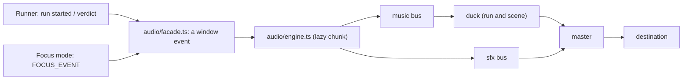

# Sound: opt-in, synthesised, and quiet

MechaLab's sound is the plan's section 6, and the plan's three rules are the design:

1. **Off until asked for, and no autoplay on landing.** A remembered "on" is *armed*: the first
   pointer press or key press starts the context. Remembering a preference is not permission to make
   noise at someone's desk.
2. **One press from muted.** The header carries the toggle, and focus mode carries the same button
   next to its way out — because focus hides the header, and a mute you cannot reach is not a mute.
3. **Nothing is required.** Every cue has a visual already on screen — the pips, the stamp, the award
   card, the failing line — so a muted learner loses no information. No setting here is a gate.

**No audio files.** Every cue and both beds are oscillators and gain envelopes, scheduled when they
play. The bundle carries a few kilobytes of code instead of a media pack, so there is no licence to
track, no third-party request, and nothing to cache offline.



## The graph

`master`, `duck`, `music bus` and `sfx bus` are the whole mixer. The bed level is

```
music = level × scene factor × duck factor
```

| Factor | Home | Focus | Run active |
| :--- | :--- | :--- | :--- |
| scene | 1 | 0.45 | unchanged |
| duck | 1 | 1 | 0.32 (≈ −10 dB) |

Focus and the duck are separate nodes, so they compose instead of overwriting each other — the one
bug this shape exists to prevent. Cues never duck: the relay click and the verification stinger are
the point of the sound.

## What plays, and when

| Moment | Cue | What it is |
| :--- | :--- | :--- |
| Sound is turned on | `boot` | A low swell, once — first light on the bench |
| Run pressed | `run-start` | A relay click; the bed steps back |
| Run passes, first time on this lesson | `verify` | The stamp's two-note stinger (under 1 s) |
| Run passes again | `run-pass` | The same rising third as the pips, shorter than the stamp |
| Run fails | `run-fail` | A neutral low tick — never a buzzer |

A **watch run** — the machine repeating a check on the learner's behalf — is silent: it did not press
Run, so it gets neither the click nor the duck.

The beds are named in the plan and both exist: **Lab Night** (a low drone) at home, **Focus Current**
(a quieter, higher shimmer) in focus mode. They crossfade over 1.2 s, and the room tone is part of
the same music bus.

## Where the code is

| File | Owns |
| :--- | :--- |
| `app/src/audio/prefs.ts` | the store (`mechalab_sound_v1`), clamping, subscribers, the labels |
| `app/src/audio/facade.ts` | `playCue` / `setSoundScene` — two functions on a window event, no audio code |
| `app/src/audio/engine.ts` | the AudioContext, graph, synthesis, ducking, scenes (a lazy chunk) |
| `app/src/components/SoundControl.tsx` | the header button and panel, the focus pill, arming on a gesture |
| `scripts/test_audio.mjs` | the store, the graph, the automation, the bus — with a recording double |

The facade is why the runner can say "a run started" without importing the synthesiser: a learner
who never enables sound downloads the button and the event name, not the engine.

## Accessibility and the archive

The toggle is a real `aria-pressed` button; the panel's sliders have labels and a visible percentage,
and every level is rounded to what the slider can show. Cues are short (≤ 1.2 s), quiet, and never a
buzzer — the plan's "failures are neutral". The preference is a preference: like the palette, the
layout and the fold keys, it is **not** carried in a backup, and `backupBundle.ts` says so in the
archive's README.

## The gate

```bash
npm run test:audio        # 17 checks: defaults, clamping, graph, ducking, focus, rate limit, the bus
npm run test:e2e:game     # in Chromium: off by default, one press on, a cue on verify, a duck on run,
                          # and a reload that arms rather than autoplays
```

`test:audio` runs in the workbench matrix (`npm run test:workbench`), so a change to the engine runs
on the same dev server and the same built bundle as the rest of the app.
