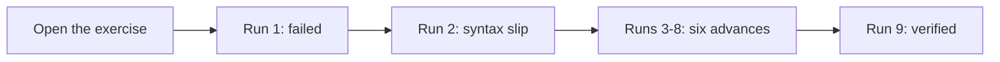

# Author walk — one graded exercise, not a participant

Not a pilot row, and not counted in the table above: **N (non-author) stays 0.** What this is for is
the instruments the pilot will read — the sitting clock (`app/src/sittingClock.ts`) and the learning
log — exercised on a real walk, so a participant's numbers later are not the first time either one
ran. 2026-10-23, `EX.00-foundations.T1.00a`, fresh profile, from the workbench's landing screen.

| What | Measured |
| :--- | ---: |
| First open → verified | 3 min 52 s |
| Runs | 9 — the first failure, one syntax slip, six advances, the pass |
| In-course hints | 0 |
| Solutions loaded | 0 |
| Sittings recorded | 1 — 9 runs, 1 lesson, 232 s start to last answer |

Per hole, run to run: 35 s (that one carries a `SyntaxError` from an over-indented line), 23, 23, 21,
20, 26, 27, 29. Every failure named the next hole and none re-opened a filled one — the behaviour Runs
211–213 assert from the outside, seen from the inside.

**The two instruments agree, which is the point.** The sitting clock and the learning log were written
by the same nine actions: 9 runs in the sitting, 9 `run` events in the log, and the sitting's 232.3 s
span equals the log's first-event-to-last. The pilot's `active_minutes` and the clock's sitting length
are then the same minutes, measured two ways.

**What this walk is not.** An author number. The seven bodies were the reference solution read in Run
213, the edits went in through the editor's test bridge rather than by typing, and every tool round trip
adds 3–6 s to a gap. 3 min 52 s is a floor for a machine-assisted author, not an estimate for a beginner.

**Two defects the measurement exposed — both fixed.**

1. **The panel's clock line was stale — fixed.** `StudyPanel` read the clock on mount and on a card
   rating only, so after the final run it still said *Today under a minute* while the store held a
   232 s sitting; a reload read the stored number. The clock now announces every write
   (`SITTING_RECORDED_EVENT`, dispatched from `recordSittingEvent`) and the panel re-reads on it, so a
   run written one component over moves the line it prints. Pinned by `test:sitting` and by a check in
   `test:e2e:runtime` that runs a program and compares the panel's run count with the store's.
2. **A dev build double-logged the open — fixed.** `main.tsx` mounts the app inside `React.StrictMode`,
   which replays every effect in development, so this log had two `lesson_open` events 7 ms apart at
   load and an exported `opens` count inflated by one per visit. The runner now keeps the lesson it has
   already filed in a ref that survives the replay, so one visit is one open in a dev build as well;
   visiting A → B → A still files three. Pinned by `test:e2e:focus`, on the dev server where the replay
   happens.
