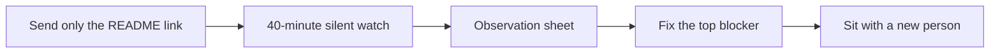

# Watch a real beginner do Step 1

**Status: not run. Participants: 0.** You cannot recruit a stranger from CI, so this page is the
sitting script and the observation sheet, ready for the first two people. Until it is run, every
claim about beginner difficulty in this repository is a target, not a result.

The full protocol (stages, help budget, publication rules) is [`PILOT.md`](PILOT.md). This page is
the 45-minute version: one person, Step 1, and every place they stop.

## Who counts

- Has never written code, **or** has never wired a circuit, and is not you.
- Has not read this repository before.
- Two people are enough for round 1. Five is the pilot minimum; do not wait for five to fix the
  first blocker.
- A colleague who already codes is a useful smoke test, not a beginner. Log them separately.

Where to find them: a local makerspace or library, a community-college intro class, a robotics
club, or `r/learnprogramming`, `r/robotics`, `r/arduino` with the post below. Offer a token thank-you
and disclose it.

## Before the sitting (5 min)

1. Fresh browser profile or private window. No saved progress, no signed-in account.
2. Send only the README link. Do not explain the route, do not name the app, do not say "click
   Beginner View".
3. Ask for consent to take notes and to quote anonymised quotes. Do not record names or screens.
4. Open the [observation sheet](#observation-sheet) and start a timer.

## The sitting (40 min)

| Minute | You do | You say |
| ---: | :--- | :--- |
| 0–2 | Say the goal, then stop talking. | "Show me how you would start this. Think out loud; there are no wrong moves." |
| 2–12 | Watch. Note every pause over 20 seconds. | Nothing. |
| 12–15 | If they are stuck, ask what they expected. | "What did you think would happen?" |
| 15+ | A hint is allowed, and logged. Never give the answer. | "Try the first hint in the lesson." |
| 35–40 | Stop, even unfinished. | "What would have made the first five minutes easier?" |

Rules:

- **No help for the first 15 minutes.** The in-course hints are course material and always allowed;
  a hint from you is an outside help event.
- **Never drive the mouse.** If you take over, the session is over as data.
- **Log the stalls that resolve.** A stuck point that ends in success is still the top-10 list.
- **Stop at 40 minutes.** Completion is not the point of round 1; the stuck points are.

## Observation sheet

Copy this into a private note per participant. Publish aggregates only.

| Field | Value |
| :--- | :--- |
| Date, start time | |
| Background (coding / electronics / maths) | |
| Device and browser | |
| Reached Lesson 1 without help? | yes / no — how long |
| Total session elapsed (minutes) | |
| Focused lesson minutes (lesson open) | |
| Setup / tool / re-read minutes | |
| First confusion (quote) | |
| Stuck points (time, page, what they tried) | |
| Hints used (in-course / person) | |
| Run & Verify reached? | yes / no |
| Error message understood? | yes / partly / no — quote |
| Did they know what to do next? | yes / no |
| Finished Step 1? | yes / no — minutes |
| Their one-sentence fix | |
| Course bug? | yes / no + page |
| Transfer question (day 7–14) | due `____` / pass / fail — asked without a screen; keep the concept, in [`PILOT_KIT.md`](PILOT_KIT.md) |

## Triage: fix these first

Sort by **people blocked × minutes lost**, not by how easy the fix is.

1. Any stall that blocks **reaching Lesson 1** (landing page, install, sign-in).
2. Any stall where the page **does not say what to do next**.
3. Any error message the participant **could not act on**.
4. Wording that made them think they needed hardware or maths they do not have.

One fix per stuck point, with a test where the page is generated or graded. Re-run the same
sitting with a new person; do not count the author re-reading the fix as validation.

## Logging the result

The order to do these in, with the command at each step, is [`PILOT_KIT.md`](PILOT_KIT.md). In short:
export while the participant is still there, run `python3 scripts/pilot_preflight.py <export>` on the
file, copy the `sheet` line into the row, and keep the export in `pilot-data/` where it cannot be
committed.

- Row per lesson in the pilot sheet ([`PILOT.md`](PILOT.md) §4), and the anonymised session in
  [`pilot-results.md`](pilot-results.md) once there is data.
- A one-off observation can be filed with the
  [`beginner-session-log`](../.github/ISSUE_TEMPLATE/beginner-session-log.md) template.
- The browser's **Export Learning Log (.json)** is the machine record; run
  `python3 scripts/friction_report.py <log.json>` to add it to
  [`friction-report.md`](friction-report.md).

## Author proxy pass (not a beginner)

On 2026-10-19 the author walked the first five minutes as a newcomer would, from the README. It
found two defects, both fixed the same day:

1. **The README's first screen was a badge wall and a tier matrix.** It is now a two-sentence
   what-this-is, a Lesson 1 link, and the finished result as a moving image, before any route
   table or advanced vocabulary.
2. **The app opened on the advanced tier roadmap, and its runner headline said "32 Beginner
   Lessons" beside an actual 86 graded exercises.** The runner now opens by default and its counts
   are rendered from the lesson data.
3. **The header and Beginner View tab subtitles still spoke in Stage/Pass and FOC/SVPWM.** The
   header now says Start here, Beginner, Applied and Advanced; each tab's beginner subtitle is
   plain English, and the technical one is kept for Advanced View.

The run-verify failure for the untouched starter was readable: it named the variable, the expected
value and the actual value. That is the bar the rest of the error states have to meet.

This pass is **not** beginner evidence. It is the author reading his own page, which is exactly the
bias the pilot exists to remove.

## Recruitment post (copy, edit the thank-you)

> **Looking for two complete beginners to try a free robotics course (40 minutes)**
>
> I'm testing the first lesson of a free, browser-only mechatronics course. No coding, electronics,
> or maths beyond school arithmetic needed — if you have never programmed, you are exactly who I
> need. You'll try to start the course while I watch and take notes, and I'll ask what was confusing.
> 40 minutes, on your own laptop, no installation. [gift card / coffee] for your time. I will not
> publish your name, and you can stop at any point. Reply or DM if you're interested.
