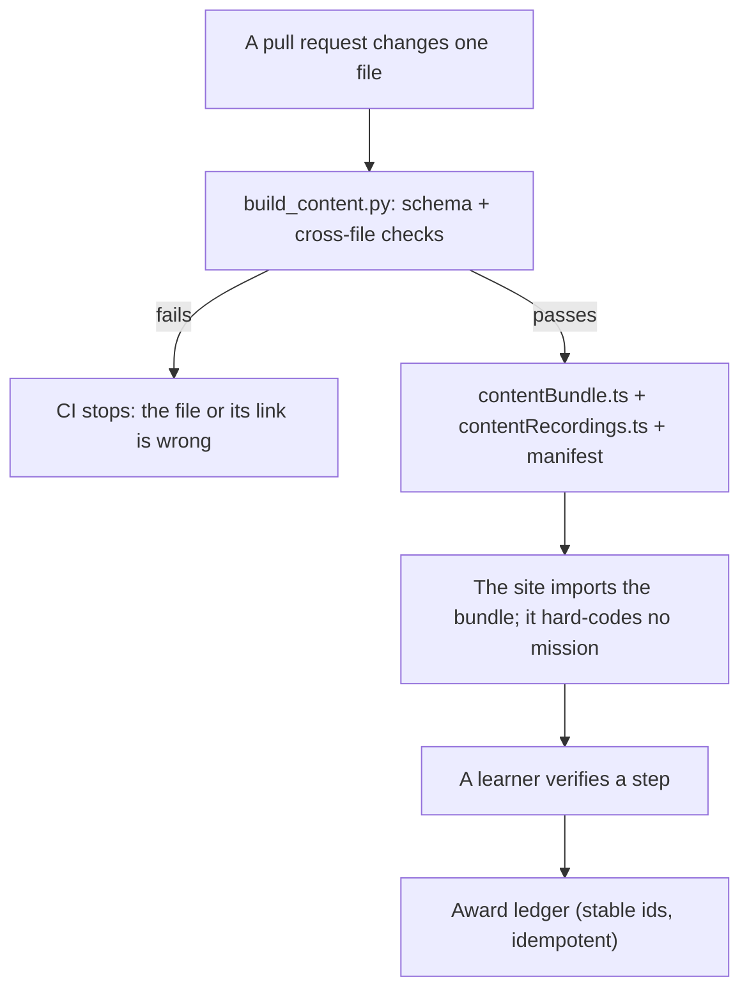

# The content pipeline

GitHub is the source of truth for MechaLab 3.0's story, missions and reward rules. The site is a
build of them.

```
content/                       reviewed files — the only place a mission, a recording or a rule is written
  missions/NN-slug.yaml        one per mission: capability, boss moment, toys, door line, clue
  blackbox/NN-slug.md          the recording, with front matter (voice, credit, clue)
  rewards/rules.yaml           the ladder, proof marks, Street Cred, Scrap, Neon, night shifts
  arm/parts.json               which part each mission seats on H-7
  aliases.yaml                 old id → new id, for renames
schemas/*.schema.json          the shape of each file
scripts/build_content.py       validate → app/src/data/contentBundle.ts + contentRecordings.ts + manifest
app/src/content/{loader,recordings}.ts   the only modules that import the generated files
```



## The commands

```bash
npm run build:content    # validate content/ and rebuild the generated files
npm run check:content    # fail if the generated files are stale (CI runs this)
npm run test:content     # the bundle as the app reads it
npm run test:game        # the reward engine, without a browser
```

`python3 scripts/build_content.py --json` prints one JSON object — the versions and counts — for a
script or a test that needs them.

## What the build checks

Schema first, with a validator that implements exactly the keywords the schemas use (`type`,
`required`, `additionalProperties`, `properties`, `items`, `enum`, `pattern`, `minimum`, `maximum`,
`minItems`, `maxItems`, `minLength`, `maxLength`). A schema keyword outside that set is a finding, so
a rule cannot be written into a schema that nothing enforces. CI installs no Python packages; the
small validator is why.

Then the things a schema cannot say:

- mission numbers are exactly 1..10, unique, and each mission's `spineStep` equals its number — the
  lesson list is the route model's, so a mission cannot point at another step's lessons;
- the chapter letter matches the number (I: 1–3, II: 4–7, III: 8–10);
- every mission names a recording that exists, and every recording belongs to the mission of its
  own number;
- a recording is at most 120 words, and its `words` field is the real count;
- the ladder is exactly 0..10, every level above 0 unlocks at least one perk, and no perk id is used
  twice;
- every mission seats exactly one part, and a part that names a lesson names one the runner lists;
- an alias does not point at itself, and its target exists.

## Adding or changing a mission

1. Edit `content/missions/NN-slug.yaml`. Keep `spineStep` equal to `number`; the lessons are chosen
   by the route model, not here.
2. Edit the recording beside it if the story moved.
3. `npm run build:content` — this rewrites `app/src/data/contentBundle.ts`,
   `app/src/data/contentRecordings.ts` and `app/public/content/manifest.json`.
4. `npm run test:content && npm run test:game`, then commit the content file **and** the rebuilt
   files. `npm run check:content` in CI fails if only one of them landed.

## Why there are two generated files

`contentRecordings.ts` holds the ten recordings — about 9 kB of prose that only the dashboard's Black
Box page reads. Keeping it out of `contentBundle.ts` keeps it out of the entry chunk: the engine
needs missions and rules, not sentences. Splitting them is what let 3.0 ship the whole story inside
the existing weight budget (`npm run check:weight`).

## Versioning and progress

`CONTENT_VERSION` is a hash of everything in `content/`. Each verification stores the version and a
fingerprint of the lesson's own grading contract (`app/src/gamification/verifyStamp.ts`). When either
moves, the app offers a **gentle re-verify**: the flag stays, the learner is told the checks changed,
and nothing is reset. Old flags with no stamp are left alone — flagging every one of them on upgrade
would be noise, not a prompt.

## Ids

An id is never reused for something else. A rename adds one line to `content/aliases.yaml`, and
`resolveLessonId` / `resolveMissionNumber` (`app/src/content/loader.ts`) resolve old ids at read time,
so stored progress is not orphaned. The build refuses an alias that points at itself or at a lesson
the registry does not list.
