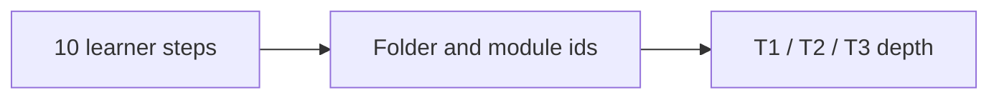

# Curriculum architecture

> **Audience:** maintainers, and learners who have finished a few steps and want the whole
> map. The front page deliberately shows only **Steps 1-10**; this page keeps the internal
> vocabulary (`T1`/`T2`/`T3`, "Core", "Extensions") that the module ids and CI use.

## One name for a learner, one id for a maintainer

A learner sees ten steps and nothing else. Each step is one folder, and the modules inside it
carry their depth in the id (`T1` = first pass, `T2` = model and apply, `T3` = derive and
validate). The mapping is fixed here so a page never has to explain it twice.

| Step | Folder | Learner-facing title | Ids inside |
| ---: | :--- | :--- | :--- |
| 1 | [`track-p/`](../track-p/README.md) | Python and the maths a robot needs | `P.1`-`P.14`, `P.M` |
| 2 | [`stage-0/`](../stage-0/README.md) | Circuits and your first microcontroller | `S0.0`-`S0.M` |
| 3 | [`00-foundations/`](../00-foundations/README.md) | Make a joint move: foundations | `00.x`, `T1.00a-e`, `T2.00a-j`, `T3.00a` |
| 4 | [`01-electronics-and-power/`](../01-electronics-and-power/README.md) | Power the joint: electronics | `01.x`, `T1.01a-d`, `T2.01a-b` |
| 5 | [`02-mechanics-kinematics-dynamics/`](../02-mechanics-kinematics-dynamics/README.md) | Build the arm: mechanics | `02.x`, `T1.02a`, `T2.02a`, `T3.02a` |
| 6 | [`03-sensors-and-actuators/`](../03-sensors-and-actuators/README.md) | Measure the joint: sensors | `03.x`, `T1.03a`, `T2.03a` |
| 7 | [`04-embedded-and-realtime/`](../04-embedded-and-realtime/README.md) | Run it in real time: embedded C | `04.x`, `T1.04a-b`, `T2.04a-b` |
| 8 | [`05-control-and-estimation/`](../05-control-and-estimation/README.md) | Make it hold still: control | `05.x`, `T1.05a`, `T2.05a`, `T3.05a-c` |
| 9 | [`06-robotics-and-autonomy/`](../06-robotics-and-autonomy/README.md), [`07-systems-hil-and-production/`](../07-systems-hil-and-production/README.md) | Plan motion and bring it up safely | `06.1`, `07.1`, `T1.06a`, `T1.07a`, `T2.07a` |
| 10 | [`08-capstone-projects/`](../08-capstone-projects/README.md) | Put it together: the 2-DOF arm | `08.1`, `T3.07a` |

The required set is exactly `scripts/route_model.py`'s `STEPS`; `scripts/generate_sim_route.py`
holds the same ids in `CORE_MODULES`. `scripts/check_consistency.py` fails if the two lists
disagree, if a step's lessons or hours change without the README being regenerated, or if a
learner-facing page uses a second name for a step.

## The full depth matrix

The learner-facing steps hide a second axis: every step's folder also holds deeper modules for
learners who want the derivation, not just the result. CI counts these from
`modules/_index.yaml` and the module pages.

| Folder | Beginner path (Step's lessons) | Deeper practice (`T2`) | Advanced (`T3`) | What bridges maker work to custom work |
| :--- | :--- | :--- | :--- | :--- |
| **Track P** | Lessons P.1-P.14 & P.M: Python, SI units, binary, trig, graphs, torque, datasheets | - | - | Zero-background entry ramp |
| **Stage 0** | Lessons S0.0-S0.M: effort x flow, Ohm's law, dividers, CC/CV, Falstad twins, Arduino Uno | - | - | Falstad and Wokwi on-ramp |
| **Maths ramp** | Lessons R.1-R.6: rate of change, accumulation, state vectors, matrix updates, phasors, frequency response | - | - | [`TIER1_EXIT_CHECK.md`](TIER1_EXIT_CHECK.md): 14 items, each mapped to R.1-R.6 |
| **00 Foundations** | 00.1-00.3 + `T1.00a-e`: effort/flow, springs, modelling | State-space, quaternions, Tustin biquads | Lie groups SO(3)/SE(3), Port-Hamiltonian | Moving average to pre-warped TDF-II biquad notch |
| **01 Electronics** | 01.1-01.4 + `T1.01a-d`: MOSFETs, H-bridges, RC filters | 4-layer KiCad, gate drivers, Kelvin shunts | 6-layer <2 nH 48 V/30 A inverter, SAR charge buckets | `DRV8833`/`INA219` breakouts to `DRV8353` + `INA240` Kelvin PCB |
| **02 Mechanics** | 02.1-02.5 + `T1.02a`: 2-link FK/IK, N² inertia, belts | Maxwell exact constraint, CadQuery, URDF/MuJoCo | Screw PoE, Ti-6Al-4V flexures, Featherstone O(n) RNEA | 200:1 hobby servos to 8:1 backdrivable QDD actuator |
| **03 Sensors** | 03.1-03.3 + `T1.03a`: encoders, 3-phase BLDC, FK micro-lab | Clarke/Park, Type-II PLL, Allan variance | 25-40 kHz decoupled d-q FOC, SVPWM, harmonic LUT | Hobby ESC / voltage mode to centre-aligned ADC current FOC |
| **04 Embedded** | 04.1-04.3 + `T1.04a-b`: ints, CRC-8, struct pointers | FreeRTOS scheduling, DMA buffers, CAN-FD | Bare-metal TIM1 to ADC, CORDIC, `WaitFreeSeqLock` | Global structs / mutex to DMA pipelines |
| **05 Control** | 05.1-05.2 + `T1.05a`: PID anti-windup, complementary IMU | Bode loop shaping, gang of four, swing-up LQR, linear KF | Joseph-form manifold ESKF, MPC, CBF-QP | Trial-and-error PID to LQR + predictive safety filter |
| **06 Robotics** | 06.1 + `T1.06a`: cubic trajectories, gravity feedforward | Jacobian transpose, Ruckig, ROS 2, Gazebo | Khatib WBC, LeRobot ACT/diffusion, GPU sim | Rigid `servo.write()` stepping to 1 kHz torque/impedance control |
| **07 Systems** | 07.1 + `T1.07a`: 10-step bring-up, sine-sweep SysID | Regen clamps, OPC UA, CRC watchdogs, HIL faults | Schroeder multisine, <1 μs hardware STO, digital twins | Software `if(fault) pwm=0` to dual-channel hardware STO |
| **08 Capstones** | 08.1: 2-DOF compliant arm boss | Custom 4-layer CAN servo + LQR/MuJoCo | Capstones I-V (48 V FOC, Furuta, 6-DOF, hopper, AMR) | Progressive three-pass hardware/software capstone |

## Where the other maps live

| Question | Page |
| :--- | :--- |
| Where do I start, and what are the ten steps? | [`../README.md`](../README.md) |
| What pages are required, and how many hours? | [`SIM_ROUTE.md`](SIM_ROUTE.md) |
| What is the smallest finish that still builds the arm? | [`MINIMUM.md`](MINIMUM.md) |
| Which modules are optional, and what can I skip? | [`EXTENSIONS.md`](EXTENSIONS.md) |
| What does CI check? | [`VERIFICATION.md`](VERIFICATION.md) |
