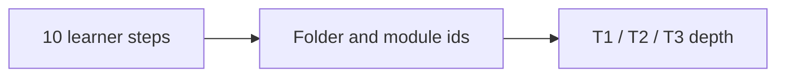

# Curriculum architecture

> **Audience:** maintainers, and learners who have finished a few steps and want the whole
> map. The front page shows only **Steps 1-10**; this page keeps the internal vocabulary
> (`T1`/`T2`/`T3`, folder names, module ids) those steps compile to, with what each costs.

## One name for a learner, one id for a maintainer

A learner sees ten steps and nothing else. Each step is one folder - two folders for Step
9 - and the modules inside it carry their depth in the id (`T1` = the arm pass, `T2` =
model and apply, `T3` = derive and validate). The mapping is fixed here so no page explains
it twice, and the hours are the pages' own metadata.

| Step | Folder | Learner-facing title | Lessons | Arm layer | Depth layer | Focused hours |
| ---: | :--- | :--- | ---: | :--- | :--- | ---: |
| 1 | [`track-p/`](../track-p/README.md) | Python and the maths a robot needs | 14 | — | — | **16.75-42.5** |
| 2 | [`stage-0/`](../stage-0/README.md) | Circuits and your first microcontroller | 11 | — | — | **13.75-33** |
| 3 | [`00-foundations/`](../00-foundations/README.md) | Make a joint move: foundations | 3 | 5 modules · 20.5-26.5 h | 11 modules · 34.5 h | **55-61** |
| 4 | [`01-electronics-and-power/`](../01-electronics-and-power/README.md) | Power the joint: electronics | 4 | 4 modules · 18-25.5 h | 2 modules · 8.5 h | **26.5-34** |
| 5 | [`02-mechanics-kinematics-dynamics/`](../02-mechanics-kinematics-dynamics/README.md) | Build the arm: mechanics | 5 | 1 module · 10.5-20.5 h | 2 modules · 9.5 h | **20-30** |
| 6 | [`03-sensors-and-actuators/`](../03-sensors-and-actuators/README.md) | Measure the joint: sensors | 3 | 1 module · 6.85-11.5 h | 1 module · 4.5 h | **11.35-16** |
| 7 | [`04-embedded-and-realtime/`](../04-embedded-and-realtime/README.md) | Run it in real time: embedded C | 3 | 2 modules · 11-17 h | 2 modules · 8 h | **19-25** |
| 8 | [`05-control-and-estimation/`](../05-control-and-estimation/README.md) | Make it hold still: control | 2 | 1 module · 6.5-10.5 h | 4 modules · 10.5 h | **17-21** |
| 9 | [`06-robotics-and-autonomy/`](../06-robotics-and-autonomy/README.md) + [`07-systems-hil-and-production/`](../07-systems-hil-and-production/README.md) | Plan motion and bring it up safely | 2 | 2 modules · 10-14 h | 1 module · 4.5 h | **14.5-18.5** |
| 10 | [`08-capstone-projects/`](../08-capstone-projects/README.md) | Put it together: the 2-DOF arm | 1 | 1 module · 6.5-9 h | — | **6.5-9** |

Totals: arm **120.35-210 h**, depth **80 h**, full course **200.35-290 h**. The arm layer is every Tier 1 bridge plus the
Step 10 capstone; the depth layer is every other module in the step, taken as a second
pass in the same step order. `scripts/route_model.py` is the declaration; this page and
`docs/SYLLABUS.md` are rendered from it by `scripts/generate_step_docs.py`, and
`scripts/check_consistency.py` fails when a step's lessons, layers or hours move without
them being regenerated.

## The ids each step compiles to

The folder names above are for the reader; these are the ids a contributor edits, in the
order the step asks for them (arm layer first, then the depth layer).

| Step | Lesson ids | Arm module ids | Depth module ids |
| ---: | :--- | :--- | :--- |
| 1 | `P.1`-`P.M` (14) | — | — |
| 2 | `S0.0`-`S0.M` (11) | — | — |
| 3 | `00.1`-`00.3` (3) | `00-foundations.T1.00a`-`00-foundations.T1.00e` (5) | `00-foundations.T2.00a`-`00-foundations.T3.00a` (11) |
| 4 | `01.1`-`01.4` (4) | `01-electronics.T1.01a`-`01-electronics.T1.01d` (4) | `01-electronics.T2.01a`-`01-electronics.T2.01b` (2) |
| 5 | `02.1`-`02.5` (5) | `02-mechanics.T1.02a` | `02-mechanics.T2.02a`-`02-mechanics.T3.02a` (2) |
| 6 | `03.1`-`03.3` (3) | `03-sensors.T1.03a` | `03-sensors.T2.03a` |
| 7 | `04.1`-`04.3` (3) | `04-embedded.T1.04a`-`04-embedded.T1.04b` (2) | `04-embedded.T2.04a`-`04-embedded.T2.04b` (2) |
| 8 | `05.1`-`05.2` (2) | `05-control.T1.05a` | `05-control.T2.05a`-`05-control.T3.05c` (4) |
| 9 | `06.1`-`07.1` (2) | `06-robotics.T1.06a`-`07-systems.T1.07a` (2) | `07-systems.T2.07a` |
| 10 | `08.1` | `08-capstones.T3.07a` | — |

## The three depth layers, per track

Every step folder holds three layers. **Depth 1** is the arm: the Tier 1 bridge and the
track's own lessons, in step order. **Depth 2** is the practice modules (`T2`) and the
derivation modules (`T3`) that the route requires, taken after Step 10 in the same step
order. **Depth 3** is the handful of modules outside both routes - still graded, still
badgeable, never required.

| Track | Step | Depth 1 · arm | Depth 2 · practice | Depth 3 · outside both routes | What bridges maker work to custom work |
| :--- | ---: | :--- | :--- | :--- | :--- |
| **Foundations, Bench Intuition & Multi-Domain Mathematics** | 3 | 8 · 20.5-26.5 h | 11 · 34.5 h | — | Moving average to pre-warped TDF-II biquad notch |
| **Mixed-Signal Electronics, Power Stages & High-Speed PCB Design** | 4 | 8 · 18-25.5 h | 2 · 8.5 h | — | `DRV8833`/`INA219` breakouts to `DRV8353` + `INA240` Kelvin PCB |
| **Precision Mechanical Design, Kinematics & Multibody Dynamics** | 5 | 6 · 10.5-20.5 h | 2 · 9.5 h | — | 200:1 hobby servos to 8:1 backdrivable QDD actuator |
| **Sensors, Metrology, Actuators & Field-Oriented Drive Systems** | 6 | 4 · 6.85-11.5 h | 1 · 4.5 h | — | Hobby ESC / voltage mode to centre-aligned ADC current FOC |
| **Hard Real-Time Embedded Systems, Industrial Networks & FPGA Co-Design** | 7 | 5 · 11-17 h | 2 · 8 h | 2 · 8 h | Global structs / `mutex` to DMA ping-pong pipelines |
| **Classical, Optimal, Nonlinear Control & State Estimation** | 8 | 3 · 6.5-10.5 h | 4 · 10.5 h | — | Trial-and-error PID to LQR + predictive safety filter |
| **Robotics, Whole-Body Control, Perception & Autonomous Systems** | 9 | 2 · 5-7 h | — | 2 · 10 h | Rigid `servo.write()` stepping to 1 kHz torque/impedance control |
| **Mechatronic Systems Engineering, SysID, Real-Time HIL & Production Qualification** | 9 | 2 · 5-7 h | 1 · 4.5 h | — | Software `if(fault) pwm=0` to dual-channel hardware STO |
| **Boss Capstone Projects, One per Depth (Tier 1 → Tier 2 → Tier 3)** | 10 | 2 · 6.5-9 h | — | — | One arm, three depths: breakout build, custom CAN servo, production capstone |

## Where the other maps live

| Question | Page |
| :--- | :--- |
| Where do I start, and what are the ten steps? | [`../README.md`](../README.md) |
| What does each step cost, page by page? | [`SYLLABUS.md`](SYLLABUS.md) |
| What pages are required for the arm, and how many hours? | [`SIM_ROUTE.md`](SIM_ROUTE.md) |
| What is the optional depth pass? | [`DEPTH.md`](DEPTH.md) |
| What is the smallest finish that still builds the arm? | [`MINIMUM.md`](MINIMUM.md) |
| Which modules are optional, and what can I skip? | [`EXTENSIONS.md`](EXTENSIONS.md) |
| What does CI check? | [`VERIFICATION.md`](VERIFICATION.md) |
