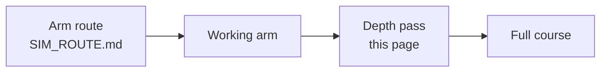

# The depth pass: the second route, after the arm

<!-- Generated by scripts/generate_sim_route.py - do not edit by hand.
     Pages and focused hours come from each page's own metadata. -->

**This is the depth pass, and it is optional.** It is 23 Tier 2/3 modules and **80 focused hours**, taken after the arm route. It is
not part of [`SIM_ROUTE.md`](SIM_ROUTE.md), which contains no depth work at all.

The arm route is **≈121–212 focused hours**; this pass adds **80**; the full course is **≈201–292 focused hours**. Nothing on the arm route depends on
these pages, and skipping all of them still leaves a working arm.

## Depth pass (23 modules)

| Stage | Item | Focused hours |
| :--- | :--- | ---: |
| Step 3 · Make a joint move: foundations | `00-foundations.T2.00a` Numerical Derivatives & Integrals: Backward Difference and the Running Sum **· depth** | 2 |
| Step 3 · Make a joint move: foundations | `00-foundations.T2.00g` Matrix-Vector Multiplication & the One-Step State Update **· depth** | 3 |
| Step 3 · Make a joint move: foundations | `00-foundations.T2.00b` Vectors, Dot & Cross Products, Linear Independence & Change of Basis **· depth** | 3.5 |
| Step 3 · Make a joint move: foundations | `00-foundations.T2.00c` First- & Second-Order ODEs, Characteristic Roots, Natural Frequency & Damping Ratio **· depth** | 4.5 |
| Step 3 · Make a joint move: foundations | `00-foundations.T2.00d` Complex Numbers, Euler's Formula & Phasors **· depth** | 2 |
| Step 3 · Make a joint move: foundations | `00-foundations.T2.00h` Winding Impedance, Transfer Functions, Decibels & the Resonance Peak **· depth** | 3 |
| Step 3 · Make a joint move: foundations | `00-foundations.T2.00e` Laplace Transform, Poles/Zeros, Continuous State-Space (x_dot = Ax + Bu) & Euler/Tustin Discretization **· depth** | 4.5 |
| Step 3 · Make a joint move: foundations | `00-foundations.T2.00f` Nyquist Sampling, Aliasing & the Analog Anti-Alias Filter **· depth** | 2 |
| Step 3 · Make a joint move: foundations | `00-foundations.T2.00i` Pre-Warped Tustin Biquads: Where the Notch Really Lands **· depth** | 2.5 |
| Step 3 · Make a joint move: foundations | `00-foundations.T2.00j` Gaussian Variance, Covariance & the Predict Step **· depth** | 2.5 |
| Step 3 · Make a joint move: foundations | `00-foundations.T3.00a` Skew-Symmetric Hat Map [omega]_x, Matrix Exponential e^{At}, Rodrigues' Formula & Energy Conservation **· depth** | 5 |
| Step 3 · Make a joint move: foundations | **11 depth modules, together** | 34.5 |
| Step 4 · Power the joint: electronics | `01-electronics.T2.01a` Operational Amplifiers, Differential Shunt Amplification, Common-Mode Voltage & Kelvin Sensing **· depth** | 4 |
| Step 4 · Power the joint: electronics | `01-electronics.T2.01b` Parasitic Loop Inductance (4-Layer Stackup), Bootstrap Gate Drivers & 48 V Pre-Charge/TVS Clamping **· depth** | 4.5 |
| Step 4 · Power the joint: electronics | **2 depth modules, together** | 8.5 |
| Step 5 · Build the arm: mechanics | `02-mechanics.T2.02a` 6-DOF Rigid-Body Degrees of Freedom, 3D Homogeneous Transforms (SE(3)), Velocity Jacobians & Parallel-Axis Inertia **· depth** | 4.5 |
| Step 5 · Build the arm: mechanics | `02-mechanics.T3.02a` 6D Spatial Twists & Wrenches, Screw Axes in SE(3), Notch Flexure Stiffness & Recursive Newton-Euler Passivity **· depth** | 5 |
| Step 5 · Build the arm: mechanics | **2 depth modules, together** | 9.5 |
| Step 6 · Measure the joint: sensors | `03-sensors.T2.03a` Three-Phase Stator Reference Frames (abc -> alpha-beta -> d-q), Phase-Locked Loops & Sensor Random Walk **· depth** | 4.5 |
| Step 6 · Measure the joint: sensors | **1 depth module, together** | 4.5 |
| Step 7 · Run it in real time: embedded C | `04-embedded.T2.04a` Vendor HAL Drivers (SPI/I2C), Bare-Metal Register Basics (MMIO/BSRR) & Ping-Pong DMA Buffers **· depth** | 4 |
| Step 7 · Run it in real time: embedded C | `04-embedded.T2.04b` RTOS Tasks, FreeRTOS Preemptive Scheduling, Priority Inversion & CAN Bus Bitwise Arbitration **· depth** | 4 |
| Step 7 · Run it in real time: embedded C | **2 depth modules, together** | 8 |
| Step 8 · Make it hold still: control | `05-control.T2.05a` Gain/Phase Margin, Sensitivity Waterbed (S+T=1), Luenberger State Observers & Bryson's Rule for LQR **· depth** | 4.5 |
| Step 8 · Make it hold still: control | `05-control.T3.05a` Joseph-Form Covariance Update, Suboptimal Kalman Gains & NEES Consistency **· depth** | 2 |
| Step 8 · Make it hold still: control | `05-control.T3.05b` Rodrigues on SO(3), Multiplicative Error Injection & the ESKF Reset **· depth** | 2 |
| Step 8 · Make it hold still: control | `05-control.T3.05c` Control Barrier Functions, Forward Invariance & the 1D CBF-QP Safety Filter **· depth** | 2 |
| Step 8 · Make it hold still: control | **4 depth modules, together** | 10.5 |
| Step 9 · Plan motion and bring it up safely | `07-systems.T2.07a` Regenerative Braking Shunt Choppers, CAN-FD CRC-16 + Rolling-Counter Watchdogs & SIL/HIL Fault Injection **· depth** | 4.5 |
| Step 9 · Plan motion and bring it up safely | **1 depth module, together** | 4.5 |
| **Depth pass total** | **23 modules** | **80** |

Each module is still graded, has its own Break-it case and badge, and keeps its
browser-verifiable exercise. Taking the pass adds hours; skipping it costs nothing on
the arm route.

## Why these modules come second

- **They extend a Tier 1 bridge, they do not replace it.** The arm route supplies the plant,
  units and tool each one assumes; the depth work then explains why the arm behaves as it
  does.
- **The order is the same ten steps.** Return to Track 00 for the foundations ladder, then
  follow the track order through each track's Tier 2 work and the Tier 3 depth line.
- **Nothing on the arm route consumes them.** The capstone's checks run on the arm route
  alone, so the depth pass can be taken now, later, or not at all.

## Extensions (a third layer, optional)

These ten modules are outside every route, not part of the depth total above.

| Where | Item | Focused hours |
| :--- | :--- | ---: |
| Optional | `01-electronics.T3.01a` 6-Layer Flux-Canceling Return Planes, Constant Group-Delay Bessel Filters, SAR ADC Charge-Bucket Settling & Cauer Thermal RC Networks | 5 |
| Optional | `03-sensors.T3.03a` Rotating-Frame Cross-Coupling (omega_e L i), Min-Max SVPWM Bus Utilization (1/sqrt(3)) & Encoder Harmonic Calibration | 4.5 |
| Optional | `04-embedded.T2.04c` Zephyr RTOS: West Workspaces, Devicetree Hardware Binding, Kconfig & Static Kernel Primitives | 4 |
| Optional | `04-embedded.T2.04d` micro-ROS on Microcontrollers: XRCE-DDS Client-Agent Transport, Static rclc_executor & MCU-to-ROS 2 Bridging | 4 |
| Optional | `04-embedded.T3.04a` Center-Aligned PWM Midpoint ADC Triggering, Q1.31 Fixed-Point Arithmetic & Lock-Free SeqLock | 5 |
| Optional | `06-robotics.T2.06a` ROS 2 Computational Graph (Nodes, Executors, Topics, Services, Actions, QoS), TF2 Frames, URDF & ros2_control | 5.5 |
| Optional | `06-robotics.T2.06b` ROS 2 Operations: Launch & Parameter Composition, Deterministic rosbag2 Recording/Replay & Simulator Integration (Gazebo / MuJoCo) | 4.5 |
| Optional | `06-robotics.T3.06a` PyTorch Tensors, Automatic Differentiation (autograd), Loss Functions & Behavior Cloning on Trajectory Logs | 5 |
| Optional | `06-robotics.T3.06b` Markov Decision Processes (MDPs), Policy Gradient / PPO, Action Chunking & Sim-to-Real Safety Wrappers | 5.5 |
| Optional | `07-systems.T3.06a` OPC UA Information Models, IEC 63278 Asset Administration Shell (AAS) Submodels & ISO 13849-1 Performance Level d (PLd) | 4.5 |
| - | **10 modules** | **47.5** |

## Why 4 modules are optional

- **`04-embedded.T2.04c`** (Zephyr RTOS: West Workspaces, Devicetree Hardware Binding, Kconfig & Static Kernel Primitives): Zephyr is a second RTOS toolchain (west, devicetree, Kconfig) on top of the FreeRTOS unit that already teaches preemption, priority inversion and a static kernel; the Core's timing work needs the concepts, not a second build system.
- **`04-embedded.T2.04d`** (micro-ROS on Microcontrollers: XRCE-DDS Client-Agent Transport, Static rclc_executor & MCU-to-ROS 2 Bridging): micro-ROS bridges a microcontroller to a ROS 2 graph, and the Core's integration checkpoint runs trajectory, estimator and controller on the plant in the browser; the bridge is real work but nothing on the required route consumes it.
- **`06-robotics.T2.06a`** (ROS 2 Computational Graph (Nodes, Executors, Topics, Services, Actions, QoS), TF2 Frames, URDF & ros2_control): A local ROS 2 install is the most common place a self-guided beginner stops: it needs a supported Ubuntu, several GB and a shell, while the 2-DOF arm, its estimator and its controller all run in the browser. The page keeps its graded exercise and badge; the Docker and browser walkthroughs teach the node graph without the install.
- **`06-robotics.T2.06b`** (ROS 2 Operations: Launch & Parameter Composition, Deterministic rosbag2 Recording/Replay & Simulator Integration (Gazebo / MuJoCo)): This is the operations half of the same ROS 2 toolchain (launch files, rosbag2 replay, Gazebo integration), so it carries the same install wall as `T2.06a`; nothing later on the required route opens a ROS 2 shell.

Each stays in its track, keeps its graded package and its badge, and keeps its
browser-verifiable exercise - moving it changes what is required, not what exists.
