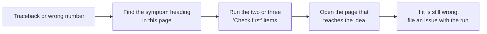

# The error explainer — fifteen failures, one sentence each, and what to check first

When something breaks, the traceback names the line but not the habit. These fifteen are the failures
that recur across the curriculum's own sittings: every entry is drawn from a **course bug** or a
**Common mistakes** bullet the author hit while dogfooding the graded packages, and each one names the
page that teaches the idea and the first two or three things to look at.

**Provenance, stated plainly:** these come from **author-dogfood** sittings and the modules' own
Common-mistakes sections, not from a beginner pilot — there has been no pilot yet. When one runs, its
stuck-points replace or confirm this list, and the log lives in
[`docs/dogfood-log.md`](dogfood-log.md).

Use it as an index, not a fix. Each heading is the message or symptom you actually see; the page it
links to has the worked case.

---

## 1. `ValueError: matrix columns must match vector length`

**What it means.** A table was applied to a list of the wrong length — most often `u` passed as a flat
`[0.4]`-style list instead of a column, or a state built with three slots for a 2 × 2 `A`.

**Check first.**
- `len(state) == len(A[0])`, and `B` is a list of **rows**, each of length 1 for a single input.
- Print the shapes (`len(A), len(A[0]), len(state)`) immediately before the multiply.
- If the state length changed, find the function that returned a longer list — `add` returning a
  concatenation is the usual culprit.

**Where it comes from.** [`00-foundations.T2.00g`](../modules/00-foundations.T2.00g.md) ·
[`R.4`](../ramp/R.4-matrix-updates.md)

## 2. `TypeError: can only concatenate list (not "int") to list`

**What it means.** `+` on two lists **concatenates**; it does not add them slot by slot. `[1.0, 2.0] +
[0.5, -1.0]` is a four-slot list, not `[1.5, 1.0]`, and a scalar on either side is a `TypeError`.

**Check first.**
- Replace `a + b` with an element-wise function or `[x + y for x, y in zip(a, b)]`.
- `a * 2` repeats a list; scaling needs `[2 * x for x in a]`.
- After any arithmetic on a state, assert its length before the next tick.

**Where it comes from.** [`R.3`](../ramp/R.3-state-vectors.md) ·
[`00-foundations.T1.00b`](../modules/00-foundations.T1.00b.md)

## 3. `ZeroDivisionError` in a rate or average

**What it means.** The denominator was a measurement that can legitimately be zero: a time step read
as `0`, a window with one sample, or `dt` taken as `1/0` from an unset sample rate.

**Check first.**
- A rate needs **two** samples; guard `if len(samples) < 2: raise ValueError(...)`.
- Ten samples at 100 Hz span **nine** intervals — `(len(samples) - 1) * dt_s`, never `len(samples)`.
- Fail loudly with `ValueError`, not `0.0`: a zero rate is a real answer and must not hide a bad one.

**Where it comes from.** [`R.1`](../ramp/R.1-rate-of-change.md) ·
[`00-foundations.T1.00a`](../modules/00-foundations.T1.00a.md)

## 4. A speed that is exactly 1000× too big or too small

**What it means.** Milliseconds were used where seconds belong, or `dt` was taken as the sample rate
instead of its reciprocal. The arithmetic is right; the unit is not.

**Check first.**
- 1 kHz is `0.001 s`, not `1000`; write `dt_s` in the name so the unit travels with the value.
- Sanity-check one tick: at 1 rad/s for 10 ms the joint moves `0.01 rad`, not `10 rad`.
- Print `dt_s` and one displacement next to the rate; a factor of 1000 is visible immediately.

**Where it comes from.** [`R.1`](../ramp/R.1-rate-of-change.md) ·
[`04-embedded.T2.04b`](../modules/04-embedded.T2.04b.md)

## 5. A rate that is low by exactly 10% on a ten-sample trace

**What it means.** The window divided by ten sample *periods* instead of nine sample *intervals* — the
classic off-by-one that looks like a small calibration error.

**Check first.**
- Count intervals: `n` samples hold `n - 1` gaps.
- Test on a trace whose answer is known: a straight line where `q` rises by `k` each tick must return
  `k / dt_s`.
- Keep the index arithmetic in one named helper, not copy-pasted per call site.

**Where it comes from.** [`R.1`](../ramp/R.1-rate-of-change.md) ·
[`docs/TIER1_EXIT_CHECK.md`](TIER1_EXIT_CHECK.md) item 3

## 6. Position is right by the *change*, wrong by the *start*

**What it means.** The accumulator started at `0.0` instead of the joint's actual starting pose, so it
answers "how far did it move" while the caller asked "where is it".

**Check first.**
- `q = q0` before the loop; `q0` is added **once**, never inside it.
- A joint starting at `1.2 rad` that accumulates `0.9 rad` is at `2.1 rad`, not `0.9 rad`.
- Assert the first value: after zero ticks the state must still be `q0`.

**Where it comes from.** [`R.2`](../ramp/R.2-accumulation.md) ·
[`docs/TIER1_EXIT_CHECK.md`](TIER1_EXIT_CHECK.md) item 8

## 7. The controller drives harder the faster the joint moves

**What it means.** A sign convention broke — often `abs()` applied to a *measured* rate, or an encoder
counted down where the controller assumes up. A negative rate is information, not an error.

**Check first.**
- Move the joint by hand toward `+q` and confirm the sign of the reported rate.
- Clamp the **command**, never the measurement.
- Test the loop at zero error with a small negative rate: the command must reduce the motion.

**Where it comes from.** [`R.1`](../ramp/R.1-rate-of-change.md) ·
[`05-control.T1.05a`](../modules/05-control.T1.05a.md)

## 8. Speed is fine at 100 Hz and unusable at 1 kHz

**What it means.** One encoder count divided by a short window is a large apparent speed: one count is
`1.534 rad/s` over 1 ms. Halving the window doubles the noise.

**Check first.**
- Compute the quantisation floor for your counts-per-turn and window: `2π / (CPR × dt)`.
- Widen the window, or filter the derivative, before changing gains.
- Confirm the joint is actually still: a stationary arm must report `0 ± floor`, not a wandering value.

**Where it comes from.** [`R.1`](../ramp/R.1-rate-of-change.md) ·
[`03-sensors.T1.03a`](../modules/03-sensors.T1.03a.md)

## 9. `math.sin(30)` returns `-0.988`

**What it means.** Degrees were passed to a function that takes radians. Python's trig functions never
guess the unit.

**Check first.**
- Convert at the boundary: `math.radians(deg)`, and name the variable `_deg` or `_rad`.
- Sanity-check a known angle: `sin(90°) = 1`, `sin(π/2) = 1`.
- Keep every stored joint angle in radians; degrees belong to displays.

**Where it comes from.** [`P.10`](../track-p/P.10-radians-and-right-triangle-trig.md) ·
[`00-foundations.T1.00d`](../modules/00-foundations.T1.00d.md)

## 10. The arm reaches the right place, pointing the wrong way

**What it means.** Two rotations were applied in the wrong order, or a transform was read as mapping
the wrong way. Rotations do not commute: `Rz @ Ry` is not `Ry @ Rz`.

**Check first.**
- Write, per matrix, which frame it maps **from** and **to**; the order is then forced.
- Test on a single axis: rotate `x` by 90° about `z` and expect `y`.
- Compare against the plant's own pose function rather than a hand-built matrix.

**Where it comes from.** [`00-foundations.T3.00a`](../modules/00-foundations.T3.00a.md) ·
[`06-robotics.T2.06a`](../modules/06-robotics.T2.06a.md)

## 11. The covariance stops being symmetric, then the filter diverges

**What it means.** `P = (I - K H) P` in floating point drifts away from symmetric and can lose positive
definiteness; the next update amplifies the asymmetry instead of correcting it.

**Check first.**
- Symmetrise every update: `P = 0.5 * (P + P.T)`.
- Prefer the Joseph form for the posterior: `P = (I-KH) P (I-KH)ᵀ + K R Kᵀ`.
- Print `max|P - Pᵀ|` per step; anything above `1e-12` is the bug, not noise.

**Where it comes from.** [`05-control.T3.05a`](../modules/05-control.T3.05a.md)

## 12. After a reset, the next correction counts the same error twice

**What it means.** The error-state mean was reset but the covariance was not, or the correction was
applied twice: with zero innovation the estimate still moves.

**Check first.**
- After injecting and resetting, feed an **exactly zero** innovation and assert the state does not change.
- Keep reset in one function that zeroes the error mean **and** sets `P` consistently.
- Compare against the closed-form single-step answer, not against the previous run.

**Where it comes from.** [`05-control.T3.05b`](../modules/05-control.T3.05b.md) ·
[`docs/ASSESSMENTS.md`](ASSESSMENTS.md) (the T3.05b gate)

## 13. `SELF-CHECK PASS` printed, but the lesson is still unverified

**What it means.** The output matched by printing the expected text — a print-only submission. The
presentation check says `MATCHED` and the behavioural check says `FAILED`, and the lesson stays
unverified on purpose.

**Check first.**
- Look at both badges: `MATCHED` alone means nothing; behaviour must pass.
- Re-grade the package: `python3 scripts/run_exercise.py --only <id>` (the bare `unittest discover`
  form fails with `EXERCISE_TARGET is not set`, because the tests grade whichever submission you point
  them at).
- If you wrote the check yourself, make it call the function — never assert on a string you printed.

**Where it comes from.** [`docs/QUALITY_SPEC.md`](QUALITY_SPEC.md) ·
[`app/src/outputMatch.ts`](../app/src/outputMatch.ts)

## 14. An elapsed time comes out negative when a counter passes 65535

**What it means.** A fixed-width counter (`uint16_t`) wrapped. `now - prev` in unsigned arithmetic gives
a huge positive number, or a negative one after conversion, depending on how it was cast.

**Check first.**
- Subtract in the counter's own width: `(uint16_t)(now - prev)`, then convert — the wrap cancels.
- Test across the boundary explicitly (`65530 → 5` must give 11 ticks, not `-65525`).
- Keep one function that converts ticks to seconds, and never open-code the subtraction.

**Where it comes from.** [`04-embedded.T1.04a`](../modules/04-embedded.T1.04a.md)

## 15. A bare `except:` hides the failure you needed to read

**What it means.** `except:` (or `except Exception: pass`) swallows the message, so the program continues
with a value that was never computed and fails somewhere unrelated later.

**Check first.**
- Catch the specific class, and keep the name: `except ZeroDivisionError as exc: return None, type(exc).__name__`.
- Never `pass` on an exception you cannot fix at that layer — re-raise with context.
- Reproduce the failure with the guard removed before trusting the "fix".

**Where it comes from.** [`00-foundations.T1.00a`](../modules/00-foundations.T1.00a.md) ·
[`R.1`](../ramp/R.1-rate-of-change.md)

---

## How this list is kept honest

`tests/test_error_explainer.py` checks the shape of this page on every CI run: fifteen or more entries,
each with a symptom heading, a one-sentence **What it means**, at least two **Check first** bullets, a
**Where it comes from** line, and links that resolve to files in the repository. Adding an entry means
naming the page that teaches it; a link to a page that does not exist fails the build.

The workbench reads this page too. `scripts/generate_error_index.py` generates
`app/src/data/errorIndex.ts` from it — number, heading, sentence, bullets and source — and a failing
run matches a heading against the traceback it just read: a quoted exception and message, or a class
alone. Editing an entry here without regenerating fails `python3 scripts/generate_error_index.py
--check` (CI gate `error_index`), which is what keeps the card and this page saying the same thing.
Entries whose headings are not exceptions — a wrong number, a swallowed `except` — match nothing and
stay here to be read, rather than being claimed for a failure they do not describe.
