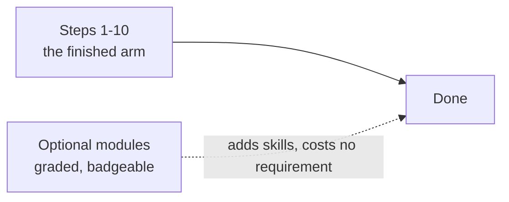

# Optional modules (Extensions)

The ten-step route finishes with a working simulated arm. Everything here is extra: each
module is graded, has its own Break-it case and badge, and can be skipped without losing the
arm or the skills the route names. Taking one adds hours; skipping one costs nothing.

There are **10 optional modules, 47.5 focused hours** in total. The generated per-module list,
with focused hours from each page, is the Extensions table in
[`SIM_ROUTE.md`](SIM_ROUTE.md#extensions-optional-still-graded). These are lesson-time targets,
not elapsed time; the README gives the calendar estimate.

## ROS 2

The two ROS 2 modules (`06-robotics.T2.06a` and `T2.06b`, about 10 hours) are here because a
local ROS 2 install is the most common place a self-guided beginner stops: it expects a
supported Ubuntu, several GB of packages, and a shell. **You can finish the course without
installing ROS 2.**

Pick one of these instead:

1. **Browser walkthrough** — follow the node, topic, TF and `ros2_control` walkthrough in the
   lessons without running a shell. The exercises still grade; only the live CLI checks are
   simulated.
2. **Container** — run the provided image (`docker run` on Linux, macOS, or WSL2). This keeps
   ROS 2 off your host and is the recommended path if you want to run the commands.
3. **Skip it** — read the computational-graph lesson, answer its checkpoint, and move on to
   Step 10. Nothing after Step 9 opens a ROS 2 shell, and the capstone runs in Python.

If you do install it: use a supported Ubuntu or the container, never `sudo pip`, and budget
2-3 hours for the install alone before counting any lesson time.

## What is optional, and why

- **ROS 2 pair** (`T2.06a`, `T2.06b`): the arm, estimator and controller all run in the
  browser; the node graph is taught by the walkthroughs without the install.
- **Zephyr** (`T2.04c`): a second RTOS toolchain on top of the FreeRTOS unit that already
  teaches preemption, priority inversion and a static kernel.
- **micro-ROS** (`T2.04d`): bridges a microcontroller to a ROS 2 graph; nothing on the
  required route consumes the bridge.
- **Six depth modules** (`T3.01a`, `T3.03a`, `T3.04a`, `T3.06a`, `T3.06b`, `T3.07-system`):
  inverter and filter design, SVPWM depth, Q1.31 CORDIC, behaviour cloning, PPO, and OPC
  UA/AAS. Each is a full project; none is a prerequisite for the capstone.

The required depth line - rotation foundations, Joseph covariance, the ESKF reset, constrained
control, and one simulation capstone - stays in the route because the capstone uses it.
