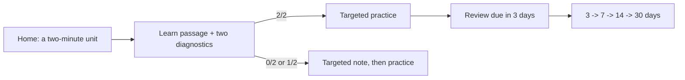

# Atomic micro-learning (beta)

Micro-learning is the workbench's sixteenth tab. It teaches one P.1 concept per unit in roughly two
minutes, asks two diagnostics, chooses the practice from the answers, and schedules a review. It is
**beta** until a person who has never seen the workbench completes P.1 and reports where they got
stuck.

It never marks the parent lesson verified. A micro result is evidence for the micro store only; the
P.1 verified/completed maps and the lesson runner are untouched.



## The seven P.1 units

| Unit | Parent anchor | The one idea |
| :--- | :--- | :--- |
| `variables` | `#micro-variables` | A variable names a value; `=` assigns it. |
| `assignment-order` | `#micro-assignment-order` | Later assignments replace earlier ones; read top to bottom. |
| `int-float` | `#micro-int-float` | `int` and `float` are different numeric types. |
| `strings` | `#micro-strings` | Text is a string; quotes are syntax, not content. |
| `booleans` | `#micro-booleans` | `True` and `False` are values, capitalised. |
| `mixed-types` | `#micro-mixed-types` | Mixing incompatible types raises `TypeError`. |
| `f-strings` | `#micro-f-strings` | An f-string inserts a value into text. |

Each unit has an authored teaching passage, a read-only worked example, two four-option diagnostics
(or normalized short answers), a practice, a four-question review pool and one transfer challenge.
Answers are graded locally and deterministically: no model, no network, no code execution.

## Design and evidence

`micro/P.1.json` is the authored source. `scripts/generate_micro_lessons.py` validates it and writes
`app/src/data/microLessons.ts`; `scripts/generate_parent_lessons.py` writes the metadata-only
`app/src/data/parentLessons.json`. `scripts/micro_timing.py` is the one time model. Every activity
models at **≤120 seconds**; an author/model gap over 20% is a warning, not a build failure, because
both are estimates. The live clock is separate:

- `visibleSeconds` is wall-clock while the tab is visible.
- `adjustedSeconds` caps each inactivity gap at **90 seconds**; the live timer and the 120-second
  target use it.
- A visible activity over **180 seconds** gets a quiet note; nothing is blocked or discarded.

Review is one concept at a time, two questions, every rotation set deterministic. A successful
review moves a 3/7/14/30-day ladder; a successful challenge schedules 14 days; a failure keeps
mastery and skip eligibility but schedules tomorrow. A source-revision change marks the old evidence
stale and clears skip eligibility; it does not delete mastery.

## Storage and the switch

All progress is browser-local. There is no sync and no import.

| Key | Meaning |
| :--- | :--- |
| `mechalab_micro_progress_v1` | Versioned store: compact concept aggregates plus a bounded evidence log (240 events). |
| `mechalab_micro_enabled_v1` | Runtime beta switch. `0` hides the tab and Home's lab; stored progress is untouched. |
| `mechalab_micro_session_v1:<concept>` | Session snapshot for the activity clock, cleared on reset. |

A newer store version is **read-only**: the tab says so and refuses writes and reset rather than
dropping fields it does not understand. A blocked or full bucket falls back to an in-memory session
with a visible "progress won't be saved" note. Dedupe uses the stable `eventId`; an intentional
retry gets a new `attemptId`. Saves re-apply the reducer to the latest stored state and retry after
a conflict, so a second tab cannot overwrite the first tab's evidence.

## Commands

```bash
python3 scripts/generate_micro_lessons.py --stats   # authored vs modelled timings
npm run check:micro                                  # generated catalogue + parent manifest + Python contract
npm run test:micro                                   # reducer, rotation, clocks, store, save races
npm run test:e2e:micro                               # Home door, 2/2, 0/2, due review, switch, 390 px
npm run check:micro-debug                            # fails if the debug readout is in dist/
```

`VITE_MICRO_DEBUG=1 npm run dev` adds the local timing readout. It is a dynamic import behind a
build-time check; `npm run check:micro-debug` proves the production bundle does not contain it.

## Self-study protocol

Day 1: all seven Learn units. Deliberately answer some diagnostics wrong so the 1/2 and 0/2 paths,
the targeted notes and the practice branches are exercised. Scripted browser runs are allowed.

Day 2, at least 18 hours later: reviews (launched manually if not due) plus challenges on variables
and mixed types/`TypeError`. Record where you stopped, the adjusted and visible times, and whether
the 0/2 adjusted time stayed at or below 90 seconds for each Learn activity.

The repository's automated gate seeds a due state instead of waiting 18 hours; it proves the
review screen, the consolidation rule and the saved future due date, not a human retention curve.
The 18-hour protocol and the 120-second beginner claim remain the beta exit criteria. Until then,
the tab is labelled beta in the rail, Home and this page.

## What is deliberately absent

- No AI, cloud generation, personalization or account requirement.
- No code execution in a micro unit; examples are read-only.
- No multi-concept review session; the plan defers that until one-concept review is proven.
- No parent-lesson verification from micro evidence.
