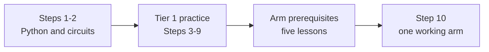

# The minimum viable finish: one working arm

<!-- Generated by scripts/generate_sim_route.py - do not edit by hand.
     Pages and focused hours come from each page's own metadata. -->

**This is a real finish, not a consolation prize.** Do Step 1, Step 2, every arm module
in Steps 3-9, the five lessons the capstone opens, and Step 10. That builds and verifies
the same simulated two-joint arm the arm route builds.

**Everything else is someday.** The arm route adds the remaining prose lessons and the
capstone's graded exercise; the depth pass is a separate, optional document with its own
80 hours; Extensions are a third layer. Stopping at the minimum is a finished project, not
an incomplete course.

| Where | Page | Focused hours |
| :--- | :--- | ---: |
| Step 1 | [`P.1` Variables and Fundamental Data Types](../track-p/P.1-variables-and-data-types.md) | 1-3 |
| Step 1 | [`P.2` Computer Arithmetic and Order of Operations](../track-p/P.2-arithmetic-and-order-of-operations.md) | 1-2.5 |
| Step 1 | [`P.3` Conditional Decisions (if/elif/else) and Command Clamping](../track-p/P.3-decisions-and-clamping.md) | 1.5-3.5 |
| Step 1 | [`P.4` Ordered Lists and Repeating Actions with for Loops](../track-p/P.4-lists-and-for-loops.md) | 1.5-3.5 |
| Step 1 | [`P.5` Reusable Functions (def/return) and while Loops](../track-p/P.5-functions-and-while-loops.md) | 1.5-3.5 |
| Step 1 | [`P.6` Loading Modules (import) and Automated Self-Checks (assert)](../track-p/P.6-modules-and-automated-asserts.md) | 1-3 |
| Step 1 | [`P.7` Base SI Units and Metric Prefixes (M, k, m, µ)](../track-p/P.7-si-units-and-metric-prefixes.md) | 1-2.5 |
| Step 1 | [`P.8` Cycle Frequency (Hz), Period (T = 1/f) and Binary Bits (2^N)](../track-p/P.8-frequency-and-binary-bits.md) | 1-3 |
| Step 1 | [`P.9` Rearranging Physics Formulas and Linear Range Scaling](../track-p/P.9-rearranging-formulas-and-scaling.md) | 1-3 |
| Step 1 | [`P.10` Radians, Rotational Speed (rad/s) and Right-Triangle Trigonometry](../track-p/P.10-radians-and-right-triangle-trig.md) | 1.5-3.5 |
| Step 1 | [`P.11` Reading Time-Series Graphs — Slope and Area](../track-p/P.11-reading-time-series-graphs.md) | 1.5-3.5 |
| Step 1 | [`P.12` Linear Forces (F = ma) and Lever Torque (tau = m*g*L*cos(theta))](../track-p/P.12-forces-and-lever-torque.md) | 1.5-3.5 |
| Step 1 | [`P.14` Reading a Datasheet Table — Unit Columns, Min/Typ/Max & Safe Operating Bounds](../track-p/P.14-reading-a-datasheet-table.md) | 0.75-2 |
| Step 1 | [`P.15` The Analysis Workflow — Given, Unknown, Model, Compute, Check, Answer](../track-p/P.15-analysis-workflow-given-unknown-model-check-answer.md) | 0.75-2 |
| Step 1 | [`P.M` Track P Milestone — Gravity-Holding Robot Arm Link Simulator](../track-p/P.M-track-p-milestone.md) | 1-2.5 |
| Step 2 | [`S0.0` Why Electricity Is Like Water Flow — Effort, Flow & Pipe Constriction](../stage-0/S0.0-why-electricity-is-like-flow.md) | 0.75-2 |
| Step 2 | [`S0.1` Closed DC Circuits, Ground Reference (0 V) and Ohm's Law](../stage-0/S0.1-closed-circuits-and-ohms-law.md) | 1-3 |
| Step 2 | [`S0.2` Series vs. Parallel Resistor Networks, Voltage Dividers and Potentiometers](../stage-0/S0.2-series-parallel-and-voltage-dividers.md) | 1.5-3.5 |
| Step 2 | [`S0.3` Reading Schematics, Breadboards and Short Circuits](../stage-0/S0.3-breadboards-and-short-circuits.md) | 1-3 |
| Step 2 | [`S0.4` Diodes, LEDs, Forward Voltage Drop (V_f) and Resistor Power Ratings (P = VI)](../stage-0/S0.4-leds-and-resistor-power.md) | 1.5-3.5 |
| Step 2 | [`S0.5` Virtual Multimeters (Voltmeter vs. Ammeter) and Current-Limited (CC/CV) Bench Supplies](../stage-0/S0.5-multimeters-and-current-limited-supplies.md) | 1-3 |
| Step 2 | [`S0.6` Capacitors — Charge Storage (tau = R*C) and Power-Rail Decoupling](../stage-0/S0.6-capacitors-and-decoupling.md) | 1.5-3 |
| Step 2 | [`S0.7` Meet the Microcontroller (Arduino Uno 5 V) — Digital I/O and INPUT_PULLUP](../stage-0/S0.7-arduino-uno-digital-io-and-pullups.md) | 1.5-3.5 |
| Step 2 | [`S0.8` Reading Analog Sensors — The 10-Bit ADC (analogRead) and Serial Monitor](../stage-0/S0.8-adc-analog-read-and-serial-monitor.md) | 1.5-3 |
| Step 2 | [`S0.9` Switching Power Smoothly — PWM Duty Cycle and analogWrite()](../stage-0/S0.9-pwm-duty-cycle-and-analog-write.md) | 1.5-3 |
| Step 2 | [`S0.M` Stage 0 Milestone — Potentiometer LED Dimmer with Safety Kill-Switch](../stage-0/S0.M-stage-0-milestone.md) | 1-2.5 |
| Step 3 | [`00-foundations.T1.00a` Running Python, Variables, Loops, Functions & Tracebacks](../modules/00-foundations.T1.00a.md) | 3 |
| Step 3 | [`00-foundations.T1.00b` Lists, Dictionaries, NumPy Arrays, Plotting & Git/Terminal Basics](../modules/00-foundations.T1.00b.md) | 3.5 |
| Step 3 | [`00-foundations.T1.00c` SI Units, Engineering Prefixes & Dimensional Analysis](../modules/00-foundations.T1.00c.md) | 2.5 |
| Step 3 | [`00-foundations.T1.00d` Linear Equations, Unit-Circle Trig, Radians, atan2 & 2D Vectors](../modules/00-foundations.T1.00d.md) | 3.5 |
| Step 3 | [`00-foundations.T1.00e` Position, Velocity, Acceleration, Force, Mass, Energy & Torque in a Loop](../modules/00-foundations.T1.00e.md) | 4 |
| Step 4 | [`01-electronics.T1.01a` Voltage, Current, Resistance, Ohm's Law, KVL/KCL & Voltage Dividers](../modules/01-electronics.T1.01a.md) | 3 |
| Step 4 | [`01-electronics.T1.01b` Low-Side MOSFET Switching, PWM Duty Cycle & H-Bridge Polarity Reversal](../modules/01-electronics.T1.01b.md) | 3.5 |
| Step 4 | [`01-electronics.T1.01c` Multimeter, Current-Limited Bench Supply, Breadboard & ESD/Short-Circuit Safety](../modules/01-electronics.T1.01c.md) | 2.5 |
| Step 4 | [`01-electronics.T1.01d` Capacitors, Inductors, RC Time Constants & Inductive Flyback](../modules/01-electronics.T1.01d.md) | 3 |
| Step 5 | [`02-mechanics.T1.02a` Free-Body Diagrams, Gravity Lever-Arm Torque & Gear Speed/Torque Power Scaling](../modules/02-mechanics.T1.02a.md) | 3.5 |
| Step 6 | [`03-sensors.T1.03a` Electromagnets, Permanent Magnets, Pole Pairs, Quadrature Pulses & Faraday Back-EMF](../modules/03-sensors.T1.03a.md) | 3.5 |
| Step 7 | [`04-embedded.T1.04a` From Python to C/Arduino: Fixed-Width Types, Bitwise Masks, Structs & Pointers](../modules/04-embedded.T1.04a.md) | 3.5 |
| Step 7 | [`04-embedded.T1.04b` Non-Blocking millis()/micros() State Machines, Hardware Interrupts (ISRs) & volatile](../modules/04-embedded.T1.04b.md) | 3.5 |
| Step 8 | [`05-control.T1.05a` Open-Loop vs. Closed-Loop Feedback, P/I/D Physical Roles & Actuator Saturation](../modules/05-control.T1.05a.md) | 3.5 |
| Step 9 | [`06-robotics.T1.06a` 1D Point-to-Point Motion, Boundary Conditions & Virtual Joint Spring-Damper](../modules/06-robotics.T1.06a.md) | 3.5 |
| Step 9 | [`07-systems.T1.07a` Industrial State Machines, Cyclic PLC Scan, E-Stop Chains & Sine-Sweep Gain/Phase](../modules/07-systems.T1.07a.md) | 3.5 |
| Arm prerequisites | [`02.2` 2-Link Planar Arm Forward Kinematics (theta_1, theta_2 -> x, y)](../02-mechanics-kinematics-dynamics/02.2-2link-planar-forward-kinematics.md) | 1.5-3.5 |
| Arm prerequisites | [`02.3` 2-Link Planar Arm Inverse Kinematics (x, y -> theta_1, theta_2) and Reachability](../02-mechanics-kinematics-dynamics/02.3-2link-planar-inverse-kinematics.md) | 1.5-4 |
| Arm prerequisites | [`04.2` Packed Binary Telemetry Structs (struct.pack), CRC-8 & UART Bandwidth Budgets](../04-embedded-and-realtime/04.2-packed-structs-and-crc8-telemetry.md) | 1.5-3.5 |
| Arm prerequisites | [`06.1` Rest-to-Rest Cubic Polynomial Trajectories and Joint-Space Gravity Feedforward](../06-robotics-and-autonomy/06.1-cubic-trajectories-and-compliant-joints.md) | 1.5-3.5 |
| Arm prerequisites | [`07.1` 10-Step Smoke-Free Hardware Bring-Up and Single-Tone Sine-Sweep System Identification](../07-systems-hil-and-production/07.1-safe-bringup-and-sine-sweep-sysid.md) | 1.5-3.5 |
| Step 10 | [`08.1` Tier 1 Boss Milestone — 1 kHz 2-DOF Compliant Arm Plant, Figure-8 PD Control & CRC-8 Telemetry](../08-capstone-projects/08.1-tier1-2dof-compliant-arm-capstone.md) | 2-4.5 |
| **Minimum viable finish** | **48 pages: 32 lessons + 16 modules** | **93.75-153** |

At **6 focused hours a week** the page time is about 4-6 months. Add the first-time
overhead the README explains (5x focused hours) and plan **1.5-2.5 years**; at 10x it is
3-5 years. The arm route is about 3-5 years at 6 hours a week with the same 5x.

## What the minimum leaves out

- **17 prose lessons and the capstone's graded exercise**, ≈27–59 focused hours: the rest of the arm route in [`SIM_ROUTE.md`](SIM_ROUTE.md). They are arm reading, not depth work.
- **23 depth modules**, 80 focused hours: the separate depth pass in [`DEPTH.md`](DEPTH.md), taken after the arm.
- **10 optional Extensions**, 47.5 focused hours. None is required for any
  finish line.
- **Physical hardware and a local ROS 2 install.** Every page in the minimum runs in the
  browser. The optional bench and the ROS 2 walkthrough are in `docs/EXTENSIONS.md`.

## What the arm route adds

The arm route is **121.1-212 focused hours**: 17 arm modules and all 49 lessons (66 pages). It is the same arm with all of its reading and the capstone's graded exercise, not a different project.

The depth pass is a second, optional route: **23 modules, 80-80 focused hours**, page by page in [`DEPTH.md`](DEPTH.md). The full course is the arm plus the depth pass, **201.1-292 focused hours**.
