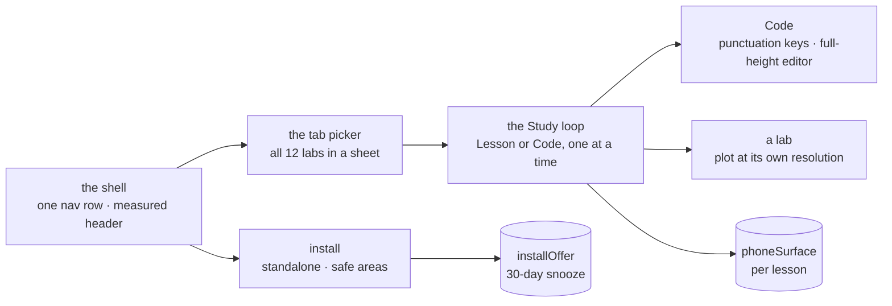

# MOBILE.md — the workbench on a phone

MechaLab is a course, and a course read on a bus is a phone. This page is the phone's map: what the
workbench does differently below 768 px, which module owns each piece, what it costs in pixels, and
the gate that measures all of it. It is written for the next person to change a phone layout, and it
records the failures that produced each rule rather than only the rule.



## The loop, in the order a learner meets it

1. **The shell.** Below `md` the twelve-tab rail is replaced by `components/PhoneTabPicker.tsx`: one
   row that names the current lab and opens a sheet listing all twelve. The rail stays in the DOM for
   `md` and up and is hidden by CSS, so a rotation or a resize needs no React state to choose between
   them. The header measures itself into `--header-h` (`components/Header.tsx`), because the picker is
   a second sticky row and a guessed offset puts it under the header the moment the action tray wraps.
   Two rows are the phone header's budget — brand, then the swipeable action strip — and 112 px is the
   gate's ceiling. The account chip is the avatar alone below `md`: an email is longer than the strip
   beside it, and the words stay as its accessible name so the disc is not an unnamed button.
2. **The lesson list has a door at every width.** The 224 px chooser rail needs `lg` and the phone's
   Lessons strip needs `md` to be absent, so between them the brief carries a Lessons button that
   opens the same sheet (`data-testid="btn-lessons-tablet"`). Without it a tablet could change tabs
   but never lessons — the built-bundle suite's 834 px check is what found that.
3. **Study is one surface at a time.** At 390 px the lesson text and the editor cannot share a column:
   each would be narrower than a Python line, and the keyboard then hides half of what is left. The
   runner shows either the prose or the code (`app/src/phoneSurface.ts`), switched from the fixed bar
   at the bottom. The choice is stored **per lesson**, so a stored `code` for P.1 never opens P.2 in the
   editor — a new lesson starts on the text, the thing the learner has not read.
4. **The editor mounts on demand.** `codeOpened` is separate from the surface on purpose: opening Code
   mounts CodeMirror and starts warming Pyodide; going back to Lesson hides the editor but does not
   unmount it, so the document, caret and undo history survive the round trip. A phone that only reads
   never pays the editor's 149 kB or the interpreter's 10 MB.
5. **The punctuation strip.** A phone keyboard's first pane has letters, a space and return. Python
   needs `:`, `(`, `)`, `"`, `_`, `#`, brackets and indentation on nearly every line, and each trip to
   the symbol pane loses the caret's place. `components/PythonKeys.tsx` inserts at the caret through
   the editor's own handle; every key is 40 px square, above the app's 28 px floor, because these are
   hit repeatedly and without looking.
6. **A plot opens at its own resolution.** A 320 px Bode card cannot be read for a phase margin.
   `components/PlotExpander.tsx` snapshots the live canvas with `toDataURL` and shows it in a sheet
   that scrolls both ways; the snapshot is taken when the sheet opens, because the canvas redraws every
   frame and a live copy would either be stale or be a second draw loop. All seven canvas labs carry it.
7. **Install, once.** `app/src/installOffer.ts` decides whether the tab sheet shows the install row:
   never inside the installed app, the browser's own prompt when `beforeinstallprompt` exists, the
   Share-sheet words on iOS (which has no prompt event), nothing on a laptop. "Not now" is a thirty-day
   snooze. Accepted installs need no record — the next launch is `standalone` and the first rule hides
   the row.

**The workflow rides in Code.** The editor's output views — Predict, Run output, Expected, Workflow — are
tabs of one card, and the Workflow canvas is born in one column: the same flow is legible in a 380 px
split and at 390 px, the dotted paper scrolls inside its own pane, and an arrow is drawn by tapping a
card's dot and then the card it feeds — the drag gesture, for a finger that cannot hover. Every
control stays at the touch floor, and **Open workflow** in the study panel switches to the Code
surface before scrolling to the card, so the tab a learner asked for is never on a surface they
cannot see. The editor's tab strip wraps whenever its tabs do not fit
— at 390 px into labelled rows with its icons hidden, and at a desktop width when a helper file
overruns the row — so all four output views are reachable without the sideways scroll that used to
push the last one off screen.

## One sheet, seven overlays

`components/Sheet.tsx` is the only dialog: a bottom sheet on a phone, the centred dialog the desktop
already had at `sm` and up. It carries what a dialog cannot skip — `role="dialog"`, `aria-modal`, a
labelled title, Escape, a focus trap, focus restored to the control that opened it, a locked page
behind it, and `env(safe-area-inset-bottom)` so its last button clears a home indicator. It writes
`data-sheet-open` on `<body>`; `index.css` hides the fixed Study bar from that attribute, which is
cheaper than threading "a sheet is open" through every caller. The seven overlays it replaced:
Help, Pair, Shortcuts, Command palette, Account, Reset progress and the cheat sheet.

## Touch and type floors

The floors are one block in `app/src/index.css`, keyed on **`pointer: coarse`** rather than width: a
touch laptop gets them and a 390 px window with a mouse does not.

| Control | Floor | Why |
| :--- | ---: | :--- |
| `.btn` (primary actions) | 44 px | the comfortable target; Run, Start, Install |
| `.action-tray .btn` | 40 px | header chrome, so the tray stays one line high |
| punctuation keys | 40 × 40 px | repeated, without looking |
| small secondary controls | 28 × 28 px | the app-wide minimum |
| text fields on touch | 16 px type | the size iOS will not zoom on focus |

The element floors live in `@layer base` and the primitives in `@layer components`. That is not
tidiness: an unlayered rule outranks every Tailwind utility whatever its specificity, and the first
version of this block sat outside the layers — its 28 px floor flattened the `min-h-[40px]`
punctuation key back to 28, which the gate caught on its first run.

## Breakpoints

| Width | What changes |
| :--- | :--- |
| `< 380` | the picker and Predict print their icons only; the tray strip scrolls |
| `390–639` | the phone layout: picker, one-surface Study, fixed Run bar |
| `640–767` | labels return (`sm:`); still the phone shell |
| `768–1023` | the rail returns (`md:`), the picker goes; Study is one column of prose then editor, and the brief's **Lessons** button opens the chooser sheet (the 224 px rail needs `lg`) |
| `1024+` | the lesson rail sits beside the work area (`lg:`) |
| `1536+` | header controls print their words (`2xl:`) |

## Install and safe areas

`app/public/manifest.webmanifest` is `display: standalone`, with four icons: `icon-192.png`,
`icon-512.png`, a `maskable` 512 whose art sits inside the 80 % safe circle, and `favicon.svg` for a
browser tab. iOS reads `apple-touch-icon.png` and the `apple-mobile-web-app-*` meta tags in
`app/index.html` instead. All four PNGs are rendered from `favicon.svg` by `npm run icons` — change the
drawing, run that, and every size follows.

`viewport-fit=cover` in the viewport meta is what lets an installed app paint into the notch: without
it iOS letterboxes the page and `env(safe-area-inset-*)` is always zero. `index.css` pads the body by
the top/left/right insets in `display-mode: standalone` and the Study bar by the bottom inset always
(a browser tab already handles the notch itself, but a home indicator still overlaps a fixed bar).

## Storage keys

| Key | What it is | Owner |
| :--- | :--- | :--- |
| `mechalab_phone_surface_v1` | `{lesson, surface}` — the half of Study last shown, for that lesson | `app/src/phoneSurface.ts` |
| `mechalab_install_offer_v1` | the timestamp of "not now" | `app/src/installOffer.ts` |

Both are shape-checked one field at a time: a store from an older build reads as "no record", never as
a throw, and blocked storage leaves the switch working for the visit.

## The gate

```bash
npm run test:phone        # the pure rules: surface migration and the install offer
npm run test:e2e:mobile   # 390×844 at DPR 3 with touch, then 768 and 1024
npm run icons             # regenerate the manifest PNGs from favicon.svg
```

`scripts/e2e_mobile.mjs` is a real Chromium at 390 × 844, `isMobile`, `hasTouch`, DPR 3. It asserts,
in order: the shell fits with the picker as its only nav row and the header publishing its measured
height; all twelve tabs are in the sheet with 44 px rows, Escape closes it and focus returns; a lab's
plot opens at its own resolution and scrolls; Study opens on the text, Code mounts the editor, a
punctuation key inserts at the caret, every key is 40 px, the Run bar ends on the bottom edge, and a
sheet hides it; a reload inside Code comes back to Code and Lesson hides the editor without a remount;
the lesson sheet selects another entry and the strip follows; the install row appears only with a
prompt event (or the iOS UA) and calls the prompt exactly once; and at 768/1024 the rail is back with
Predict sharing Run's row. It launches no interpreter: `test:e2e` and `test:predict` own running code,
and 10 MB on a throttled phone link would make this too slow to gate every pull request.

Measured on the run that added it: header 107.75 px (budget 112), picker rows 56 px, punctuation keys
40 × 40, phone Run 44 px, Study bar flush with the 844 px edge, and no horizontal scroll on the shell,
a lab, either Study surface, or after a lesson change.

## Deliberate limits

- **Landscape is not laid out separately.** A phone on its side is 844 × 390: the same single surface,
  with less vertical room. The editor's 45dvh minimum is what keeps it usable.
- **Pinch still zooms the page.** The plot expander is the answer for a trace; prose zoom stays the
  browser's own, because taking it over breaks the text-size setting a learner chose.
- **The phone editor is deferred, not deferred forever.** Opening Code mounts it; a preset that shows
  the editor does too. Nothing on the reading surface pays for it.
- **`viewport-fit=cover` changes a browser tab too.** That is why the body padding is scoped to
  `display-mode: standalone`: in a tab the browser has already inset the page.
