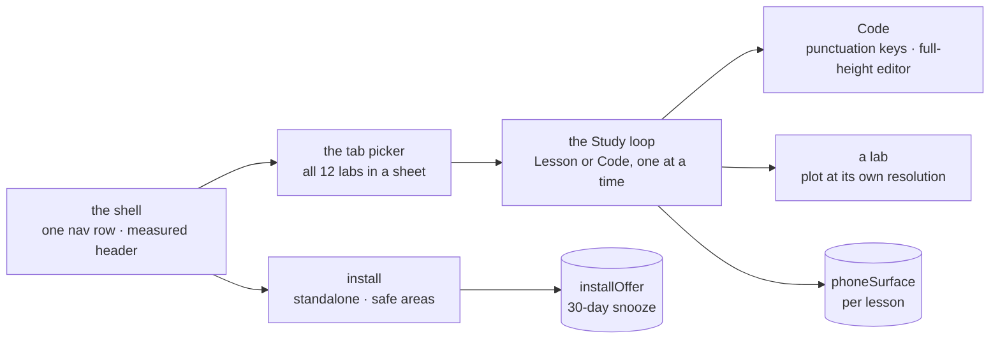

# MOBILE.md — the workbench on a phone

MechaLab is a course, and a course read on a bus is a phone. This page is the phone's map: what the
workbench does differently below 768 px, which module owns each piece, what it costs in pixels, and
the gate that measures all of it. It is written for the next person to change a phone layout, and it
records the failures that produced each rule rather than only the rule.



## The loop, in the order a learner meets it

1. **The shell.** Below `md` the tab rail is replaced by `components/PhoneTabPicker.tsx`: one
   row that names the current lab and opens a sheet listing all sixteen tabs. The rail stays in the DOM for
   `md` and up and is hidden by CSS, so a rotation or a resize needs no React state to choose between
   them. The header measures itself into `--header-h` (`components/Header.tsx`), because the picker is
   a second sticky row and a guessed offset puts it under the header the moment the action tray wraps.
   Two rows are the phone header's budget — brand, then the swipeable action strip — and 112 px is the
   gate's ceiling. The account chip is the avatar alone below `md`: an email is longer than the strip
   beside it, and the words stay as its accessible name so the disc is not an unnamed button.
2. **The lesson list has a door at every width.** The 224 px chooser rail needs `lg` and the phone's
   Lessons strip needs `md` to be absent, so between them the brief carries a Lessons button that
   opens the same sheet (`data-testid="btn-lessons-tablet"`). Without it a tablet could change tabs
   but never lessons — the built-bundle suite's 834 px check is what found that.
3. **Study is one surface at a time.** At 390 px the lesson text and the editor cannot share a column:
   each would be narrower than a Python line, and the keyboard then hides half of what is left. The
   runner shows either the prose or the code (`app/src/phoneSurface.ts`), switched from the fixed bar
   at the bottom. The choice is stored **per lesson**, so a stored `code` for P.1 never opens P.2 in the
   editor — a new lesson starts on the text, the thing the learner has not read.
4. **The editor mounts on demand.** `codeOpened` is separate from the surface on purpose: opening Code
   mounts CodeMirror and starts warming Pyodide; going back to Lesson hides the editor but does not
   unmount it, so the document, caret and undo history survive the round trip. A phone that only reads
   never pays the editor's 149 kB or the interpreter's 10 MB.
5. **The coding keyboard.** A phone keyboard's first pane has letters, a space and return. Python
   needs `:`, `(`, `)`, `"`, `_`, `#`, brackets and indentation on nearly every line, and each trip to
   the symbol pane loses the caret's place. `components/MobilePythonKeyboard.tsx` is one full
   keyboard drawn once by `EditorCodePane` and shared by Python Code and Visual: indentation actions,
   the programming symbols, QWERTY with number labels, Shift, the operator row, and `123` / native /
   space / Done. **Fn** makes the top row block verbs and the QWERTY row digits; **123** opens the
   digits and arithmetic page; Shift is one-shot, and a second quick tap locks capitals. Closing the
   keyboard — Done, Native, or the caret leaving — clears both, as the OS keyboard does, while Fn,
   the page and the lighting stay remembered. Keys clear the app's 28 px floor at **44 px**, a 10 %
   raise from 40 px: they are hit repeatedly and without looking, and the phone's horizontal budget
   does not allow them to grow wider. A key acts on **pointerdown**, the way a native keyboard does,
   rather than waiting for the synthetic click on the lift. That is also what makes two overlapping
   thumbs work: a browser does not synthesise a click for every touch in a multi-touch sequence, so
   the old click-only key lost those characters entirely. A keyboard or switch activation has
   `detail === 0` and still acts exactly once. A key cancels its pointer default, so the caret, the
   field and the open keyboard stay put. It also compresses under the finger (a transform, so no
   neighbour moves), raises its character above the cap, and asks for a light vibration where the
   device has one; Enter is a medium tap and the mode keys answer with two ticks. iOS Safari has no
   Vibration API, so there the press animation is the feedback, and no copy promises otherwise.

   **Return and Backspace follow the file, not a timer.** A suite header opens its body at four
   spaces (`indentUnit.of('    ')`), so Enter inside `if True:` continues the indent the starters and
   lessons use. Backspace uses `deleteCharBackwardStrict`: one tap deletes one character, including
   at the end of an indentation unit, where the indentation-aware command used to remove all four.
   A held repeating key acts on the way down and consumes the click that follows its lift, however
   late the browser makes it; a keyboard or switch activation (`detail === 0`) still fires once. No
   time window decides whether a press was real.

   **The caret is the switch.** A focus in CodeMirror or in a block field opens the keys; a focus
   that lands on the lesson text, another tab or the page outside them folds them. The shell is kept
   mounted and slides off the bottom edge with a transform — `visibility` changes only after the
   movement — so closing is a transition rather than a disappearance, and the page, Fn state and
   lighting layer are still there when a field takes the caret again. What keeps the keyboard is
   named in `EditorCodePane` (the mode bar, the keys themselves, a sheet): a press on one of those is
   not the learner leaving the editor, while tapping the prose is.

   **The keyboard is the site's, not only the editor's.** `components/PhoneFieldKeyboard.tsx` is
   mounted once at the app root and follows the caret into every other text field — the lesson
   search, a note, a name or password in a sheet, the calculator's line, the visual toolbox's field,
   the sticky-note composer's `contenteditable`. It suppresses the OS keyboard at `pointerdown`
   (`inputmode="none"` has to be on the field before the browser focuses it, or iOS has already
   begun to raise its own), restores the original attribute when it folds, and retargets without a
   slide when the next field is a text field too. Done blurs; tapping the prose folds. When this
   keyboard takes the bottom edge the editor's keys fold (`FIELD_KEYBOARD_OPEN_EVENT`), so one shell
   owns it and the Study bar rides on it. The native key is a handoff, not a one-way door: the field
   keeps the OS keyboard while the caret stays in it, and leaving and returning to the field gives
   the site keys back, with `inputmode=none` restored before the next focus. If the OS keyboard is
   put away while the field still has the caret, the visual viewport growing back to the height
   remembered when Native was chosen is the signal to raise the site keys again. That baseline is
   used rather than `window.innerHeight` because Android shrinks both together. The touch gate stubs
   `visualViewport` and sends its resize events to exercise that dismissal while the editor keeps
   focus, so the path is covered without a real phone. Number, date, range, colour and file controls keep the browser's own
   keyboard — their keypads are the honest ones. Above 768 px the host renders nothing, and a phone
   that never types draws no second keyboard until a field first asks.

   **Fn → 123 / ABC is the lighting layer**, not a second keyboard. The Fn row's `123` / `ABC` key
   prints `RGB` while Fn is on; one press swaps the three non-letter rows for the six modes (off,
   static, cycle, breathing, rainbow, reactive), six presets, a custom colour and brightness/speed
   sliders, while the letter rows underneath stay as the live preview. The same key returns to the
   typing page it kept. The lighting is CSS custom properties on the section and a `::before` wash
   under each cap, so no JavaScript runs per frame; a loop pauses while the shell is folded and stops
   under `prefers-reduced-motion`. The choice is stored with the editor's other device preferences.

   Sizing is in CSS pixels inside the fixed shell and never reads the editor's `--editor-font-size`,
   so zooming the code grows the code, not the keyboard; the keys keep their 44 px floor at every
   viewport and `env(safe-area-inset-bottom)` keeps the last row clear of a home indicator. Pinch
   zoom on the code stays the browser's, as does the text-size setting it exists for; the keyboard
   itself is not a surface to pan or pinch (`touch-action: none`), because a fast thumb rolls while
   it holds a key. That drift used to be read as a page gesture — a 48 px slide dragged the page
   44 px and the next finger dragged it back, the recoil a learner saw while typing. The section and
   every cap now opt out, while the RGB sliders still take a drag.

   The keyboard is **fixed to the bottom edge**, not in the page's flow: at 390 px the editor card
   is taller than the screen, and an in-flow keyboard sits thousands of pixels below the editor. It
   takes the bottom edge the way a phone's own keyboard does, so the fixed Study bar rides on top of
   the keys while they are up (`data-mobile-keyboard` and the measured height, the hook a sheet
   also uses) and returns to the edge with **Done** — nothing is left between the last key row and
   the screen edge, and Run/Lesson stay one press away. The keys' own inset is
   the safe-area inset alone. The pane measures the keyboard and reserves the same height at its
   end, and while the code face is showing it is a **measured band**, not a page-height document:
   `EditorCodePane` measures from the mode bar's bottom edge to the nearer of the Study bar that
   rides on the keys, the keys themselves, and — for the OS keyboard — the visual viewport's
   bottom edge. The editor fills exactly that box, never more than the room that exists. A 140 px
   floor used to overrun a short phone: at 360×640 the Study bar began at 242 px while the face
   ended at 293 px, so the last two lines — the line being typed — were behind the bar. The band
   is capped at the measured space; a smaller band is honest, an overlapping one hides the caret.

   **While the keys are up, the typing layer owns the screen.** The global header and the tab
   picker are hidden (`data-phone-typing` on `<html>` and `<body>`), the mode bar is pinned to the
   top, and the page is locked with `overflow: hidden` plus a guard that restores the locked
   `window.scrollY`; only the editor's own scroller moves. The chrome's 153 px, less the mode bar's
   own 43, go to the code: the band is **403 px at 390×844**, 225 at 375×667, 199 at 360×640 and
   96 at 320×568, where the old pin-and-scroll left 293, 116, 89 and 17. Leaving Code for Lesson
   releases the layer at once and brings the header and page scrolling back. When the keys close,
   the page is moved just far enough to put the mode bar under the header **and the sticky tab
   picker**, so the way back to the keys is not left behind the chrome. The editor's own view
   tabs and run controls sit above the mode bar, so they are off-screen while the keys are up;
   Done gives them back.

   The old card was as tall as its file — a 40-line starter made a 1048 px editor in a 3151 px
   page — so the editor's own scroller never moved, the page's scrollbar did the scrolling, and the
   caret sat far below the keys. The band is placed with an instant scroll (the page's own
   `scroll-behavior` is smooth, so `auto` would animate a measurement), and the surface switch
   does not scroll to the card's top while the keys are up. The page's height no longer changes as
   lines wrap, so the scrollbar stays where the learner left it.

   **Every key reveals the caret.** The code's scroller also contains its overscroll
   (`overscroll-behavior: contain`), so reaching the first or last line never drags the page. CodeMirror
   scrolls for the browser's own typing, but a
   key press goes through the editor's handle — `insertText`, `backspace`, `insertNewLine`,
   `insertTab`, indent, undo — and a command's dispatch is programmatic. Each of those now asks the
   view to scroll the caret into the band, with the 26 px `scrollMargins` bottom keeping the line
   being typed clear of the Study bar and the keys. The scroller moves by the line; the page does
   not. Custom keys put `inputmode=none` on CodeMirror's content and on the focused
   block field, which is the only way to keep the OS keyboard shut while the custom one is the
   keyboard; the **native** key removes it and focuses the real editor in the same gesture, so the
   OS keyboard rises as the custom shell slides away. The band follows
   `visualViewport.height + offsetTop` while the OS keyboard is up, because iOS keeps `innerHeight`
   full; the Study bar is its edge only when its top is actually above that visual bottom (Android
   shrinks the layout viewport, iOS leaves the bar behind the keyboard). The mode bar's key button
   is the way back: it re-applies `inputmode=none`, blurs and focuses the surface so the OS keyboard
   closes, and the caret and selection never moved. A press on the mode bar holds the typing layer
   until its click lands, so the button cannot move out from under the finger; the blur that
   dismisses the OS keyboard is not read as leaving the editor. **Done** folds the keyboard and
   leaves that button in its place, under the chrome. In Visual the toolbox dock folds while the
   keyboard is up, and a focused field is scrolled into the band above the keys.
6. **A plot opens at its own resolution.** A 320 px Bode card cannot be read for a phase margin.
   `components/PlotExpander.tsx` snapshots the live canvas with `toDataURL` and shows it in a sheet
   that scrolls both ways; the snapshot is taken when the sheet opens, because the canvas redraws every
   frame and a live copy would either be stale or be a second draw loop. All seven canvas labs carry it.
7. **Install, once.** `app/src/installOffer.ts` decides whether the tab sheet shows the install row:
   never inside the installed app, the browser's own prompt when `beforeinstallprompt` exists, the
   Share-sheet words on iOS (which has no prompt event), nothing on a laptop. "Not now" is a thirty-day
   snooze. Accepted installs need no record — the next launch is `standalone` and the first rule hides
   the row.

**Visual blocks dock on a phone.** `EditorCodePane`'s Visual face draws the same `main.py` as cards.
Its Python Toolbox is a **dock**, not the panel at the end of the workspace: fixed above the fixed
Study bar (measured, so it sits on the bar rather than under it), a grabber that drags the sheet
between one row and about a third of the screen, and the catalog scrolling inside it. The swipe is
live: the height follows the finger rather than deciding on release, and letting go settles it with
one short ease (or snaps back if the drag ended on the side it started). The workspace keeps 42vh of
bottom padding so the last card can still be scrolled above the dock. A card opens with its five
controls folded at every width — the toggle is on the card — and a touch that rests on a card for a
third of a second lifts it to drag. The label chip that follows the finger rides just above it, so
the finger (and the chip) never covers the landing point; the card under it draws the point a
release will snap to, with a small accent arrow in the gap the statement will land in — pointing
down for a drop below its old place, up for a drag above it, or into an empty suite's dashed
target. When sound is on, the lift and the landing reuse the interface's quiet `row` and `chip`
ticks; a muted phone loses only the sound, not the card, the chip or the arrow. A small info button
on every card names the kind and explains it without opening the five verbs. The dock's elements
take the same hold: rest a finger on one and it lifts out of the catalog with the row tick, then
lands on a card with the chip; a quicker vertical drag still scrolls the list. A touch that moves sooner scrolls instead, and
`npm run test:e2e:snap-arrow` screenshots the paused drag at 390 px and proves the arrow's pixels
are painted. No browser long-press gesture claims that finger:
the card declines text selection and the iOS callout in CSS, and the editor attaches its non-passive
`touchmove` and `contextmenu` guards when the finger goes down (so the first move cannot be taken as
a scroll) while only `preventDefault`ing once the hold has lifted. The gate drives the card drag, the
toolbox hold and the grabber swipe with CDP touch input rather than a mouse, and measures that the
page does not scroll or select under any of them. The toolbar above the code is one compact row below
`sm` and the full bar with its sentence above that. From `sm` up the toolbox is the inline panel, so
Visual is not a phone-only face.

**The workflow rides in Code.** The editor's output views — Predict, Run output, Expected, Workflow — are
tabs of one card, and the Workflow canvas is born in one column: the same flow is legible in a 380 px
split and at 390 px, the dotted paper is capped at 70% of the viewport and scrolls inside its own
pane, and an arrow is drawn by tapping one of a card's four dots — left, right, top or bottom — and
then a dot on the card it feeds: the drag gesture, for a finger that cannot hover. The vertical pair
is what keeps a join or a loop from crossing the column. **Fit** frames a flow taller than the phone pane and turns into
**100%** for the way back; a finger pans by scrolling the paper itself, so panning never fights the
scroll a phone already does well. The checklist is a count one press from its sentences, so a card's
warning cannot push the canvas down the page. Every control stays at the touch floor, and **Open workflow** in the
study panel switches to the Code surface before scrolling the editor's tab strip into view, so the
tab a learner asked for is never on a surface they cannot see. The editor's tab strip wraps whenever its tabs do not fit
— at 390 px into labelled rows with its icons hidden, and at a desktop width when a helper file
overruns the row — so all four output views are reachable without the sideways scroll that used to
push the last one off screen.

## One sheet, seven overlays

`components/Sheet.tsx` is the only dialog: a bottom sheet on a phone, the centred dialog the desktop
already had at `sm` and up. It carries what a dialog cannot skip — `role="dialog"`, `aria-modal`, a
labelled title, Escape, a focus trap, focus restored to the control that opened it, a locked page
behind it, and `env(safe-area-inset-bottom)` so its last button clears a home indicator. It writes
`data-sheet-open` on `<body>`; `index.css` hides the fixed Study bar from that attribute, which is
cheaper than threading "a sheet is open" through every caller. The seven overlays it replaced:
Help, Pair, Shortcuts, Command palette, Account, Reset progress and the cheat sheet.

## Touch and type floors

The floors are one block in `app/src/index.css`, keyed on **`pointer: coarse`** rather than width: a
touch laptop gets them and a 390 px window with a mouse does not.

| Control | Floor | Why |
| :--- | ---: | :--- |
| `.btn` (primary actions) | 44 px | the comfortable target; Run, Start, Install |
| `.action-tray .btn` | 40 px | header chrome, so the tray stays one line high |
| punctuation keys | 44 × 44 px | repeated, without looking |
| small secondary controls | 28 × 28 px | the app-wide minimum |
| text fields on touch | 16 px type | the size iOS will not zoom on focus |

The element floors live in `@layer base` and the primitives in `@layer components`. That is not
tidiness: an unlayered rule outranks every Tailwind utility whatever its specificity, and the first
version of this block sat outside the layers — its 28 px floor flattened the `min-h-[44px]`
punctuation key back to 28, which the gate caught on its first run.

## Breakpoints

| Width | What changes |
| :--- | :--- |
| `< 380` | the picker and Predict print their icons only; the tray strip scrolls |
| `390–639` | the phone layout: picker, one-surface Study, fixed Run bar |
| `640–767` | labels return (`sm:`); still the phone shell |
| `768–1023` | the rail returns (`md:`), the picker goes; Study is one column of prose then editor, and the brief's **Lessons** button opens the chooser sheet (the 224 px rail needs `lg`) |
| `1024+` | the lesson rail sits beside the work area (`lg:`) |
| `1536+` | header controls print their words (`2xl:`) |

## Install and safe areas

`app/public/manifest.webmanifest` is `display: standalone`, with four icons: `icon-192.png`,
`icon-512.png`, a `maskable` 512 whose art sits inside the 80 % safe circle, and `favicon.svg` for a
browser tab. iOS reads `apple-touch-icon.png` and the `apple-mobile-web-app-*` meta tags in
`app/index.html` instead. All four PNGs are rendered from `favicon.svg` by `npm run icons` — change the
drawing, run that, and every size follows.

`viewport-fit=cover` in the viewport meta is what lets an installed app paint into the notch: without
it iOS letterboxes the page and `env(safe-area-inset-*)` is always zero. `index.css` pads the body by
the top/left/right insets in `display-mode: standalone` and the Study bar by the bottom inset always
(a browser tab already handles the notch itself, but a home indicator still overlaps a fixed bar).

## Storage keys

| Key | What it is | Owner |
| :--- | :--- | :--- |
| `mechalab_phone_surface_v1` | `{lesson, surface}` — the half of Study last shown, for that lesson | `app/src/phoneSurface.ts` |
| `mechalab_install_offer_v1` | the timestamp of "not now" | `app/src/installOffer.ts` |
| `mechalab_keyboard_rgb_v1` | the keyboard lighting: mode, colour, brightness, speed | `app/src/keyboard/rgb.ts` |

Both are shape-checked one field at a time: a store from an older build reads as "no record", never as
a throw, and blocked storage leaves the switch working for the visit.

## The gate

```bash
npm run test:phone               # the pure rules: surface migration and the install offer
npm run test:e2e:mobile          # 390×844 at DPR 3 with touch, then 768 and 1024
npm run test:e2e:keyboard-speed  # sudden speed changes and overlapping thumbs
npm run icons                    # regenerate the manifest PNGs from favicon.svg
```

`scripts/e2e_mobile.mjs` is a real Chromium at 390 × 844, `isMobile`, `hasTouch`, DPR 3. It asserts,
in order: the shell fits with the picker as its only nav row and the header publishing its measured
height; all sixteen tabs are in the sheet with 44 px rows, Escape closes it and focus returns; a lab's
plot opens at its own resolution and scrolls; Study opens on the text, Code mounts the editor, a
punctuation key inserts at the caret, every key clears 43.5 px (the 44 px target), the Run bar ends on
the bottom edge, and a sheet hides it; a reload inside Code comes back to Code and Lesson hides the
editor without a remount; the lesson sheet closes from the list's own corner × and hands focus back,
then selects another entry and the strip follows; the install row appears only with a
prompt event (or the iOS UA) and calls the prompt exactly once; and at 768/1024 the rail is back with
Predict sharing Run's row. Its last block drives the keyboard with Chromium's own touch events rather
than mouse clicks, because every key cancels `pointerdown` and a mouse-only gate cannot see the
difference: it taps the editor's keys and a page field's keys, holds one for its preview, types at
40, 70, 100, 120 and 150 WPM, then runs **100 seeded code plans (1,325 touches)** and **20 seeded
Visual plans (192 touches)** mixing letters, symbols, operators, Return, Backspace, Shift, Fn and
layout switches. It locks capitals on a double Shift, holds Backspace for a second in the editor, a
controlled search and the note composer and proves it repeats then stops, puts a finger in the gap
between two caps and in both 123 and ABC without losing the caret, hands the editor and a page field
to the OS keyboard and gets the site keys back, carries the keys between two fields without folding,
measures touch-to-rendered-text latency, and records the shell's position every frame so a slide
cannot pass for a jump — at 360, 390, 428 and 740 px, including the calculator display and the rich
note composer. Ten blur/refocus cycles and five Done/show cycles check that the keyboard's visibility
belongs to its own state, not to an animation ending. The session fails on a page exception or a
console error as well as on a wrong character. It launches no interpreter: `test:e2e` and
`test:predict` own running code, and 10 MB on a throttled phone link would make this too slow to gate
every pull request.

Measured on the run that added it: header 107.75 px (budget 112), picker rows 56 px, punctuation keys
44 × 44, phone Run 44 px, Study bar flush with the 844 px edge, and no horizontal scroll on the shell,
a lab, either Study surface, or after a lesson change. The same gate's 12-sample touch-to-rendered-text
measurement reads **median 15.4–21.2 ms, max 29.1 ms across runs** after keys began acting on
pointerdown; the click-on-release path measured 34.2 ms median on the same VM.

`scripts/e2e_keyboard_speed.mjs` is the changing-speed gate. It first types a fixed slow opening that
accelerates to 8 ms keys, then the exact two-thumb overlap that typed nothing before keys acted on
pointerdown. Its 100 seeded plans (1,744 touches; 41 single-thumb and 59 overlapping) mix 90–160 ms
opening gaps with 6–20 ms bursts and occasional pauses, and two fingers whose touches overlap by
14 ms. Each plan asserts the complete document, caret, focus, keyboard state and no
console/page error; every seed prints its keys, gaps and holds if it fails.

## Deliberate limits

- **Landscape is not laid out separately.** A phone on its side is 844 × 390: the same single surface,
  with less vertical room. The keyboard is measured at 740 × 390 with every 44 px cap still hitting
  its own centre, but it covers most of that height; the editor's 45dvh minimum is what keeps the
  code usable above it.
- **Pinch still zooms the page.** The plot expander is the answer for a trace; prose zoom stays the
  browser's own, because taking it over breaks the text-size setting a learner chose.
- **The phone editor is deferred, not deferred forever.** Opening Code mounts it; a preset that shows
  the editor does too. Nothing on the reading surface pays for it.
- **`viewport-fit=cover` changes a browser tab too.** That is why the body padding is scoped to
  `display-mode: standalone`: in a tab the browser has already inset the page.
