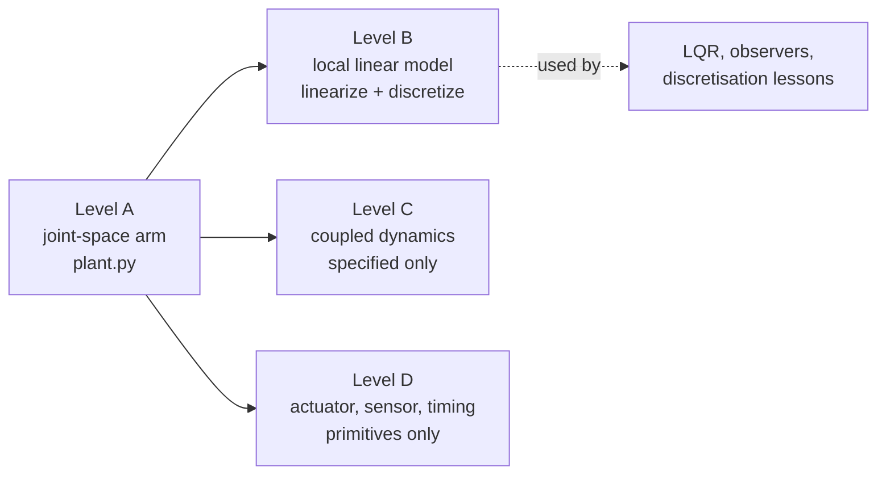

# Model Levels — one robot, four explicit models

"Same robot across tiers" must not mean "same simplified equations forever", and it must not mean
quietly replacing the model a lesson's numbers came from. So the shared arm has **named levels**.
Each one says what it includes, what it leaves out, where its parameters came from, and when it is
the right model. [`resources/plants/mechalab_models.py`](../resources/plants/mechalab_models.py) is
the executable part of this page; [`tests/test_model_levels.py`](../tests/test_model_levels.py)
holds it to the plant.



## The levels

| | A — joint-space arm | B — local linear model | C — coupled dynamics | D — actuator/sensor/timing |
| :--- | :--- | :--- | :--- | :--- |
| **Status** | implemented, the model of record | implemented | **specified only** | **primitives only** |
| **Entry point** | `motor_dynamics`, `step_arm`, `simulate_arm` | `linearize`, `discretize`, `simulate_linear`, `compare_to_plant` | — | `simulate_motor`, `quantize_angle`, `add_noise`, `simulate_uart_tx` |
| **State** | `(q1, q2, dq1, dq2)` rad, rad/s | `(dq1, dq2, ddq1, ddq2)` deviations | same as A | current, speed, angle, counts |
| **Input** | `(tau1, tau2)` N·m, clamped | `(dtau1, dtau2)` N·m deviations | same as A | volts, frame rate, noise σ |
| **Includes** | constant reflected inertias, gravity, damping, torque clamp | gravity slope at the operating point, damping, inertia; forward-Euler, semi-implicit and ZOH discretisation | configuration-dependent `M(q)`, Coriolis/centrifugal, inertia coupling | motor electrical/mechanical step, one-count encoder quantisation, seeded noise, UART drop model |
| **Omits** | `M(q)`, Coriolis, compliance, backlash | large-angle validity (first order only) | flexibility, friction nonlinearities | current loop, PWM, sensor delay, computation delay |
| **Provenance** | the Tier 1 capstone's stated values, one lesson per value in `tier1_arm_motor.yaml` | analytic Jacobian of A, checked against finite differences and against `step_arm` | would come from the same link masses/inertias — no invented numbers | motor constants are required arguments (bench measurements); encoder values are the AS5600 datasheet |
| **Use for** | every published run and every quoted number | LQR, pole placement, observer design, discretisation lessons | nonlinear control, once built — until then no lesson may imply coupling | the electrical, encoder and telemetry lessons |
| **Must not be used for** | coupling or actuator claims | anything outside small deviations | claiming a capstone number | closed-loop timing claims about the arm |

## The integration order, reconciled

The plant's docstring used to say "explicit Euler" while the code updated velocity **first** and
then used the new velocity to advance position:

```
ddq = (tau - tau_g + tau_dist - b dq) / I
dq  = dq + ddq * dt        # velocity first
q   = q  + dq * dt         # position uses the NEW velocity
```

That is **semi-implicit (symplectic) Euler**, not forward Euler. The distinction is not pedantry:
it is exactly what `00-foundations.T2.00a` teaches, and a learner who implements forward Euler from
a page that calls this "explicit Euler" gets different traces and is told they are wrong. The
docstrings and [`resources/plants/README.md`](../resources/plants/README.md) now name the scheme,
`tests/test_model_levels.py::test_step_arm_updates_velocity_before_position` pins the order, and
`discretize(..., "semi-implicit")` reproduces it. `simulate_motor` uses the same order and keeps its
`dt < 2 * (pole time constant)` refusal, which is the stability limit of that scheme.

## What Level B guarantees, and how it is proved

`linearize(q1, q2)` returns continuous `A` (4×4) and `B` (4×2) for Level A. Gravity's slope is the
only configuration-dependent term in Level A, so it is the only stiffness:

```
d(tau_g2)/dq1 = d(tau_g2)/dq2 = -m2 g lc2 sin(q1 + q2)
d(tau_g1)/dq1 = -(m1 lc1 + m2 l1) g sin(q1) + d(tau_g2)/dq1
```

Three checks, none of which compares the algebra with itself:

1. every column of `A` against a central difference of `plant.motor_dynamics`;
2. every discretisation against its closed form, and `zoh` against an independent series;
3. `compare_to_plant` perturbs `step_arm` about an equilibrium (with the holding torque applied —
   without it the arm is falling, and that bias is not part of `A`) and demands agreement below
   `1e-9`, measured at `3e-11` today.

## Rules for adding a level

1. Do not edit Level A to make a new lesson easier. Add a level.
2. Every level states its state, input, units, included and omitted effects, provenance, and the
   conditions it is meant for — the table above is the contract, and `tests/test_model_levels.py`
   fails if a level is missing a field.
3. A level that is not implemented says so, in this table and in `LEVELS[letter]["status"]`. A
   plausible stand-in is worse than an admitted gap.
4. If a lesson's published number changes because of a new level, that is a re-record of the
   baseline, with a note — never a quiet edit.
