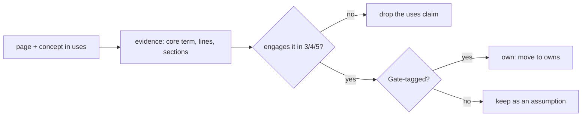

# Legacy concepts in `uses:` — owned, kept, or dropped

<!-- Generated by scripts/mentions_audit.py — do not edit by hand.
     `--apply` rewrites resources/mentions-decisions.json, the pages' front matter and this
     file; `--check` fails when a decided change is not applied. -->

41 page–concept pairs across 22 bridge pages name a legacy
concept in `uses:`. Each was measured, not eyeballed: a line engages the idea when it carries two
of the concept's tokens or its **core term** (the rarest token across the course), and the
sections those lines land in decide the claim.

| Decision | Rule | Count |
| :--- | :--- | ---: |
| `own` | the page engages it in §3/§4/§5 and tags it in its Gate test (a concept may have more than one owning page) | 3 |
| `keep` | the page genuinely applies the idea in a graded section | 20 |
| `drop` | the page never engages it outside prose, or not at all | 18 |

## Dropped (`uses` claim removed)

| Page | Concept | Core term | Lines | Sections it does appear in |
| :--- | :--- | :--- | ---: | :--- |
| `00-foundations.T2.00a` | `symplectic_euler_integration` | `symplectic` | 0 | — |
| `01-electronics.T2.01a` | `star_grounding` | `grounding` | 0 | — |
| `04-embedded.T2.04a` | `hardware_timer_isr_and_jitter` | `jitter` | 2 | 6. Simulation path |
| `04-embedded.T2.04a` | `packed_binary_telemetry_struct` | `packed` | 0 | — |
| `05-control.T3.05a` | `augmented_kalman_disturbance_observer` | `augmented` | 0 | — |
| `00-foundations.T2.00a` | `so2_rotation_matrix` | `so2` | 0 | — |
| `02-mechanics.T1.02a` | `so2_rotation_matrix` | `so2` | 0 | — |
| `03-sensors.T3.03a` | `sar_adc_c0g_charge_bucket_design` | `c0g` | 0 | — |
| `05-control.T1.05a` | `symplectic_euler_integration` | `symplectic` | 0 | — |
| `05-control.T1.05a` | `hardware_timer_isr_and_jitter` | `jitter` | 1 | 6. Simulation path |
| `05-control.T2.05a` | `discrete_pid_controller` | `pid` | 1 | 1. Why it matters |
| `05-control.T3.05a` | `discrete_infinite_horizon_lqr` | `horizon` | 0 | — |
| `05-control.T3.05b` | `discrete_infinite_horizon_lqr` | `horizon` | 0 | — |
| `06-robotics.T1.06a` | `discrete_pid_controller` | `pid` | 1 | 7. Checkpoint |
| `06-robotics.T1.06a` | `planar_2link_forward_kinematics` | `2link` | 0 | — |
| `06-robotics.T3.06a` | `ruckig_time_optimal_jerk_limited_scurve` | `jerk` | 1 | 8. Common mistakes |
| `07-systems.T2.07a` | `can_fd_mit_impedance_packet_packing` | `packet` | 5 | 2. Intuition first, 6. Simulation path, 7. Checkpoint |
| `07-systems.T3.06a` | `can_fd_crc16_rolling_counter_watchdog` | `crc16` | 1 | 7. Checkpoint |

## Owned (moved from `uses:` to `owns:`)

| Page | Concept | Lines | Sections |
| :--- | :--- | ---: | :--- |
| `03-sensors.T2.03a` | `so2_rotation_matrix` | 4 | 3. Formalization, 5. Exercise, 7. Checkpoint |
| `07-systems.T2.07a` | `regenerative_braking_bus_voltage_surge` | 31 | 2. Intuition first, 3. Formalization, 4. Worked example, 5. Exercise, 6. Simulation path, 7. Checkpoint, 8. Common mistakes, 9. Resources |
| `00-foundations.T3.00a` | `unit_quaternion_kinematics_slerp` | 6 | 3. Formalization, 7. Checkpoint |

## Kept (the claim is real)

| Page | Concept | Lines | Sections |
| :--- | :--- | ---: | :--- |
| `01-electronics.T3.01a` | `four_layer_pcb_ground_plane_stackup` | 9 | 1. Why it matters, 2. Intuition first, 3. Formalization, 4. Worked example, 5. Exercise, 6. Simulation path, 8. Common mistakes |
| `02-mechanics.T2.02a` | `planar_2link_forward_kinematics` | 1 | 5. Exercise |
| `02-mechanics.T3.02a` | `rodrigues_so3_se3_exp_log_maps` | 1 | 5. Exercise |
| `02-mechanics.T3.02a` | `parallel_axis_urdf_inertia_tensor` | 4 | 1. Why it matters, 2. Intuition first, 5. Exercise |
| `03-sensors.T2.03a` | `electrical_vs_mechanical_pole_pairs` | 4 | 2. Intuition first, 5. Exercise, 7. Checkpoint, 8. Common mistakes |
| `03-sensors.T2.03a` | `open_loop_three_phase_sine_modulation` | 11 | 1. Why it matters, 3. Formalization, 5. Exercise, 6. Simulation path, 7. Checkpoint, 8. Common mistakes |
| `03-sensors.T3.03a` | `synchronous_dq_foc_current_loop` | 7 | 1. Why it matters, 3. Formalization, 5. Exercise, 7. Checkpoint, 9. Resources |
| `03-sensors.T3.03a` | `amplitude_invariant_clarke_park_transform` | 3 | 3. Formalization, 5. Exercise |
| `04-embedded.T2.04a` | `spi_magnetic_encoder_readout` | 6 | 1. Why it matters, 3. Formalization, 5. Exercise, 7. Checkpoint, 8. Common mistakes |
| `04-embedded.T3.04a` | `dma_double_buffered_ping_pong_isr` | 7 | 2. Intuition first, 3. Formalization, 6. Simulation path, 7. Checkpoint, 8. Common mistakes |
| `04-embedded.T3.04a` | `rate_monotonic_response_time_analysis` | 1 | 5. Exercise |
| `04-embedded.T3.04a` | `minmax_zero_sequence_svpwm_injection` | 2 | 1. Why it matters, 5. Exercise |
| `05-control.T3.05b` | `rodrigues_so3_se3_exp_log_maps` | 21 | 3. Formalization, 4. Worked example, 5. Exercise, 6. Simulation path, 7. Checkpoint, 8. Common mistakes |
| `05-control.T3.05c` | `discrete_infinite_horizon_lqr` | 2 | 3. Formalization, 5. Exercise |
| `06-robotics.T2.06a` | `parallel_axis_urdf_inertia_tensor` | 2 | 2. Intuition first, 3. Formalization |
| `06-robotics.T2.06a` | `can_fd_mit_impedance_packet_packing` | 2 | 3. Formalization, 7. Checkpoint |
| `06-robotics.T3.06a` | `jacobian_transpose_cartesian_impedance` | 2 | 5. Exercise, 8. Common mistakes |
| `07-systems.T1.07a` | `ten_step_power_on_bringup` | 2 | 1. Why it matters, 5. Exercise |
| `07-systems.T1.07a` | `rc_cutoff_phase_lag` | 17 | 2. Intuition first, 3. Formalization, 4. Worked example, 5. Exercise, 7. Checkpoint |
| `07-systems.T3.06a` | `opc_ua_industrial_telemetry` | 30 | 1. Why it matters, 2. Intuition first, 3. Formalization, 4. Worked example, 5. Exercise, 6. Simulation path, 7. Checkpoint, 8. Common mistakes, 9. Resources |

## What each decision changes

- **Drop** removes the concept from `uses:`. The page may still mention it in prose; the claim that
  it *depends* on the idea is what was false. Nothing else moves, because the crosswalk keeps
  teaching-page links for every legacy concept.
- **Own** moves the id from `uses:` to `owns:`. This is the honest direction when the page
  derives and tests the idea: an assumption it teaches is not an assumption. `owns:` is a separate
  block so the legacy id does not spend the page's three-`new_concepts` budget; `validate_modules`
  accepts a Gate tag for an id this page owns, and still rejects one for any other legacy id.
- **Keep** leaves the front matter untouched. The evidence column is already printed, so a reader
  can challenge a keep without re-running the analysis.
