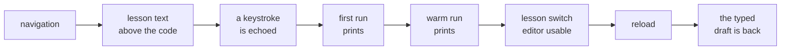

# The visit, timed

Six moments, measured on a laptop and on a throttled phone, with the machine and the date
written down next to every number. `npm run test:perf` runs the walk
([`scripts/perf_walk.mjs`](../scripts/perf_walk.mjs)); `npm run test:perf:unit` proves this page and
[`docs/perf-budget.json`](perf-budget.json) still describe the same six moments, and runs in CI.

Every other gate in this repository measures a fact. `check:weight` weighs the bundle, `check:axe`
reads the markup, `check:snapshot` measures the surfaces, and `check:lighthouse` deliberately refuses
to score performance — "a score that moves with the runner is not a gate this repository keeps",
which is right for a gate and useless for a claim. *"It feels slow to open"* is the first sentence a
beginner says, and until Run 231 there was nothing here that could answer it with a number.

## What is measured, and what each moment means

| Moment | What it means | Why it is the shape it is |
| :--- | :--- | :--- |
| Navigation → lesson text | the document request until the lesson pane carries its own prose | the first paint that matters is the page, not a spinner |
| Lesson text → first keystroke | until a character typed into CodeMirror comes back | "the editor is visible" and "the editor is ready" are different claims |
| First run → first output | until the first program prints | Pyodide warming, or the cost of having warmed it late |
| Warm run → first output | the same thing again | the number a learner repeats all evening |
| Lesson switch → usable editor | until a new lesson's title and code are on screen and take a keystroke | cached lesson data, and a remounted editor |
| Reload → draft restored | a reload until the typed draft is back in the editor | the storage promise, timed rather than asserted |

Each arrow is one of the six rows below. Timing is the page's own clock (`performance.now()` from
navigation start), except the reload moment, which reads `Date.now() - performance.timeOrigin` in the
**new** document so the driver's round trip before the reload is not part of it. Every number is a
wall-clock millisecond.

One overlap is worth knowing when reading the table: the workbench warms Pyodide on idle after first
paint, so the first-run number on a slow profile includes whatever the warm-up had already finished.
That is the behaviour a learner gets — the app is trying to be ready before they press Run — so the
number reported is the one they experience, not the cost of a cold interpreter with the warm-up
disabled.

## The two profiles

| Profile | What it is | Why |
| :--- | :--- | :--- |
| `laptop` | 1440×900, DPR 1, no CPU or network throttling | the machine this repository is developed on |
| `phone` | 390×844, DPR 3, mobile layout, **4× CPU slowdown, Slow 4G** (1.6 Mbit down, 750 kbit up, 150 ms RTT) | "can a beginner study on the train", which is the question an average of the two would hide |

The throttling is Lighthouse's own mobile preset, applied through the DevTools protocol
(`Emulation.setCPUThrottlingRate`, `Network.emulateNetworkConditions`) rather than simulated after
the fact. Both profiles pin the light palette and ask for reduced motion, so a stored palette or a
fade's duration cannot become a second variable in a measurement that already has a machine in it.

## The numbers

One row per date, machine and profile, appended by `--record`. A re-run on the same machine and day
replaces its own row rather than contradicting it.

| Date | Machine | Profile | Navigation → lesson text | Lesson text → first keystroke | First run → first output | Warm run → first output | Lesson switch → usable editor | Reload → draft restored |
| :--- | :--- | :--- | ---: | ---: | ---: | ---: | ---: | ---: |
| 2026-10-24 | Apple M1 · darwin 27.0.0 · 8 GB · Node v22.23.2 | laptop | 425 | 162 | 1536 | 86 | 177 | 230 |
| 2026-10-24 | Apple M1 · darwin 27.0.0 · 8 GB · Node v22.23.2 | phone | 11239 | 6136 | 24855 | 139 | 244 | 13452 |
| 2026-10-28 | Apple M1 · darwin 27.0.0 · 8 GB · Node v22.23.2 | laptop | 469 | 106 | 1208 | 65 | 221 | 207 |
| 2026-10-28 | Apple M1 · darwin 27.0.0 · 8 GB · Node v22.23.2 | phone | 14224 | 7781 | 24779 | 194 | 311 | 16331 |

## What the walk grades

The **ceilings** in [`docs/perf-budget.json`](perf-budget.json), not the numbers above. They sit at
roughly three to four times the recorded value — looser where the recorded number is small enough for
scheduler noise to dominate — which is deliberate: a walk that fails on a busy afternoon teaches
people to re-run it until it passes, and a gate people re-run until it passes is a gate nobody reads.
What fails here is a regression that would matter.

| Profile | Moment | Ceiling |
| :--- | :--- | ---: |
| laptop | navigation → lesson text | 1 600 ms |
| laptop | lesson text → first keystroke | 1 200 ms |
| laptop | first run → first output | 6 000 ms |
| laptop | warm run → first output | 1 200 ms |
| laptop | lesson switch → usable editor | 1 200 ms |
| laptop | reload → draft restored | 2 000 ms |
| phone | navigation → lesson text | 40 000 ms |
| phone | lesson text → first keystroke | 25 000 ms |
| phone | first run → first output | 150 000 ms |
| phone | warm run → first output | 3 000 ms |
| phone | lesson switch → usable editor | 4 000 ms |
| phone | reload → draft restored | 45 000 ms |

On a phone the editor is deferred until Code is chosen (`app/src/phoneSurface.ts`), so *lesson text →
first keystroke* and *lesson switch → usable editor* include the Code tap — the same tap a learner
makes, not a state the walk could conjure. That is why the phone's two numbers are larger than they
were before the phone shell: they now measure the flow that exists.

Raising a ceiling is allowed, and it has to leave a trace: a fresh `--record` row, the reason the new
number is acceptable, and — if the rise was not intended — the change that caused it. Lowering one is
always allowed, and is how the ceilings tighten over a few releases.

## Why this is not a CI step

CI's runner is a shared virtual machine, and the six moments would be a function of its contention
more than of this app. `check_lighthouse.mjs` already learned that on the performance category and
left it out. So the walk runs where a person is — before a release, and after a change that touches
the first paint — with `--record` when the numbers moved on purpose. CI runs only
`npm run test:perf:unit`, which is cheap and proves this page still lists the six moments the walk
records.

## What this does not claim

- **Not a benchmark of the app against other apps.** It is this app on two named profiles, before and
  after a change.
- **Not a phone.** The `phone` profile is a desktop Chrome emulating a small viewport at 4× slower CPU
  over a throttled link. It is a floor for what a phone pays, not that phone's number.
- **Not every screen.** The walk measures the Python runner's first visit, the moments §4 named. The
  eleven other tabs still have no timing gate; the weight gate and the snapshot gate cover their cost
  statically.
- **Not gated in CI**, for the reason above. A regression that lands while nobody runs the walk is not
  caught by anything until somebody does.
