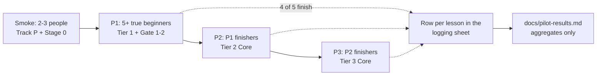

# The beginner pilot — protocol, logging sheet, and how results get published

**Status: not started. No participants yet, no data, no results.** This page is the protocol and the
reporting template; [`docs/pilot-results.md`](pilot-results.md) stays a template until a real sitting
fills it. Nothing in this repository claims beginner completion data, and the hour figures are
author targets until this pilot says otherwise.

The point of the pilot is the one claim the rest of the course cannot make for itself: that someone who
did **not** write the material can finish the Core route with only occasional help. Author-dogfood
([`docs/dogfood-log.md`](dogfood-log.md)) finds bugs; it cannot measure beginner difficulty, because the
author already knows the material.

## 1. Stages and who is in them

| Stage | Who | Route | Gate to the next stage |
| :--- | :--- | :--- | :--- |
| **Smoke** | 2–3 people, any background | Track P + Stage 0 | Every broken link, unclear instruction and dead-end logged; no blocking UX defect left |
| **P1** | 5+ true beginners — no coding or electronics background | Track P → Tier 1 → Gate 1→2 maths check + the six practical gates | 4 of 5 finish Tier 1 with "occasional" help (see §3) |
| **P2** | P1 finishers | Tier 2 Core (20 modules) | Most participants finish; no lesson where most people stall survives unrevisioned |
| **P3** | P2 finishers, or *disclosed* early engineering students | Tier 3 Core (6 modules + one capstone) | Most participants finish; ESKF and CBF pages each get a stuck-point log |

Recruit through a makerspace, a community-college intro class, a hobby club, or friends with no coding
background. A small thank-you (gift card, acknowledgement) improves completion; disclose it.

## 2. Rules of the sitting

- **No help before 15 minutes of being stuck**, and every help event is logged. Help means a hint from a
  person, not the in-course hint ladder (that is course material and always allowed).
- **Never give the answer.** Name the lesson, not the fix.
- **One sitting template** for everyone, so the numbers are comparable with
  [`docs/dogfood-log.md`](dogfood-log.md): active minutes, hints used, stuck type, course bug, transfer
  attempt.
- **Transfer is asked 7–14 days later**, and only on a concept learned at least a week before. An
  immediate transfer question measures memory, not understanding.
- **Log the stalls even when they resolve.** A stuck point that ends in success is still the data the
  revision needs.

## 3. What "occasional help" means

A help event is any outside hint, solution peek, or explanation. The budget is **fewer than 1 in 3
lessons** requiring one, and **no single lesson** requiring help from more than half the participants.
Both are counted from the log; neither is estimated from memory.

## 4. The logging sheet

One row per module or lesson, in a private sheet during the pilot, published as an aggregate:

| Field | Values | Why it is there |
| :--- | :--- | :--- |
| `id` | e.g. `00-foundations.T2.00a`, `P.4`, `R.3` | Joins the row to the page |
| `date` | `YYYY-MM-DD` | Transfer timing, and whether a break preceded a stall |
| `active_minutes` | integer | The time claim the roadmap publishes |
| `hints_used` | 0–3 | Distinguishes "used the ladder" from "needed a person" |
| `help` | `none` · `hint_1` · `hint_2` · `solution` · `person` | The help budget in §3 |
| `stuck` | `none` · `setup` · `tool` · `maths` · `instruction` · `bug` | The top-10 stuck-point table |
| `course_bug` | `yes`/`no` + one line | Every `yes` becomes a fix **and** a regression test |
| `transfer` | `-` until 7–14 days later, then `pass`/`fail` | Delayed understanding, not recall |

Publish only aggregates. Participant names stay out of the repository; a participant may be quoted with
consent and initials.

## 5. What gets published

[`docs/pilot-results.md`](pilot-results.md) is filled in after each stage and keeps its own limits:

- **the actual N**, with counts next to every percentage (five people are described, not turned into
  statistics);
- the **funnel**: how many started, finished each stage, and dropped;
- **median and range** per stage, not means;
- **help per lesson**, by type, against the §3 budget;
- the **top 10 stuck points**, and what changed because of each;
- **before/after** numbers on every revised page;
- **limitations**: self-selection, the author as observer, small N, and anything learned from watching
  rather than counting.

A pilot that fails its targets is published as it happened. If P1 does not reach 4 of 5, the result is a
finding about the course, and the next revision is planned from it.

## 6. What does **not** count as a pilot

Author-dogfood, a colleague skimming a page, or a model reading the lessons. Those find defects; they do
not test whether a beginner can finish. The distinction is the whole reason this file exists.
