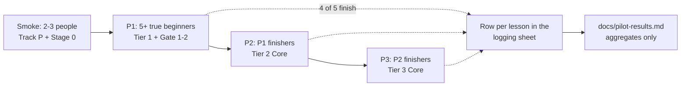

# The beginner pilot — protocol, logging sheet, and how results get published

**Status: not started. No participants yet, no data, no results.** This page is the protocol and the
reporting template; [`docs/pilot-results.md`](pilot-results.md) stays a template until a real sitting
fills it. Nothing in this repository claims beginner completion data, and the hour figures are
author targets until this pilot says otherwise.

For a single 40-minute first sitting, use the script and observation sheet in
[`docs/BEGINNER_TEST.md`](BEGINNER_TEST.md); it is the same protocol narrowed to Step 1, so a blocker
can be fixed before five people are recruited.

The point of the pilot is the one claim the rest of the course cannot make for itself: that someone who
did **not** write the material can finish the Core route with only occasional help. Author-dogfood
([`docs/dogfood-log.md`](dogfood-log.md)) finds bugs; it cannot measure beginner difficulty, because the
author already knows the material.

## 1. Stages and who is in them

| Stage | Who | Route | Gate to the next stage |
| :--- | :--- | :--- | :--- |
| **Smoke** | 2–3 people, any background | Track P + Stage 0 | Every broken link, unclear instruction and dead-end logged; no blocking UX defect left |
| **P1** | 5+ true beginners — no coding or electronics background | Track P → Tier 1 → Gate 1→2 maths check + the six practical gates | 4 of 5 finish Tier 1 with "occasional" help (see §3) |
| **P2** | P1 finishers | Tier 2 Core (20 modules) | Most participants finish; no lesson where most people stall survives unrevisioned |
| **P3** | P2 finishers, or *disclosed* early engineering students | Tier 3 Core (6 modules + one capstone) | Most participants finish; ESKF and CBF pages each get a stuck-point log |

Recruit through a makerspace, a community-college intro class, a hobby club, or friends with no coding
background. A small thank-you (gift card, acknowledgement) improves completion; disclose it.

## 2. Rules of the sitting

- **No help before 15 minutes of being stuck**, and every help event is logged. Help means a hint from a
  person, not the in-course hint ladder (that is course material and always allowed).
- **Never give the answer.** Name the lesson, not the fix.
- **One sitting template** for everyone, so the numbers are comparable with
  [`docs/dogfood-log.md`](dogfood-log.md): active minutes, hints used, stuck type, course bug, transfer
  attempt.
- **Transfer is asked 7–14 days later**, and only on a concept learned at least a week before. An
  immediate transfer question measures memory, not understanding. The due date is written into the
  participant's folder at the sitting and read back by `scripts/pilot_followup.py --due`, which also
  names any folder that has an export and no date — that is the promise this protocol loses if nobody
  keeps it for it ([`PILOT_KIT.md`](PILOT_KIT.md)).
- **Log the stalls even when they resolve.** A stuck point that ends in success is still the data the
  revision needs.

## 3. What "occasional help" means

A help event is any outside hint, solution peek, or explanation. The budget is **fewer than 1 in 3
lessons** requiring one, and **no single lesson** requiring help from more than half the participants.
Both are counted from the log; neither is estimated from memory.

## 4. The logging sheet

One row per module or lesson, in a private sheet during the pilot, published as an aggregate:

| Field | Values | Why it is there |
| :--- | :--- | :--- |
| `id` | e.g. `00-foundations.T2.00a`, `P.4`, `R.3` | Joins the row to the page |
| `date` | `YYYY-MM-DD` | Transfer timing, and whether a break preceded a stall |
| `active_minutes` | integer | Focused lesson time: the time claim the roadmap publishes. **Measured** by the app's sitting clock (five minutes without a run or an answer ends a sitting; three hours is the cap), written into the exported log as `sittings` — sum the durations that fall in the sitting |
| `elapsed_minutes` | integer | Wall-clock time from sitting down to stopping, including setup and breaks |
| `overhead_minutes` | integer | `elapsed_minutes - active_minutes`: setup, tool recovery and re-reading. This is what calibrates the 5x/10x calendar multiplier |
| `hints_used` | 0–3 | Distinguishes "used the ladder" from "needed a person" |
| `help` | `none` · `hint_1` · `hint_2` · `solution` · `person` | The help budget in §3 |
| `stuck` | `none` · `setup` · `tool` · `maths` · `instruction` · `bug` | The top-10 stuck-point table |
| `course_bug` | `yes`/`no` + one line | Every `yes` becomes a fix **and** a regression test |
| `transfer` | `-` until 7–14 days later, then `pass`/`fail` | Delayed understanding, not recall |
| `export` | the participant's `mechalab-learning-log-*.json` | Machine-recorded opens, runs, failures, hints and verifies — the sheet's evidence, not its replacement |

The workbench keeps its own log in the browser and the header's **Export Learning Log (.json)** button hands
it over; nothing is sent anywhere. The file carries two arrays: `events` (what happened) and `sittings`
(when it happened, and for how long — [`app/src/sittingClock.ts`](../app/src/sittingClock.ts)). Run `python3 scripts/friction_report.py <exported logs...>` to turn those
files into [`docs/friction-report.md`](friction-report.md): attempts-to-verify P50/P80, help share,
unfinished share, and the most common first failing assertion per unit. That page is empty until logs
exist and says so; it is the instrument the pilot's help budget is measured with.

**The sheet is a record, not a recollection.** Every field above has a home in one JSON file per sitting,
`pilot-data/<date>-<initials>/sitting.json`, written by [`scripts/pilot_sitting.py`](../scripts/pilot_sitting.py)
while it happens: `--new` opens it empty, `--stop` adds one row per place they stopped (minute, page, what
they tried, kind), and `--finish` closes it from the export — copying `active_minutes`, the run and hint
counts and `verified` rather than asking anyone to remember them. `--check` is the gate over the whole
record: `finished` without a verified export is refused, minutes that drifted from the export are
refused, and an `overhead_minutes` that is not `elapsed - active` is refused. `--status` then counts
participants — and only folders with an export and a closed record behind them count.

Publish only aggregates. Participant names stay out of the repository; a participant may be quoted with
consent and initials.

The operator's order of operations is [`PILOT_KIT.md`](PILOT_KIT.md): dry-run the export before anyone
sits, run `scripts/pilot_preflight.py` on the participant's file while they are still in the room, then
file the row. The preflight is what makes `active_minutes` a measurement rather than an estimate — it
reads the sittings out of the export and refuses one that has none.

## 5. What gets published

[`docs/pilot-results.md`](pilot-results.md) is generated after each stage — `python3 scripts/pilot_results.py`
renders it from the participant folders, `--check` fails when the page and the folders disagree, and the
author walk it carries lives in [`AUTHOR_WALK.md`](AUTHOR_WALK.md) — and keeps its own limits:

- **the actual N**, with counts next to every percentage (five people are described, not turned into
  statistics);
- the **funnel**: how many started, finished each stage, and dropped;
- **median and range** per stage for both focused and elapsed minutes, not means, plus the
  overhead ratio that lets the published calendar estimate be checked against real sittings;
- **help per lesson**, by type, against the §3 budget;
- the **top 10 stuck points**, and what changed because of each;
- **before/after** numbers on every revised page;
- **limitations**: self-selection, the author as observer, small N, and anything learned from watching
  rather than counting.

A pilot that fails its targets is published as it happened. If P1 does not reach 4 of 5, the result is a
finding about the course, and the next revision is planned from it.

## 6. What does **not** count as a pilot

Author-dogfood, a colleague skimming a page, or a model reading the lessons. Those find defects; they do
not test whether a beginner can finish. The distinction is the whole reason this file exists.
