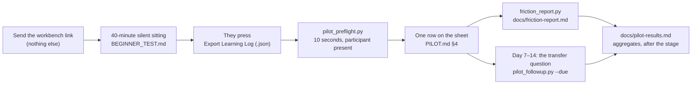

# The pilot run kit — one sitting, from link to row

**Status: ready to run, N = 0.** This is the operator's side of the first beginner sitting: the order to
do things in, the exact command at each step, and what to do when one of them complains. The participant
side is a 40-minute script in [`BEGINNER_TEST.md`](BEGINNER_TEST.md); the protocol behind it is
[`PILOT.md`](PILOT.md); the sheet the row lands in is `PILOT.md` §4.

Nothing here is new machinery. It is the existing pieces in the order they are used, plus one check —
[`scripts/pilot_preflight.py`](../scripts/pilot_preflight.py) — that reads the participant's export while
they are still in the room, so a broken or empty export is re-taken rather than discovered next week.



## What is in the kit

| Piece | Where | What it is for |
| :--- | :--- | :--- |
| The sitting script | [`BEGINNER_TEST.md`](BEGINNER_TEST.md) | The minute-by-minute table, the observation sheet, the triage order, the recruitment post |
| The sitting record | `python3 scripts/pilot_sitting.py --new <folder>` | One JSON file per participant in their folder: every stop with its minute, page and kind, then the export's own minutes. `--check` refuses a claim the export does not support |
| The workbench link | the README badge, <https://tle47.github.io/Mechatronics-Roadmap/> | What you send. Browser-only, no install, no account |
| The export | the app's header → **Export Learning Log (.json)** | The machine record: opens, runs, failures, hints, verifies, and the measured sittings |
| The preflight | `python3 scripts/pilot_preflight.py <export>` | Checks the export and prints the numbers the row needs, before the participant leaves |
| The private folder | `pilot-data/<date>-<initials>/` | Where exports live. **Git-ignored, never committed** |
| The aggregate | `python3 scripts/friction_report.py pilot-data/*/*.json` | Writes [`friction-report.md`](friction-report.md): attempts-to-verify, help share, unfinished share, first failures |
| The row | `PILOT.md` §4 | One line per lesson: the sheet's evidence, not its replacement |
| The follow-up | `python3 scripts/pilot_followup.py --due` | Who is owed the transfer question on day 7–14 — and any folder with an export but no due date, which is the sitting that would be forgotten |
| The results | [`pilot-results.md`](pilot-results.md) | Aggregates, after a stage — not after one sitting |

## Before the sitting (10 minutes)

1. **Send only the workbench link.** Do not name the app, the route or the first lesson; finding it is
   part of what is being measured. `BEGINNER_TEST.md` "Before the sitting" has the rest: consent, no
   screen recording, a fresh browser profile.
2. **Dry-run the export yourself, in a scratch profile.** Open the link, press **Export Learning Log
   (.json)**, and run the check on the file:

   ```bash
   python3 scripts/pilot_preflight.py ~/Downloads/mechalab-learning-log-*.json
   ```

   What you are looking for is `1 opens` on the `events` line. Two opens for the one visit means the
   build is older than Run 216 and counts every visit twice — that is the denominator the whole pilot
   is a share of, so use the current deployment. A `[WARN]` about no `run` events is correct here: you
   opened a lesson and ran nothing, exactly like a participant who reads and leaves.
3. **Make the folder, and confirm it is ignored** — one folder per participant, named for the date and
   their initials, never their name:

   ```bash
   mkdir -p pilot-data/2026-10-24-ab
   git check-ignore pilot-data/2026-10-24-ab/mechalab-learning-log-2026-10-24.json
   ```

   `git check-ignore` printing the path is the pass: the file cannot be committed by accident. An
   export that reaches the repository carries a participant's whole session, and the pilot's privacy
   rule is the only thing standing between a stranger's Tuesday and a public commit.

4. **Open the sitting record.** It sits beside the export it will be checked against:

   ```bash
   python3 scripts/pilot_sitting.py --new pilot-data/2026-10-24-ab --date 2026-10-24
   ```

   It starts empty on purpose — no minutes, no `verified`, no `finished` — because every one of those
   is a number this kit measures, not one the observer remembers. Asking for them later is the
   difference between a record and a recollection.

## During the sitting (40 minutes)

Follow the table in [`BEGINNER_TEST.md`](BEGINNER_TEST.md): say the goal, then stop talking; 20-second
pauses noted; a person's hint allowed only after 15 minutes stuck and never the answer; stop at 40
minutes even unfinished. Keep the observation sheet open on a second screen or on paper, not in the
participant's browser.

Log every stop as it happens — it takes ten seconds and it is the only row the top-10 table has:

```bash
python3 scripts/pilot_sitting.py --stop pilot-data/2026-10-24-ab --minute 6 --kind link \
    --page README --tried "scrolled looking for Start" --resolved "pointed at the heading"
```

`--kind` is one of `link`, `setup`, `tool`, `instruction`, `maths`, `error`, `bug`, and it comes from
[`PILOT.md`](PILOT.md) §4 so the aggregate can group stops instead of re-reading prose. Log the ones
that resolve too: a stall that ends in success is still where people stop.

Time is measured twice, and both are needed:

- **active minutes** come from the app's sitting clock, which is why the export matters;
- **elapsed minutes** come from your timer, and `overhead_minutes` is the difference. That ratio is the
  one number that calibrates the published calendar estimates.

## After the sitting (10 minutes)

1. **Ask for the export while they are still there.** Header → **Export Learning Log (.json)** → save
   it into their folder. The browser names it `mechalab-learning-log-<date>.json`.
2. **Run the preflight.** Ten seconds, and it prints the row:

   ```bash
   python3 scripts/pilot_preflight.py pilot-data/2026-10-24-ab/mechalab-learning-log-*.json
   ```

   | Output line | Where it goes on the sheet |
   | :--- | :--- |
   | `active_minutes 12` | `active_minutes` — copy it, do not estimate |
   | `sitting 1 12 min 20 s · 9 runs` | the sitting the row belongs to, and `runs` for the row's notes |
   | `hints_used 2 · help hint_2` | `hints_used`, `help` (`none`, `hint_1`, `hint_2`, `solution`) |
   | `verified yes` | confirmation that the row is a finished unit |
   | `lessons P.1` | `id` — one row per lesson named |

   Two severities, and they mean different things in the room:

   - **`[FAIL]`** — the export cannot be logged as it stands (wrong schema, no events, no sittings). Ask
     them to press export again; a cleared profile or a blocked-storage browser is usually why.
   - **`[WARN]`** — loggable, and the warning itself is a finding. Copy it into the sheet's notes: two
     opens a few milliseconds apart is a visit counted twice, a sitting whose run count does not match
     the log is one instrument that missed a write, and "ran nothing" is a participant who read and
     left — which is the abandon signal the pilot exists to find.
3. **Close the record** with the timer's number. `--finish` reads the export itself and copies
   `active_minutes`, the run count, the hint count and `verified`; it computes `overhead_minutes`, and it
   refuses an export the preflight would refuse:

   ```bash
   python3 scripts/pilot_sitting.py --finish pilot-data/2026-10-24-ab --elapsed 40 --person-hint 1
   python3 scripts/pilot_sitting.py --check pilot-data/2026-10-24-ab
   ```

   Then answer what the app cannot see, in one command rather than by editing the JSON:

   ```bash
   python3 scripts/pilot_sitting.py --debrief pilot-data/2026-10-24-ab \
       --reached-lesson-1 yes --minutes-to-lesson-1 4 \
       --understood partly --error-quote "IndexError: list index out of range" \
       --knew-next no --their-fix "say what the red line means" \
       --run-verify yes --finished yes --finished-minutes 33
   ```

   `--debrief` writes the answers the sitting alone can supply: whether they found the first lesson
   unaided and in how many minutes (`reached_lesson_1`, `minutes_to_lesson_1`), what they made of the
   failure message (`understood_error` with the message it is about), `knew_next`, `their_fix`, and the
   graded loop (`run_verify`, `finished`, `finished_minutes`). It audits a copy first and **writes nothing
   when an answer would make the record unfilable** — `finished yes` with no graded loop or no finish
   minute, a find with no minute, a minute past the sitting — so the mistake is caught while the
   participant is still in the room. It prints what is still unanswered when it finishes. `course_bug`
   stays in the record, because it names a page and a line.

   `--check` is the gate over the whole record: **`finished` without a verified export is refused**,
   `active_minutes` that drifted from the export is refused, and `overhead_minutes` that is not
   `elapsed - active` is refused. A sitting that ended early is recorded as ended, which is a finding,
   not a failure.
4. **Write down when the transfer question is owed, before the folder is closed.** Day 7–14, and only
   about a concept learned at least a week before: an immediate question measures memory. The due date
   goes in the participant's folder, not in your head — that is the promise most likely to be lost, and
   the last section of this page is what reads it back:

   ```bash
   python3 scripts/pilot_followup.py --add pilot-data/2026-10-24-ab --lesson P.1
   ```

   The default is day 10, the middle of the window. `--days` inside 7–14 is allowed; anything else is
   refused, because a question asked on day 3 is a different measurement with the same name.
5. **Aggregate, once there are exports to aggregate:**

   ```bash
   python3 scripts/friction_report.py --out /tmp/aggregate.md pilot-data/*/*.json
   ```

   `--out` writes the report elsewhere, so the first run over real logs is an experiment rather than a
   publication: read the numbers, then write the committed page with the same command minus the flag.
   That page is generated — `python3 scripts/friction_report.py` with no arguments puts the empty page
   back, which is what the repository commits until there is data.
6. **Publish aggregates, not sittings.** A single sitting is an issue
   ([`beginner-session-log`](../.github/ISSUE_TEMPLATE/beginner-session-log.md)) and a row; the results
   page is filled when a stage completes, with N beside every percentage. Nothing that identifies a
   participant enters either.

   The issue's body is rendered from the closed record, not retyped:

   ```bash
   python3 scripts/pilot_sitting.py --issue pilot-data/2026-10-24-ab --out sitting.md
   ```

   `--issue` fills the ticket's sections from the record's own fields, refuses the same claims `--check`
   refuses (and then prints no body to copy), and prints a suggested title to stderr. An unanswered field
   comes out as `not answered`, never as a blank that reads like `no`.

   The results page is generated the same way, from the folders rather than from memory:

   ```bash
   python3 scripts/pilot_results.py
   ```

   It counts with the same predicate `--status` uses, groups by the record's `stage`, and fills the
   stage, funnel, time, help, top-10 and transfer tables from the records and their follow-up files. A
   record whose claim its own evidence refuses is left off the page and counted in a `not counted` line
   instead. `--check` fails when the committed page and the folders disagree, so a hand-typed `N` cannot
   survive a gate.

## The transfer check (day 7–14)

This is a second, short conversation, and it is the only measurement in the pilot that a sitting cannot
supply: whether the idea survived the fortnight.

1. **Ask it without a screen.** No lesson open, no editor, no notes — a concept looked up is not a
   concept remembered. One question, in your own words, about the concept behind the lesson they
   finished: a different situation where the same idea applies, not the same exercise again.
2. **Grade it while you are there**, with one line of what they said. A pass is the idea transferred;
   a fail is a finding about the page, and is published as one.

   ```bash
   python3 scripts/pilot_followup.py --due
   python3 scripts/pilot_followup.py --grade pilot-data/2026-10-24-ab pass --note "picked the right formula unprompted"
   ```

   `--due` is the check that the reminder exists at all. It lists who is due, who is overdue, and — the
   line that matters — any folder holding an export and no due date, which is a sitting whose transfer
   will be forgotten. It exits non-zero while there is one, so a run before each sitting says whether
   the last one is closed.
3. **The grade goes in the sheet's `transfer` column** (`pass`/`fail`, `-` until then) and into
   [`pilot-results.md`](pilot-results.md) as a share with its count. A transfer asked on the wrong day
   is flagged rather than counted: `--due` reports a hand-written date outside 7–14 by name.

## What "ready" means

One command, about a second, and the only one you need before a sitting:

```bash
npm run check:pilot
```

It runs the eight gates below and prints one line each, finishing with either `[PASS] 8 pilot gate(s)` or
which one is red. It is not part of `npm run check:all` — that already runs all of them through its
`tests` and `doc_commands` gates — so this is a five-second answer before someone sits down, not a
second CI. (`python3 tests/test_check_pilot_kit.py`, 8 checks, guards the runner itself: a failing gate
cannot print a green summary.)

- `python3 tests/test_pilot_sitting.py` — 51 checks over the sitting record: a template that invents
  nothing, a stop that cannot be counted refused, `finished` refused without a verified export, minutes
  that drifted from the export caught, a find of Lesson 1 with no minute (or a minute with no find)
  refused, `--status` saying `N = 0` rather than printing an empty table, the observation ticket carrying
  the record's own kinds and field names, `--issue` rendering that ticket's sections from the record (or
  withholding the body when it cannot), and `--debrief` refusing an answer that would make the record
  unfilable without writing any of it.
- `python3 tests/test_pilot_preflight.py` — 13 checks over the preflight: a clean export, a doubled
  visit, a missing `sittings` array, a foreign schema, a clock/log disagreement, a broken file, and the
  JSON mode.
- `python3 tests/test_pilot_followup.py` — 12 checks over the transfer follow-up: a due date written and
  refused outside 7–14, the day it falls due and every day after, an export with no record, grading,
  and a pilot with no participants yet.
- `python3 tests/test_friction_report.py` — the aggregate's arithmetic: every percentage with its count,
  a section that empties when its input does, and the committed page matching what the script renders.
- `python3 scripts/friction_report.py --check` — `docs/friction-report.md` is still what the script
  would write, so the committed aggregate cannot drift from the logs it describes.
- `python3 tests/test_pilot_results.py` — 12 checks over the generated results page: a count read from the
  folders, a typed count caught by the staleness check, a record with no export or with a refused claim
  left out, the stage taken from the record, the top-10 table stopping at ten, and the author walk inlined
  once.
- `python3 scripts/pilot_results.py --check` — `docs/pilot-results.md` is still what the folders render,
  so the published count cannot drift from the records behind it.
- `python3 scripts/check_doc_commands.py` — every command on this page exists, so a renamed script
  cannot leave an operator holding a dead instruction.

The one thing the kit cannot supply is the participant: a person who did not write the course. Until one
sits, every hour figure stays an author target and `pilot-results.md` stays the template it says it is.
