# MechaLab 2.0 plan — what already ships, what does not

The plan was written from the repository's file list, because the live site is a JavaScript SPA that a
text-only fetch cannot render. Several of its "Phase 0/1 first, everything depends on this" items were
therefore already in production when it was written. This page maps the plan onto the code as it is
today, so the next slice is chosen from evidence rather than from a list that assumes a blank page.

```mermaid
flowchart LR
    subgraph shipped["Already in production"]
        W["Pyodide in a Web Worker<br/>Stop via SharedArrayBuffer"]
        D["Bounded drafts<br/>+ run history"]
        S["Scope panel<br/>scope.stream()"]
        P["⌘K palette"]
        T["Dark/light tokens<br/>contrast measured in CI"]
        H["A failing check names<br/>its own hint rung"]
        A["Scope cursor, zoom<br/>A/B run overlay"]
        J["Jedi completions, hover,<br/>signatures; pyflakes + pycodestyle"]
        B["One-press backup<br/>and a merging restore"]
    end
    subgraph next["Next, in this order"]
        N1["The study layer: notes,<br/>flashcards, focus mode"]
        N3["Parsed tracebacks, matched<br/>to the hint that answers them"]
    end
    shipped --> next
```

Verdicts: **ships** (in production with tests), **partial** (the core exists, the plan asks for more),
**missing** (no such surface).

## Phase 0 — the three "do this week" items

| Plan item | Reality now | Verdict |
| :--- | :--- | :--- |
| Python in a Web Worker + isolation on Pages + a real Stop | `PYODIDE_WORKER_SOURCE` in [`app/src/components/tabs/TabPyodideRunner.tsx`](../app/src/components/tabs/TabPyodideRunner.tsx) runs Pyodide off-thread; Stop writes a `SharedArrayBuffer` interrupt word (`setInterruptBuffer`), so `KeyboardInterrupt` lands **in place** and imports survive; [`app/public/sw.js`](../app/public/sw.js) supplies COOP/COEP on Pages, with a terminate-the-worker fallback when isolation is absent. Pinned by `npm run test:runtime` (real Chromium, real `SharedArrayBuffer`). | **ships** |
| IndexedDB persistence with snapshot-on-run | The six large stores — drafts, filed versions, the learning log, notes and highlights, review schedules, sittings — are in **IndexedDB** (`mechalab`/`kv`) behind a `Storage`-shaped write-behind cache ([`app/src/bulkStorage.ts`](../app/src/bulkStorage.ts), [`app/src/idbBackend.ts`](../app/src/idbBackend.ts), `npm run test:storage`, `npm run test:e2e:storage`), migrated from the bucket copy-first so a browser that refuses a database loses nothing. The small first-paint keys (theme, focus, last lesson, view mode, progress flags) stay in `localStorage`, where a synchronous read at mount time is what they need. Hand-written rather than Dexie: one object store and three operations do not earn a dependency. Drafts are per lesson, bounded and evicted ([`app/src/lessonDraft.ts`](../app/src/lessonDraft.ts)); every Run files the code it started from with its verdict, five per lesson, restorable ([`app/src/draftHistory.ts`](../app/src/draftHistory.ts), `npm run test:history`). **The backup half ships**: one press writes a `.zip` of six stores — progress flags, drafts, filed versions, notes and highlights, review schedules and the learning log — with a manifest and a README ([`app/src/backupZip.ts`](../app/src/backupZip.ts), [`app/src/backupBundle.ts`](../app/src/backupBundle.ts), `npm run test:e2e:backup`) — and the **sitting clock is deliberately outside it**: a sitting is a fact about one machine's clock, and merging two machines' would count the same hour twice, which is the number it exists to keep honest ([`app/src/sittingClock.ts`](../app/src/sittingClock.ts) states the decision, and `npm run test:backup` pins it — an archive carrying sittings writes nothing into the clock), and a restore merges — flags union, drafts fill gaps, versions and log events dedupe — so it never deletes and never doubles. **The cross-lesson timeline ships**: `app/src/timeline.ts` folds the log and the sittings into days of work, and the roadmap's trail card draws them newest first — one row per open, run, hint, pass or export, a verification folded into the run that passed, measured time filed on the day its sitting started, and the caps saying what they left out ([`app/src/components/TrailCard.tsx`](../app/src/components/TrailCard.tsx), `npm run test:trail`, `npm run test:e2e:trail`). The caps (~2.0 M characters, measured by `npm run test:backup`) are now the archive's size rather than a bucket emergency. **Verdict corrected to ships in Run 200.** The row read `partial` because the archive and the timeline were missing when it was written; both have shipped since (Runs 152–156), and every clause the plan names — persistence, snapshot-on-run, a backup that restores by merging, a cross-lesson timeline — is covered by a suite this repository runs on every push (`test:storage`, `test:history`, `test:backup`, `test:trail`). Nothing this row asks for is absent, so a `partial` here would be sending the next reader to build something that already exists. | **ships** |
| A Scope panel with a `scope.plot()` helper | Ships: `mechalab.scope.stream(name, t, y)` / `scope.plot(...)` inside a run, batched through the worker, drawn on one pair of axes with last values in the legend and the same data as a table ([`app/src/scopeModel.ts`](../app/src/scopeModel.ts), [`app/src/components/ScopePanel.tsx`](../app/src/components/ScopePanel.tsx), `npm run test:scope`, browser step 7h). **Verdict corrected to ships in Run 200.** This row was written as `partial` with "no uPlot zoom/cursors, no A/B run overlay yet"; the reader below it now records all three, measured on a canvas rather than in uPlot (browser steps 7h-i and 7h-ii, `npm run test:scope`). uPlot was never the requirement — the reading was — so its absence is an implementation note, not a gap, and keeping the row `partial` cost it the only thing a gap page has to sell: that a `partial` means work. | **ships** |

## Phases 1–3 — runtime, workspace, editor

| Plan | Reality | Verdict |
| :--- | :--- | :--- |
| Worker runtime, warm-up, measured boot, restart kernel | Warm-up on idle, `ready in N ms` reported from the worker, Reset Runtime respawns it, `input()` blocks the worker on `Atomics.wait` while the page stays live (`npm run test:runtime` drives all four in a real browser, and `npm run test:e2e` waits on the warm-up before its first Run). | **ships** |
| Dockable panels, `⌥1`–`⌥4` layout presets, activity bar | **Four presets ship**, chosen with `⌥1`–`⌥4` or the buttons in the editor's header and remembered across a reload: **Study** (the chooser, the editor and the results — what the tab opens as), **Write** (the editor alone), **Read** (the results, with the editor and chooser hidden) and **Split** (the editor on the left, the results on the right). Split is the fourth arrangement the plan named: `workspaceLayout.ts` keeps two rules apart — *which* regions a preset shows, and *how* the ones left are arranged — so its table pins both. The two columns are measured on the **built bundle**, where the utilities that draw them exist — the dev server the workbench suites share resolves its config without the Tailwind plugin, so there `display` reads `block` on a `grid` container: the built-bundle step presses `⌥4` at 1440 px and asserts two grid tracks with the results *beside* the editor, while the dev step pins the structure (the preset in force, the `lg:grid-cols-2` class, the editor first in the DOM). At the `lg` breakpoint the columns appear; below it the same preset stacks, so a phone is not asked to split 375 px. The shortcut reads `KeyboardEvent.code`, because `⌥2` types `™` in `key` on a Mac ([`app/src/workspaceLayout.ts`](../app/src/workspaceLayout.ts), `npm run test:layout`, browser step 5d, `npm run test:e2e:pages`). **Split's divider drags and is remembered.** The share of the width the editor gets is stored as a *share* rather than in pixels — 42% of a laptop and 42% of a monitor are the same arrangement, where 480 px is two different amounts of code — and the handle is a real `role="separator"`: a pointer drag captured by the handle itself, `←`/`→` in 2% steps (`Shift` for 10%), `Home`/`End` for the two ends, a double-click back to even, and `aria-valuenow` announcing the share it actually has. Neither column may fall below 30%: at 1440 px that is a 345 px editor, still a line of Python without wrapping, because a divider that can squeeze the code until it wraps has changed what the learner is looking at in order to show them the output. Measured on the built bundle: dragging to 35% leaves a **416 px** editor of 1188 px of free space (the activity bar takes its 196 px of the 1440), `Home`/`End` land on 30%/70%, and a **reload** puts the divider back where it was left. **Docking closes the row (Run 194).** A panel that sits beside another can take either edge: Study's chooser moves to the right of the work area, Split's results to the left of the editor, chosen with one button that names the panel it will move *in the preset in force* (`List → Right`, `Results → Left`) and drawn only where a second edge exists — Write and Read show none. The sides are stored separately and validated field by field, and the stored ratio stays the **editor's**, so the grid template, the pointer mapping and the two arrows reverse together with the results: `Home` still puts the handle at the container's left edge, which is the editor at its widest. The Split pair is placed by CSS column rather than by document order, so the editor stays first in the DOM while either panel can be first on screen, and `dense` packing is what keeps the docked pair on one row. Measured on the built bundle at 1440 px: the results end before the editor starts, both on the same row, the editor keeps 70% on the right, a drag to 65% of the width leaves a **35%** editor of 1188 px, Study's chooser takes the second cell (388 px, starting where the work area ends at 1012 px), and a reload brings back each side and the share. **The activity bar ships beside it**: above 1280 px the twelve tabs are a vertical strip down the left edge, pinned while a long lesson scrolls, every label visible and nothing behind a sideways scroll; below it the rail is the horizontal scroller it has always been ([`app/src/App.tsx`](../app/src/App.tsx), [`app/src/workspaceLayout.ts`](../app/src/workspaceLayout.ts), `npm run test:layout`, browser step 5d-ii, `npm run test:e2e:pages`). | **ships** |
| CodeMirror 6 with multi-file tabs, read-only helpers | CodeMirror 6 with Python highlighting, bracket handling, indent, search and Jedi completion; `main.py` plus a **read-only** plant tab where a lesson uses one (`npm run test:editor` pins the extensions and the tabs; browser step 12 opens a lesson and reads the highlighting, the plant tab and its read-only state back out of the DOM). | **ships** |
| Jedi completions/hover, Ruff lint + format, parsed tracebacks | **Tracebacks are parsed, not printed**: `app/src/traceback.ts` reads CPython's own text into frames and an exception, picks the deepest frame that is the learner's (not the appended `_selfcheck`), handles chained failures and both SyntaxError shapes, and `app/src/errorIndex.ts` matches it against the page's 15<!-- plan-fact:error_entries --> entries — generated from [`docs/ERROR_EXPLAINER.md`](ERROR_EXPLAINER.md) by `scripts/generate_error_index.py`, with `--check` as the drift gate. The card names the line, moves the cursor there, and brings the entry's own check-first list; a failure the page does not cover says so instead of guessing (`npm run test:traceback`, `npm run test:e2e` step 3). **Completions, hover and signatures ship, from the interpreter itself**: Jedi answers `math.` with `acos` and its signature, hovering a name opens a card with its definition line, its call and the docstring, and typing `math.acos(` shows that call with the argument being typed marked ([`app/src/analysisClient.ts`](../app/src/analysisClient.ts), [`app/src/editor/completions.ts`](../app/src/editor/completions.ts), [`app/src/editor/analysisTips.ts`](../app/src/editor/analysisTips.ts)); the Checker strip names an unused import on its line, and gives a style rule the code a learner can look up (`npm run test:analysis`, `npm run test:runtime`). Ruff is a Rust binary and cannot run in Pyodide at all, so **both halves are the tools Ruff reimplements**: the formatter is Black (the toolbar's **Format** button, and *Format the file with Black* in `⌘K`, re-indents the file with Black's default mode inside the same worker — pure Python, installed through micropip on the first press, so it adds nothing to the bundle — as **one undo step**, with a status line that says tidied / already tidy / the parser's own position, and a refusal that leaves the file untouched), and the **style lint is pycodestyle**, installed beside pyflakes in the same worker (`app/src/analysisClient.ts`, `npm run test:analysis`, `npm run test:runtime`). **The rule slice is measured rather than guessed.** E4 (imports) and E7 (statements) are the pycodestyle families Ruff shipped by default for years, and the ones that name a beginner's `if x == None`, a bare `except`, `total = lambda …` or `import os, sys`; W291, W293 and W605 are added because they name characters a learner cannot see — whitespace after a line's last word, whitespace on a blank line, an escape Python reads literally. Two rules are off on purpose. **E741** is off because in this course a bare `l` is a link length or an observer gain: the lessons teach that symbol, and a note telling a learner to rename it would be the checker arguing with the material. **E501**, the line-length rule, is off by the same measurement that sets the slice: at Black's 88 columns it fires **740 times across this repo's own 100<!-- plan-fact:starters_solutions --> starters and solutions**, so a learner who edited one line of a lesson would be shown notes about lines the lesson shipped — while the slice as a whole produces **two** notes on those same files, both E741. The strip says `Checker · pyflakes + pycodestyle` instead of borrowing Ruff's name, and both tools' notes arrive as one list in reading order. What this row still does not do is run Ruff itself or the wider families it began enabling by default in v0.16 (bugbear, pyupgrade, RUF): the indentation and spacing families are the ones Black's Format button fixes, which for a beginner is a better answer than a sentence describing the fix. The analyzers install on first use (~1.6 MB), so a first visit that never edits pays nothing for them. | **ships** |
| Inline values, parameter sliders, `# %%` cells | **Inline values ship**: after a run, the worker sends the namespace *that run* returned (functions, classes, modules and dunders filtered out, reprs cut to 48 characters), and the editor draws each value at the end of the **last top-level assignment** that bound it — an indented line runs many times, so it is not a home for one value ([`app/src/inlineValues.ts`](../app/src/inlineValues.ts), [`app/src/editor/inlineWidget.ts`](../app/src/editor/inlineWidget.ts), `npm run test:inline`, browser step 5b). An edit clears them, because the numbers then describe a document that is gone, and a stopped or timed-out run draws none. Sliders ship as a `# @slider 0 20 0.1` comment on a literal, rewritten in the file and re-run on settle, across 7 starters ([`app/src/editor/sliderModel.ts`](../app/src/editor/sliderModel.ts), `npm run test:editor`). **`# %%` cells ship**: a marker at column 0 draws a **Run to here** button, which runs the document *through* that cell — not just the cell, because the worker runs each program in a fresh namespace — and strictly **ungraded**: nothing is verified, no hint rung is unlocked, and a lesson with no markers looks exactly as it did ([`app/src/editor/cells.ts`](../app/src/editor/cells.ts), [`app/src/editor/cellWidget.ts`](../app/src/editor/cellWidget.ts), `npm run test:cells`, browser step 5e). | **ships** |
| Diff view against starter/solution | Ships as the runner's **Diff** button: the editor's own text against the starter, line by line, with both line numbers, `+`/`−` rows, the unchanged runs trimmed to three lines each side and counted (`… 12 unchanged`). A second reference, the lesson's solution, unlocks once the learner has opened it in this visit or passed the lesson — the panel cannot be used to read an answer nobody earned — and a large file degrades to common head and tail instead of freezing ([`app/src/codeDiff.ts`](../app/src/codeDiff.ts), `npm run test:codediff`, browser step 7g-i). **The third reference is the learner's own work**: the panel also compares against the code a filed run started from — the newest five attempts, each labelled with its age and the verdict that run got — so "what changed since the run that passed" is one click, and a version a restore or the cap removed falls back to the starter rather than blanking the panel ([`app/src/diffReference.ts`](../app/src/diffReference.ts), `npm run test:codediff`, browser step 7g-i). The same engine now counts the roadmap card's changed lines, so the two surfaces cannot disagree. No side-by-side or word-level view. | **ships** |

## Phases 4–7 — lab, learning layer, study layer

| Plan | Reality | Verdict |
| :--- | :--- | :--- |
| Scope (uPlot), A/B runs, arm view upgrades, fault panel | The learner's own `scope.stream()` traces are drawn on a canvas with a cursor that reads every signal at one `t`, zoom (wheel, buttons, `+`/`-`/`0`) and drag-pan clamped to the data, and an A/B overlay: pin a run as A, change a gain, run again, and both traces share the axes with the cursor reading both ([`app/src/scopeModel.ts`](../app/src/scopeModel.ts), [`app/src/components/ScopePanel.tsx`](../app/src/components/ScopePanel.tsx), `npm run test:scope`, browser step 7h-i/7h-ii). Not uPlot, so no box-zoom or tooltips beyond the one cursor; arm-view upgrades and the fault panel are unchanged. | **ships** |
| Checks as a test runner + watch mode | Output comparison (`exact` vs formatting-tolerant) and instructor behaviour checks run per lesson; the 08.1 bench and Tier 3 budgets gate passes. **Watch mode ships** as a remembered toggle: after a *graded failure*, a 1.5 s pause in typing re-runs the checks, and nothing else does — not a pass, not a Stop, not a runtime error mid-typing, and not while the predict gate is waiting on a guess. Automatic runs file no versions and log no `run` event, so the fix loop cannot evict a learner's real attempts or inflate the friction report ([`app/src/watchMode.ts`](../app/src/watchMode.ts), `npm run test:watch`, browser step 7g-ii). | **ships** |
| Hint ladder tied to the failing check | Each failed run opens a card naming the check that is red — behaviour or presentation — with the check's own line (the instructor's assertion, or the output line that differs) and the one rung that answers it ([`app/src/checkHints.ts`](../app/src/checkHints.ts), `npm run test:checkhints`, browser steps 0a-i and 10a). Rung 2 is now *earned*: it waits for a run made after the nudge was opened, not for the run already on screen. Blocks that are not a graded check (a harness metric, a traceback, a stopped loop) keep their own cards and name no hint. | **ships** |
| Predict-first gate, try-it blocks, symbol linking | **The gate ships**: a lesson's first Run asks *what will this print?* instead of running, holds the run for the guess, grades it against the lesson's own `expectedOutput` (exact / reordered / n of m / none, on trimmed lines rather than substrings), then lets the run go. Skip is a recorded decision, the question is asked once per lesson, and **Predict again** is a second attempt ([`app/src/predictGate.ts`](../app/src/predictGate.ts), `npm run test:predict`, `npm run test:e2e:predict`). Suites that drive many runs switch the prompt off with `window.__mechalabPredictFirst = false`; the gate has a browser suite of its own because that is the only way the default path is reachable. **Symbol linking ships**: **F12** (or ⌘-click / Ctrl-click) on a name puts the cursor on the line that defines it — in `main.py`, or in the read-only plant the lesson imports, whose tab opens on its own `def` — and a name nothing defines is named in the file strip rather than silently ignored ([`app/src/symbolIndex.ts`](../app/src/symbolIndex.ts), `npm run test:symbols`, browser step 5c). The index is a line scan, not a parser: a `def` inside a docstring would be indexed, and an attribute (`z.real`) is declined on purpose. **Try-it blocks ship**: a page marks a fence with `<!-- try -->` on the line above it, and `scripts/generate_try_links.mjs` writes the link that opens the workbench on that page's entry with the snippet in a **scratch** editor — every run there is ungraded, no version is filed, and the learner's draft is untouched ([`app/src/tryLink.ts`](../app/src/tryLink.ts), [`app/src/tryLinks.ts`](../app/src/tryLinks.ts), `npm run test:try`, `npm run check:try-links`, browser step 5f). Three worked examples carry one; a block too long for the 2,000-character cap is refused by its measured size, so the largest ones stay read-only. | **ships** |
| Notes, highlights, flashcards (FSRS), focus mode, measured time | **Notes, highlights and FSRS cards ship**: every lesson has a note box that saves as the learner types, **Pin selected text** keeps a passage with an optional comment ([`app/src/studyNotes.ts`](../app/src/studyNotes.ts)), and a commented highlight becomes a review card asked back by the Study panel's **Review (N due)** deck ([`app/src/fsrs.ts`](../app/src/fsrs.ts), [`app/src/studyCards.ts`](../app/src/studyCards.ts), `npm run test:review`, `npm run test:e2e:review`). The scheduler is the published FSRS-5 — its default weights, its formulas, a 90% retention target and a one-year interval cap — not an approximation, and the panel offers Again/Hard/Good/Easy only after the answer is revealed. Cards are derived from notes, so deleting a highlight or clearing its comment retires the card; the deck rides in the backup as `study-cards.json` and a restore keeps the more-reviewed schedule. Both stores are bounded and evicted (20 highlights per lesson, 25 lessons; 500 cards) and merge back the way drafts do. **Focus mode ships** — `⌘.`, the header button or the pill; the chrome hides, the work stays, and `Escape`, `⌘.` and the pill all leave it, with the choice remembered ([`app/src/focusMode.ts`](../app/src/focusMode.ts), `npm run test:e2e:focus`). **Measured time ships** as sittings: an open, a run or a review extends the sitting, five minutes without one closes it, three hours is the cap, the study panel prints `Today 34 min · median sitting 18 min`, and the log export carries the raw sittings so `docs/PILOT.md`'s `active_minutes` is measured rather than estimated ([`app/src/sittingClock.ts`](../app/src/sittingClock.ts), `npm run test:sitting`). **The portfolio export now carries the work**: the Markdown keeps its three progress sections and adds notes and kept passages, the review deck (due now, the next card, the first twenty cards), and the measured time as totals plus a sitting table — each section written only when it has content ([`app/src/portfolio.ts`](../app/src/portfolio.ts), `npm run test:portfolio`). | **ships** |
| Debugger + time travel, embedded C/AVR | **The trace ships: a run is recorded and replayed, not paused.** The worker's `settrace` hook — the one that already enforced the step budget — keeps each executed line of the learner's own file with the frame's values (six names, reprs cut to 40 characters), caps the recording at 300 steps while still counting every line it ran, and the panel beside the output steps through it: a slider, prev/next, the quoted source line from **the text that ran**, the values that line held, and **Show line** to put the caret there. A stop and a timeout keep their partial traces, because "where was my loop when I stopped it" is what Stop is pressed to answer. The replay is still not a debugger, so **Pause and Step ship beside it**: the toolbar's **Pause** parks the interpreter at the next line of the learner's own file — the worker waits on a shared command word, the same reason Stop uses one, because a message queues behind the very loop it is meant to steer — and the bar above the editor names the line it is about to run, quotes it, and shows that frame's values; **Step** walks one line at a time, **Continue** runs on, and **Stop** wakes a parked run and leaves the interpreter loaded ([`app/src/runtime/pythonWorker.js`](../app/src/runtime/pythonWorker.js), `npm run test:runtime`). A pause is only offered when the browser gave the page shared memory, since without it nothing can reach a parked worker. **Breakpoints ship**: the gutter beside the line numbers is a column of slots — click one, or put the caret on the line and press `F9`, and the run stops there without anyone reaching for Pause; clicking an armed line disarms it, each lesson keeps its own list in `localStorage` across a reload, and the bar says `Breakpoint` rather than `Paused` because a park the learner placed and one they asked for answer different questions ([`app/src/editor/breakpoints.ts`](../app/src/editor/breakpoints.ts), [`app/src/editor/breakpointGutter.ts`](../app/src/editor/breakpointGutter.ts), `npm run test:breakpoints`, `npm run test:runtime`, browser step 5i). A dot follows its statement: the editor holds a breakpoint as a **document position**, so typing a newline above one carries it down (undo brings it back), while what is stored and restored with the draft is the **line number** it now sits on. One limit is deliberate rather than hidden: the list is the one that **travelled with the request**, so a dot added while a program runs is for the next run. The recording itself is [`app/src/runTrace.ts`](../app/src/runTrace.ts) and [`app/src/components/TracePanel.tsx`](../app/src/components/TracePanel.tsx), with the Python half in [`app/src/runtime/pythonWorker.js`](../app/src/runtime/pythonWorker.js) (`npm run test:trace`, browser step 5h). **A parked frame can be changed**: every value the bar shows is a button, and the one-line form it opens evaluates a Python expression **in the frame the interpreter is stopped in** and writes it back, so Continue runs the next line with the value the learner chose — at top level, and inside a function through `PyFrame_LocalsToFast` (CPython 3.12 hands a function frame a snapshot dict; if that private call ever stops existing the worker says so instead of pretending). The run stays parked and re-posts with the frame's new values, and a refused expression is shown in the interpreter's own words rather than applied silently (`npm run test:runtime`, checks 14). **A breakpoint can be narrowed, not only placed**: the toolbar's **Breakpoints (N)** panel lists every dot with one line of room for a condition, and a condition is a Python expression the worker compiles **once per run** and evaluates in the frame that reached the line — so `n == 3` stops the third pass of a loop instead of its first, and a stepped-over line is not a stop per turn. A narrowed dot is drawn **hollow**, because a filled dot would claim a park that only sometimes stops; the condition rides the dot when an edit moves it (it is part of the position's entry, not a line-keyed side table); a condition that raises parks **anyway**, with the interpreter's own sentence under the parked line, because a typo in the condition must neither end the run nor silently skip the park; and conditions reach the interpreter with the request, like the dots themselves, so one written while a program runs is for the next run (`npm run test:breakpoints`, `npm run test:runtime`, checks 15–16). **Step in reaches the call**: Step runs a call to its end, and **Step in** parks on the called function's first line — in the learner's file, and in a file that is not theirs, because the files the learner can open (a lesson's helper tabs, the shared plant) are where steps are allowed to land. Every parked step carries **which file** it is in, so the bar names it and quotes **that** file's line rather than main.py's; a step from inside the plant stays in the plant, and a step over parks at the depth that asked for it or shallower, so a returning call lands back in its caller — the usual way out without a Step out button. CPython's own frames are not places to stand: a call into a C function (`math.sqrt`) has no source in the editor, so a step in on one behaves as a step over (`npm run test:runtime`, checks 17–18). **Step out** finishes the frame that is parked and stops in its caller, on the line that made the call — parked on the frame's **return** rather than on the caller's next line, because a call is usually the last thing on its line and the caller would never get a line event to stop at; from the plant it lands back in the learner's file, and at top level it runs on to the end like Continue (`npm run test:runtime`, checks 19–20). **Watch expressions close the debugger half**: the paused bar's field pins a Python expression — `total`, `n * 2`, `plant.L1` — and the worker evaluates it **in whichever frame it parks in**, so the same question is answered at every stop rather than only in a frame where the name happens to be a local. A watch is pinned from the bar while the run stands there, and the answer arrives in that same frame (the parked worker reads the expression from the frame-edit buffer and posts the line again), up to five per lesson, remembered per lesson like the dots; one this frame cannot answer (`NameError`, a syntax error) says so beside the expression and the run stays parked, and unpinning removes it without moving the run ([`app/src/editor/watches.ts`](../app/src/editor/watches.ts), `npm run test:watches`, `npm run test:runtime`, checks 21). Embedded C/AVR is still **missing**, and this row now records **why it cannot be closed the way the other rows were**. The five Arduino sketches in `stage-0/S0.7`–`S0.M` and `01.2` are verified today by CI, not by the learner: `scripts/extract_and_compile_sketches.py` compiles every `Full Solution` with `g++` against a mock `Arduino.h` and checks its `Serial` output, and `arduino-cli compile --fqbn arduino:avr:uno` compiles the `.ino` files for the real board. Doing that in the browser needs a compiler, and there is no honest little one: `wasi-sdk` is not on npm at all (404), a browser clang build is ~25–30 MB plus a sysroot, `@wasmer/wasi` is 6.8 MB and is only the *runtime* (it cannot compile C), and `avr8js` is an AVR **emulator**, which executes a `.hex` but never produces one (its cost was recorded here as "400 kB"; Run 200 measured it properly — the npm unpacked size counts typings and both module formats, and the library's JavaScript is **165 kB raw, 28.8 kB gzipped**, less than the Vim keymap's lazy chunk). Fetching tens of megabytes to run a ten-line sketch would be a different product from the one this repo measures (`docs/weight-budget.json`: 1.06<!-- plan-fact:weight_total_mb --> MB total measured, and Pyodide's 10 MB is fetched only because it *is* the lesson runtime). **Run 200 turned that paragraph into a decision, because the measurement changed and the conclusion did not.** What blocks the row is not the emulator's weight — at 28.8 kB gzipped it would be the cheapest lazy chunk in the app — and not the hexes either: `compile-arduino-uno-sketches` in [`.github/workflows/link-check.yml`](../.github/workflows/link-check.yml) already installs `arduino:avr` and compiles all eight sketches from the pages. What blocks it is the loop the row was written about: **a learner who changes `const int ledPin = 13;` to `12` and presses Run must see a different program**, and an emulator fed a precompiled hex cannot do that. Shipping the emulator alone would be a demo labelled as a run — the one thing this page's other rows refused to do. So the row stayed **missing** while the two ways out were written down with their costs, and **both were then taken, in Runs 201–202** — see *The board row, in full* below: the Board card bridges to Wokwi or Tinkercad (`npm run test:board`, browser step 15), and the Board tab executes the committed firmware in `avr8js` (`npm run test:avr`, browser step 16). | **ships** |

### The board row, in full

**The C half ships as a bridge, not a simulator (Run 201).** The five Arduino lessons — Stage 0's four plus Track 01's H-bridge lab — are C, a tab that runs CPython cannot compile it, and the two ways to fake it are both wrong: an `iframe` of a simulator is blocked outright, because this document is served under `COEP: require-corp` for `SharedArrayBuffer` and neither Wokwi nor Tinkercad sends CORP, and Wokwi's own embed is an unsupported prototype; a C-in-wasm AVR toolchain does not exist at any weight this app accepts. So the **Board** card, in the roadmap beside the on-ramp it belongs to, does what is provable and says where the seam is: it shows the lesson's own **Full Solution**, generated from the page (`scripts/extract_and_compile_sketches.py --write-panel` → `app/src/data/boardBridges.json`, `--check` in `check_all` and CI) so the card cannot teach an older program; it **copies** that sketch to the clipboard, because the copy is the bridge; it hands the learner to Wokwi or Tinkercad in another tab with the three steps spelled out; and it **grades the half the page owns** — *what does the serial print?* — against the exact text CI proves by compiling the same sketch against a host mock of `Arduino.h` and comparing it with the lesson's `### Expected Output` (`compareStdout`, so spacing is forgiven and a wrong value is named by line). The card says out loud that the board runs elsewhere, that it needs the network, and that nothing pasted there reaches this page; the graded prediction files into the learning log as a run, so the friction report can see it ([`app/src/components/BoardBridge.tsx`](../app/src/components/BoardBridge.tsx), [`app/src/boardBridge.ts`](../app/src/boardBridge.ts), `npm run test:board`, browser step 15). **And the emulator ships too (Run 202).** The gap the card names is now closed on this side of the seam: **Board** is a twelfth tab that fetches a lesson's compiled `.hex` and executes it in `avr8js` — the same core Wokwi runs — with the USART as a serial monitor, a cycle clock, Run/Stop/Reset, and a click-to-run **guess** graded against what the emulator actually printed rather than the page's text. `scripts/extract_and_compile_sketches.py --write-firmware` compiles each `Full Solution` for `arduino:avr:uno` and commits it to `app/public/firmware/` (51<!-- plan-fact:firmware_kb --> kB of Intel HEX, served not bundled) with `app/src/data/firmware.json` recording the sketch and file hashes; `--check-firmware` is a gate row and a CI step, and `npm run test:avr` runs every committed hex through the tab's own module (`app/src/avrSim.ts`) and asserts it prints the lesson's serial. `avr8js` 0.21.1 costs 9.2 kB gzipped in its own `vendor-avr` chunk — its own chunk because the catch-all `vendor` chunk is preloaded, and leaving the emulator there put it in every first visit for a tab nobody opened (`entry_gzip` caught it at 481.7 kB against a 480 kB ceiling before the split, 472.4 kB after). The twelfth tab moved what a twelfth tab must: `check_tab_names` to 12<!-- plan-fact:tabs -->, the surface snapshot from 44 to 48<!-- plan-fact:snapshot_pairs --> pairs (re-recorded), axe to 12<!-- plan-fact:tabs --> tabs × 4 palettes (0 exceptions), and `js_gzip` 735 → 750 kB with `total` 1.06 → 1.08 MB, both by hand and with the reason in `docs/weight-budget.json`. **What it still cannot do** is run an *edit*: what executes is the compiled reference, and a changed sketch runs on a board or in CI — the tab says so, and the page's serial is the check that keeps the claim honest.

## Phases 8–9 — reach and polish

| Plan | Reality | Verdict |
| :--- | :--- | :--- |
| ⌘K palette | **Three doors, one dialog.** `⌘K` ranks every lesson, exercise, tab and command from the lesson registry ([`app/src/paletteCatalog.ts`](../app/src/paletteCatalog.ts)); `⌘↵` runs the open lesson. `⌘P` is the same ranking over **lessons only**, and it takes the key from the browser's Print — the cheat sheet's own button still prints. `⌘⇧F` searches **inside** the lessons: the starter, the hint ladder, the instructor's checks and the expected output, computed per keystroke by [`app/src/lessonSearch.ts`](../app/src/lessonSearch.ts) and capped per lesson and overall so a common word cannot build a wall. A starter hit is a **line**, so it opens the lesson *on that line* — carried as part of the editor's mount (`initialLine`), because the pick switches lessons and the editor is keyed by the lesson it holds: a reveal asked of the old editor would land in text about to be replaced, and a remount (a strict double mount, a slow chunk) would drop it entirely. A hint, check or output hit names its panel instead, because its line number counts lines in *that* block, not in `main.py`. **The full solution is not indexed**, by the same rule the diff panel enforces: an answer that is locked in one door cannot be readable through another. `?` opens the key sheet, whose rows are [`app/src/shortcuts.ts`](../app/src/shortcuts.ts) — one table, so the sheet cannot go stale — and `?` stays a **character** inside the editor or a field; the sheet is in the palette too, so a learner who never guessed `?` can find it by typing `shortcuts` (`npm run test:palette`, `npm run test:search`, browser step 12b). **The 65<!-- plan-fact:prose_pages --> reading pages are searched too** (Run 193). Pages serves only the built app, so their words are not in the bundle: `scripts/generate_prose_index.py` writes the searchable text of the 48<!-- plan-fact:prose_lessons --> prose lessons and 17<!-- plan-fact:arm_modules --> arm modules — headings, prose, lists, safety notes; **not** code fences, tables, or the callouts and ladder-gate exam scripts write into every page — to `app/public/prose-index.json`, and the app fetches it **the first time `⌘⇧F` is opened**, never on a normal visit (207 kB gzipped, measured as its own `prose_gzip` budget because it is neither JavaScript nor part of a first paint). A hit names its section and opens the page **on GitHub at that heading** (the slug is `github-slugger`'s rule, including the `-1` suffix a repeated heading gets), in a new tab, so the workbench keeps the learner's draft; headings outrank body text, two sections per page and fifteen rows overall ([`app/src/proseSearch.ts`](../app/src/proseSearch.ts), `npm run test:prose`, `python3 scripts/generate_prose_index.py --check` as the drift gate, and browser step 12b). | **ships** |
| Offline PWA | `sw.js` precaches the shell, manifest and favicon, serves same-origin assets cache-first with a background refresh, falls back to the cached document for any navigation, and caches the Pyodide runtime the module worker loads. **Take this step offline** ([`app/src/offlineTakeAlong.ts`](../app/src/offlineTakeAlong.ts), `npm run test:takealong`): one press sends the worker this document's own script/link URLs, warms the runtime, and reports the measured cost (`Offline ready · 8.0 MB · 16 files`), and the offline suite now starts from that press with no lesson run first. `npm run test:offline` serves the bundle with no host headers, then goes offline: reload, deep link, and a lesson run to its verdict from the cache. The manifest is installable. | **ships** |
| Themes, contrast, reduced motion, keyboard | **Four palettes from one token set** — dark, light, paper and high contrast — with every tab measured for contrast in each of them in CI (`npm run test:theme:e2e`: twelve tabs plus the reference page, 52 palette pairs, lowest text run 4.52:1). High contrast is taken on a first visit when the OS reports `prefers-contrast: more` (ahead of `prefers-color-scheme`) and holds body text to a 7:1 floor where the others aim at 4.5:1. **Paper is the opposite end and is never a default**: a warm cream sheet with brown-black ink for long lesson pages, its accents darkened until each clears 4.5:1 on a hovered row (`--panel-3`) as well as on `--panel`. Contrast and paper are each a real on/off beside the dark/light flip, so `aria-pressed` states what is drawn and turning either off returns to the OS palette ([`app/src/index.css`](../app/src/index.css), [`app/src/theme.ts`](../app/src/theme.ts), `npm run test:theme`, `npm run test:theme:tokens`, `python3 tests/test_theme_docs.py` — all four palettes checked against the stylesheet and the reference page). Reduced-motion branch, visible focus ring. **A run's verdict is announced**: one polite live region says the outcome first and then the reason — the two lines that differ (`expected "…", got "…"`, quoted from the original text rather than the whitespace-stripped form), the harness's own sentence about the metric that is off, the exception's last line for a runtime error, or `stopped`, with the lesson's prediction as a second sentence ([`app/src/announce.ts`](../app/src/announce.ts), `npm run test:announce`, browser steps 5 and 7g-iii). It used to say "read the failing line above", which is an instruction written for eyes. **Vim keys ship**: the toolbar's `Vim keys` control installs `@replit/codemirror-vim` — `dd`, `ciw`, visual blocks — into a **compartment of the editor's own state**, so the toggle changes the keymap without rebuilding the document, the caret or the undo history, and the badge beside the line count names the mode that is reading the keys (`NORMAL`, `INSERT`, `VISUAL LINE`, or `UNAVAILABLE` when the chunk could not be fetched). It is off unless asked for and remembered once asked; the package is 39 kB gzipped and dynamically imported into its own `vendor-vim` chunk, so a visitor who never presses the button never downloads it ([`app/src/vimMode.ts`](../app/src/vimMode.ts), [`app/src/components/pythonEditorImpl.tsx`](../app/src/components/pythonEditorImpl.tsx), `npm run test:vim`, browser step 5g). **A keybinding editor ships too (Run 195).** The six app-wide keys are the sheet's rows: a row's key is a button, and the next chord becomes that action's — checked against the rules (`⌘` or `⌥` required, no key the browser keeps, no bare letter) and against the other five (a clash is refused with the action that has the key, and the old chord is freed by the move). A chord is stored physically (`KeyboardEvent.code` plus modifiers, so `⌥1` survives a Mac that types `¡`), except the sheet's own `?`, which is stored as the character because that is true on a US layout and a French one. The four preset digits, the editor's F9/F12 and Escape/Tab stay fixed, and the sheet says so; **Reset all keys** restores the six. The Emacs-style line motions were already CodeMirror's default keymap, and there is no Emacs *mode* — a plugin with an editing model of its own, which the plan never asked for. | **ships** |
| Share links, "ask for help", pair study | **Share ships**: the runner's **Share** button copies `?lesson=<id>#share=<payload>` — this lesson and the editor's text in one link, with the code in the URL fragment so it never reaches the host. The fragment is base64url (encoding, not encryption, and the status line says so), the whole URL is capped at a measured 2,000 characters with a refusal that names its size, an empty editor is not a link, and a received attempt is **offered, never applied** — the card says how many lines arrived and what its button replaces, and loading then stores it as the lesson's draft ([`app/src/shareLink.ts`](../app/src/shareLink.ts), `npm run test:share`, browser step 7g-i-b). **"Ask for help" ships too (Run 196).** A link is the work; a person answering a beginner also needs the lesson, what the check said and which line Python named, and retyping those four things into a chat is where the half that mattered gets lost. **Ask for help** under a verdict that did not pass builds one Markdown report from the screen — lesson id, title and page, the verdict in the badge's own words, attempts and `Hints opened: 2 of 3`, the traceback's line and the explainer entry it matched, a capstone's failing metric lines, the checks' own detail, the code that ran and its output ([`app/src/helpReport.ts`](../app/src/helpReport.ts), [`app/src/components/HelpSheet.tsx`](../app/src/components/HelpSheet.tsx)). The learner's own question opens it (focused textarea, 500 characters), because that is the one thing a run cannot say. **Nothing is sent from the app**: the sheet's `<pre>` *is* the report, Copy puts it on the clipboard, and **Open a GitHub issue** opens GitHub's own `issues/new` pre-filled — the learner files it. The code is in the report and the footer says where it goes. Three things are deliberately absent or printed: **the ladder never travels** (how many rungs are open, never their text — otherwise a helper's reply quotes the answer back and the report is a way around `checkHints.ts`), and each cap names what it dropped (120 lines of code, 1,200 characters per output block, 4,000 characters of Markdown, a 7,000-character issue URL refused in the sheet with its measured size while Copy still works). `npm run test:help` pins the sections, the ladder exclusion, the three caps and the URL round-trip; browser step 3c presses the button after a `NameError`, reads the report, types the question and reads the clipboard and the issue anchor back. **A pair session ships (Run 197).** Two workbenches connect **directly**, with no server and no room to join: the host copies an invitation (`mechalab-pair-1:` plus base64url SDP), the guest returns a reply, the host pastes it back, and from then on the two pages talk only to each other over a WebRTC data channel ([`app/src/pairing.ts`](../app/src/pairing.ts), [`app/src/usePairSession.ts`](../app/src/usePairSession.ts), [`app/src/components/PairSheet.tsx`](../app/src/components/PairSheet.tsx)). The connection is carried by hand because a static Pages bundle cannot host a signalling endpoint without becoming a service; and it is **not** offered as a peer-to-peer trick — the sheet says what it is, that there is **no ICE server** (two tabs or two machines on one network; a restrictive network may not connect, and the status line says so rather than waiting), and that a session's codes are the whole of its identity. Inside a session, **Send my attempt** carries the lesson and the editor's text, and on the other side it arrives as a **card**: its line count, and — when the two learners are on different lessons — the lesson it belongs to with **Open P.2** offered first, so code is never dropped into another lesson's draft. **Load their code** is the only thing that replaces a draft, the same rule the share link follows. Messages are validated field by field (version, kind, a string code, a 24,000-character cap refused rather than truncated) and parsing writes nothing, which `npm run test:pair` pins; browser step 7g-i-c walks a real invitation and reply between **two pages** and watches the attempt cross the channel. **Simultaneous editing ships too (Run 198).** **Co-edit together** joins the two editors into one document: the host offers the lesson and its text, the guest accepts (their editor is replaced only then), and from that point every local change is diffed into character ops and applied on the other side ([`app/src/collab.ts`](../app/src/collab.ts), `npm run test:collab`). The decision the plan's row was waiting for is a **CRDT**, and the smallest one that converges: an RGA where each character carries `{workbench, sequence}` and the id it was typed after, the file being a walk of that tree — so two people typing at the same spot get the same order on both machines with no server and no clock. It is also the answer to **"whose undo?"**: a peer's edit is applied through `applyWithoutHistory` (`Transaction.addToHistory.of(false)`), so ⌘Z steps back through what you typed; the one honest limit, printed on the sheet, is that typing inside the exact range you undo takes those characters too, as if you had selected and deleted. The editor only ever says "the text is now this", so one code path covers typing, a paste, Format, Load Solution and a slider; a paste is split into batches of 200 rather than refused, a file past 24,000 characters ends co-editing with a sentence, and moving to another lesson, stopping, or leaving the session ends it on both screens with the reason. What it does not add is presence — no remote cursor, no roster. | **ships** |
| CI rigour (workers, E2E, budgets) | 36<!-- plan-fact:gates_total --> gates in `scripts/check_all.py` (34<!-- plan-fact:gates_fast --> of them on every push, `--list` names them) plus 58 workbench suites on one dev server and one built bundle, including the real-browser worker suite, the trail, and a Pages-bundle sweep that fails if a starter verifies. **Both budgets ship**: `npm run check:axe` runs axe-core over all 12<!-- plan-fact:tabs --> tabs in all four palettes and fails on any serious/critical finding that `docs/a11y-allowlist.json` does not explain (empty, and stale entries fail); `npm run check:weight` holds the gzipped bundle to `docs/weight-budget.json` and fails on a breach *or* on a budget nothing measures, in the shape that ships: when `dist/` is the local-only build it builds the signed-in one beside it and removes it (Run 226), so the class of breach that needed a push to find is a local failure. On its first run it found 22 unnamed sliders, a brand link whose name reworded what is on screen, and an editor scroll region no keyboard could reach — all fixed, none allowlisted. **The row's last two words ship too (Run 199).** `npm run check:lighthouse` runs Lighthouse 13 against the built bundle for the three categories whose audits are facts — `best-practices`, `seo`, `accessibility` — and fails on any audit below a full score that `docs/lighthouse-allowlist.json` does not explain, with the same three-way ratchet as the a11y list (unlisted fails, wider than `max_items` fails, stale fails). **`performance` is not run at all**, because the row's own sentence above is the reason: a score that moves with the runner is not a gate, and printing one nobody gates is a promise the build does not keep. Its first run found three real defects the axe gate had passed — two header buttons whose words are `hidden` below 1536 px and so had no accessible name at all, a lesson card's `h3` skipping the level under the page's only `h1`, and the docking control's `aria-label` describing the move without containing the visible `List → Right` (WCAG 2.5.3) — all fixed; the fourth, `valid-source-maps`, is the one allowlisted entry, because the bundle is built from this public repository and maps would roughly double what Pages serves. **Both default palettes are pinned (Run 225)**, because Lighthouse cannot be told which `prefers-color-scheme` to audit and a bare runner is a different machine from this one: dark and then light are requested as launch flags, the audited browser is asked which it resolved before the audit, and a browser that does not take the pin exits 2 rather than grading whatever desktop it is on. `npm run check:snapshot` records and compares the **painted surface** of all 48<!-- plan-fact:snapshot_pairs --> tab/palette combinations: header, activity rail, main pane and first panel geometry (2 px tolerance), button/input/link/heading/canvas/table counts, and resolved colours, type and palette tokens. It is deliberately **not a pixel diff** — a baseline taken on a Mac does not survive the trip to the Linux runner, and a gate that goes red on antialiasing is a gate people skip — but it is the only check that notices a panel that stopped being a panel, and it is deterministic: two consecutive sweeps record byte-identical files. **A command in a page is gated too (Run 200).** `scripts/check_doc_commands.py` reads this plan, `README.md`, `CONTRIBUTING.md`, `docs/README.md`, `docs/VERIFICATION.md`, `app/README.md` and both workflow files, and fails when a `npm run <script>` or a `scripts/<name>.py` they name does not exist — it is why this row's own `npm run test:e2e:storage` is a script rather than a hope. **This page's own verdicts are gated too (Run 203).** `scripts/check_plan_rows.py` reads the page's four verdict tables and fails on an open row or on a `ships` row that names no command, path or numbered step a reader can run — which is the rule that caught this page's own two uncited rows, and the reason the board paragraph moved out of a table cell to the section below it (`python3 scripts/check_plan_rows.py`, `python3 tests/test_plan_rows.py`). **And the numbers in it are measured, not remembered (Run 206)**: a count whose owner is a file carries a `plan-fact` marker, resolved against [`docs/plan-facts.json`](plan-facts.json), so a stale number fails the gate instead of waiting for a sweep. Wall-clock timings stay un-gated for the same reason, and the measurement that *is* gated is documented in `docs/VERIFICATION.md`. | **ships** |

## What was built next, in order

All three are shipped (Runs 160–162). **Run 198 closed the share row** — share links, "ask for help"
and pair study are all **ships** now, live co-editing included. **Run 199 closed the CI row**, with
Lighthouse and the surface snapshot; the same run's Lighthouse pass found and fixed three accessibility
defects the axe gate had passed. **Run 201 closed the last row**, embedded C/AVR, as a bridge to a
third-party simulator, and **Run 202 added the emulator** behind it — the Board tab executes the
committed Arduino firmware in `avr8js`, and the paragraph above records exactly what that does and
does not claim. The plan has **no open rows**, and nothing in it is waiting on a decision: what is
listed below is history. Most of the
items this list used to carry have shipped since it was written: the diff view (Run 163), the
predict-first gate (Run 164), symbol linking, the try-it blocks (Run 175), the fourth layout
preset, Split (Run 179), and the rest of the debugger — breakpoints, conditions, a frame edit, Step
in/out and watch expressions (Runs 184–188). **The editor row is closed as of Run 190**: Black
(Run 189) and pycodestyle (Run 190) ship the lint-and-format half the plan asked Ruff for, with the
rule slice and the two deliberate omissions measured against this repo's own lesson code. **Run 191
added the draggable divider**, and **Run 194 closed the workspace row**: docking, and the activity
bar above 1280 px.

1. ~~**The trail as a study input**~~ — **shipped in Run 161**: `app/src/trailReading.ts` reads the same
days for what they imply (a lesson that resisted, the review deck going quiet, days that were only
opens), behind a floor per rule, at most three, each printed under **What this says** in the trail card
(`npm run test:trailreading`, `npm run test:e2e:trail`).
2. ~~**The first explicit completion after a remount is dropped**~~ — **fixed in Run 160**, and not where
   the note guessed. The completion field was never involved: a tab switch terminates the runner's
   worker while its state survives, so the remounted runner still reported `ready` while it warmed a
   new worker, and `getReadyAnalysis` correctly refused the request. `getOrCreateWorker` now resets the
   status and its ref with the worker. `npm run test:runtime` is the pin.
3. ~~**The paint, measured**~~ — **shipped in Run 162**: `app/src/paintTiming.ts` records
   `first-contentful-paint`, `largest-contentful-paint`, the editor mounting and the runner committing,
   one sample per visit in its own bounded store, carried by the learning-log export under `paint`
   (`npm run test:paint`, and `npm run test:e2e` reads the sample back out of the downloaded file). A
   cold visit on this machine reports first paint 385 ms, editor 582 ms, Run 384 ms, so the lazy
   editor costs about 200 ms after the text is readable — the first number chosen from a measurement
   rather than from a chunk listing. Wall-clock stays un-gated; the measurement is what is gated.

## Closing the 2.0 phase (Run 208)

Every row above reads **ships**, and the page has stopped being a wish list. This is the summary to read
before the detail: what exists, what a gate now guarantees, and what is deliberately left as a boundary.

**What ships.** The workbench the plan described is the one that runs: Python in a worker with an
in-place Stop, Pause, Step in and out, breakpoints with conditions, a parked frame that can be edited
and watches answered in every frame; four layout presets with docking and an activity rail; a palette
over lessons, tabs and commands, and a search that reaches inside the reading pages; a scope with a
cursor, zoom, drag-pan and A/B runs; the study layer — notes, highlights, FSRS review, focus mode,
measured sittings, the trail, the portfolio export; sharing, the stuck report, a direct pair session
with live co-editing; and the **Board** tab, which executes a lesson's own compiled firmware in an
emulated Uno and grades a guess against what the USART printed.

**What the gates guarantee.** Four properties of this page, enforced on every push: a row cannot be
reopened, because the plan is closed; every row names a command, a path, a step id or a runtime check
that a reader can run; every number whose owner is a file is recomputed from that file; and a fact that
is defined but no longer quoted fails, so the page and its registry move together. Behaviour is not
this gate's job — `check_all.py` and the workbench suites prove that — and the page cites them.

**What remains a boundary.**

- *The Board tab runs the compiled reference.* An edit to a sketch runs on a board or in CI; the tab
  says so, and unconnected inputs read 0 exactly as the host mock CI compiles against does.
- *The archive carries the stores it merges.* The sitting clock is deliberately outside it, because
  merging two machines' sittings would count the same hour twice.
- *Wall-clock timings are measured, never gated.* Lighthouse's performance category is not run and page
  timings are exported without a threshold: a number that moves with the runner is not a gate.
- *Run-owned numbers are the run's to print.* A suite's own check count changes when it gains a case, so
  the page names the suite instead of promising a total.
- *Data and identity stay local by default.* No account is in the bundle, no server stands behind a
  backup, and no signalling service carries a pair session — the invitation is handed over by hand.

The machinery is [`scripts/check_plan_rows.py`](../scripts/check_plan_rows.py), the numbers it resolves
are [`docs/plan-facts.json`](plan-facts.json), and what every other check proves is
[`docs/VERIFICATION.md`](VERIFICATION.md).
