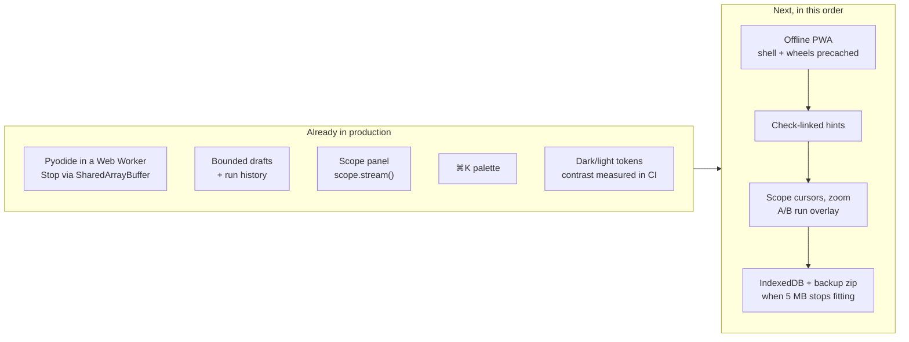

# MechaLab 2.0 plan — what already ships, what does not

The plan was written from the repository's file list, because the live site is a JavaScript SPA that a
text-only fetch cannot render. Several of its "Phase 0/1 first, everything depends on this" items were
therefore already in production when it was written. This page maps the plan onto the code as it is
today, so the next slice is chosen from evidence rather than from a list that assumes a blank page.

Verdicts: **ships** (in production with tests), **partial** (the core exists, the plan asks for more),
**missing** (no such surface).

## Phase 0 — the three "do this week" items

| Plan item | Reality now | Verdict |
| :--- | :--- | :--- |
| Python in a Web Worker + `coi-serviceworker` + a real Stop | `PYODIDE_WORKER_SOURCE` in [`app/src/components/tabs/TabPyodideRunner.tsx`](../app/src/components/tabs/TabPyodideRunner.tsx) runs Pyodide off-thread; Stop writes a `SharedArrayBuffer` interrupt word (`setInterruptBuffer`), so `KeyboardInterrupt` lands **in place** and imports survive; [`app/public/coi-serviceworker.js`](../app/public/coi-serviceworker.js) supplies COOP/COEP on Pages, with a terminate-the-worker fallback when isolation is absent. Pinned by `npm run test:runtime` (real Chromium, real `SharedArrayBuffer`). | **ships** |
| IndexedDB persistence with snapshot-on-run | Drafts are `localStorage` per lesson, bounded and evicted ([`app/src/lessonDraft.ts`](../app/src/lessonDraft.ts)); every Run files the code it started from with its verdict, five per lesson, restorable ([`app/src/draftHistory.ts`](../app/src/draftHistory.ts), `npm run test:history`). No IndexedDB, no zip backup, no cross-lesson timeline. | **partial** |
| A Scope panel with a `scope.plot()` helper | Ships: `mechalab.scope.stream(name, t, y)` / `scope.plot(...)` inside a run, batched through the worker, drawn on one pair of axes with last values in the legend and the same data as a table ([`app/src/scopeModel.ts`](../app/src/scopeModel.ts), [`app/src/components/ScopePanel.tsx`](../app/src/components/ScopePanel.tsx), `npm run test:scope`, browser step 7h). No uPlot zoom/cursors, no A/B run overlay yet. | **partial** |

## Phases 1–3 — runtime, workspace, editor

| Plan | Reality | Verdict |
| :--- | :--- | :--- |
| Worker runtime, warm-up, measured boot, restart kernel | Warm-up on idle, `ready in N ms` reported from the worker, Reset Runtime respawns it, `input()` blocks the worker on `Atomics.wait` while the page stays live. | **ships** |
| Dockable panels, `⌥1`–`⌥4` layout presets, activity bar | One fixed two-column layout per tab; no docking, no presets. | **missing** |
| CodeMirror 6 with multi-file tabs, read-only helpers | CodeMirror 6 with Python highlighting, bracket handling, indent, search and name completion; `main.py` plus a **read-only** plant tab where a lesson uses one. | **ships** |
| Jedi completions/hover, Ruff lint + format, parsed tracebacks | Completion is keyword- and file-derived, not Jedi (no docstrings on `np.`); no linter; tracebacks are shown as text. [`docs/ERROR_EXPLAINER.md`](ERROR_EXPLAINER.md) exists as prose, not as an in-app matcher. | **missing** |
| Inline values, parameter sliders, `# %%` cells | Sliders ship as a `# @slider 0 20 0.1` comment on a literal, rewritten in the file and re-run on settle, across 7 starters ([`app/src/editor/sliderModel.ts`](../app/src/editor/sliderModel.ts), `npm run test:editor`). No inline values, no cells. | **partial** |
| Diff view against starter/solution | Not a diff view; the roadmap card counts changed lines and written steps. | **missing** |

## Phases 4–7 — lab, learning layer, study layer

| Plan | Reality | Verdict |
| :--- | :--- | :--- |
| Scope (uPlot), A/B runs, arm view upgrades, fault panel | Arm rendering, fault bench (08.1) and per-tab simulators exist; nothing is a live scope the learner's code streams into. | **partial** |
| Checks as a test runner + watch mode | Output comparison (`exact` vs formatting-tolerant) and instructor behaviour checks run per lesson; the 08.1 bench and Tier 3 budgets gate passes. No watch-on-save. | **partial** |
| Hint ladder tied to the failing check | Three levels per lesson, and level 2+ requires a completed run first ([`app/src/lessonCoach.ts`](../app/src/lessonCoach.ts)); hints are per lesson, not per check. | **partial** |
| Predict-first gate, try-it blocks, symbol linking | None of the three. | **missing** |
| Notes, highlights, flashcards (FSRS), focus mode, measured time | None; the portfolio export is Markdown of progress, not of notes. | **missing** |
| Debugger + time travel, embedded C/AVR | None. | **missing** |

## Phases 8–9 — reach and polish

| Plan | Reality | Verdict |
| :--- | :--- | :--- |
| ⌘K palette | Ships, built from the lesson registry ([`app/src/paletteCatalog.ts`](../app/src/paletteCatalog.ts), `npm run test:palette`); `⌘↵` runs. No `⌘P`, no `⌘⇧F` full-text search, no `?` sheet beyond the header modal. | **partial** |
| Offline PWA, install prompt, download-step | `coi-serviceworker` is the only service worker; no precache of shell, lessons or Pyodide, so a plane still fails. | **missing** |
| Themes, contrast, reduced motion, keyboard | Dark and light from one token set, every tab measured for contrast in both modes in CI (`npm run test:theme:e2e`), reduced-motion branch, visible focus ring. No high-contrast, no paper theme, no keymap (Vim/Emacs), no screen-reader announcements for run results. | **partial** |
| Share links, "ask for help", pair study | None. | **missing** |
| CI rigour (workers, E2E, budgets) | 28 repository gates plus 15 workbench suites on one dev server and one built bundle, including the real-browser worker suite and a Pages-bundle sweep that fails if a starter verifies. No Lighthouse budget, no axe run, no visual-regression snapshots. | **partial** |

## What to build next, in order

1. **Offline PWA** — highest reachability win per line of code, and it needs no new dependency: precache
   the shell, the registry JSON and the Pyodide wheels the current lesson needs. Acceptance: a browser
   suite loads the app, goes offline, reloads, and runs a lesson.
2. **Check-linked hints** — the checks already carry ids and labels, and the hint ladder already counts
   levels; pointing a hint at the failing check is the smallest change that makes the ladder feel
   specific. Acceptance: a failing check names its own hints, and hint 2 does not reveal hint 3.
3. **Scope follow-ups** — cursors and zoom, then the plan's A/B overlay (pin run #3, change `Kp`, run
   again, both traces on one pair of axes). The panel now has the data and the message channel; this is
   interaction on top of it. Acceptance: two runs overlay, and a cursor reads both values at one `t`.
4. **Dexie / IndexedDB + backup zip** — only worth doing once history, notes or plots outgrow the 5 MB
   bucket; until then the bounded `localStorage` stores are cheaper and already tested.
5. **Jedi completions + Ruff lint in the worker** — a real editor at ~2 MB of extra cached weight; do it
   after the study layer, because it changes how a lesson feels rather than what a learner can do.
