# MechaLab 2.0 plan — what already ships, what does not

The plan was written from the repository's file list, because the live site is a JavaScript SPA that a
text-only fetch cannot render. Several of its "Phase 0/1 first, everything depends on this" items were
therefore already in production when it was written. This page maps the plan onto the code as it is
today, so the next slice is chosen from evidence rather than from a list that assumes a blank page.

```mermaid
flowchart LR
    subgraph shipped["Already in production"]
        W["Pyodide in a Web Worker<br/>Stop via SharedArrayBuffer"]
        D["Bounded drafts<br/>+ run history"]
        S["Scope panel<br/>scope.stream()"]
        P["⌘K palette"]
        T["Dark/light tokens<br/>contrast measured in CI"]
        H["A failing check names<br/>its own hint rung"]
        A["Scope cursor, zoom<br/>A/B run overlay"]
        J["Jedi completions, hover,<br/>signatures; pyflakes lint"]
        B["One-press backup<br/>and a merging restore"]
    end
    subgraph next["Next, in this order"]
        N1["The study layer: notes,<br/>flashcards, focus mode"]
        N3["Parsed tracebacks, matched<br/>to the hint that answers them"]
    end
    shipped --> next
```

Verdicts: **ships** (in production with tests), **partial** (the core exists, the plan asks for more),
**missing** (no such surface).

## Phase 0 — the three "do this week" items

| Plan item | Reality now | Verdict |
| :--- | :--- | :--- |
| Python in a Web Worker + isolation on Pages + a real Stop | `PYODIDE_WORKER_SOURCE` in [`app/src/components/tabs/TabPyodideRunner.tsx`](../app/src/components/tabs/TabPyodideRunner.tsx) runs Pyodide off-thread; Stop writes a `SharedArrayBuffer` interrupt word (`setInterruptBuffer`), so `KeyboardInterrupt` lands **in place** and imports survive; [`app/public/sw.js`](../app/public/sw.js) supplies COOP/COEP on Pages, with a terminate-the-worker fallback when isolation is absent. Pinned by `npm run test:runtime` (real Chromium, real `SharedArrayBuffer`). | **ships** |
| IndexedDB persistence with snapshot-on-run | The six large stores — drafts, filed versions, the learning log, notes and highlights, review schedules, sittings — are in **IndexedDB** (`mechalab`/`kv`) behind a `Storage`-shaped write-behind cache ([`app/src/bulkStorage.ts`](../app/src/bulkStorage.ts), [`app/src/idbBackend.ts`](../app/src/idbBackend.ts), `npm run test:storage`, `npm run test:e2e:storage`), migrated from the bucket copy-first so a browser that refuses a database loses nothing. The small first-paint keys (theme, focus, last lesson, view mode, progress flags) stay in `localStorage`, where a synchronous read at mount time is what they need. Hand-written rather than Dexie: one object store and three operations do not earn a dependency. Drafts are per lesson, bounded and evicted ([`app/src/lessonDraft.ts`](../app/src/lessonDraft.ts)); every Run files the code it started from with its verdict, five per lesson, restorable ([`app/src/draftHistory.ts`](../app/src/draftHistory.ts), `npm run test:history`). **The backup half ships**: one press writes a `.zip` of all seven stores with a manifest and a README ([`app/src/backupZip.ts`](../app/src/backupZip.ts), [`app/src/backupBundle.ts`](../app/src/backupBundle.ts), `npm run test:backup`, `npm run test:e2e:backup`), and a restore merges — flags union, drafts fill gaps, versions and log events dedupe — so it never deletes and never doubles. **The cross-lesson timeline ships**: `app/src/timeline.ts` folds the log and the sittings into days of work, and the roadmap's trail card draws them newest first — one row per open, run, hint, pass or export, a verification folded into the run that passed, measured time filed on the day its sitting started, and the caps saying what they left out ([`app/src/components/TrailCard.tsx`](../app/src/components/TrailCard.tsx), `npm run test:trail`, `npm run test:e2e:trail`). The caps (~2.0 M characters, measured by `npm run test:backup`) are now the archive's size rather than a bucket emergency. | **partial** |
| A Scope panel with a `scope.plot()` helper | Ships: `mechalab.scope.stream(name, t, y)` / `scope.plot(...)` inside a run, batched through the worker, drawn on one pair of axes with last values in the legend and the same data as a table ([`app/src/scopeModel.ts`](../app/src/scopeModel.ts), [`app/src/components/ScopePanel.tsx`](../app/src/components/ScopePanel.tsx), `npm run test:scope`, browser step 7h). No uPlot zoom/cursors, no A/B run overlay yet. | **partial** |

## Phases 1–3 — runtime, workspace, editor

| Plan | Reality | Verdict |
| :--- | :--- | :--- |
| Worker runtime, warm-up, measured boot, restart kernel | Warm-up on idle, `ready in N ms` reported from the worker, Reset Runtime respawns it, `input()` blocks the worker on `Atomics.wait` while the page stays live. | **ships** |
| Dockable panels, `⌥1`–`⌥4` layout presets, activity bar | **Four presets ship**, chosen with `⌥1`–`⌥4` or the buttons in the editor's header and remembered across a reload: **Study** (the chooser, the editor and the results — what the tab opens as), **Write** (the editor alone), **Read** (the results, with the editor and chooser hidden) and **Split** (the editor on the left, the results on the right). Split is the fourth arrangement the plan named: `workspaceLayout.ts` keeps two rules apart — *which* regions a preset shows, and *how* the ones left are arranged — so its table pins both. The two columns are measured on the **built bundle**, where the utilities that draw them exist — the dev server the workbench suites share resolves its config without the Tailwind plugin, so there `display` reads `block` on a `grid` container: the built-bundle step presses `⌥4` at 1440 px and asserts two grid tracks with the results *beside* the editor, while the dev step pins the structure (the preset in force, the `lg:grid-cols-2` class, the editor first in the DOM). At the `lg` breakpoint the columns appear; below it the same preset stacks, so a phone is not asked to split 375 px. The shortcut reads `KeyboardEvent.code`, because `⌥2` types `™` in `key` on a Mac ([`app/src/workspaceLayout.ts`](../app/src/workspaceLayout.ts), `npm run test:layout`, browser step 5d, `npm run test:e2e:pages`). **Docking, an activity bar and a draggable divider are still absent.** | **partial** |
| CodeMirror 6 with multi-file tabs, read-only helpers | CodeMirror 6 with Python highlighting, bracket handling, indent, search and Jedi completion; `main.py` plus a **read-only** plant tab where a lesson uses one. | **ships** |
| Jedi completions/hover, Ruff lint + format, parsed tracebacks | **Tracebacks are parsed, not printed**: `app/src/traceback.ts` reads CPython's own text into frames and an exception, picks the deepest frame that is the learner's (not the appended `_selfcheck`), handles chained failures and both SyntaxError shapes, and `app/src/errorIndex.ts` matches it against the page's fifteen entries — generated from [`docs/ERROR_EXPLAINER.md`](ERROR_EXPLAINER.md) by `scripts/generate_error_index.py`, with `--check` as the drift gate. The card names the line, moves the cursor there, and brings the entry's own check-first list; a failure the page does not cover says so instead of guessing (`npm run test:traceback`, `npm run test:e2e` step 3). **Completions, hover and signatures ship, from the interpreter itself**: Jedi answers `math.` with `acos` and its signature, hovering a name opens a card with its definition line, its call and the docstring, and typing `math.acos(` shows that call with the argument being typed marked ([`app/src/analysisClient.ts`](../app/src/analysisClient.ts), [`app/src/editor/completions.ts`](../app/src/editor/completions.ts), [`app/src/editor/analysisTips.ts`](../app/src/editor/analysisTips.ts)); pyflakes names an unused import on its line in a Checker strip (`npm run test:analysis`, `npm run test:runtime`). Ruff is a Rust binary and cannot run in Pyodide at all, so Ruff's lint *and* its formatter are the browser's one real gap here: pyflakes has no style rules and nothing reformats the file. The analyzers install on first use (~1.5 MB), so a first visit that never edits pays nothing for them. | **partial** |
| Inline values, parameter sliders, `# %%` cells | **Inline values ship**: after a run, the worker sends the namespace *that run* returned (functions, classes, modules and dunders filtered out, reprs cut to 48 characters), and the editor draws each value at the end of the **last top-level assignment** that bound it — an indented line runs many times, so it is not a home for one value ([`app/src/inlineValues.ts`](../app/src/inlineValues.ts), [`app/src/editor/inlineWidget.ts`](../app/src/editor/inlineWidget.ts), `npm run test:inline`, browser step 5b). An edit clears them, because the numbers then describe a document that is gone, and a stopped or timed-out run draws none. Sliders ship as a `# @slider 0 20 0.1` comment on a literal, rewritten in the file and re-run on settle, across 7 starters ([`app/src/editor/sliderModel.ts`](../app/src/editor/sliderModel.ts), `npm run test:editor`). **`# %%` cells ship**: a marker at column 0 draws a **Run to here** button, which runs the document *through* that cell — not just the cell, because the worker runs each program in a fresh namespace — and strictly **ungraded**: nothing is verified, no hint rung is unlocked, and a lesson with no markers looks exactly as it did ([`app/src/editor/cells.ts`](../app/src/editor/cells.ts), [`app/src/editor/cellWidget.ts`](../app/src/editor/cellWidget.ts), `npm run test:cells`, browser step 5e). | **ships** |
| Diff view against starter/solution | Ships as the runner's **Diff** button: the editor's own text against the starter, line by line, with both line numbers, `+`/`−` rows, the unchanged runs trimmed to three lines each side and counted (`… 12 unchanged`). A second reference, the lesson's solution, unlocks once the learner has opened it in this visit or passed the lesson — the panel cannot be used to read an answer nobody earned — and a large file degrades to common head and tail instead of freezing ([`app/src/codeDiff.ts`](../app/src/codeDiff.ts), `npm run test:codediff`, browser step 7g-i). **The third reference is the learner's own work**: the panel also compares against the code a filed run started from — the newest five attempts, each labelled with its age and the verdict that run got — so "what changed since the run that passed" is one click, and a version a restore or the cap removed falls back to the starter rather than blanking the panel ([`app/src/diffReference.ts`](../app/src/diffReference.ts), `npm run test:codediff`, browser step 7g-i). The same engine now counts the roadmap card's changed lines, so the two surfaces cannot disagree. No side-by-side or word-level view. | **ships** |

## Phases 4–7 — lab, learning layer, study layer

| Plan | Reality | Verdict |
| :--- | :--- | :--- |
| Scope (uPlot), A/B runs, arm view upgrades, fault panel | The learner's own `scope.stream()` traces are drawn on a canvas with a cursor that reads every signal at one `t`, zoom (wheel, buttons, `+`/`-`/`0`) and drag-pan clamped to the data, and an A/B overlay: pin a run as A, change a gain, run again, and both traces share the axes with the cursor reading both ([`app/src/scopeModel.ts`](../app/src/scopeModel.ts), [`app/src/components/ScopePanel.tsx`](../app/src/components/ScopePanel.tsx), `npm run test:scope`, browser step 7h-i/7h-ii). Not uPlot, so no box-zoom or tooltips beyond the one cursor; arm-view upgrades and the fault panel are unchanged. | **ships** |
| Checks as a test runner + watch mode | Output comparison (`exact` vs formatting-tolerant) and instructor behaviour checks run per lesson; the 08.1 bench and Tier 3 budgets gate passes. **Watch mode ships** as a remembered toggle: after a *graded failure*, a 1.5 s pause in typing re-runs the checks, and nothing else does — not a pass, not a Stop, not a runtime error mid-typing, and not while the predict gate is waiting on a guess. Automatic runs file no versions and log no `run` event, so the fix loop cannot evict a learner's real attempts or inflate the friction report ([`app/src/watchMode.ts`](../app/src/watchMode.ts), `npm run test:watch`, browser step 7g-ii). | **ships** |
| Hint ladder tied to the failing check | Each failed run opens a card naming the check that is red — behaviour or presentation — with the check's own line (the instructor's assertion, or the output line that differs) and the one rung that answers it ([`app/src/checkHints.ts`](../app/src/checkHints.ts), `npm run test:checkhints`, browser steps 0a-i and 10a). Rung 2 is now *earned*: it waits for a run made after the nudge was opened, not for the run already on screen. Blocks that are not a graded check (a harness metric, a traceback, a stopped loop) keep their own cards and name no hint. | **ships** |
| Predict-first gate, try-it blocks, symbol linking | **The gate ships**: a lesson's first Run asks *what will this print?* instead of running, holds the run for the guess, grades it against the lesson's own `expectedOutput` (exact / reordered / n of m / none, on trimmed lines rather than substrings), then lets the run go. Skip is a recorded decision, the question is asked once per lesson, and **Predict again** is a second attempt ([`app/src/predictGate.ts`](../app/src/predictGate.ts), `npm run test:predict`, `npm run test:e2e:predict`). Suites that drive many runs switch the prompt off with `window.__mechalabPredictFirst = false`; the gate has a browser suite of its own because that is the only way the default path is reachable. **Symbol linking ships**: **F12** (or ⌘-click / Ctrl-click) on a name puts the cursor on the line that defines it — in `main.py`, or in the read-only plant the lesson imports, whose tab opens on its own `def` — and a name nothing defines is named in the file strip rather than silently ignored ([`app/src/symbolIndex.ts`](../app/src/symbolIndex.ts), `npm run test:symbols`, browser step 5c). The index is a line scan, not a parser: a `def` inside a docstring would be indexed, and an attribute (`z.real`) is declined on purpose. **Try-it blocks ship**: a page marks a fence with `<!-- try -->` on the line above it, and `scripts/generate_try_links.mjs` writes the link that opens the workbench on that page's entry with the snippet in a **scratch** editor — every run there is ungraded, no version is filed, and the learner's draft is untouched ([`app/src/tryLink.ts`](../app/src/tryLink.ts), [`app/src/tryLinks.ts`](../app/src/tryLinks.ts), `npm run test:try`, `npm run check:try-links`, browser step 5f). Three worked examples carry one; a block too long for the 2,000-character cap is refused by its measured size, so the largest ones stay read-only. | **ships** |
| Notes, highlights, flashcards (FSRS), focus mode, measured time | **Notes, highlights and FSRS cards ship**: every lesson has a note box that saves as the learner types, **Pin selected text** keeps a passage with an optional comment ([`app/src/studyNotes.ts`](../app/src/studyNotes.ts)), and a commented highlight becomes a review card asked back by the Study panel's **Review (N due)** deck ([`app/src/fsrs.ts`](../app/src/fsrs.ts), [`app/src/studyCards.ts`](../app/src/studyCards.ts), `npm run test:review`, `npm run test:e2e:review`). The scheduler is the published FSRS-5 — its default weights, its formulas, a 90% retention target and a one-year interval cap — not an approximation, and the panel offers Again/Hard/Good/Easy only after the answer is revealed. Cards are derived from notes, so deleting a highlight or clearing its comment retires the card; the deck rides in the backup as `study-cards.json` and a restore keeps the more-reviewed schedule. Both stores are bounded and evicted (20 highlights per lesson, 25 lessons; 500 cards) and merge back the way drafts do. **Focus mode ships** — `⌘.`, the header button or the pill; the chrome hides, the work stays, and `Escape`, `⌘.` and the pill all leave it, with the choice remembered ([`app/src/focusMode.ts`](../app/src/focusMode.ts), `npm run test:e2e:focus`). **Measured time ships** as sittings: an open, a run or a review extends the sitting, five minutes without one closes it, three hours is the cap, the study panel prints `Today 34 min · median sitting 18 min`, and the log export carries the raw sittings so `docs/PILOT.md`'s `active_minutes` is measured rather than estimated ([`app/src/sittingClock.ts`](../app/src/sittingClock.ts), `npm run test:sitting`). **The portfolio export now carries the work**: the Markdown keeps its three progress sections and adds notes and kept passages, the review deck (due now, the next card, the first twenty cards), and the measured time as totals plus a sitting table — each section written only when it has content ([`app/src/portfolio.ts`](../app/src/portfolio.ts), `npm run test:portfolio`). | **ships** |
| Debugger + time travel, embedded C/AVR | **The trace ships: a run is recorded and replayed, not paused.** The worker's `settrace` hook — the one that already enforced the step budget — keeps each executed line of the learner's own file with the frame's values (six names, reprs cut to 40 characters), caps the recording at 300 steps while still counting every line it ran, and the panel beside the output steps through it: a slider, prev/next, the quoted source line from **the text that ran**, the values that line held, and **Show line** to put the caret there. A stop and a timeout keep their partial traces, because "where was my loop when I stopped it" is what Stop is pressed to answer. The replay is still not a debugger, so **Pause and Step ship beside it**: the toolbar's **Pause** parks the interpreter at the next line of the learner's own file — the worker waits on a shared command word, the same reason Stop uses one, because a message queues behind the very loop it is meant to steer — and the bar above the editor names the line it is about to run, quotes it, and shows that frame's values; **Step** walks one line at a time, **Continue** runs on, and **Stop** wakes a parked run and leaves the interpreter loaded ([`app/src/runtime/pythonWorker.js`](../app/src/runtime/pythonWorker.js), `npm run test:runtime`). A pause is only offered when the browser gave the page shared memory, since without it nothing can reach a parked worker. **Breakpoints ship**: the gutter beside the line numbers is a column of slots — click one, or put the caret on the line and press `F9`, and the run stops there without anyone reaching for Pause; clicking an armed line disarms it, each lesson keeps its own list in `localStorage` across a reload, and the bar says `Breakpoint` rather than `Paused` because a park the learner placed and one they asked for answer different questions ([`app/src/editor/breakpoints.ts`](../app/src/editor/breakpoints.ts), [`app/src/editor/breakpointGutter.ts`](../app/src/editor/breakpointGutter.ts), `npm run test:breakpoints`, `npm run test:runtime`, browser step 5i). A dot follows its statement: the editor holds a breakpoint as a **document position**, so typing a newline above one carries it down (undo brings it back), while what is stored and restored with the draft is the **line number** it now sits on. One limit is deliberate rather than hidden: the list is the one that **travelled with the request**, so a dot added while a program runs is for the next run. The recording itself is [`app/src/runTrace.ts`](../app/src/runTrace.ts) and [`app/src/components/TracePanel.tsx`](../app/src/components/TracePanel.tsx), with the Python half in [`app/src/runtime/pythonWorker.js`](../app/src/runtime/pythonWorker.js) (`npm run test:trace`, browser step 5h). **A parked frame can be changed**: every value the bar shows is a button, and the one-line form it opens evaluates a Python expression **in the frame the interpreter is stopped in** and writes it back, so Continue runs the next line with the value the learner chose — at top level, and inside a function through `PyFrame_LocalsToFast` (CPython 3.12 hands a function frame a snapshot dict; if that private call ever stops existing the worker says so instead of pretending). The run stays parked and re-posts with the frame's new values, and a refused expression is shown in the interpreter's own words rather than applied silently (`npm run test:runtime`, checks 14). **A breakpoint can be narrowed, not only placed**: the toolbar's **Breakpoints (N)** panel lists every dot with one line of room for a condition, and a condition is a Python expression the worker compiles **once per run** and evaluates in the frame that reached the line — so `n == 3` stops the third pass of a loop instead of its first, and a stepped-over line is not a stop per turn. A narrowed dot is drawn **hollow**, because a filled dot would claim a park that only sometimes stops; the condition rides the dot when an edit moves it (it is part of the position's entry, not a line-keyed side table); a condition that raises parks **anyway**, with the interpreter's own sentence under the parked line, because a typo in the condition must neither end the run nor silently skip the park; and conditions reach the interpreter with the request, like the dots themselves, so one written while a program runs is for the next run (`npm run test:breakpoints`, `npm run test:runtime`, checks 15–16). **Step in reaches the call**: Step runs a call to its end, and **Step in** parks on the called function's first line — in the learner's file, and in a file that is not theirs, because the files the learner can open (a lesson's helper tabs, the shared plant) are where steps are allowed to land. Every parked step carries **which file** it is in, so the bar names it and quotes **that** file's line rather than main.py's; a step from inside the plant stays in the plant, and a step over parks at the depth that asked for it or shallower, so a returning call lands back in its caller — the usual way out without a Step out button. CPython's own frames are not places to stand: a call into a C function (`math.sqrt`) has no source in the editor, so a step in on one behaves as a step over (`npm run test:runtime`, checks 17–18). What the row still lacks is a **Step out** button and watch expressions. Embedded C/AVR is still **missing**, and this row now records **why it cannot be closed the way the other rows were**. The five Arduino sketches in `stage-0/S0.7`–`S0.M` and `01.2` are verified today by CI, not by the learner: `scripts/extract_and_compile_sketches.py` compiles every `Full Solution` with `g++` against a mock `Arduino.h` and checks its `Serial` output, and `arduino-cli compile --fqbn arduino:avr:uno` compiles the `.ino` files for the real board. Doing that in the browser needs a compiler, and there is no honest little one: `wasi-sdk` is not on npm at all (404), a browser clang build is ~25–30 MB plus a sysroot, `@wasmer/wasi` is 6.8 MB and is only the *runtime* (it cannot compile C), and `avr8js` — 400 kB — is an AVR **emulator**, which executes a `.hex` but never produces one. Fetching tens of megabytes to run a ten-line sketch would be a different product from the one this repo measures (`docs/weight-budget.json`: 1.02 MB total, and Pyodide's 10 MB is fetched only because it *is* the lesson runtime). So the sketches stay CI-verified and the row stays **missing** until either a small C-in-wasm toolchain exists or a hosted compiler is acceptable. | **missing** |

## Phases 8–9 — reach and polish

| Plan | Reality | Verdict |
| :--- | :--- | :--- |
| ⌘K palette | Ships, built from the lesson registry ([`app/src/paletteCatalog.ts`](../app/src/paletteCatalog.ts), `npm run test:palette`); `⌘↵` runs. No `⌘P`, no `⌘⇧F` full-text search, no `?` sheet beyond the header modal. | **partial** |
| Offline PWA | `sw.js` precaches the shell, manifest and favicon, serves same-origin assets cache-first with a background refresh, falls back to the cached document for any navigation, and caches the Pyodide runtime the module worker loads. **Take this step offline** ([`app/src/offlineTakeAlong.ts`](../app/src/offlineTakeAlong.ts), `npm run test:takealong`): one press sends the worker this document's own script/link URLs, warms the runtime, and reports the measured cost (`Offline ready · 8.0 MB · 16 files`), and the offline suite now starts from that press with no lesson run first. `npm run test:offline` serves the bundle with no host headers, then goes offline: reload, deep link, and a lesson run to its verdict from the cache. The manifest is installable. | **ships** |
| Themes, contrast, reduced motion, keyboard | **Four palettes from one token set** — dark, light, paper and high contrast — with every tab measured for contrast in each of them in CI (`npm run test:theme:e2e`: eleven tabs plus the reference page, 48 palette pairs, lowest text run 4.52:1). High contrast is taken on a first visit when the OS reports `prefers-contrast: more` (ahead of `prefers-color-scheme`) and holds body text to a 7:1 floor where the others aim at 4.5:1. **Paper is the opposite end and is never a default**: a warm cream sheet with brown-black ink for long lesson pages, its accents darkened until each clears 4.5:1 on a hovered row (`--panel-3`) as well as on `--panel`. Contrast and paper are each a real on/off beside the dark/light flip, so `aria-pressed` states what is drawn and turning either off returns to the OS palette ([`app/src/index.css`](../app/src/index.css), [`app/src/theme.ts`](../app/src/theme.ts), `npm run test:theme`, `npm run test:theme:tokens`, `python3 tests/test_theme_docs.py` — all four palettes checked against the stylesheet and the reference page). Reduced-motion branch, visible focus ring. **A run's verdict is announced**: one polite live region says the outcome first and then the reason — the two lines that differ (`expected "…", got "…"`, quoted from the original text rather than the whitespace-stripped form), the harness's own sentence about the metric that is off, the exception's last line for a runtime error, or `stopped`, with the lesson's prediction as a second sentence ([`app/src/announce.ts`](../app/src/announce.ts), `npm run test:announce`, browser steps 5 and 7g-iii). It used to say "read the failing line above", which is an instruction written for eyes. **Vim keys ship**: the toolbar's `Vim keys` control installs `@replit/codemirror-vim` — `dd`, `ciw`, visual blocks — into a **compartment of the editor's own state**, so the toggle changes the keymap without rebuilding the document, the caret or the undo history, and the badge beside the line count names the mode that is reading the keys (`NORMAL`, `INSERT`, `VISUAL LINE`, or `UNAVAILABLE` when the chunk could not be fetched). It is off unless asked for and remembered once asked; the package is 39 kB gzipped and dynamically imported into its own `vendor-vim` chunk, so a visitor who never presses the button never downloads it ([`app/src/vimMode.ts`](../app/src/vimMode.ts), [`app/src/components/pythonEditorImpl.tsx`](../app/src/components/pythonEditorImpl.tsx), `npm run test:vim`, browser step 5g). The Emacs-style line motions were already CodeMirror's default keymap; there is no Emacs *mode* and no keybinding editor. | **partial** |
| Share links, "ask for help", pair study | **Share ships**: the runner's **Share** button copies `?lesson=<id>#share=<payload>` — this lesson and the editor's text in one link, with the code in the URL fragment so it never reaches the host. The fragment is base64url (encoding, not encryption, and the status line says so), the whole URL is capped at a measured 2,000 characters with a refusal that names its size, an empty editor is not a link, and a received attempt is **offered, never applied** — the card says how many lines arrived and what its button replaces, and loading then stores it as the lesson's draft ([`app/src/shareLink.ts`](../app/src/shareLink.ts), `npm run test:share`, browser step 7g-i-b). No pair study: this is the send, not a shared session. | **partial** |
| CI rigour (workers, E2E, budgets) | 31 repository gates plus 34 workbench suites on one dev server and one built bundle, including the real-browser worker suite, the trail, and a Pages-bundle sweep that fails if a starter verifies. **Both budgets ship**: `npm run check:axe` runs axe-core over all 11 tabs in all four palettes and fails on any serious/critical finding that `docs/a11y-allowlist.json` does not explain (empty, and stale entries fail); `npm run check:weight` holds the gzipped bundle to `docs/weight-budget.json` and fails on a breach *or* on a budget nothing measures. On its first run it found 22 unnamed sliders, a brand link whose name reworded what is on screen, and an editor scroll region no keyboard could reach — all fixed, none allowlisted. No Lighthouse run and no visual-regression snapshots; wall-clock timings are deliberately not gated, because CI variance is larger than any regression this app could ship. | **partial** |

## What was built next, in order

All three are shipped (Runs 160–162). What is left is chosen from the **missing** and **partial** rows
above, and that is an owner's call rather than a default: the debugger and time travel, embedded C/AVR,
docking and layout presets, share links and pair study, a
high-contrast palette, watch mode on save. None of them is a repair — the gates are green. Five of the
items this list used to carry have shipped since it was written: the diff view (Run 163), the
predict-first gate (Run 164), symbol linking, the try-it blocks (Run 175), and the fourth layout
preset, Split (Run 179) — so *"docking and layout presets"* is now only docking.

1. ~~**The trail as a study input**~~ — **shipped in Run 161**: `app/src/trailReading.ts` reads the same
days for what they imply (a lesson that resisted, the review deck going quiet, days that were only
opens), behind a floor per rule, at most three, each printed under **What this says** in the trail card
(`npm run test:trailreading`, `npm run test:e2e:trail`).
2. ~~**The first explicit completion after a remount is dropped**~~ — **fixed in Run 160**, and not where
   the note guessed. The completion field was never involved: a tab switch terminates the runner's
   worker while its state survives, so the remounted runner still reported `ready` while it warmed a
   new worker, and `getReadyAnalysis` correctly refused the request. `getOrCreateWorker` now resets the
   status and its ref with the worker. `npm run test:runtime` is the pin.
3. ~~**The paint, measured**~~ — **shipped in Run 162**: `app/src/paintTiming.ts` records
   `first-contentful-paint`, `largest-contentful-paint`, the editor mounting and the runner committing,
   one sample per visit in its own bounded store, carried by the learning-log export under `paint`
   (`npm run test:paint`, and `npm run test:e2e` reads the sample back out of the downloaded file). A
   cold visit on this machine reports first paint 385 ms, editor 582 ms, Run 384 ms, so the lazy
   editor costs about 200 ms after the text is readable — the first number chosen from a measurement
   rather than from a chunk listing. Wall-clock stays un-gated; the measurement is what is gated.
