# MechaLab 2.0 plan — what already ships, what does not

The plan was written from the repository's file list, because the live site is a JavaScript SPA that a
text-only fetch cannot render. Several of its "Phase 0/1 first, everything depends on this" items were
therefore already in production when it was written. This page maps the plan onto the code as it is
today, so the next slice is chosen from evidence rather than from a list that assumes a blank page.

```mermaid
flowchart LR
    subgraph shipped["Already in production"]
        W["Pyodide in a Web Worker<br/>Stop via SharedArrayBuffer"]
        D["Bounded drafts<br/>+ run history"]
        S["Scope panel<br/>scope.stream()"]
        P["⌘K palette"]
        T["Dark/light tokens<br/>contrast measured in CI"]
        H["A failing check names<br/>its own hint rung"]
        A["Scope cursor, zoom<br/>A/B run overlay"]
        J["Jedi completions, hover,<br/>signatures; pyflakes lint"]
        B["One-press backup<br/>and a merging restore"]
    end
    subgraph next["Next, in this order"]
        N1["The study layer: notes,<br/>flashcards, focus mode"]
        N3["Parsed tracebacks, matched<br/>to the hint that answers them"]
    end
    shipped --> next
```

Verdicts: **ships** (in production with tests), **partial** (the core exists, the plan asks for more),
**missing** (no such surface).

## Phase 0 — the three "do this week" items

| Plan item | Reality now | Verdict |
| :--- | :--- | :--- |
| Python in a Web Worker + isolation on Pages + a real Stop | `PYODIDE_WORKER_SOURCE` in [`app/src/components/tabs/TabPyodideRunner.tsx`](../app/src/components/tabs/TabPyodideRunner.tsx) runs Pyodide off-thread; Stop writes a `SharedArrayBuffer` interrupt word (`setInterruptBuffer`), so `KeyboardInterrupt` lands **in place** and imports survive; [`app/public/sw.js`](../app/public/sw.js) supplies COOP/COEP on Pages, with a terminate-the-worker fallback when isolation is absent. Pinned by `npm run test:runtime` (real Chromium, real `SharedArrayBuffer`). | **ships** |
| IndexedDB persistence with snapshot-on-run | The six large stores — drafts, filed versions, the learning log, notes and highlights, review schedules, sittings — are in **IndexedDB** (`mechalab`/`kv`) behind a `Storage`-shaped write-behind cache ([`app/src/bulkStorage.ts`](../app/src/bulkStorage.ts), [`app/src/idbBackend.ts`](../app/src/idbBackend.ts), `npm run test:storage`, `npm run test:e2e:storage`), migrated from the bucket copy-first so a browser that refuses a database loses nothing. The small first-paint keys (theme, focus, last lesson, view mode, progress flags) stay in `localStorage`, where a synchronous read at mount time is what they need. Hand-written rather than Dexie: one object store and three operations do not earn a dependency. Drafts are per lesson, bounded and evicted ([`app/src/lessonDraft.ts`](../app/src/lessonDraft.ts)); every Run files the code it started from with its verdict, five per lesson, restorable ([`app/src/draftHistory.ts`](../app/src/draftHistory.ts), `npm run test:history`). **The backup half ships**: one press writes a `.zip` of all seven stores with a manifest and a README ([`app/src/backupZip.ts`](../app/src/backupZip.ts), [`app/src/backupBundle.ts`](../app/src/backupBundle.ts), `npm run test:backup`, `npm run test:e2e:backup`), and a restore merges — flags union, drafts fill gaps, versions and log events dedupe — so it never deletes and never doubles. **The cross-lesson timeline ships**: `app/src/timeline.ts` folds the log and the sittings into days of work, and the roadmap's trail card draws them newest first — one row per open, run, hint, pass or export, a verification folded into the run that passed, measured time filed on the day its sitting started, and the caps saying what they left out ([`app/src/components/TrailCard.tsx`](../app/src/components/TrailCard.tsx), `npm run test:trail`, `npm run test:e2e:trail`). The caps (~2.0 M characters, measured by `npm run test:backup`) are now the archive's size rather than a bucket emergency. | **partial** |
| A Scope panel with a `scope.plot()` helper | Ships: `mechalab.scope.stream(name, t, y)` / `scope.plot(...)` inside a run, batched through the worker, drawn on one pair of axes with last values in the legend and the same data as a table ([`app/src/scopeModel.ts`](../app/src/scopeModel.ts), [`app/src/components/ScopePanel.tsx`](../app/src/components/ScopePanel.tsx), `npm run test:scope`, browser step 7h). No uPlot zoom/cursors, no A/B run overlay yet. | **partial** |

## Phases 1–3 — runtime, workspace, editor

| Plan | Reality | Verdict |
| :--- | :--- | :--- |
| Worker runtime, warm-up, measured boot, restart kernel | Warm-up on idle, `ready in N ms` reported from the worker, Reset Runtime respawns it, `input()` blocks the worker on `Atomics.wait` while the page stays live. | **ships** |
| Dockable panels, `⌥1`–`⌥4` layout presets, activity bar | One fixed two-column layout per tab; no docking, no presets. | **missing** |
| CodeMirror 6 with multi-file tabs, read-only helpers | CodeMirror 6 with Python highlighting, bracket handling, indent, search and Jedi completion; `main.py` plus a **read-only** plant tab where a lesson uses one. | **ships** |
| Jedi completions/hover, Ruff lint + format, parsed tracebacks | **Tracebacks are parsed, not printed**: `app/src/traceback.ts` reads CPython's own text into frames and an exception, picks the deepest frame that is the learner's (not the appended `_selfcheck`), handles chained failures and both SyntaxError shapes, and `app/src/errorIndex.ts` matches it against the page's fifteen entries — generated from [`docs/ERROR_EXPLAINER.md`](ERROR_EXPLAINER.md) by `scripts/generate_error_index.py`, with `--check` as the drift gate. The card names the line, moves the cursor there, and brings the entry's own check-first list; a failure the page does not cover says so instead of guessing (`npm run test:traceback`, `npm run test:e2e` step 3). **Completions, hover and signatures ship, from the interpreter itself**: Jedi answers `math.` with `acos` and its signature, hovering a name opens a card with its definition line, its call and the docstring, and typing `math.acos(` shows that call with the argument being typed marked ([`app/src/analysisClient.ts`](../app/src/analysisClient.ts), [`app/src/editor/completions.ts`](../app/src/editor/completions.ts), [`app/src/editor/analysisTips.ts`](../app/src/editor/analysisTips.ts)); pyflakes names an unused import on its line in a Checker strip (`npm run test:analysis`, `npm run test:runtime`). Ruff is a Rust binary and cannot run in Pyodide at all, so Ruff's lint *and* its formatter are the browser's one real gap here: pyflakes has no style rules and nothing reformats the file. The analyzers install on first use (~1.5 MB), so a first visit that never edits pays nothing for them. | **partial** |
| Inline values, parameter sliders, `# %%` cells | **Inline values ship**: after a run, the worker sends the namespace *that run* returned (functions, classes, modules and dunders filtered out, reprs cut to 48 characters), and the editor draws each value at the end of the **last top-level assignment** that bound it — an indented line runs many times, so it is not a home for one value ([`app/src/inlineValues.ts`](../app/src/inlineValues.ts), [`app/src/editor/inlineWidget.ts`](../app/src/editor/inlineWidget.ts), `npm run test:inline`, browser step 5b). An edit clears them, because the numbers then describe a document that is gone, and a stopped or timed-out run draws none. Sliders ship as a `# @slider 0 20 0.1` comment on a literal, rewritten in the file and re-run on settle, across 7 starters ([`app/src/editor/sliderModel.ts`](../app/src/editor/sliderModel.ts), `npm run test:editor`). No `# %%` cells. | **partial** |
| Diff view against starter/solution | Ships as the runner's **Diff** button: the editor's own text against the starter, line by line, with both line numbers, `+`/`−` rows, the unchanged runs trimmed to three lines each side and counted (`… 12 unchanged`). A second reference, the lesson's solution, unlocks once the learner has opened it in this visit or passed the lesson — the panel cannot be used to read an answer nobody earned — and a large file degrades to common head and tail instead of freezing ([`app/src/codeDiff.ts`](../app/src/codeDiff.ts), `npm run test:codediff`, browser step 7g-i). The same engine now counts the roadmap card's changed lines, so the two surfaces cannot disagree. No side-by-side/word-level view and no diff against a filed version. | **ships** |

## Phases 4–7 — lab, learning layer, study layer

| Plan | Reality | Verdict |
| :--- | :--- | :--- |
| Scope (uPlot), A/B runs, arm view upgrades, fault panel | The learner's own `scope.stream()` traces are drawn on a canvas with a cursor that reads every signal at one `t`, zoom (wheel, buttons, `+`/`-`/`0`) and drag-pan clamped to the data, and an A/B overlay: pin a run as A, change a gain, run again, and both traces share the axes with the cursor reading both ([`app/src/scopeModel.ts`](../app/src/scopeModel.ts), [`app/src/components/ScopePanel.tsx`](../app/src/components/ScopePanel.tsx), `npm run test:scope`, browser step 7h-i/7h-ii). Not uPlot, so no box-zoom or tooltips beyond the one cursor; arm-view upgrades and the fault panel are unchanged. | **ships** |
| Checks as a test runner + watch mode | Output comparison (`exact` vs formatting-tolerant) and instructor behaviour checks run per lesson; the 08.1 bench and Tier 3 budgets gate passes. **Watch mode ships** as a remembered toggle: after a *graded failure*, a 1.5 s pause in typing re-runs the checks, and nothing else does — not a pass, not a Stop, not a runtime error mid-typing, and not while the predict gate is waiting on a guess. Automatic runs file no versions and log no `run` event, so the fix loop cannot evict a learner's real attempts or inflate the friction report ([`app/src/watchMode.ts`](../app/src/watchMode.ts), `npm run test:watch`, browser step 7g-ii). | **ships** |
| Hint ladder tied to the failing check | Each failed run opens a card naming the check that is red — behaviour or presentation — with the check's own line (the instructor's assertion, or the output line that differs) and the one rung that answers it ([`app/src/checkHints.ts`](../app/src/checkHints.ts), `npm run test:checkhints`, browser steps 0a-i and 10a). Rung 2 is now *earned*: it waits for a run made after the nudge was opened, not for the run already on screen. Blocks that are not a graded check (a harness metric, a traceback, a stopped loop) keep their own cards and name no hint. | **ships** |
| Predict-first gate, try-it blocks, symbol linking | **The gate ships**: a lesson's first Run asks *what will this print?* instead of running, holds the run for the guess, grades it against the lesson's own `expectedOutput` (exact / reordered / n of m / none, on trimmed lines rather than substrings), then lets the run go. Skip is a recorded decision, the question is asked once per lesson, and **Predict again** is a second attempt ([`app/src/predictGate.ts`](../app/src/predictGate.ts), `npm run test:predict`, `npm run test:e2e:predict`). Suites that drive many runs switch the prompt off with `window.__mechalabPredictFirst = false`; the gate has a browser suite of its own because that is the only way the default path is reachable. **Symbol linking ships**: **F12** (or ⌘-click / Ctrl-click) on a name puts the cursor on the line that defines it — in `main.py`, or in the read-only plant the lesson imports, whose tab opens on its own `def` — and a name nothing defines is named in the file strip rather than silently ignored ([`app/src/symbolIndex.ts`](../app/src/symbolIndex.ts), `npm run test:symbols`, browser step 5c). The index is a line scan, not a parser: a `def` inside a docstring would be indexed, and an attribute (`z.real`) is declined on purpose. Try-it blocks are still absent. | **partial** |
| Notes, highlights, flashcards (FSRS), focus mode, measured time | **Notes, highlights and FSRS cards ship**: every lesson has a note box that saves as the learner types, **Pin selected text** keeps a passage with an optional comment ([`app/src/studyNotes.ts`](../app/src/studyNotes.ts)), and a commented highlight becomes a review card asked back by the Study panel's **Review (N due)** deck ([`app/src/fsrs.ts`](../app/src/fsrs.ts), [`app/src/studyCards.ts`](../app/src/studyCards.ts), `npm run test:review`, `npm run test:e2e:review`). The scheduler is the published FSRS-5 — its default weights, its formulas, a 90% retention target and a one-year interval cap — not an approximation, and the panel offers Again/Hard/Good/Easy only after the answer is revealed. Cards are derived from notes, so deleting a highlight or clearing its comment retires the card; the deck rides in the backup as `study-cards.json` and a restore keeps the more-reviewed schedule. Both stores are bounded and evicted (20 highlights per lesson, 25 lessons; 500 cards) and merge back the way drafts do. **Focus mode ships** — `⌘.`, the header button or the pill; the chrome hides, the work stays, and `Escape`, `⌘.` and the pill all leave it, with the choice remembered ([`app/src/focusMode.ts`](../app/src/focusMode.ts), `npm run test:e2e:focus`). **Measured time ships** as sittings: an open, a run or a review extends the sitting, five minutes without one closes it, three hours is the cap, the study panel prints `Today 34 min · median sitting 18 min`, and the log export carries the raw sittings so `docs/PILOT.md`'s `active_minutes` is measured rather than estimated ([`app/src/sittingClock.ts`](../app/src/sittingClock.ts), `npm run test:sitting`). **The portfolio export now carries the work**: the Markdown keeps its three progress sections and adds notes and kept passages, the review deck (due now, the next card, the first twenty cards), and the measured time as totals plus a sitting table — each section written only when it has content ([`app/src/portfolio.ts`](../app/src/portfolio.ts), `npm run test:portfolio`). | **ships** |
| Debugger + time travel, embedded C/AVR | None. | **missing** |

## Phases 8–9 — reach and polish

| Plan | Reality | Verdict |
| :--- | :--- | :--- |
| ⌘K palette | Ships, built from the lesson registry ([`app/src/paletteCatalog.ts`](../app/src/paletteCatalog.ts), `npm run test:palette`); `⌘↵` runs. No `⌘P`, no `⌘⇧F` full-text search, no `?` sheet beyond the header modal. | **partial** |
| Offline PWA | `sw.js` precaches the shell, manifest and favicon, serves same-origin assets cache-first with a background refresh, falls back to the cached document for any navigation, and caches the Pyodide runtime the module worker loads. **Take this step offline** ([`app/src/offlineTakeAlong.ts`](../app/src/offlineTakeAlong.ts), `npm run test:takealong`): one press sends the worker this document's own script/link URLs, warms the runtime, and reports the measured cost (`Offline ready · 8.0 MB · 16 files`), and the offline suite now starts from that press with no lesson run first. `npm run test:offline` serves the bundle with no host headers, then goes offline: reload, deep link, and a lesson run to its verdict from the cache. The manifest is installable. | **ships** |
| Themes, contrast, reduced motion, keyboard | **Three palettes from one token set** — dark, light and high contrast — with every tab measured for contrast in each of them in CI (`npm run test:theme:e2e`, 33 tab/palette pairs). The contrast palette is taken on a first visit when the OS reports `prefers-contrast: more` (ahead of `prefers-color-scheme`), is a real on/off beside the dark/light flip, and holds body text to a 7:1 floor where the other two aim at 4.5:1 ([`app/src/index.css`](../app/src/index.css), [`app/src/theme.ts`](../app/src/theme.ts), `npm run test:theme`, `npm run test:theme:tokens`, `python3 tests/test_theme_docs.py` — all three palettes checked against the stylesheet and the reference page). Reduced-motion branch, visible focus ring. **A run's verdict is announced**: one polite live region says the outcome first and then the reason — the two lines that differ (`expected "…", got "…"`, quoted from the original text rather than the whitespace-stripped form), the harness's own sentence about the metric that is off, the exception's last line for a runtime error, or `stopped`, with the lesson's prediction as a second sentence ([`app/src/announce.ts`](../app/src/announce.ts), `npm run test:announce`, browser steps 5 and 7g-iii). It used to say "read the failing line above", which is an instruction written for eyes. No paper theme, no keymap (Vim/Emacs). | **partial** |
| Share links, "ask for help", pair study | **Share ships**: the runner's **Share** button copies `?lesson=<id>#share=<payload>` — this lesson and the editor's text in one link, with the code in the URL fragment so it never reaches the host. The fragment is base64url (encoding, not encryption, and the status line says so), the whole URL is capped at a measured 2,000 characters with a refusal that names its size, an empty editor is not a link, and a received attempt is **offered, never applied** — the card says how many lines arrived and what its button replaces, and loading then stores it as the lesson's draft ([`app/src/shareLink.ts`](../app/src/shareLink.ts), `npm run test:share`, browser step 7g-i-b). No pair study: this is the send, not a shared session. | **partial** |
| CI rigour (workers, E2E, budgets) | 31 repository gates plus 34 workbench suites on one dev server and one built bundle, including the real-browser worker suite, the trail, and a Pages-bundle sweep that fails if a starter verifies. **Both budgets ship**: `npm run check:axe` runs axe-core over all 11 tabs in all three palettes and fails on any serious/critical finding that `docs/a11y-allowlist.json` does not explain (empty, and stale entries fail); `npm run check:weight` holds the gzipped bundle to `docs/weight-budget.json` and fails on a breach *or* on a budget nothing measures. On its first run it found 22 unnamed sliders, a brand link whose name reworded what is on screen, and an editor scroll region no keyboard could reach — all fixed, none allowlisted. No Lighthouse run and no visual-regression snapshots; wall-clock timings are deliberately not gated, because CI variance is larger than any regression this app could ship. | **partial** |

## What was built next, in order

All three are shipped (Runs 160–162). What is left is chosen from the **missing** and **partial** rows
above, and that is an owner's call rather than a default: the debugger and time travel, embedded C/AVR,
docking and layout presets, try-it blocks and symbol linking, share links and pair study, a
high-contrast palette, watch mode on save. None of them is a repair — the gates are green. Two of the
items this list used to carry have shipped since it was written: the diff view (Run 163) and the
predict-first gate (Run 164).

1. ~~**The trail as a study input**~~ — **shipped in Run 161**: `app/src/trailReading.ts` reads the same
days for what they imply (a lesson that resisted, the review deck going quiet, days that were only
opens), behind a floor per rule, at most three, each printed under **What this says** in the trail card
(`npm run test:trailreading`, `npm run test:e2e:trail`).
2. ~~**The first explicit completion after a remount is dropped**~~ — **fixed in Run 160**, and not where
   the note guessed. The completion field was never involved: a tab switch terminates the runner's
   worker while its state survives, so the remounted runner still reported `ready` while it warmed a
   new worker, and `getReadyAnalysis` correctly refused the request. `getOrCreateWorker` now resets the
   status and its ref with the worker. `npm run test:runtime` is the pin.
3. ~~**The paint, measured**~~ — **shipped in Run 162**: `app/src/paintTiming.ts` records
   `first-contentful-paint`, `largest-contentful-paint`, the editor mounting and the runner committing,
   one sample per visit in its own bounded store, carried by the learning-log export under `paint`
   (`npm run test:paint`, and `npm run test:e2e` reads the sample back out of the downloaded file). A
   cold visit on this machine reports first paint 385 ms, editor 582 ms, Run 384 ms, so the lazy
   editor costs about 200 ms after the text is readable — the first number chosen from a measurement
   rather than from a chunk listing. Wall-clock stays un-gated; the measurement is what is gated.
