# MechaLab 2.0 plan — what already ships, what does not

The plan was written from the repository's file list, because the live site is a JavaScript SPA that a
text-only fetch cannot render. Several of its "Phase 0/1 first, everything depends on this" items were
therefore already in production when it was written. This page maps the plan onto the code as it is
today, so the next slice is chosen from evidence rather than from a list that assumes a blank page.

```mermaid
flowchart LR
    subgraph shipped["Already in production"]
        W["Pyodide in a Web Worker<br/>Stop via SharedArrayBuffer"]
        D["Bounded drafts<br/>+ run history"]
        S["Scope panel<br/>scope.stream()"]
        P["⌘K palette"]
        T["Dark/light tokens<br/>contrast measured in CI"]
        H["A failing check names<br/>its own hint rung"]
        A["Scope cursor, zoom<br/>A/B run overlay"]
        J["Jedi completions, hover,<br/>signatures; pyflakes lint"]
        B["One-press backup<br/>and a merging restore"]
    end
    subgraph next["Next, in this order"]
        N1["The study layer: notes,<br/>flashcards, focus mode"]
        N2["IndexedDB, when the caps<br/>stop fitting 5 MB"]
        N3["Parsed tracebacks, matched<br/>to the hint that answers them"]
    end
    shipped --> next
```

Verdicts: **ships** (in production with tests), **partial** (the core exists, the plan asks for more),
**missing** (no such surface).

## Phase 0 — the three "do this week" items

| Plan item | Reality now | Verdict |
| :--- | :--- | :--- |
| Python in a Web Worker + isolation on Pages + a real Stop | `PYODIDE_WORKER_SOURCE` in [`app/src/components/tabs/TabPyodideRunner.tsx`](../app/src/components/tabs/TabPyodideRunner.tsx) runs Pyodide off-thread; Stop writes a `SharedArrayBuffer` interrupt word (`setInterruptBuffer`), so `KeyboardInterrupt` lands **in place** and imports survive; [`app/public/sw.js`](../app/public/sw.js) supplies COOP/COEP on Pages, with a terminate-the-worker fallback when isolation is absent. Pinned by `npm run test:runtime` (real Chromium, real `SharedArrayBuffer`). | **ships** |
| IndexedDB persistence with snapshot-on-run | Drafts are `localStorage` per lesson, bounded and evicted ([`app/src/lessonDraft.ts`](../app/src/lessonDraft.ts)); every Run files the code it started from with its verdict, five per lesson, restorable ([`app/src/draftHistory.ts`](../app/src/draftHistory.ts), `npm run test:history`). **The backup half ships**: one press writes a `.zip` of all seven stores with a manifest and a README ([`app/src/backupZip.ts`](../app/src/backupZip.ts), [`app/src/backupBundle.ts`](../app/src/backupBundle.ts), `npm run test:backup`, `npm run test:e2e:backup`), and a restore merges — flags union, drafts fill gaps, versions and log events dedupe — so it never deletes and never doubles. No IndexedDB and no cross-lesson timeline yet: `npm run test:backup` measures the caps at ~2.0 M characters (~4.0 MB of the 5 MB bucket), so the move is not earned by size today - but the study layer and the review deck took the slack down to 20%, and the next large store will not fit. | **partial** |
| A Scope panel with a `scope.plot()` helper | Ships: `mechalab.scope.stream(name, t, y)` / `scope.plot(...)` inside a run, batched through the worker, drawn on one pair of axes with last values in the legend and the same data as a table ([`app/src/scopeModel.ts`](../app/src/scopeModel.ts), [`app/src/components/ScopePanel.tsx`](../app/src/components/ScopePanel.tsx), `npm run test:scope`, browser step 7h). No uPlot zoom/cursors, no A/B run overlay yet. | **partial** |

## Phases 1–3 — runtime, workspace, editor

| Plan | Reality | Verdict |
| :--- | :--- | :--- |
| Worker runtime, warm-up, measured boot, restart kernel | Warm-up on idle, `ready in N ms` reported from the worker, Reset Runtime respawns it, `input()` blocks the worker on `Atomics.wait` while the page stays live. | **ships** |
| Dockable panels, `⌥1`–`⌥4` layout presets, activity bar | One fixed two-column layout per tab; no docking, no presets. | **missing** |
| CodeMirror 6 with multi-file tabs, read-only helpers | CodeMirror 6 with Python highlighting, bracket handling, indent, search and Jedi completion; `main.py` plus a **read-only** plant tab where a lesson uses one. | **ships** |
| Jedi completions/hover, Ruff lint + format, parsed tracebacks | **Completions, hover and signatures ship, from the interpreter itself**: Jedi answers `math.` with `acos` and its signature, hovering a name opens a card with its definition line, its call and the docstring, and typing `math.acos(` shows that call with the argument being typed marked ([`app/src/analysisClient.ts`](../app/src/analysisClient.ts), [`app/src/editor/completions.ts`](../app/src/editor/completions.ts), [`app/src/editor/analysisTips.ts`](../app/src/editor/analysisTips.ts)); pyflakes names an unused import on its line in a Checker strip (`npm run test:analysis`, `npm run test:runtime`). Ruff is a Rust binary and cannot run in Pyodide at all, so Ruff's lint *and* its formatter are the browser's one real gap here: pyflakes has no style rules and nothing reformats the file. Tracebacks are still text and [`docs/ERROR_EXPLAINER.md`](ERROR_EXPLAINER.md) is prose rather than an in-app matcher. The analyzers install on first use (~1.5 MB), so a first visit that never edits pays nothing for them. | **partial** |
| Inline values, parameter sliders, `# %%` cells | Sliders ship as a `# @slider 0 20 0.1` comment on a literal, rewritten in the file and re-run on settle, across 7 starters ([`app/src/editor/sliderModel.ts`](../app/src/editor/sliderModel.ts), `npm run test:editor`). No inline values, no cells. | **partial** |
| Diff view against starter/solution | Not a diff view; the roadmap card counts changed lines and written steps. | **missing** |

## Phases 4–7 — lab, learning layer, study layer

| Plan | Reality | Verdict |
| :--- | :--- | :--- |
| Scope (uPlot), A/B runs, arm view upgrades, fault panel | The learner's own `scope.stream()` traces are drawn on a canvas with a cursor that reads every signal at one `t`, zoom (wheel, buttons, `+`/`-`/`0`) and drag-pan clamped to the data, and an A/B overlay: pin a run as A, change a gain, run again, and both traces share the axes with the cursor reading both ([`app/src/scopeModel.ts`](../app/src/scopeModel.ts), [`app/src/components/ScopePanel.tsx`](../app/src/components/ScopePanel.tsx), `npm run test:scope`, browser step 7h-i/7h-ii). Not uPlot, so no box-zoom or tooltips beyond the one cursor; arm-view upgrades and the fault panel are unchanged. | **ships** |
| Checks as a test runner + watch mode | Output comparison (`exact` vs formatting-tolerant) and instructor behaviour checks run per lesson; the 08.1 bench and Tier 3 budgets gate passes. No watch-on-save. | **partial** |
| Hint ladder tied to the failing check | Each failed run opens a card naming the check that is red — behaviour or presentation — with the check's own line (the instructor's assertion, or the output line that differs) and the one rung that answers it ([`app/src/checkHints.ts`](../app/src/checkHints.ts), `npm run test:checkhints`, browser steps 0a-i and 10a). Rung 2 is now *earned*: it waits for a run made after the nudge was opened, not for the run already on screen. Blocks that are not a graded check (a harness metric, a traceback, a stopped loop) keep their own cards and name no hint. | **ships** |
| Predict-first gate, try-it blocks, symbol linking | None of the three. | **missing** |
| Notes, highlights, flashcards (FSRS), focus mode, measured time | **Notes, highlights and FSRS cards ship**: every lesson has a note box that saves as the learner types, **Pin selected text** keeps a passage with an optional comment ([`app/src/studyNotes.ts`](../app/src/studyNotes.ts)), and a commented highlight becomes a review card asked back by the Study panel's **Review (N due)** deck ([`app/src/fsrs.ts`](../app/src/fsrs.ts), [`app/src/studyCards.ts`](../app/src/studyCards.ts), `npm run test:review`, `npm run test:e2e:review`). The scheduler is the published FSRS-5 — its default weights, its formulas, a 90% retention target and a one-year interval cap — not an approximation, and the panel offers Again/Hard/Good/Easy only after the answer is revealed. Cards are derived from notes, so deleting a highlight or clearing its comment retires the card; the deck rides in the backup as `study-cards.json` and a restore keeps the more-reviewed schedule. Both stores are bounded and evicted (20 highlights per lesson, 25 lessons; 500 cards) and merge back the way drafts do. **Missing**: focus mode, measured time per sitting, and a portfolio export that carries notes rather than progress. | **partial** |
| Debugger + time travel, embedded C/AVR | None. | **missing** |

## Phases 8–9 — reach and polish

| Plan | Reality | Verdict |
| :--- | :--- | :--- |
| ⌘K palette | Ships, built from the lesson registry ([`app/src/paletteCatalog.ts`](../app/src/paletteCatalog.ts), `npm run test:palette`); `⌘↵` runs. No `⌘P`, no `⌘⇧F` full-text search, no `?` sheet beyond the header modal. | **partial** |
| Offline PWA | `sw.js` precaches the shell, manifest and favicon, serves same-origin assets cache-first with a background refresh, falls back to the cached document for any navigation, and caches the Pyodide runtime the module worker loads. **Take this step offline** ([`app/src/offlineTakeAlong.ts`](../app/src/offlineTakeAlong.ts), `npm run test:takealong`): one press sends the worker this document's own script/link URLs, warms the runtime, and reports the measured cost (`Offline ready · 8.0 MB · 16 files`), and the offline suite now starts from that press with no lesson run first. `npm run test:offline` serves the bundle with no host headers, then goes offline: reload, deep link, and a lesson run to its verdict from the cache. The manifest is installable. | **ships** |
| Themes, contrast, reduced motion, keyboard | Dark and light from one token set, every tab measured for contrast in both modes in CI (`npm run test:theme:e2e`), reduced-motion branch, visible focus ring. No high-contrast, no paper theme, no keymap (Vim/Emacs), no screen-reader announcements for run results. | **partial** |
| Share links, "ask for help", pair study | None. | **missing** |
| CI rigour (workers, E2E, budgets) | 28 repository gates plus 24 workbench suites on one dev server and one built bundle, including the real-browser worker suite and a Pages-bundle sweep that fails if a starter verifies. No Lighthouse budget, no axe run, no visual-regression snapshots. | **partial** |

## What to build next, in order

1. **The last of the study layer** — focus mode, and measured time per sitting. Notes, highlights and
   FSRS review now answer "what did I write down" and "when do I see it again"; what is still missing is
   the sitting itself: a mode that removes the rail and the checks while a review is open, and a clock
   that lets the author estimates in `docs/PILOT.md` be checked against a real learner.
2. **Dexie / IndexedDB** — the other half of the persistence item, now that the backup makes the data
   portable, and the caps now measure **~4.0 MB of the 5 MB bucket** in `npm run test:backup` — the
   review deck took the last real slack. The bounded `localStorage` stores are still cheaper and
   already tested, but the next store that is not a rounding error is the one that forces this, so it
   is worth doing before that store, not after it.
3. **Parsed tracebacks** — the last editor item that is still prose. A failing run currently prints
   CPython's traceback as text; parsing it into the frame the learner owns, with the line highlighted
   and the matching entry from [`docs/ERROR_EXPLAINER.md`](ERROR_EXPLAINER.md) beside it, is the same
   shape as the hint ladder that already names the failing check.
