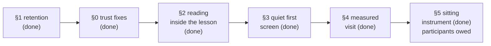

# MechaLab 2.1a — make the capability feel safe, joined up and quiet

This is the review's 2.1a ("study confidence") plan, rewritten after checking every claim against the
repository at `b93036a`. The review read `edad7b3`; two commits have landed since (the palette-pinned
Lighthouse gate and the local weight run for the shipped bundle shape), so anything that names a commit
is one release behind.

The purpose of this page is to keep the next slice chosen from evidence. Each review finding below is
marked **verified**, **stale** (true when written, no longer true), or **fixed in this slice**, with the
file and the check that settles it.



## What the review got right, and what moved

| # | Review finding | Verdict at `b93036a` |
| --- | --- | --- |
| 1 | Drafts evict past 12 lessons; notes evict past 25 | **Verified** — `MAX_DRAFTS` in [`app/src/lessonDraft.ts`](../app/src/lessonDraft.ts), `MAX_NOTE_LESSONS` in [`app/src/studyNotes.ts`](../app/src/studyNotes.ts). Both caps were applied on every write, including a restore. **Fixed in this slice**; see §1. |
| 2 | Reading leaves the workspace: "Read this page on GitHub" is the reading copy, and the **Read** preset means *results only* | **Verified** at `b93036a` — [`app/src/components/tabs/TabPyodideRunner.tsx`](../app/src/components/tabs/TabPyodideRunner.tsx) line ~3181, [`docs/ROUTE.md`](ROUTE.md), and a palette hit for a prose page opens GitHub ([`app/src/palette.ts`](../app/src/palette.ts) line 38). **Fixed in Run 229**: the lesson renders in a pane beside the editor, Read is the reading preset, and the position is remembered. See §2. |
| 3 | The everyday toolbar carries too many actions for one row | **Verified** — Run & Verify sits beside Watch, Vim, Format, History, Diff, Sharing, Pairing, Reset Runtime, Self-mark and the hint controls, most of them at 11–12.5 px ([`TabPyodideRunner.tsx`](../app/src/components/tabs/TabPyodideRunner.tsx)). Planned as §3. |
| 4 | Small labels (11–12.5 px) need a rendered check on an ordinary laptop | **Verified** — the same file and [`app/src/components/StudyPanel.tsx`](../app/src/components/StudyPanel.tsx) use 10.5–12.5 px for controls and metadata. The review's own caveat stands: source does not prove how it looks. Planned as §3. |
| 5 | Passing CI does not establish speed; Lighthouse excludes performance; the recorded bundle is `local_only` | **Partly stale.** The exclusion is deliberate and documented in [`scripts/check_lighthouse.mjs`](../scripts/check_lighthouse.mjs) — Best Practices, SEO and Accessibility are facts about the document; Performance on a runner is not. The `local_only` gap in the weight gate was closed in Run 226: [`docs/weight-budget.json`](weight-budget.json) now carries a `signed_in` block, and [`scripts/check_weight_budget.mjs`](../scripts/check_weight_budget.mjs) builds and grades that shape when `dist/` is local-only. What remains true is that **no timing is measured at all**. Planned as §4. |
| 6 | `package.json` still says `1.0.0`; the switch says "All 10 Engineering Labs" while the registry has 12 tabs | **Verified, both cheap; fixed in Run 228** — `labsSwitchLabel(WORKBENCH_TABS.length)` now renders *All 12 Engineering Labs (Technical Names)*, and `package.json` is `2.0.0`, read by [`app/src/appVersion.ts`](../app/src/appVersion.ts) and printed in the footer. See §0. |
| 7 | Zero non-author participants; the author walk is not beginner evidence | **Verified** — [`docs/pilot-results.md`](pilot-results.md) says N = 0 at every stage. **Fixed as far as code can**: §5's instrument landed in Runs 232–234 (a record per sitting, a debrief, the rendered observation ticket, the 7–14 day transfer check), and every success criterion is now a field a gate audits. The three beginners are still owed, and nothing in this plan claims completion before them. |
| 8 | Restore can silently drop older entries | **Verified for the old store** (a restore went through the capped writer). **Fixed in this slice**: every lesson is kept, and a refused write is reported instead of counted as restored. |

The review's overall direction — *make the workspace safer and simpler before adding capability* — is
right and is the order this plan uses.

## The rule this plan adopts: authored work is not cache

| Store | May it drop anything? | Why |
| --- | --- | --- |
| Drafts ([`lessonDraft.ts`](../app/src/lessonDraft.ts)) | **No count cap.** One draft per lesson, replaced in place. `MAX_DRAFT_CHARS` per draft only. | A half-written exercise is the progress. |
| Notes and highlights ([`studyNotes.ts`](../app/src/studyNotes.ts)) | **No count cap.** `MAX_NOTE_CHARS` per note, `MAX_HIGHLIGHTS` and the two 400-char caps per lesson. | What was understood is what a term of study is made of. |
| Progress flags ([`progressKeys.ts`](../app/src/progressKeys.ts)) | Never dropped; union-merged. | A tick is evidence of work. |
| Filed versions ([`draftHistory.ts`](../app/src/draftHistory.ts)) | Five per lesson, oldest per lesson; a total cap. | A version is a re-derivable snapshot of an edit. |
| Review schedules ([`studyCards.ts`](../app/src/studyCards.ts)) | 500 cards; a card exists while its highlight has a comment. | Derived from authored highlights. |
| Learning log ([`learningLog.ts`](../app/src/learningLog.ts)) | 5,000 events. | An event stream, not authored text. |
| Sittings ([`sittingClock.ts`](../app/src/sittingClock.ts)) | Merged only while one sitting is open. | A fact about one machine's clock. |

Two consequences are stated rather than hidden:

- **The `localStorage` fallback can fill.** It is only used when a browser refuses IndexedDB; the writer
  then returns `false`, and the editor and study panel say *Not saved — storage is blocked or full*
  instead of pretending. Authoring in IndexedDB (the normal path) is bounded by the disk, not 5 MB.
- **Per-lesson caps remain.** A lesson with more than 20 highlights keeps the newest 20, and a draft past
  40,000 characters is not stored. Those bound one page's cost; they never remove a lesson's history.

## §0 — Trust fixes (done in Run 228)

1. **The count comes from the registry.** `labsSwitchLabel(count)` in
   [`app/src/tabNames.ts`](../app/src/tabNames.ts) is called with `WORKBENCH_TABS.length`; the switch
   renders *All 12 Engineering Labs (Technical Names)*. `scripts/check_tab_names.py` now fails if
   App.tsx stops passing the registry count or hard-codes `All <number> Engineering Labs` again, and
   `npm run test:smoke` reads the rendered label in both views.
2. **The release identity is settled at 2.0.0.** `package.json` is the one place it lives; the footer
   prints `v2.0.0` through [`app/src/appVersion.ts`](../app/src/appVersion.ts), so a bug report can name
   the build it came from. `test:smoke` pins the footer against `package.json` and the version against
   semver — a second literal anywhere fails the suite.

**Acceptance:** `npm run test:tabnames` and `npm run test:smoke` pass; editing `workbenchTabs.json`
changes the switch's number without touching App.tsx; changing `package.json` changes the footer.

## §1 — Retention: no authored work is evicted (done in this slice)

What changed:

- `lessonDraft.ts`: the twelve-draft cap and its eviction sort are gone. Every edited lesson keeps its
  latest draft; `MAX_DRAFT_CHARS` stays. `saveDraft` returns `false` when the write is refused.
- `studyNotes.ts`: `MAX_NOTE_LESSONS` and the eviction sort in `writeStudy` are gone. A restore writes
  the whole merged store. `saveNote`, `addHighlight`, `setComment` and `replaceStudy` report a refused
  write instead of swallowing it.
- `StudyPanel.tsx`: a note, pin or comment that did not land says so and leaves the box dirty for the
  next attempt; a refused highlight keeps the selection.
- `backupBundle.ts`: a restore whose study write is refused reports `study.json (the store refused the
  write)` and does not count notes it did not write.

Acceptance (all run in this slice, all green):

```bash
npm run test:draft    # 14 edited lessons, all kept; refused write returns false
npm run test:study    # 40 notated lessons, all kept; restore keeps 30 of 30
npm run test:backup   # restore + cap arithmetic; archive ceiling under MAX_BACKUP_BYTES
```

**What this does not claim:** the fallback bucket still cannot hold an entire course at every per-entry
cap (measured in `test:backup`: ~6.5 M characters → ~13 MB), which is why the write must say when it
fails. The old "fits 5 MB at worst case" property is deliberately retired.

## §2 — Reading inside the lesson (done in Run 229)

The workspace is *lesson on the left, editor on the right, checks underneath*: that is Study now. Read
gives the text the window, because that is what a preset named Read should do.

```text
┌──────────────────────────────┬──────────────────────────────┐
│ LESSON                       │ CODE                         │
│ explanation · equations      │ main.py                      │
│ worked example · exercise    │ [ Run & Check ]              │
│ [ Highlight ] [ Top ]        ├──────────────────────────────┤
│                              │ OUTPUT / CHECKS              │
└──────────────────────────────┴──────────────────────────────┘
```

What shipped, against the implementation order this section asked for:

1. **One source.** `scripts/generate_lesson_pages.py` reads each registry entry's own Markdown page and
   writes `app/public/lesson-pages/<path>.json` — one file per page, served beside the bundle and fetched
   when the lesson opens. The page list is the registry's (`build_lessons`), not a glob, and `--check` is
   the drift gate. No lesson is stored twice.
2. **A small block payload, not HTML.** Headings keep GitHub's anchors (`github-slugger`'s rule,
   including the `-1` a repeated heading gets), and paragraphs, nested lists, tables, code fences, safety
   quotes, display maths and images are blocks. Inline emphasis, links, code spans and `$…$` maths stay
   Markdown in the payload and are parsed once in `app/src/readerMarkdown.ts`; KaTeX — already the app's
   maths renderer — draws the formulas. A block this build does not know is refused by
   `isLessonPage`, not painted raw, and a stale payload version is refused too. The generator skips what
   would be wrong here: the **Full Solution** (the diff panel and palette keep that behind Load Solution),
   the generated run callouts (the reader *is* the workbench), the ladder-gate exam and Mermaid.
3. **The link stays, demoted.** The pane's footer reads *View source on GitHub ↗* — for copying, printing
   and filing an issue — and a failed fetch says so and still offers it.
4. **Position is remembered, and is not a draft.** `app/src/readingPosition.ts` stores a heading anchor plus
   a pixel offset per lesson, in `localStorage`, in its own key: opening a lesson does not mark it edited
   and clearing a draft does not scroll the reader to the top. The anchor survives a page regenerated after
   a sentence changed; the offset is the fallback when a heading is gone. Writes are one per scroll pause
   and one on the way out.
5. **Highlights anchor to the rendered page.** Selecting in the pane offers **Highlight**, which writes the
   same quote-keyed highlight the notes panel reads, so "pin selected text" now means the lesson.
6. **Presets match their names.** Study = lesson + chooser + editor + results; Read = the lesson text at the
   window's height; Write and Debug do not render the pane at all (so they cost no fetch), and the chooser
   became a rail rather than a third of the work area. Docking moves the lesson text to the other edge in
   Study, with the editor still first in the DOM.

Acceptance, all run in this slice (green):

```bash
npm run test:reader                            # 21/21: inline rules, GitHub anchors, payload guard, position store
npm run test:layout                            # 24/24: four presets, docking, Debug's divider
python3 scripts/generate_lesson_pages.py --check # 92 pages current, 653.3 kB gzipped
python3 tests/test_lesson_pages.py             # 14/14: what the generator must and must not copy
npm run check:weight                           # reader_gzip 669.2 kB of 720 kB; entry 479.4 kB of 495 kB
npm run test:e2e:pages                         # Study reads beside the editor; a reload returns to the same heading
```

**What this does not claim:** the pane is a reading copy, not an editor — the full solution, the graded
checks and the code that runs stay the workbench's own controls. A page whose payload is missing says so
instead of rendering a blank card, and a lesson with no Markdown page says that too.

## §3 — A quiet first screen (done in Run 230)

The row at rest is four layout presets, the dock toggle, **More ⋯**, **Run & Verify** and **Predict**
— eight controls, measured. **Pause** and **Stop** join while a program runs, **Next lesson** is in
the passed card, and everything else is one press away behind More:

| Context | Appears |
| --- | --- |
| Running | Pause, Stop |
| Paused at a breakpoint | Continue, Step, Stop (in the park bar) |
| Failed run | Explain this error, the check's own hint rung |
| Passed | Next lesson, review card if a comment exists |
| Under More | Format with Black, History, Diff, Load Solution, Reset Starter, Reset Runtime, Breakpoints, Share, Pair, Vim keys, Watch, Self-Mark |

More is a disclosure, not a menu: `aria-expanded` / `aria-controls`, a `role="group"` panel, and
`Escape` closes it and puts focus back on the button. Every folded control keeps its testid and its
title, and stays in the DOM — the fold is visual, so an action is never absent for a keyboard or a
screen reader, only folded.

**The type scale was measured, not asserted.** `scripts/check_label_sizes.mjs` renders the built
bundle in Chromium at 1280×800 and reads computed sizes:

| What | Floor | Why |
| --- | --- | --- |
| Primary actions (Run, Stop, Pause, More, presets, dock) | 13 px | the controls a beginner presses first |
| Every other control | 12 px | the folded toolbar included |
| Metadata (counters, statuses, captions) | 11 px | secondary, never tiny |
| Lesson paragraphs | 17–18 px | reading text, h2 22 px, h3/h4 18 px, quotes 15.5 px |

The gate also holds the row itself: at most eight controls at rest, by id; More must reveal all
thirteen folded ids; and none of them may be visible before it is opened. That is what keeps
"quieter" from quietly becoming "hidden".

The capability is unchanged: no editor was shrunk and no action was removed. Only its default
visibility moved.

Acceptance, all run in this slice (green):

```bash
npm run check:labels    # PASS: 8 controls at rest, 12 behind More, lesson text 17 px at 1280x800
npm run test:e2e        # PASS: every moved action is still reached through More
npm run test:e2e:pages  # PASS on the built bundle, chromium and firefox
npm run test:runtime    # PASS: Breakpoints and Format with Black, now via More
npm run check:axe       # PASS: 12 tabs x 4 palettes, no serious/critical finding
npm run check:snapshot  # PASS after one re-record; the toolbar's extra row is the only move
```

**What this does not claim:** the measurement covers the Python runner's first screen at one laptop
size, because that is the screen the review named. The other eleven tabs keep their own type and are
still covered by `check:axe`, `test:theme:e2e` and `check:snapshot`; if this scale becomes the app's,
the gate should walk those tabs too.

## §4 — Measure the visit (done in Run 231)

`scripts/perf_walk.mjs` (`npm run test:perf`) drives the **built bundle** — served at the Pages base
path by `startStaticServer`, the same artifact `check:lighthouse` and `test:e2e:pages` grade — in the
same real Chromium the runtime suite uses, and records the six moments §4 asked for:

| Moment | What it means | How it is timed |
| --- | --- | --- |
| Navigation → lesson text | first paint that matters | `performance.now()` until the pane's own prose is on screen |
| Lesson text → first keystroke | CodeMirror is ready | until a typed character comes back through the editor bridge |
| First Run → first output | Pyodide warm, or the cost of warming | the click until the program's stdout carries its sentence |
| Warm Run → first output | the number a learner actually repeats | the same, with a different sentence so the previous run's output cannot satisfy it |
| Lesson switch → usable editor | cached lesson data | selecting the next lesson until its title and code are up and take a keystroke |
| Reload → draft restored | the storage promise | the new document's `Date.now() - performance.timeOrigin` until the typed draft is back |

**Two profiles, because an average of them describes neither.** `laptop` is 1440×900 at DPR 1 with no
throttling. `phone` is 390×844 at DPR 3 with **4× CPU slowdown and Lighthouse's own Slow 4G** (1.6 Mbit
down, 750 kbit up, 150 ms RTT), applied over the DevTools protocol before the first navigation. Both
pin the light palette and ask for reduced motion, so a stored palette or a fade's duration cannot
become a second variable.

The numbers live in [`docs/PERF.md`](PERF.md), one row per date, machine and profile, written by
`--record`; a number without the machine and the date is not a measurement. What is **gated** is the
ceilings in [`docs/perf-budget.json`](perf-budget.json), at roughly two to three times the recorded
value: a doubling fails, a busy afternoon does not. A moment the run could not measure, or one the
budget does not name, is a failure too — otherwise the gate would pass by omission.

**Why it is not a CI step.** CI's runner is a shared virtual machine, and the six moments would be a
function of its contention rather than of this app, which is exactly why Lighthouse's performance
category is not gated either. CI runs `npm run test:perf:unit` instead: it proves the page, the
budget and the walk still describe the same six moments, and that no recorded number sits above its
own ceiling. Cheap, no browser, and it fails the moment the doc drifts.

Acceptance, run in this slice (green):

```bash
npm run test:perf          # six moments on both profiles, each under its ceiling
npm run test:perf:unit     # 21/21: the budget's judgement, the row writer, and the shipped doc
npm run test:perf -- --record  # writes the two rows into docs/PERF.md
```

**What this does not claim:** the `phone` profile is desktop Chrome emulating a small viewport on a
slower CPU over a throttled link — a floor for what a phone pays, not that phone's number. The walk
measures the Python runner's first visit, the moments this plan named; the eleven other tabs still
have no timing gate (their cost is covered statically by `check:weight` and `check:snapshot`). And a
regression that lands while nobody runs the walk is caught by nothing until somebody does.

## §5 — One beginner sitting before any "finished" claim

Follow [`docs/PILOT.md`](PILOT.md): three non-author beginners, first lesson unaided, observer records
where they stop rather than helping. Success is not "completed the feature list"; it is: finds the first
lesson, edits, runs, understands one failure, continues without guidance. The author walk in
`pilot-results.md` stays labelled as an instrument check, never as evidence.

**The instrument is built; the participants are not.** No command can produce a non-author beginner, so
this section is finished in the only sense available to code: every criterion is a field, every field is
written by one command, and every claim is refused without its evidence.

| Criterion | Record field | Written by | Refused when |
| --- | --- | --- | --- |
| Finds the first lesson, unaided | `reached_lesson_1`, `minutes_to_lesson_1` | `--debrief` | yes with no minute; a minute past the sitting; `no` beside a minute |
| Where they stopped | `stops[]` (minute, page, tried, kind) | `--stop` as it happens | a stop with no minute, page or kind |
| Edits and runs | `runs`, `active_minutes`, `elapsed_minutes` | `--finish`, from the export | numbers that drifted from the export's sittings |
| Understands one failure | `understood_error` (+ `--error-quote`) | `--debrief` | the export contradicts the help type |
| Continues without guidance | `knew_next`, `help`, `person_hints` | `--debrief`, `--finish` | `person` help with no count; a hint the log does not record |
| Finished | `finished`, `run_verify`, `finished_minutes` | `--debrief` | finished without a verified export and the graded loop |
| The finding leaves the room | — | `--issue` | any of the above, since the body is withheld |

The order is [`docs/PILOT_KIT.md`](PILOT_KIT.md)'s: open the record, log stops as they happen, finish from
the export, debrief the answers, check, file the observation. The transfer question is the 7–14 day
follow-up ([`scripts/pilot_followup.py`](../scripts/pilot_followup.py)), because a question asked the same
day measures memory.

**Acceptance:** `docs/pilot-results.md` gains a real row with N ≥ 3, or the release notes keep saying
"no beginner evidence yet". `npm run check:pilot` still validates the kit, and now also that the answers
cannot be written as claims without their evidence.

**What this does not claim:** these sittings are run by the course author, so a participant recruited that
way is self-selected and a row is a first reading, not a sample. `--status` prints `N (non-author) = 0`
until a folder holds an export **and** an answered record, and `pilot-results.md` stays the template it
says it is.

## Order, and what this plan refuses

Risk and value first: **§1 and §0 (done) → §2 (done) → §3 (done) → §4 (done) → §5 (instrument done)**.
§2 was the release; §3 and §4 were a week each; §5 decides whether the release may be called convenient,
and nothing in this plan may claim it before three beginners have sat down. What remains is not code: it
is three people, one timer and the operator's own `--stop` key.

Not in 2.1a: new tabs or runtimes, a different editor, uPlot, cloud sync, a second design system, or any
cap that deletes a lesson's authored work to make a number smaller. The review's closing line is the
plan's closing line: make the capability feel quieter, safer and more connected — do not add more of it.
