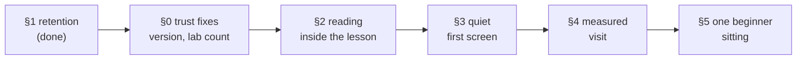

# MechaLab 2.1a — make the capability feel safe, joined up and quiet

This is the review's 2.1a ("study confidence") plan, rewritten after checking every claim against the
repository at `b93036a`. The review read `edad7b3`; two commits have landed since (the palette-pinned
Lighthouse gate and the local weight run for the shipped bundle shape), so anything that names a commit
is one release behind.

The purpose of this page is to keep the next slice chosen from evidence. Each review finding below is
marked **verified**, **stale** (true when written, no longer true), or **fixed in this slice**, with the
file and the check that settles it.



## What the review got right, and what moved

| # | Review finding | Verdict at `b93036a` |
| --- | --- | --- |
| 1 | Drafts evict past 12 lessons; notes evict past 25 | **Verified** — `MAX_DRAFTS` in [`app/src/lessonDraft.ts`](../app/src/lessonDraft.ts), `MAX_NOTE_LESSONS` in [`app/src/studyNotes.ts`](../app/src/studyNotes.ts). Both caps were applied on every write, including a restore. **Fixed in this slice**; see §1. |
| 2 | Reading leaves the workspace: "Read this page on GitHub" is the reading copy, and the **Read** preset means *results only* | **Verified** — [`app/src/components/tabs/TabPyodideRunner.tsx`](../app/src/components/tabs/TabPyodideRunner.tsx) line ~3181, [`docs/ROUTE.md`](ROUTE.md), and a palette hit for a prose page opens GitHub ([`app/src/palette.ts`](../app/src/palette.ts) line 38). The **Read** preset hides the chooser and editor and shows the results ([`docs/PLAN-2.0-GAP.md`](PLAN-2.0-GAP.md), layout row). Planned as §2. |
| 3 | The everyday toolbar carries too many actions for one row | **Verified** — Run & Verify sits beside Watch, Vim, Format, History, Diff, Sharing, Pairing, Reset Runtime, Self-mark and the hint controls, most of them at 11–12.5 px ([`TabPyodideRunner.tsx`](../app/src/components/tabs/TabPyodideRunner.tsx)). Planned as §3. |
| 4 | Small labels (11–12.5 px) need a rendered check on an ordinary laptop | **Verified** — the same file and [`app/src/components/StudyPanel.tsx`](../app/src/components/StudyPanel.tsx) use 10.5–12.5 px for controls and metadata. The review's own caveat stands: source does not prove how it looks. Planned as §3. |
| 5 | Passing CI does not establish speed; Lighthouse excludes performance; the recorded bundle is `local_only` | **Partly stale.** The exclusion is deliberate and documented in [`scripts/check_lighthouse.mjs`](../scripts/check_lighthouse.mjs) — Best Practices, SEO and Accessibility are facts about the document; Performance on a runner is not. The `local_only` gap in the weight gate was closed in Run 226: [`docs/weight-budget.json`](weight-budget.json) now carries a `signed_in` block, and [`scripts/check_weight_budget.mjs`](../scripts/check_weight_budget.mjs) builds and grades that shape when `dist/` is local-only. What remains true is that **no timing is measured at all**. Planned as §4. |
| 6 | `package.json` still says `1.0.0`; the switch says "All 10 Engineering Labs" while the registry has 12 tabs | **Verified, both cheap** — [`package.json`](../package.json), [`app/src/App.tsx`](../app/src/App.tsx) line 1205 against [`app/src/data/workbenchTabs.json`](../app/src/data/workbenchTabs.json). Do these first; see §0. |
| 7 | Zero non-author participants; the author walk is not beginner evidence | **Verified** — [`docs/pilot-results.md`](pilot-results.md) says N = 0 at every stage. Planned as §5; nothing in this plan may claim completion before it. |
| 8 | Restore can silently drop older entries | **Verified for the old store** (a restore went through the capped writer). **Fixed in this slice**: every lesson is kept, and a refused write is reported instead of counted as restored. |

The review's overall direction — *make the workspace safer and simpler before adding capability* — is
right and is the order this plan uses.

## The rule this plan adopts: authored work is not cache

| Store | May it drop anything? | Why |
| --- | --- | --- |
| Drafts ([`lessonDraft.ts`](../app/src/lessonDraft.ts)) | **No count cap.** One draft per lesson, replaced in place. `MAX_DRAFT_CHARS` per draft only. | A half-written exercise is the progress. |
| Notes and highlights ([`studyNotes.ts`](../app/src/studyNotes.ts)) | **No count cap.** `MAX_NOTE_CHARS` per note, `MAX_HIGHLIGHTS` and the two 400-char caps per lesson. | What was understood is what a term of study is made of. |
| Progress flags ([`progressKeys.ts`](../app/src/progressKeys.ts)) | Never dropped; union-merged. | A tick is evidence of work. |
| Filed versions ([`draftHistory.ts`](../app/src/draftHistory.ts)) | Five per lesson, oldest per lesson; a total cap. | A version is a re-derivable snapshot of an edit. |
| Review schedules ([`studyCards.ts`](../app/src/studyCards.ts)) | 500 cards; a card exists while its highlight has a comment. | Derived from authored highlights. |
| Learning log ([`learningLog.ts`](../app/src/learningLog.ts)) | 5,000 events. | An event stream, not authored text. |
| Sittings ([`sittingClock.ts`](../app/src/sittingClock.ts)) | Merged only while one sitting is open. | A fact about one machine's clock. |

Two consequences are stated rather than hidden:

- **The `localStorage` fallback can fill.** It is only used when a browser refuses IndexedDB; the writer
  then returns `false`, and the editor and study panel say *Not saved — storage is blocked or full*
  instead of pretending. Authoring in IndexedDB (the normal path) is bounded by the disk, not 5 MB.
- **Per-lesson caps remain.** A lesson with more than 20 highlights keeps the newest 20, and a draft past
  40,000 characters is not stored. Those bound one page's cost; they never remove a lesson's history.

## §0 — Trust fixes (an afternoon, no design work)

1. Derive the lab switch's label from `WORKBENCH_TABS.length` instead of the hard-coded "All 10
   Engineering Labs", so the count cannot disagree with the registry again.
2. Decide the release identity once: either `version` in `package.json` becomes the 2.x identity and an
   in-app build identifier reads it, or the review's premise is wrong and 1.0.0 stays. Do not half-change
   it. **Acceptance:** `npm run test:tabnames` (or the layout suite that already counts tabs) fails if the
   label and the registry disagree; `npm run build` shows the chosen version.

## §1 — Retention: no authored work is evicted (done in this slice)

What changed:

- `lessonDraft.ts`: the twelve-draft cap and its eviction sort are gone. Every edited lesson keeps its
  latest draft; `MAX_DRAFT_CHARS` stays. `saveDraft` returns `false` when the write is refused.
- `studyNotes.ts`: `MAX_NOTE_LESSONS` and the eviction sort in `writeStudy` are gone. A restore writes
  the whole merged store. `saveNote`, `addHighlight`, `setComment` and `replaceStudy` report a refused
  write instead of swallowing it.
- `StudyPanel.tsx`: a note, pin or comment that did not land says so and leaves the box dirty for the
  next attempt; a refused highlight keeps the selection.
- `backupBundle.ts`: a restore whose study write is refused reports `study.json (the store refused the
  write)` and does not count notes it did not write.

Acceptance (all run in this slice, all green):

```bash
npm run test:draft    # 14 edited lessons, all kept; refused write returns false
npm run test:study    # 40 notated lessons, all kept; restore keeps 30 of 30
npm run test:backup   # restore + cap arithmetic; archive ceiling under MAX_BACKUP_BYTES
```

**What this does not claim:** the fallback bucket still cannot hold an entire course at every per-entry
cap (measured in `test:backup`: ~6.5 M characters → ~13 MB), which is why the write must say when it
fails. The old "fits 5 MB at worst case" property is deliberately retired.

## §2 — Reading inside the lesson (the largest usability investment)

The workspace should be *lesson on the left, editor on the right, checks underneath*:

```text
┌──────────────────────────────┬──────────────────────────────┐
│ LESSON                       │ CODE                         │
│ explanation · equations      │ main.py                      │
│ worked example · exercise    │ [ Run & Check ]              │
│ [ Add note ] [ Highlight ]   ├──────────────────────────────┤
│                              │ OUTPUT / CHECKS              │
└──────────────────────────────┴──────────────────────────────┘
```

Implementation direction, in the order that keeps it cheap:

1. **One source.** Generate the reader's payload at build time from the course Markdown, next to
   `prose-index.json` (`scripts/generate_prose_index.py` already reads every page). Do not maintain a
   second copy of a lesson in TypeScript.
2. **Render what the pages already use**: headings and anchors, lists, tables, code fences, callouts,
   images. KaTeX is already a dependency for the maths. A hand-written renderer is acceptable only if it
   is pinned by a fixture per construct; otherwise take the smallest maintained Markdown renderer and
   measure it into `sources_gzip`/entry like any other library.
3. **The link stays, demoted.** "View source on GitHub" remains for copying, issues and printing; it is
   no longer *the* reading copy.
4. **Position is remembered**, per lesson, like a draft — and it is not a draft (it must not make a lesson
   look edited).
5. **Highlights anchor to the rendered page.** Selection already produces quote-keyed highlights; the
   reader is the surface that makes "pin selected text" mean the lesson rather than the brief.
6. **Presets match their names**: Study = lesson + editor + compact results; Read = lesson-focused;
   Write = editor-focused; Debug = editor + checks + debugging tools. Rename the old Read preset if it
   keeps its results-only meaning.

**Acceptance:** `npm run test:reader` (new) pins the renderer fixtures and the reading-position store;
`npm run test:layout` pins the four presets' regions; `npm run test:e2e:pages` opens a lesson, reads a
rendered heading and an equation in the DOM, reloads and finds the same scroll anchor. Bundle cost is
recorded in `check:weight`, not hidden in the entry.

## §3 — A quiet first screen

Keep visible: **Run & Check**, **Stop** while running, **Hints**, **Notes**, **More ⋯**, and
**Next lesson** once passed. Everything else moves behind `More` or becomes contextual:

| Context | Appears |
| --- | --- |
| Running | Stop, elapsed time |
| Paused at a breakpoint | Continue, Step, stop |
| Failed run | Explain this error, the check's own hint rung |
| Passed | Next lesson, review card if a comment exists |
| Under More | Format with Black, History/Diff, Reset Runtime, Reset Starter, Solution, Share, Pair, editor preferences, Vim |

Type scale, pending the rendered check the review asked for: 17–18 px reading text, 13–14 px controls,
12 px metadata; 11 px only for genuinely secondary labels. Do not shrink the editor to make room — the
capability stays, only its default visibility changes.

**Acceptance:** `npm run test:e2e` still reaches every moved action through `More`; `npm run check:axe`
stays green; a keyboard path exists for every always-visible action.

## §4 — Measure the visit, then split only if the measurement says so

Write `scripts/perf_walk.mjs` (Playwright, the same real Chromium the runtime suite uses) to record, on a
named laptop and a throttled phone profile:

| Moment | What it means |
| --- | --- |
| Navigation → lesson visible | first paint that matters |
| Lesson visible → editor accepts a keystroke | CodeMirror is ready |
| First Run → first output | Pyodide warm, or the cost of warming |
| Warm Run → first output | the number a learner actually repeats |
| Lesson switch → usable editor | cached lesson data |
| Reload → draft and notes restored | the storage promise |

Store the numbers in `docs/PERF.md` with the machine and date; a number without both is not a
measurement. Gate only *regressions* (a generous ceiling per moment), never a score. Current bundle
facts are in [`docs/weight-budget.json`](weight-budget.json): entry 473,064 B gzipped, largest chunk
300,791 B, both graded for the signed-in shape on every `check:weight` run.

**Acceptance:** `npm run test:perf` prints all six moments for a build; `docs/PERF.md` has one row per
date and machine; `check:weight` continues to grade both shapes.

## §5 — One beginner sitting before any "finished" claim

Follow [`docs/PILOT.md`](PILOT.md): three non-author beginners, first lesson unaided, observer records
where they stop rather than helping. Success is not "completed the feature list"; it is: finds the first
lesson, edits, runs, understands one failure, continues without guidance. The author walk in
`pilot-results.md` stays labelled as an instrument check, never as evidence.

**Acceptance:** `docs/pilot-results.md` gains a real row with N ≥ 3, or the release notes keep saying
"no beginner evidence yet". `npm run check:pilot` still validates the kit.

## Order, and what this plan refuses

Risk and value first: **§1 (done) → §0 → §2 → §3 → §4 → §5**. §0 is hours; §2 is the release; §3 and §4
are a week each; §5 decides whether the release may be called convenient.

Not in 2.1a: new tabs or runtimes, a different editor, uPlot, cloud sync, a second design system, or any
cap that deletes a lesson's authored work to make a number smaller. The review's closing line is the
plan's closing line: make the capability feel quieter, safer and more connected — do not add more of it.
