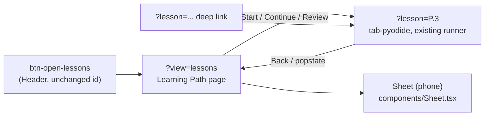

# MechaLab Learning Path — implementation plan

Status: **Phases 2 and 3 shipped in 4.22.0.** The page, the model and the six-lesson prototype are
implemented and gated; the rest of the phased order in §13 is still planned. This page answers the
fourteen questions the brief asks of the first task. It names real files and real line numbers, and
it records where the brief's assumptions do not match the repository — the references below are the
ones the plan was written against, not a claim that later work left them at those lines.

**What shipped (2026-11-24).** `?view=lessons` is a whole page in the `HomePage` union, and
`btn-open-lessons` opens it from all three headers. Start saves the offset, pushes `?lesson=`, calls
the runner's own `openLesson`, and one `popstate` listener restores the page and the lesson. The
prototype is P.1, P.2, P.2.5, P.3, P.4 and P.5 in real curriculum order; states come from the
verified map (completed / current / available / locked with one-step lookahead), locked platforms
preview only and name their predecessor, and the runner still opens every lesson by id. The six
inline-SVG landmarks, the desktop card, the phone `Sheet`, the lazy CSS sheet and the reduced-motion
rules are in `app/src/components/learningPath/`. No XP, stars, duration or prerequisite store was
added. Tests: `scripts/test_learning_path.mjs` and `scripts/e2e_learning_path.mjs`; `e2e_micro.mjs`
now reaches the runner through the path. Still open: the remaining phases below, and the brief's
minimap, streak display, district entrance transitions and richer city scenery from §14.1.

---

## 1. The application as it is today

### 1.1 The shell: pages, then tabs

`app/src/App.tsx` owns two levels of navigation.

* A **whole page** is a `HomePage` (`app/src/homeLanding.ts`): `workbench`, `home`, `admin`, `intro`.
  `openPage` (`App.tsx:1192`) sets the state, records the visit and writes `?view=<page>` with
  `history.replaceState`. `landingPage()` in `homeLanding.ts` decides which page a URL and a sitting
  open on, and `?lesson=` outranks the sitting rule.
* A **tab** is one of sixteen entries in `app/src/tabRegistry.tsx`, typed by `TabId`
  (`app/src/types.ts:1`). The runner is `tab-pyodide` (`tabRegistry.tsx:145`), the only tab with no
  lazy boundary because it is the tab the app opens on.

The brief's "Learning Path as the destination" therefore has two candidate shapes: a new whole page
(reachable at `?view=lessons`) or a seventeenth tab. Section 4 recommends the page.

### 1.2 The lesson list and the lesson experience

The runner already contains the real lesson browser and the real lesson player:

* `TabPyodideRunner.tsx` mounts `LessonChooser` (`app/src/components/LessonChooser.tsx`) in two
  places: the desktop rail (from `LessonRailToggle`, around line 2017) and the phone sheet
  (`TabPyodideRunner.tsx:2979-2987`, `testId="lesson-sheet"`). The chooser owns search, four track
  filters, the verified mark and the current row; it does not own previews or actions.
* `LessonChooser`'s props are the data a Learning Path preview needs (`LessonChooser.tsx:29-69`):
  `lessons`, `filteredLessons`, `trackFilter`, `onTrackFilter`, `searchQuery`, `onSearchQuery`,
  `currentId`, `verifiedLessons`, `completedLessons`, `onSelect`, plus the optional `onClose`.
* Choosing a row calls `selectLesson` (`TabPyodideRunner.tsx:938`): it writes the outgoing draft,
  records the phone surface, closes the sheet, remembers the last lesson, loads the draft or starter,
  resets hints, breakpoints and watches, and runs the lesson request.
* `App.openLesson` (`App.tsx:1364`) is the one door from any surface into a lesson: it sets
  `pyodideLessonId`, bumps a `lessonRequest` nonce and switches to `tab-pyodide`. `openLessonFromHome`
  (`App.tsx:1202`) does the same after `openPage('workbench')`.

### 1.3 `btn-open-lessons`, exactly

* Rendered once, in the shared header: `app/src/components/Header.tsx:376`, id preserved, inside the
  `role="group"` Navigate tray, between Review and Free study.
* Wired from three call sites, all to the same handler: `App.tsx:1888` (Home header), `App.tsx:2032`
  (the second whole-page header) and `App.tsx:2158` (the workbench header). Each is
  `onOpenLessons={() => openTabFromHome('tab-pyodide')}`; `openTabFromHome` (`App.tsx:1224`) calls
  `openPage('workbench')` and `setActiveTab('tab-pyodide')`.
* Today, pressing it lands on the runner: the editor, the desktop lesson rail or the phone lesson
  sheet, with whatever lesson was last open.
* Two browser suites pin that tray order and the button's behavior: `scripts/e2e_micro.mjs:117-136`
  (clicks the button and waits for `lesson-brief`) and `scripts/e2e_studio.mjs:198-207`. The first
  must change with the destination; the second only checks the tray order.

---

## 2. Curriculum, progress, rewards: what exists and what does not

### 2.1 Curriculum

`app/src/data/pythonLessonsData.ts` is generated by `scripts/generate_python_lessons_data.py` and is
the single curriculum registry for the runner: **97 entries**, each a `PythonLessonItem` (id, title,
goal, requirements, track, path, readerPath, ideas, starter, hints, fullSolution, expectedOutput,
outputMatch, instructor test summary and tests). The `track` values in today's build:

| track | entries |
| :-- | --: |
| `track-p` | 16 (P.1 … P.14, P.2.5 and the P.M capstone) |
| `ramp` | 6 |
| `modules` | 50 |
| `stage-0` | 2 |
| `00-foundations` … `08-capstone-projects` | 23 across nine route tracks |

The P track is the brief's "Python Tier 1" neighbourhood. The six-lesson prototype maps to real rows:
`P.1`, `P.2`, `P.2.5`, `P.3`, `P.4`, `P.5` — **not** an invented order; the actual sixth entry of the
Python track is `P.5`, and `P.2.5` sits between `P.2` and `P.3`. There is no `python-variables`
identifier and no `subjectId`; the existing id and `track` fields are authoritative.

### 2.2 Progress and prerequisites

* Verified and completed are two independent flag maps, read from `localStorage` by `readFlagMap`
  (`app/src/progressKeys.ts`) into `verifiedLessons` / `completedLessons` in `App.tsx`, and passed to
  every tab through `WorkbenchTabContext` (`tabRegistry.tsx:40-42`). Cloud sync merges the same maps
  (`cloudProgress.ts`, `progressMerge.ts`), and reset/backup own their lifecycle.
* **There is no per-lesson prerequisite field and no prerequisite check** in the runner: every row in
  `LessonChooser` can be opened, and a deep link or search hit opens any lesson directly. The brief's
  "reuse existing prerequisite validation" therefore has nothing to reuse. Section 14 proposes the
  smallest honest rule (sequence inside the Python track, verified is the gate) and asks for sign-off
  because it changes what a learner can press.
* `readPhoneSurface` (`app/src/phoneSurface.ts`) remembers which half of Study a phone last used, so
  a lesson opened from the path can land on its text or its code exactly as it does from the chooser.

### 2.3 Rewards, XP, stars, durations

There is a reward engine, but it is **not** per-lesson XP or stars:

* `app/src/gamification/` holds levels (`levels.ts`), proof marks and Street Cred
  (`rewards.ts`), the ledger (`awardStore.ts`), missions (`missions.ts`) and night shifts. A level is
  earned by verified missions only; no XP counter exists anywhere in `app/src`.
* There is no star model, and `PythonLessonItem` has **no estimated duration**. The only published
  hours are per route step (`curriculumData` / generated route data), not per exercise.

The brief's preview shows "Reward: 50 XP" and "Earned stars". Building those means inventing a second
reward model beside the existing one. Section 14 records this as an unresolved decision; the prototype
proposal is to show what the app can prove (verified/completed, requirement count, estimated minutes
from the reader's measured pace once one exists) and to leave XP and stars out until the reward owner
says otherwise.

---

## 3. The brief's "continuous city" versus this repository

The repository has an illustration system, but it is not a 3D kit: `app/src/visuals/` draws inline SVG
figures (`Diagram.tsx`, `Hologram.tsx`, `ReaderFigure.tsx`, `scenes.ts`) from tokens in
`app/src/index.css`, and `docs/VISUALS.md` is the contract for what a figure may cost. There is no
raster asset pipeline beyond `app/src/assets/fonts/` and no WebGL scene.

A performant first release is therefore: **one inline-SVG landmark per lesson kind**, a CSS-drawn
platform and path, and scenery built from a handful of reusable SVG groups — not a 3D engine. That is
the brief's own "prefer lightweight SVG/CSS" requirement and the only shape that fits the bundle
budget.

---

## 4. Recommended destination: a whole page, not a seventeenth tab

**Decision: `btn-open-lessons` becomes `openPage('lessons')`.** The page renders the Learning Path;
the runner keeps its lesson experience and its rail/sheet.

Why not a tab:

| Existing contract | What a seventeenth tab would cost |
| :-- | :-- |
| `docs/surface-snapshot.json` | Records region geometry, control counts and colours for 72 surfaces (sixteen tabs, Home and the Workflow canvas, every audited palette). A tab must be re-recorded and diffed. |
| `docs/plan-facts.json` + `scripts/check_plan_rows.py` | The tab-registry count is a number the docs quote and the gate recomputes. |
| `scripts/check_tab_names.py` | Every new tab needs a shared name in `tabNames`, and the phone picker's rows are enumerated by its own suites. |
| `docs/animation-budget.json` | Every tab gets a looping-animation count; a new surface starts at zero and is measured. |
| `railCollapse`, `prefetchTab`, walkthrough counts, phone tab picker | Each has a per-tab table that a new entry must join. |

A whole page costs one `HomePage` union member, one `landingPage` clause, one header branch (the app
already renders pages through the shared header) and one lazy component. It does **not** touch the tab
registry, the snapshot's sixteen tabs, the animation budget or the phone picker.

**What is preserved:** the button's id, its placement and its tray order; every existing lesson id and
`?lesson=` link; the runner and its chooser; `openLesson` as the only way into a lesson.

**What changes on purpose:** pressing the button no longer lands directly on the editor. The two tests
that assert that (`e2e_micro.mjs:132`, and the Home→runner expectations around it) are updated to go
through the path, or to open the runner directly where they are testing something else. This is the
one behavior the brief explicitly asks to change, so it is listed as an acceptance row rather than
hidden.

---

## 5. URLs, back navigation and scroll restoration

* `?view=lessons` opens the path. `openPage` already writes `?view=`; add `'lessons'` to
  `HomePage` and to `landingPage`'s explicit-view branch. A reload returns to the path, and
  `?lesson=` still outranks it, so a shared lesson link keeps working.
* **Start/Continue/Review** calls a new `App.startLessonFromPath(id)`:
  1. remember the path scroll position and the selected node in module stores;
  2. `history.pushState` to the workbench URL (this is the one place a push is correct: Back should
     return to the path, unlike a tab switch);
  3. `openPage('workbench')`, `setActiveTab('tab-pyodide')`, and the existing `lessonRequest` bump.
* A single `popstate` listener in `App.tsx` (there is none today) reads the URL and sets the page from
  `pageFromLocation()`, then restores the path scroll if the page is `lessons`. It is guarded for the
  SSR smoke test where `window` has no history.
* `app/src/learningPathScroll.ts` (new, pure, testable) stores `{ y, selectedId }` in
  `sessionStorage` under one key, restores after the first paint with `requestAnimationFrame`, and
  falls back silently when storage throws (private mode).
* On a phone, `openLesson` already skips its desktop `scrollIntoView`; the path page's restored
  position is the only scroll that moves.

---

## 6. Data architecture: one model, two layouts

New pure modules, no parallel curriculum:

**`app/src/learningPath.ts`**
* `pathNodes(lessons: PythonLessonItem[], progress): PathNode[]` — consumes `PYTHON_LESSONS` and the
  verified/completed maps, never a copy of the curriculum.
* A `PathNode` carries `{ lesson, regionId, index, state: 'completed' | 'current' | 'available' |
  'locked', landmark, position }`.
* `state` rules: `completed` = verified; `current` = first unverified entry in the learner's
  course order (the same "next" the runner already computes); `locked` = an unverified entry after a
  gap when the (opt-in) sequence rule is on; otherwise `available`.
* Regions map the existing `track` values to five visual identities. The brief's five subjects do not
  exist as subjects in this data; `track-p` = the programming labs, `ramp` and the route tracks =
  electronics/robotics/CAD/mathematics by their own track names. The mapping table lives in
  `app/src/learningPathRegions.ts` and is data, not layout.
* `prerequisiteFor(node)` returns the previous Python-track entry or `null`; `pathAction(node)` returns
  `{ kind: 'start' | 'continue' | 'review' | 'locked', label }` from the same state. Both are pure and
  unit-tested.

**`app/src/learningPathLandmarks.tsx`**
* `landmarkKey(lesson)` — keyword/lesson-id mapping (`variables` → `storage-tower`, `arithmetic` →
  `operator-tower`, `conditions` → `branch-arch`, `loops` → `ring-tower`, `functions` →
  `robot-factory`, `lists` → `library-tower`, …, fallback per region).
* `LANDMARKS: Record<LandmarkKey, React.FC<{ state; id }>>` — the six prototype structures plus the
  fallbacks, all inline SVG. A lesson without dedicated art gets its region's fallback silhouette, so
  no platform is ever empty.
* Art is replaceable by key without touching layout, as the brief requires.

**`app/src/learningPathLayout.ts`**
* `layoutFor(count, { columns, spread, rowGap })` → `{ x, y, row, side }[]`. Desktop: four per row,
  serpentine, alternating direction. Mobile: one per row, alternating left/right. The same node order
  feeds both; CSS consumes the coordinates, not a second list.
* `regionBands(nodes)` → the minimap's bands and the scroll anchors.

---

## 7. Visual system and interactions

### States (all four, in one component)

| State | Platform | Landmark | Label |
| :-- | :-- | :-- | :-- |
| Completed | full colour, golden rim | full colour, one sparkle field | green check, title, verified mark |
| Current | cyan dashed ring **on the platform**, 2 px glow, lifted 4 px | full colour | "Current" chip (text, not colour alone) |
| Available | normal platform | full colour | title, number |
| Locked | muted platform | 45 % saturation silhouette | lock icon + title; prerequisite named in the preview |

The dashed ring lives on the platform element (`data-platform`), not around the landmark SVG, which is
the brief's explicit requirement. Reduced motion (`useMotion`) drops the idle bob, the sparkle drift
and the current-pulse; the dashed ring remains static. Status is never colour-only: check/lock glyphs
and text carry it too.

### Desktop

* Winding rows of four, alternating direction, joined by one SVG road with a dashed centre line; the
  road is drawn from the same `layoutFor` points.
* Hover: platform lifts 4 px, landmark scales 1.03, card appears anchored to the node
  (`position: fixed` from `getBoundingClientRect`, re-placed on scroll/resize with one rAF-throttled
  listener). Escape and an outside press close it; focus returns to the node. Hover never navigates.
* Click selects (persistent ring) and opens the same card; "Start/Continue/Review" is the only door.
* A minimap in the page header: region bands, node dots by state, current marker. Optional and
  collapsible; selecting a node scrolls to it and opens its card.

### Mobile

* One column, alternating left/right, names always visible; 44 px minimum targets; no horizontal
  scrolling.
* Tap selects, then opens `Sheet` (`components/Sheet.tsx`) — the same dialog the chooser already uses,
  with its focus trap, Escape, outside-tap close and safe-area padding. Not a second sheet component.
* The minimap becomes a compact course strip in the sheet footer.

### Preview content

Title, goal sentence (existing `goal`), track/region, state, requirement count and the action that
state allows; prerequisites only when locked. XP, stars and duration are omitted until Section 14 is
decided.

---

## 8. Files

### New

| Path | Responsibility |
| :-- | :-- |
| `app/src/components/learningPath/LearningPathPage.tsx` | Page frame, header, world, minimap, preview mount; lazy-loaded. |
| `app/src/components/learningPath/LessonPlatform.tsx` | Platform, state ring, label, landmark slot, focus target. |
| `app/src/components/learningPath/LessonPreview.tsx` | Desktop anchored card and mobile sheet body, one content component. |
| `app/src/components/learningPath/CourseMiniMap.tsx` | Region bands, state dots, current marker, jump. |
| `app/src/components/learningPath/WorldScenery.tsx` | Skyline, labs, water, trees as reusable SVG groups. |
| `app/src/learningPath.ts` | Pure nodes, states, actions, prerequisites. |
| `app/src/learningPathRegions.ts` | Track → region identity, labels, scenery palette. |
| `app/src/learningPathLandmarks.tsx` | Landmark mapping and inline-SVG kit. |
| `app/src/learningPathLayout.ts` | Serpentine/vertical coordinates and minimap bands. |
| `app/src/learningPathScroll.ts` | Session scroll/selection store. |
| `scripts/test_learning_path.mjs` | Unit suite for the four pure modules. |
| `scripts/e2e_learning_path.mjs` | Browser suite: button, states, card, sheet, start, back, scroll. |

### Modified

| Path | Change |
| :-- | :-- |
| `app/src/homeLanding.ts` | `HomePage` gains `'lessons'`; `landingPage` accepts `?view=lessons`; reload stays. |
| `app/src/App.tsx` | Three `onOpenLessons` sites → `openPage('lessons')`; lazy page; `startLessonFromPath` + `popstate`; pass progress/verified maps and `openLesson`. |
| `app/src/components/Header.tsx` | No id or placement change; the tooltip copy says the path, not the runner. |
| `app/src/index.css` | Platform, ring, road, scenery and reduced-motion rules; measured and budgeted (Section 10). |
| `scripts/e2e_micro.mjs` | The `btn-open-lessons` click now lands on the path; open the runner directly for the tray assertion, or walk through the path. |
| `docs/README.md` | One row under "Building the workbench". |
| `docs/surface-snapshot.json` | Re-record **only** if the path is added as a surface; it is a page, so the existing 72 entries should stay untouched. |
| `docs/animation-budget.json` | Add `lessons` with its looping-animation count (1: the current ring pulse; 0 under reduced motion). |
| `docs/weight-budget.json` | Only if measurement demands it, with a `_why_budget_<date>_<slug>` note in the established form. |

`app/src/components/LessonChooser.tsx`, `TabPyodideRunner.tsx` and `lessonRoute.ts` need **no** change:
the path links into them rather than duplicating them.

---

## 9. Assets

* No new dependency, font, raster or WebGL scene.
* Six prototype landmarks plus region fallbacks as inline SVG, using only theme tokens
  (`--accent`, `--line`, `--panel`, `--ink`, muted variants), so both palettes and the paper theme keep
  working and `docs/THEME.md`'s token contract holds.
* Scenery uses at most three reusable groups (skyline, lab block, water) and CSS gradients already in
  the stylesheet, so the DOM stays small: one node per lesson, one label, one SVG.
* Icons come from `lucide-react` (already a dependency): check, lock, star only if Section 14 approves
  a star model.

---

## 10. Performance, weight and accessibility budgets

The measured constraints today, from `npm run check:weight`:

| Metric | Measured | Ceiling | Room |
| :-- | --: | --: | --: |
| `css_gzip` | 37,446 B | 37,800 B | **354 B** |
| `entry_gzip` (local) | 661.1 kB | 671 kB | ~10 kB |
| `entry_gzip` (signed-in) | 662.9 kB | 673 kB | ~10 kB |
| `js_gzip` (all emitted) | — | 1,279,000 B | a few kB |
| `total` | 4.04 MB | 4.048 MB | ~8 kB |

Plan:

* The page is a `React.lazy` chunk, so `entry_gzip` pays one declaration, not the world. It lands in
  `js_gzip` (emitted bytes), which the gate counts whether or not the page is opened.
* CSS is the tight one: the platform/ring/road rules will exceed 354 B. The honest move, in this
  repo's own convention, is to measure after the build and hand-raise `css_gzip` with a
  `_why_budget_<date>_learning_path` note that quotes the measurement and says no library was added.
  Do not style the page with hundreds of arbitrary utilities to dodge the metric; it would spend the
  same bytes in HTML classes and make the page unreadable.
* One delegated rAF-throttled scroll/resize listener for the card, no per-node listeners; at most one
  looping animation on the page; `prefers-reduced-motion` and `useMotion` both silence it.
* Accessibility: real buttons for platforms, `aria-current` on the current node, visible focus rings,
  the `Sheet`'s focus trap on mobile, text/glyph status besides colour, `aria-label` naming the lesson
  and state, a minimap that is a labelled list of links, and keyboard order equal to path order.
* No layout shift: fixed landmark boxes, `aspect-ratio` on scenery, measured label line counts.

---

## 11. Potential technical challenges

1. **The 354 B CSS headroom** (above). Budgeted, measured, noted.
2. **`e2e_micro` pins the old destination.** The suite clicks `btn-open-lessons` and expects
   `lesson-brief`. It must change with the feature; keeping it green by leaving the button pointing at
   the runner would silently defeat the brief.
3. **No prerequisite, XP, star or duration model.** Building them is a product change, not a rendering
   change. Section 14 asks before any of them ships.
4. **97 nodes is not six.** The prototype renders six; production must render all 97 without a 97-card
   hover storm. Mitigation: one card, rendered once, anchored; platforms are buttons, not cards.
5. **Card positioning** while scrolling, resizing, zooming or with a phone keyboard open. Fixed-position
   card from a measured rect, closed on scroll-out, one listener; the phone always uses the sheet.
6. **Back navigation** today is a single page with `replaceState`; the path is the first place a push is
   correct. The `popstate` handler must not disturb `?lesson=` deep links or the suites that call
   `page.goto`.
7. **Scroll restoration** after a lazy chunk mounts: restore after layout, not on mount; test with the
   phone sheet open and closed.
8. **Landmark quality** is the feature. A weak silhouette defeats the brief's core principle. The six
   prototype landmarks need a drawing review before the registry is expanded to 97.
9. **The animation budget** counts looping animations per surface; the current ring's pulse is one, and
   reduced motion must not create a second.
10. **Dense scenery versus reading**: scenery lives behind the path with a token-based low-contrast
    wash; labels sit on opaque platform plinths, so the background can never reduce contrast.

---

## 12. Testing strategy

| Gate | What it proves |
| :-- | :-- |
| `scripts/test_learning_path.mjs` (new, `npm run test:learning-path`) | Pure modules: states, actions, prerequisites, serpentine coordinates, region mapping, fallback landmark for every lesson, scroll store. |
| `scripts/e2e_learning_path.mjs` (new, in `e2e-a`) | Button → path; all four states from seeded progress; hover card; Escape/outside close; click → Start → runner with that lesson; Back → path at the same scroll; minimap jump; locked preview names its prerequisite. |
| `scripts/e2e_mobile.mjs` (extended) | 390×844: one column, alternating sides, names visible, 44 px targets, no sideways scroll, tap → sheet, sheet closes on outside tap, Start opens the existing Study surface; 844×390 keeps the phone shell. |
| `npm run test:phone` | The existing phone contract still holds. |
| `npm run check:weight` | The lazy split and the measured CSS/JS ceilings. |
| `npm run check:axe` | Contrast, names, focus, landmarks on the new page. |
| `npm run check:snapshot` | 72 existing surfaces unchanged; if the page is added, a deliberate re-record. |
| `npm run check:animations` | The page's loop count is the declared one. |
| `npx tsc -b`, `npm run build` | Types and the real bundle. |
| `npm run check:all` (CI) | The Python content gates, tab names, plan facts and the rest. |

Every new behavior gets a failure-shaped test: a state rendered wrong, a lost scroll, a card that stays
after Back, a locked lesson that opens.

---

## 13. Phased order

| Phase | Work | Gate before moving on |
| :-- | :-- | :-- |
| 1 | This inspection and plan | Approval (this page). |
| 2 | `?view=lessons`, lazy page shell, button retarget, popstate + scroll store | Button lands on the path; `e2e_micro` updated; `tsc`, build, link checks. |
| 3 | Pure model: nodes, states, regions, layout, landmarks; six-lesson prototype with real P.1–P.5 + P.2.5 | Unit suite green; all four states visible with seeded progress. |
| 4 | Desktop serpentine world and scenery | Hover/card/selection work; no sideways scroll at 768/1024/1440. |
| 5 | Mobile column and `Sheet` preview; minimap | Phone gate extended and green; tap/scroll/reduced-motion checks. |
| 6 | Start/Continue/Review through `openLesson`; return path, scroll and progress refresh | E2E: start, pass, return, path reflects it; Back restores position. |
| 7 | Full curriculum (97 nodes), landmark fallbacks, polish, sparkle/glow, lazy art | Unit coverage: every lesson has a landmark and a region; weight measured. |
| 8 | Accessibility, performance, docs, budgets, snapshot decision | Axe, animations, weight, full CI green. |

---

## 14. Assumptions and decisions that need sign-off

1. **XP and stars.** The app has none. Options: (a) omit them from the preview until a real model
   exists (recommended); (b) map verified lessons to the existing scrap/level ledger; (c) add a new
   per-lesson XP/star store (a second reward system, against the brief's own "reuse existing" rule).
2. **Estimated duration.** No per-lesson duration exists. Omit it, or derive it from the reader's
   measured pace once `PERF.md` has per-page numbers; do not invent minutes.
3. **Locked lessons.** The runner has no prerequisite rule. Recommended: inside the Python track, an
   unverified lesson after the learner's current one is `locked` for *preview* only — the row still
   opens a preview with the prerequisite named, and deep links/search still open the lesson as they do
   today. Confirm before the prototype shows a lock.
4. **Prototype slice.** Six real entries: `P.1`, `P.2`, `P.2.5`, `P.3`, `P.4`, `P.5`. Confirm, or name
   the six you want.
5. **The button's old behavior.** `e2e_micro` expects `btn-open-lessons` to land on the runner. The
   brief changes that on purpose; the suite will be updated. Confirm this is the intended trade.
6. **Path versus chooser.** Recommended: the path is a new page; the runner keeps its rail/sheet for
   in-lesson switching. The alternative — replacing the chooser with the path — would put the city
   inside the runner and break the sixteen-tab lesson flow; not recommended.
7. **Minimap.** Recommended: a compact region strip, not a second drawn map. Confirm the scope.
8. **Art review.** Six inline-SVG landmarks need a visual review before the registry grows to 97; the
   brief's core principle depends on recognisability, and this plan cannot promise it from code alone.

---

## 15. Acceptance mapping

| Brief row | How this plan proves it |
| :-- | :-- |
| `btn-open-lessons` opens the path, id and tray preserved | Header unchanged; App handler retargeted; a browser test clicks the real button. |
| No duplicate navigation entry | One page, one button, no new tab and no new header control. |
| Existing lesson navigation works | Start goes through `openLesson`; `?lesson=` links untouched; the runner suites stay green. |
| Back restores the path and its position | `pushState` on Start, `popstate` + `learningPathScroll`; E2E Back case. |
| Desktop horizontal winding, mobile vertical | One layout module, two column/spread configurations; measured at 390, 768, 1440. |
| One continuous world, subject regions | Region table from real `track` values; scenery groups shared by both layouts. |
| Every lesson has a landmark | Registry with per-region fallback; unit test asserts every id resolves. |
| Four states, names always visible | One platform component; seeded-progress E2E and a unit table. |
| Hover, selection, cards, sheet, minimap | E2E and phone-gate cases above. |
| Fixed camera, no auto zoom/follow | No camera code; page scroll only; explicitly asserted in E2E (scroll does not change node scale). |
| Performance and accessibility | Weight, animations, axe, reduced-motion and keyboard cases. |

---

## 16. Exact references used

* `app/src/components/Header.tsx:376` — the button.
* `app/src/App.tsx:1888`, `:2032`, `:2158` — the three handlers; `:1192` `openPage`; `:1202`
  `openLessonFromHome`; `:1224` `openTabFromHome`; `:1364` `openLesson`.
* `app/src/homeLanding.ts:36` — `HomePage` union and landing precedence.
* `app/src/tabRegistry.tsx:40-42`, `:145` — progress context and the runner entry.
* `app/src/components/tabs/TabPyodideRunner.tsx:258`, `:938`, `:2979-2987` — sheet state, `selectLesson`,
  the chooser sheet.
* `app/src/components/LessonChooser.tsx:29-69` — the props the preview can reuse.
* `app/src/data/pythonLessonsData.ts` — 97 entries, the fields above, the track counts.
* `app/src/progressKeys.ts`, `app/src/cloudProgress.ts`, `app/src/progressMerge.ts` — verified and
  completed, local and merged.
* `app/src/phoneSurface.ts:71` — remembered phone half of Study.
* `app/src/gamification/*` — levels, proof marks, Street Cred; no XP.
* `app/src/components/Sheet.tsx` — the one mobile sheet.
* `app/src/lessonRoute.ts` — `?lesson=` and `replaceState`.
* `docs/weight-budget.json` — 37,446 / 37,800 B CSS and the other measured ceilings.
* `docs/surface-snapshot.json`, `docs/animation-budget.json`, `docs/plan-facts.json`,
  `scripts/check_tab_names.py` — the contracts that make a new tab expensive.
* `scripts/e2e_micro.mjs:117-136`, `scripts/e2e_studio.mjs:198-207` — the suites that pin the tray.
* `docs/VISUALS.md` — what a figure may cost; `app/src/visuals/` — the inline-SVG kit.
