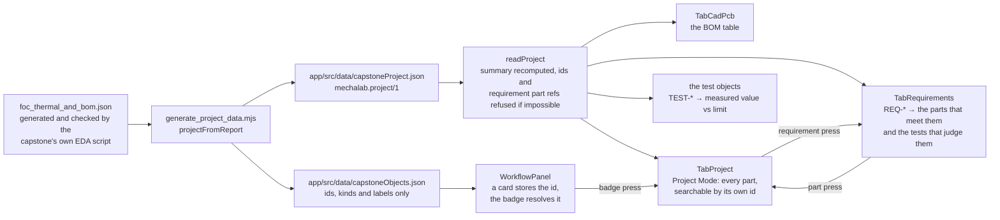

# The engineering project model

One project is one set of objects with one set of ids. The STM32 on the schematic, the line in the
bill of materials and the card in a workflow are the same object, cited by the same id, rather than
three records that happen to spell a name the same way. This page is the
schema that makes that true today, the command that generates it, and the rules for extending it.



## The document

```json
{
  "schema": "mechalab.project/1",
  "id": "08-capstone1-foc-eda",
  "source": "08-capstone-projects/eda-capstone1-foc-drive/foc_thermal_and_bom.json",
  "summary": { "lines": 12, "placements": 27, "costUsd": 40.47 },
  "components": [
    {
      "id": "08-capstone1-foc-eda/u1",
      "refDes": "U1",
      "qty": 1,
      "kind": "mcu",
      "category": "MCU",
      "mpn": "STM32G474RET6",
      "description": "170 MHz ARM Cortex-M4F MCU, …",
      "rating": "3.6V max, -40 to +125 C",
      "derated": true,
      "unitCostUsd": 5.85
    }
  ],
  "requirements": [
    {
      "id": "08-capstone1-foc-eda/req-ctrl-01",
      "ref": "REQ-CTRL-01",
      "kind": "control",
      "title": "Drive all three phases",
      "statement": "6 complementary PWM channels reach the six-FET bridge, one pair per phase.",
      "partIds": ["08-capstone1-foc-eda/u1", "08-capstone1-foc-eda/u2", "08-capstone1-foc-eda/q1"]
    }
  ],
  "tests": [
    {
      "id": "08-capstone1-foc-eda/test-ctrl-01",
      "ref": "TEST-CTRL-01",
      "title": "Complementary PWM channels",
      "method": "ERC net count on the gate-drive nets",
      "check": { "value": 6, "unit": "channels", "limit": 6, "direction": "min" },
      "requirementId": "08-capstone1-foc-eda/req-ctrl-01"
    }
  ]
}
```

| Field | What it is |
| :--- | :--- |
| `schema` | Read, never assumed: a document from another schema is refused rather than half-read. |
| `id` | The lab's own id. Every component's id starts with it, so an object cannot be cited as belonging to a project it is not in. |
| `source` | The repository path the document was generated from, so a stale copy is traceable to the file that should have regenerated it. |
| `summary` | **Recomputed from the components on every read.** A stored total that disagrees with the rows throws instead of printing. |
| `components` | One entry per BOM line. `qty` is placements *for that line*, not a separate object per part. |
| `requirements` | The project's requirements, each with its own id, its statement and the part ids that meet it. A cited id that is not a component is refused at read time. |
| `tests` | The measurements that judge those requirements: one id, one measured value, one limit and the requirement it judges. A requirement with no test, a test naming no requirement, or one citing a foreign project is refused at read time. |

## Ids

`<project id>/<first refDes>` — lowercase, punctuation collapsed to `-`, and only the first
designation when one line covers a bank:

| BOM line | Object id |
| :--- | :--- |
| `U1` | `08-capstone1-foc-eda/u1` |
| `Q1,Q2,Q3,Q4,Q5,Q6` | `08-capstone1-foc-eda/q1` |
| `R_SH_A,R_SH_B,R_SH_C` | `08-capstone1-foc-eda/r-sh-a` |
| `C_HF1..C_HF6` | `08-capstone1-foc-eda/c-hf1-c-hf6` |

A bank is **one** object because it is one thing to order, one line to derate and one id to cite —
six ids for six identical FETs would make every future view ask which one it meant. The id is never a
position on a canvas, so editing a description, a rating or a placement cannot rename the object.

## Generated, never typed

The report is the source of truth: `generate_foc_pcb_and_bom.py` builds the BOM from the design and
refuses a part that fails derating. `scripts/generate_project_data.mjs` reads that report through
`projectFromReport` and writes the app document; it never invents a component.

| Command | What it proves |
| :--- | :--- |
| `npm run gen:project` | Rewrites `app/src/data/capstoneProject.json` and the picker's `app/src/data/capstoneObjects.json` atomically from the report. |
| `npm run check:project` | Both files match the report; exits 1 and names the file when they do not. |
| `npm run test:project` | The same equality, plus the ids, the kinds, the recomputed total and the malformed shapes both functions refuse. |

`TabCadPcb` used to carry a six-line summary typed into the component while printing the twelve-line
report's total. That copy is gone: the table is `readProject(capstoneProject)` and its heading is the
model's own summary, so the card cannot show a count or a cost the design does not have.

## Project Mode: the second view

Project Mode is the tab where an id becomes an object. It is a second view over this same document,
not a second parts list: it calls the one `readProject` at module load, and every row, count and
total it prints is the model's. It re-types nothing, so a regenerated BOM reaches the table and this
page together.

| Concern | Owner |
| :--- | :--- |
| The objects, their ids and the recomputed summary | `app/src/projectModel.ts` |
| What a part is: its collection, parser, matcher and groups | `app/src/projectKinds.ts` — one entry in the model declaration |
| The id rule every kind shares: belongs to this project, is unique and is stamped onto the parsed object; a parser returning another id is refused | `app/src/projectRead.ts` (`claim` before a kind's parser, `stamp` after it) |
| What a part is called, draws and opens | `app/src/projectPresentation.ts` (label, plural, door) and `app/src/projectRows.ts` (row, browse copy); the badge glyph lives on the one card that draws it |
| "Does this object match the query", its groups and "which object does this id name" | `app/src/projectQueries.ts` — pure, generic over the declaration, and pinned by `npm run test:project` |
| The list, its search field, count, group headings and rows | `app/src/components/project/ProjectBrowser.tsx`, drawn once for every kind |
| Layout, the selected object and the copy button | `app/src/components/tabs/TabProject.tsx` |

**An id is an address, on both surfaces.** A workflow card stores one `projectRef`; pressing the
card's badge opens the view that object's kind owns, selected on that id, and this tab's search
accepts an id directly — `08-capstone1-foc-eda/u6` finds the encoder even if the learner does not
know it is `U6`. Search also matches the designation, the part number, the project's category and
the shared kind's label, and an empty query matches everything. A dangling citation is named on the
page, in the same sentence the card badge and the picker use, rather than silently resolving to the
first row. `npm run test:e2e` drives both doors in Chromium: the badge press opens the part the card
cites, and typing another id narrows the list to that one part.

A second project is one generated document and one module beside `capstoneObjects.ts`; neither the
model nor this view changes. A new view owes the same three things: cite ids, read the summary, and
put its own pure questions in a module beside the component so they can be tested without a browser.

## Requirements: the other object type

A requirement is the same kind of object as a part: it has one stable id (`<project>/<ref>`,
lowercase), it is generated from the report's verified numbers, and it is read strictly. Its
`partIds` are the object ids above, so a requirement cannot cite a part that does not exist — the
reader refuses the whole document and names the dangling id rather than drawing a link to nowhere.

| Concern | Owner |
| :--- | :--- |
| The requirement objects, the tests that judge them and the strict read | `app/src/projectModel.ts`, walking the declaration |
| What a requirement is: its collection, parser, matcher and groups | `app/src/projectKinds.ts` — the same model table as a part's |
| What a requirement is called, draws and opens | `app/src/projectPresentation.ts` and `app/src/projectRows.ts` — the same presentation entries |
| "Does this requirement match the query", requirement → parts and part → requirements | `app/src/projectQueries.ts` — pure, and pinned by `npm run test:project` |
| Layout, the selected requirement and the verification block | `app/src/components/tabs/TabRequirements.tsx` |

The values are the report's (`steady_state_tj_c`, `inverter_efficiency_pct`, the ERC pair and channel
counts, the derating verdict, the BOM total); the limits and floors are the capstone's own pass
criteria, stated once in `verificationFromReport`. `npm run test:project` asserts every value against
the report field it came from, so a design change that moves a temperature moves the sentence, the
test that judges it and the assertion that pins it.

**The link works both ways, on ids.** A requirement lists the parts that meet it; Project Mode's
detail card lists the requirements that cite the part it shows. Pressing either opens the other view
on that id — the same door the workflow's object badge uses. `npm run test:e2e` drives the round trip
in Chromium: U1 → REQ-CTRL-01 → U2 → Project Mode's U2 detail.

## Tests: the requirement's number, as an object

A requirement no longer carries its `method` and `check` as prose beside the sentence. That pairing
is a **test** with its own id (`TEST-*`, id `<project>/test-*`), derived from the same report and
linked back with `requirementId`. There is one measured value in the document, and it lives on the
test; a view prints it from there rather than from a second copy on the requirement.

| Rule | Result |
| :--- | :--- |
| A test's value is held against its own limit | `testPasses` compares `value` to `limit` in the stated direction, boundary included. |
| A requirement is met when its tests pass | `requirementPasses` is true only when every test naming the requirement passes; no test is no evidence. |
| Every requirement is judged | The strict read refuses a requirement with no test, and a test whose `requirementId` names no requirement. |
| A test is a citable object | `projectObjects` includes it, so the same id reaches the picker, the card badge, the clipboard and both exports. |

The register shows each test's reference, title, measured value, unit, limit, pass state and method;
the requirement's row names the test beside its own reference. Project Mode's part detail prints the
test's reference and the requirement's derived status, so both existing views say **how** a
requirement is judged and **whether** it passes. A card citing `test-therm-01` opens the register on
the requirement that test judges, with the test row marked. `npm run test:project` pins the two
derived-status rules, every report value, and the malformed documents the reader refuses.

**The tab is one registry entry.** `app/src/tabRegistry.tsx` holds each tab's id, labels, icon,
chunk loader and render, so adding this fourteenth tab was one entry plus its `TabId` and its name
in `workbenchTabs.json` — not the six edits (import, lazy const, prefetch map, icon map, metadata
block, render line) the shell used to need. `scripts/check_tab_names.py` reads that registry for the
shared names.

## How a workflow cites a project object

The citation lives in the **workflow** document, not in this generated one: a diagram is authored
work and must not be able to change a bill of materials. A card gains one optional field,
`projectRef`, holding an object id (`WorkflowNode.projectRef` in `app/src/workflow.ts`) for any
kind — `08-capstone1-foc-eda/u1`, `08-capstone1-foc-eda/req-therm-01` and
`08-capstone1-foc-eda/test-therm-01` use the same field and the same syntax. The canvas resolves it
through the generated object list in
[`app/src/capstoneObjects.ts`](../app/src/capstoneObjects.ts), which the canvas and the citation
picker import directly; the inspector groups that same list into Parts, Requirements and Tests in
one picker.

| Rule | Why |
| :--- | :--- |
| The id, never the name, the description or a `part:` prefix | A second copy of an object would drift; the id already names one object, so a prefix would be a second syntax to keep in step. |
| The id is kept whole or dropped | Truncating one would cite an object that does not exist; a malformed field is refused at read time like every other node field. |
| A dangling id is shown, not erased | A diagram opened beside a different project says which id it cites — in the badge, the picker and the view's banner — instead of silently losing the reference. |
| `componentId` is still read, never written | A diagram or clipboard taken by the part-only version keeps its citation; the next write stores it under `projectRef`. |
| No field on an older document | Reading a diagram never adds `projectRef`, so nothing is migrated and nothing grows on open. |

One door serves every kind: pressing the badge asks the generated object list what the id names and
opens Project Mode for a part, the Requirements view for a requirement, or the requirement that test
judges (with its test row marked) for a test, on that exact row. A copied card carries its citation
(`app/src/workflowClipboard.ts`), both exports print it only when it exists, and the edit is one
undo step like any other canvas command. `npm run test:workflow` pins the read, the legacy
migration, a test id in the clipboard and both exports; `npm run test:e2e` drives the requirement
picker, the badge, the register, the part back-link and a reload — then a test citation through the
same picker, badge, undo/redo and reload — in Chromium.

## One declaration for every object kind

`app/src/projectKinds.ts` is the single model table that says what a kind *is*: the collection it is
read from, its strict reader, its search matcher and its groups. Everything that reads or queries
data walks that table:

| Surface | What it asks the declaration |
| :--- | :--- |
| `readProject` | claims each object's id in one `seen` set before the kind's parser runs, then has `stamp` write that id onto the parsed fields and refuse a parser that returns a different id; it fills each collection in declaration order (parts, then requirements, then tests), and a kind may add a cross-collection `verify` rule. |
| `projectObjects` / `resolveProjectObject` | the list and the one lookup the generated picker and every dangling-reference message are built on; both accept the table a caller passes. |
| `projectQueries` | search, “which object does this id name” and a requirement's cited parts, one implementation for every kind; each accepts the same optional table. |
| `ProjectBrowser` | the search field, count, group headings, empty sentence and row button, drawn once. |

Presentation is deliberately not in that table. What a chip prints and where it opens is
`projectPresentation.ts` (label, plural and door name, entry-safe); what a row and a browse box
print is `projectRows.ts` (view-only, imported by the two lazy tabs); and the badge glyph is a
three-line map on `WorkflowNodeCard`, the only surface that draws one. The citation picker is its
own lazy component (`components/workflow/ProjectObjectPicker.tsx`), so the generated 32-object
list and the picker's
words load on the first card selection rather than on first paint. `WorkflowNodeCard`, the
selection inspector and the workflow panel therefore name and open a kind without importing a
strict reader or an icon module, and the requirement and test readers and browse copy stay out of
first paint.

**What adding a kind actually costs** — the old “one entry” promise was wrong, and the tables say
so:

- **Read and query only:** one entry in `projectKinds.ts` (its parser reads fields only), its
  generated collection, and its gate. `readProject` claims every object's id before the parser
  runs, writes that id onto the parsed fields through `stamp` and refuses a parser that returns
  another id; it fills whatever collection the declaration names through a collection map and does
  not name the three kinds. `npm run test:project` registers a fourth kind with a deliberately naive
  parser and exercises read, duplicate-id refusal, a mutating parser's refusal, search, groups,
  resolution and fallback through that generic path without editing `projectModel.ts`.
- **A chip or picker option:** one `PROJECT_WORDS` entry (label, plural, door — which of the two
  existing destinations answers it) and, if the badge draws it, one line in `PROJECT_ICONS` on
  `WorkflowNodeCard`.
- **A list screen:** one row builder in `PROJECT_ROWS` and one `PROJECT_BROWSE` entry, plus a lazy
  view that mounts `ProjectBrowser` for it.
- **Typed app access:** if a screen reads the collection by name, add its field to
  `EngineeringProject` in `projectModel.ts` once, beside that screen. That interface is the
  consumer's contract, not the read's shape; the read itself is declaration-driven.

The three readers are in the table because they *are* the model; the test's fourth kind uses its own
reader and needs no model edit. No module here is a pass-through: `projectRef` owns the reference
shape and its one dangling-id sentence, `projectPresentation` the entry-safe words and doors,
`projectRows` the lazy row and browse copy, `projectQueries` the pure questions, and the small
`projectRead`/`projectVocabulary`/`projectStatus` modules the primitives, buckets and derived rules
that both the model and the declaration need. The one-caller helpers that duplicated those
owners — `objectById` and `requirementsForPart` — were deleted rather than re-exported;
`partsForRequirement` stays because citation order is not BOM order, which a plain filter would
silently change. `ProjectObjectKind` is `string`, not a union, so a new kind does not also edit a
type in `projectRef.ts`; an unknown kind prints itself and opens no door.

## Kinds

`kind` is the shared vocabulary a view groups by; `category` stays the project's own word, so the
table keeps printing "Kelvin Shunt Resistor" while a second project with different categories still
lands in the same bucket. Add a category to `CATEGORY_KIND` and one entry to `COMPONENT_KINDS`; an
unknown category falls back to `other` (a new line must not break the app) and `npm run test:project`
fails until the mapping exists.

| Kind | Label | Categories today |
| :--- | :--- | :--- |
| `mcu` | Microcontroller | MCU |
| `driver` | Gate driver | Gate Driver |
| `power` | Power switch | Power MOSFET |
| `sensor` | Sensing | Current Sense Amplifier, Magnetic Encoder |
| `interface` | Communications | CAN-FD Transceiver |
| `supply` | Power supply | DC-DC Buck Converter, Low-Noise 3.3V LDO |
| `protection` | Protection | STO Safety Gate Buffer |
| `passive` | Passive | Kelvin Shunt Resistor, High-Freq Decoupling MLCC, Hybrid Polymer Bulk Cap |

## Extending it

- **A new view** imports `readProject`, addresses objects by their id, and prints `summary` rather
  than re-adding the rows. It adds no schema and no data file; Project Mode is the worked example —
  one lazy tab that mounts `ProjectBrowser`, no copy of the rows, and no per-kind questions of its
  own — and the
  workflow's citation is the smaller one: one optional id field, one resolver, one picker.
- **A new component kind** is one `CATEGORY_KIND` line and one `COMPONENT_KINDS` entry.
- **A new object type** starts with one model entry in `projectKinds.ts` and generated data with a
  gate; if it appears in a chip, add one presentation entry, and if it gets a list screen, one row
  and browse entry plus a lazy view. It inherits search, groups and the strict read from the model
  entry, and the picker, badge and both opens from the presentation and door entries. It owes what
  parts, requirements and tests have: a stable id rule, a strict read that refuses impossible data,
  a generated value with a gate, and a unit suite on the real files.

## Deliberately absent

Faults, state-machine links and URL addresses are not in this schema yet. Each earns its fields when
a view consumes them — an empty array today would be a promise no test could keep. The workflow link
is deliberately not a field here: the diagram owns its own citation, so the generated document stays
a statement about the design. The same rule kept the part's package, its operating stress and its
footprint out of the document: the report knows them, but no surface prints them, and a field nobody
reads is bytes the next feature has to pay for out of the weight budget.
